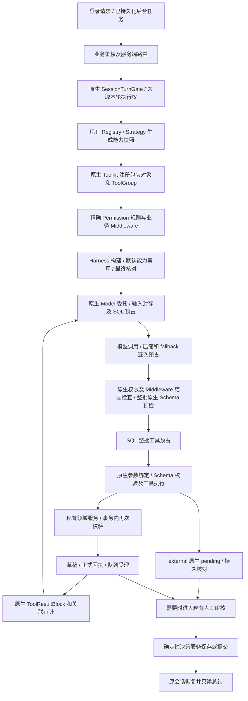

# ArtVerse 模型工具集与注册链路设计

初稿：2026-11-04；本次实施更新：2026-11-05。用户最新授权实施 B，不执行 C，继续串行完成。此前复核和实施时点保留为历史记录；最新实现与验证边界见 12.11。

状态：**A+B+C 的本地实现及适用自动化验证已完成；生产按任务和意图发布累计 35 个业务工具。真实供应商兼容和浏览器产品验收未完成。** P01–P38/T01–T30 不因局部通过统一关闭。使用项目锁定的 AgentScope Java 2.0.4，保留其他工作区改动，不提交或推送无关内容。第 0 节及第 12.2–12.11 节按各自批次保留；当前实施结论以 12.12 及 `docs/agent-tools-implementation.md` 顶部记录为准。

本方案推荐：同一后端的业务工具改为 AgentScope 本地注册；工具定义由注解与强类型 DTO 生成；分组、执行、权限规则、暂停恢复和子 Agent 管理由框架承担；作品范围、真实用户授权、版本、幂等、配额和付费约束仍由业务服务强制执行。撤销上一版为自调用 MCP 和旧工具长期兼容增加的目录/执行器/令牌扩展设计。

依据是当前工作区源码、测试、业务技能及本地 Maven 源码包，并非仅依据 HEAD 或框架最新文档。问题表区分已观察到的代码缺口和扩展时必须满足的设计条件；没有进行线上越权或真实付费实验。

方案导航：第 2.1 节索引全部 38 项问题，第 2.6 节汇总本轮现状、处理与验收；第 2.4 节给出实施依赖。第 6.1/6.12/6.13 节明确框架职责、可信能力快照及最小适配；第 7 节规定审核、恢复与事务边界；第 10.1–10.5 节规定有限预算、调用预占、生成选项和最短链检查；第 11 节列出代码和数据范围；第 12.8 节记录最新失败及证据边界；第 13 节按 9 → 27 → 35 个业务工具推进。所有问题均须有方案、改动落点和验收条件。

## 0. 上次复核基线：已有改动与未完成事项（历史快照）

下文 P01–P21 保留改造前问题的编号，便于追踪整改；其中“原链路/原实现”不能理解为这些代码现在仍全部存在。下表为 2026-11-05 18:14 报告时点的历史快照；随后后台受理/消费、V56/V57、预算和活动提示词又有实施，最新差异见 2.3/2.5/12.5。部分已有局部或数据库证据，均不能据此认定整项端到端验收通过：

| 工作区已观察到的变化 | 仍需设计和完成的部分 |
|---|---|
| Factory/Strategy 已转向本地 Toolkit，两个 self-MCP Java 文件已删除 | 审计部署配置、路由、文档及真实消费者，完成切换验证；不重建无必要的 MCP 适配 |
| draft/commit 包装已拆分，正文模型 commit 和三个旧分镜方法已撤下 | 编辑器保存/恢复回归、提示词/技能/配置清理、旧模型状态失效仍须完成 |
| 强类型分镜/automation DTO 已加入；ask_user 已改为原生 external 注解，由 GroupSupport 对生成 Schema 补长度和额外字段限制 | 仍需验证全部嵌套 DTO、动态知识字段及真实 provider 兼容；不再将手写 ask_user Schema 描述为当前实现 |
| Middleware 已捕获构建前后脱离源对象的契约，检查原始 JSON 与执行 input 一致并拒绝重复 JSON 键；已有运行身份与租约校验 | AgentToolCapability 仍只含工具名与两个布尔值；完整来源/阶段/profile、实际 ToolCallParam 输入覆盖与持久预算去重仍需闭环 |
| 计划管理组已按最新用户文本的正则匹配装载 | 正则只可辅助路由；完整计划及付费范围的真实授权、后台来源证明仍未闭环，见 P24 |
| 默认工具已大量禁用；Factory 已尝试移除 `wait_async_results` 并检查最终 Toolkit | Harness 会复制 Toolkit，且 messageBus 存在时仍加入等待工具；必须明确允许的框架辅助工具及注册属性，见第 6.5 节 |
| 默认子 Agent 已关闭，原四专家 Builder 装配已撤下 | 当前 Factory 未装配新的四个 SubagentEntry；这是尚未完成的功能，必须补齐原生专家链路，不能以全部禁用代替完成 |
| 章节空归属已改为拒绝，任务列表新增按作品过滤查询 | list 工具仍固定取 20 条、没有游标；交互来源判断和各 action 版本校验仍未闭环 |
| 分镜领域服务已加入读取记录、run/artifact/chapter 锁、具体产物覆盖授权、语义 JSON 哈希和提交回执；流程契约已改为绑定同一产物 | 实际 step/阶段/profile 关系、停滞清理与提交的串行化、读取完整性仍须验证；不能据此宣称数据库事务规则已经通过验收 |
| 原生 ask_user 已明确 USER_QUESTION；普通答复已有 AgentAnswerDelivery、受理/领取分事务、精确持久结果取证及投递本轮关闭压缩/淘汰；已有数据库＋Redis＋真实 Harness 的故障恢复用例 | 精确作者保存的原生往返仍模拟领域回执；后台 accept-before-queue、漫画所有入口、后续题与终态恢复仍待闭环。普通答案投递通过不能等同正文审核通过 |
| 最新 StoryboardArtifactIntegrationTest 为 9 / 0 / 0 / 0，新增受理后领取回滚及 Redis 已保存但 SQL 补证失败后的恢复；五类投递报告合计 48 项零失败 | 本轮只读取 XML、日志及测试源码，未重跑。不能据此宣称全部取消/提交竞态、V55 消费凭证、正文保存和产品交互已通过，见 12.3 |
| 普通 answer 已恢复原 route/taskType/step/skills；execute 接收已领取 run，Factory 按原 session 覆盖 activeGroups 和 Permission；普通答案并发只领取一次已有数据库用例 | source/profile 的完整校验、连续多次提问的 pending ID、快照读取到领取之间的竞态、迟到终态写入仍须闭环，不能将 P31 标为整体通过 |
| NovelDraftReviewService 已增加 reconcile；领域回执固化后可修复 run 投影；后台 reviewed/失败重试已接入，直接 SQL 重开 Agent 已撤下 | 六份相关历史报告合计 54 项零失败，其中正文数据库 9 项；仍未串联真实领域保存＋Harness＋产品，未保存失败的安全续接仍待完成，见 P32/12.2 |
| 保存时版本、不可变 reviewed_content/hash、no-op 的 changed 与可选 revision 已实现；不再回退当前章版本，空 hash 已转业务错误 | 历史缺证据处理和完整总结链仍须回归；当前存在后续未同步试验，旧报告不证明整个最新工作区，见 P33 |
| 后端待答已有 toolCallId/pendingVersion、原选项校验；普通答案已有 ACCEPTED/DELIVERING/NATIVE_RECORDED，WAITING 释放 lease，有效 owner 不允许重领；部分回调携 fence | 后台 acceptBackgroundAnswer 尚无生产调用；executor 已尝试检查消费证据和 CAS false，但最新分支未受测，仍用本机时间判断 child lease，漫画仍直接消费；retry 固定摘要未改，见 P23/P34/7.13.2 |
| Gateway 已在原生流完成后查持久 pending 再接桥接；generateText 已聚合一次 streamEvents；Factory 已关闭 pending 自动补错；Hydrator 已先查真实 state/call，并拒绝无结果的待答续接；结构化入口已限 taskType 和空 Toolkit | 漫画 resume 仍拼普通消息；原生错误结果与真实答复、原生已记录后重投以及全部入口仍须闭环，见 P34/P36 |
| StoryChat 与任务中心已共享普通问题类型和 AgentQuestion；提交携 call/version 及 answer/selectedOptionId 二选一；executor 已改 asText(null)，有合法选项局部测试；任务中心已加同题 key 与双击控制 | 漫画非原生分支仍发裸 confirm；浏览器实时/刷新/切会话、失败重投与实际持久消费未联合验收。前端 lint/build 日志已存在，不能再说尚无任何构建证据，见 P35 |
| AgentStructuredOutput 已加入单次辅助契约；Gateway/Boundary 已区分 response_format 与临时 generate_response；真实 Harness 四场景报告通过 | SQL root 预算、固定 outputType 调用点、原生描述/属性核对及异常资源释放仍须完善；局部报告的预算服务为 mock，不能当成持久预算通过，见 P37/6.10 |
| Gateway 的 RetryRegistry/RetryConfig/RetryOperator、旧构造器及 Agent 专属重试属性已撤下 | 核对其他配置/文档残留，验证原生单次尝试、fallback 和真实副作用不重放；不再把已删除成员列为当前缺陷 |
| Factory 已按 AgentModelCapabilities 配置两项 native 能力；AgentModelSpecFactory 按 provider/endpoint/model/可选 configId 精确匹配服务端声明，未知默认关闭；run 绑定已有 19 项服务报告，endpoint/slot 又有后续细化 | 默认声明列表为空，未声明的工具模型将被拒绝；需补完整预算根绑定、委托透传及实际 provider 验证。19 项报告不自动证明后续完整摘要/step slot 的所有场景，见 P38/6.11/12.3 |
| StrictAgentStateStore 已有有限稳定双读；AgentTurnStateStores 以本轮视图复用原生 SAVE_SCRIPT，AgentSessionTurns 在同次 EVAL 校验 owner；共享视图只读、后端连接相同 | 当前状态类 12 项报告通过，包含真实 Redis/Harness 重叠 CAS、失权和读取交错；旧 45/1 与八类 41 项均为历史快照。仍需 SQL 领域并发、shutdown、专家及全入口联合验收，T23 不作整体通过，见 7.8.1、12.3 |
| Gateway 已用 Flux.using/Mono.using 覆盖创建后资源，activeRuns 改为 actor/session 键与 putIfAbsent，取消核对 user/conversation/request | 生命周期 3 项局部测试通过；真实任务关闭、后台专家、取消/提交及失权后 checkpoint 的并发仍须验证。不得继续把旧 activeRuns.put 描述为当前代码，见 P29 |
| GroupSupport 已取消 WRITE 嵌套 READ 的重复装配；review_completed 分支只注册只读总结组 | 尚需真实 Factory 组合回归，以及根据持久回执生成 profile，不能只依赖 variables 中的布尔值 |
| 任务中心已新增复用 NovelDraftReview 的正文审核组件，runDetail 已尝试返回审核信息及 reviewReceipt | 后端需先验证真实回执再排队，覆盖刷新、通知丢失、总结失败恢复；新增前端/API 尚无本轮验证，不等于产品链路已可用 |
| 停滞回收已改为候选 ID → 行锁 → 重验状态与进度 | 租约认领/续租、固定锁序及最终提交门槛的数据库并发证据仍缺；不能继续描述成完全无锁，也不能宣称竞态已解决 |
| 原生默认禁用和单次尝试配置已加入 | STORY_CHAT 预算仍落入 Long.MAX_VALUE，DIRECTOR 工具限额为 0 却有 ask_user；当前审查工具限额与四专家最短链不匹配，见 P28 |

因此，审核后的实施先接续核查现有 diff、修正未完成改动，再按 A → B → C 验收；不覆盖其他正文审核、安全或前端工作，也不将试验代码当成已交付能力。本次进一步校正普通答复投递和模型绑定的代码/报告状态，补齐后台受理事务、具体动作消费、阶段重试、完成证据和数据库时钟约束。本文中的目标设计与当前证据分别记录。

## 1. 旧方法为何没有计入可用工具

`@Tool` 提供方法描述，只有对象或方法被加入实际 Toolkit/MCP 注册链路，且在本次模型调用中可见，模型才能调用。Spring 的 `@Component` 不等于向模型注册工具。

改造前链路是：`ArtVerseMcpServerConfiguration` 显式声明服务端工具 → `AgentToolGroupSupport` 按 Agent 选择工具名 → `AgentScopeAgentFactory` 在构建前安装 Toolkit → Harness 注册框架默认工具 → 模型调用。当前本地注册改动及其未完成项见第 0 节。

| 方法 | 改造前现状及原因 | 本设计处理 |
|---|---|---|
| `generate_storyboard` | 一次调用同时生成和保存；未被 MCP 暴露。`ToolExpectation` 将它列为禁止的旧分镜写入工具 | 删除无调用方的旧工具方法及专属嵌套生成逻辑；由模型生成内容，保存使用草稿流程 |
| `save_storyboard` | 接收文本场景并直接保存；与结构化草稿路径重叠，被流程契约禁止 | 删除无调用方的旧方法，不新增旧场景导入工具 |
| `save_structured_storyboard` | 单次调用同时建草稿和提交，跳过独立可审阅阶段，被流程契约禁止 | 删除无调用方的旧方法及两阶段关闭后的直写分支，固定 draft → 授权 → commit |
| `save_novel_content` | 是 Controller/应用服务使用的正文写入接口；参数包含 `userId` 等业务身份，并非适合直接向模型公开的契约 | 保持为应用命令，模型用 `draft_novel_content`；作者审核后服务端确定性保存 |
| `restore_novel_content` | 直接建立恢复版本，属于确定性写入操作，目前未接入模型注册链路 | 保留编辑器手动恢复的应用命令并移除工具注解；模型使用历史读取及恢复草稿，经作者审核建立新版本 |

分镜属于明确的有意隔离：`application/tools/StoryboardAgentTools.java` 类注释写明兼容方法 deliberately absent，只暴露草稿和提交。小说的判断依据是现有 Controller、正文草稿工具及 `NovelContentArtifactService.review` 的调用关系，不能据此推断旧实现当初的全部历史动机。

因此，前一轮的“11 个”指改造前显式接入业务注册链路的工具，并不表示仓库只有 11 个带工具注解的方法，也不包括框架额外加入的通用工具。目标目录和当前完成度分别以第 4、0 节为准。

## 2. 需要解决的具体问题

下表为分析范围内的 38 项问题，后文给出处理方式和验收。P01–P21 包含改造前证据和扩展缺口；P22–P38 跟踪未闭环项，其中已有部分整改的条目仍须验收。表内原始证据不抹去，当前实现状态由 2.3、12.11–12.12 明确修正，不能继续按旧缺口重复实施。A 是基础边界，B/C 已在各自本地约束通过后接入；实际 provider、浏览器和产品级验收仍按 T 项单独判断。

| 编号 / 阶段 | 改造前证据 / 当前未完成项 | 修改方案与框架边界 |
|---|---|---|
| P01 / A：同进程绕行 MCP | 原 Factory 向本机 `/internal/mcp` 发 HTTP，再调用同一批服务；当前已改本地并删除两个 self-MCP 文件，清理与切换未完整验收 | 使用原生 Toolkit；完成专属配置/文档/消费者审计和切换验证，不重建自调用。这里只判断仓库内依赖，不假定部署环境绝无外部接入 |
| P02 / A：定义重复 | 原注解、手写 MCP Schema、Strategy、skill 分组和流程契约各自维护；当前本地改动仍需统一校验 | 工具名、描述、Schema、只读/并发标记使用框架注解与 DTO；分组复用原生 ToolGroup。保留领域流程契约及每个 taskType 唯一策略，不另造通用 Catalog |
| P03 / A：参数契约仍须补全 | 原 pages 为 Object、automation 为 Map、部分模型参数缺注解；当前专用包装已有 DTO，领域旧入口仍有宽泛类型且完整约束待验收 | 模型入口补齐注解/嵌套 DTO，使用原生生成和执行前 Schema 校验；另加业务白名单、长度与版本约束。领域通用内部方法不因参数为 Object 就自动算模型入口 |
| P04 / A：默认工具收口需完整验证 | 原工厂只禁用 Shell/Filesystem；当前已大量禁用，但四专家待装配，框架 skill/wait 条件工具仍须校验 | 使用各原生 disable 方法，按最终注册集合和每轮模型 Schema 双重核对；缺少业务技能时同样执行默认禁用 |
| P05 / A：选择列表不等于授权 | 原 MCP 通用分发器未统一按 taskType/阶段校验；当前 Middleware/服务已补部分运行检查，尚未覆盖完整领域阶段/profile | 本地通过原生 Permission、Middleware 和服务内复验约束每次调用；step 必须对应本 run 的真实执行步骤或服务端登记的单步记录。取消、阶段/profile 变化立即失效，不依赖初始列表 |
| P06 / A：读写分组及授权需闭环 | 原 STORY_CHAT_READ、漫画上下文组携带计划写入；当前已有独立查询/管理分组，重复 HITL 装配已简化，但仍按正则选择管理能力 | context、automation-read、automation-manage 分开；仅可信意图与真实精确授权开放管理，skill/模型不能扩权；补真实 Factory 组合及后台拒绝，见 6.6、6.7 |
| P07 / A：旧设计清理不完整 | 三个旧分镜模型入口和正文 commit 已撤下；MangaAgentConversationService 的活动 prompt 已清理旧分镜直写推荐，历史展示及其他配置仍须逐项审计 | 清理所有活动提示/名单/分支及专属配置；历史事件可按原名展示，但不得装载旧工具或计为本轮有效提交。保留编辑器保存/恢复及历史计划产品功能。见第 4.10、11 节 |
| P08 / A：框架确认与业务审核边界需验收 | 已有 external ask_user/精确正文 review；粗粒度 helper 已撤下，分镜具体授权及局部数据库测试已有；真实持久恢复＋产品完整链仍缺 | 复用 external 暂停和原 call ID 恢复；正文由作者决策服务保存；分镜覆盖绑定具体产物。原生 ALLOW 仅准许进入业务处理，不代表作者批准变更 |
| P09 / A：草稿与提交证据绑定需验收 | 原实现只查提交前任意成功且 validated 的草稿；当前已有同产物回执、重放去重及局部数据库测试，完整 Harness＋领域链路尚缺 | 校验提交成功回执、同 artifact/hash/base/run/step；结构通过、专家质量评价、最终提交分别记录，不能互相替代 |
| P10 / A：身份与归属边界 | 部分服务依赖 Web CurrentUserService；原空归属放行当前已改拒绝，完整交互/后台/专家的共享回归尚需完成 | 使用框架隐藏注入的 RuntimeContext 和显式 actor 命令；缺身份/归属/必要租约一律拒绝。覆盖共享可见性检查的现有调用方 |
| P11 / B：读取能力不成闭环 | 当前缺少独立作品/章节、知识详情、版本、产物、候选和任务历史查询工具 | 增加有业务范围的读取接口及游标；复用既有知识事实/章节投影，不用 web、任意文件或全局会话检索代替 |
| P12 / A、B：基准与分页不明确 | 现有写入有版本机制，但新增跨章/分页/恢复功能缺统一读取基准契约 | 写入绑定服务端读取快照、版本和哈希；跨页同快照，跨章只读不改变写目标。当前章已有版本检查保留并加强，不能重取最新版本掩盖模型读旧稿 |
| P13 / C：角色/设定审核缺失 | Story/CharacterProfile 没有 Chapter 同等实体版本；尚无对应模型差异提案闭环 | 补实体版本/CAS、字段白名单和差异审核；模型只产草稿，确定性提交；修改人物素材不直接批准正式事实 |
| P14 / A、B、C：知识来源与候选批次 | 原提取有来源重读/静默截断风险；现已用 outbox 固化实际输入及原候选批次、超限拒绝，聚焦测试通过，B/C 投影与会话候选仍须扩展 | 保留已实现的来源/fence/幂等约束并联合验证；检索/详情共用投影权限，会话候选独立追加，不把新源快照贴到旧输出上，见 2.6/7.7/11.2 |
| P15 / C：生图扩展需约束 | 已有付费队列、版本、配额和不确定结果恢复，但没有模型预览/提案/查询闭环 | 工具只预览、提案、查询；真实确认后复用既有 submission/recovery。禁止直接供应商调用、管理员裁定和未知结果自动重试 |
| P16 / A、B：任务列表与并发 | 原列表截断后过滤及无游标已修正为作品先过滤、稳定分页/快照；edit 与 lifecycle 的 expectedVersion 仍不统一，正式写入与取消的原子边界未闭环 | 保留分页及持久交互来源校验；所有修改使用 expected_version，写入事务内复验原执行权/授权，明确时区和目标，后台禁管计划，见 7.14 |
| P17 / A：专家范围与总预算 | 原 Builder 默认专家装配会加入 general-purpose；当前已禁用全部专家，但新的受限四专家尚未装配；限制声明数也不等于限制累计 spawn | 以原生 SubagentsMiddleware 和显式四 Entry 替换默认装配；无动态/通用专家。业务层绑定父子运行和累计预算，任务 ID 操作限定父运行 |
| P18 / A：重试边界及切换验证 | 原 generateStructured 的整次 Agent 重试及 Gateway RetryRegistry/RetryConfig、旧构造器和 Agent 专属重试配置已撤下；仍需最终调用链/配置审计和业务效果验证 | 保留原生 ExecutionConfig 单次尝试，核对原生结构化 fallback、供应商传输重试和预算；以真实回执证明不重放副作用，不误报已删除代码仍在重试 |
| P19 / A：结果、审计与预算分散 | MCP 将业务结果串行化为文本；业务审计有顶层与 data 重复；框架也会产生工具事件 | 本地结果使用原生 ToolResultBlock，业务 DTO 单次序列化；框架事件管执行观测、领域事务管真实效果，按 call/action ID 关联去重；扩展现有预算服务 |
| P20 / A：上一版方案自建过多 | 前稿另提 Catalog/Resolver/Registrar/Guard/ExecutionService 及 MCP 凭证增强、旧契约长期兼容 | 撤销这些独立通用层；沿用现有 Registry/Strategy/Factory，只补业务能力快照与一个框架 Middleware。研发切换采用明确失效旧模型状态，不维护双轨 |
| P21 / A：同名注册可覆盖 | 本地 2.0.4 `ToolRegistry.registerTool` 使用 Map.put；框架不会自动拒绝所有重复名称 | 业务装配时做唯一性与保留名检查，构建后核对工具来源/属性/Schema。不能只比较最终名称而漏掉同名覆盖 |
| P22 / A：Schema 与实际输入仍需全链验收 | 构建前后契约副本、raw/input 语义比较与重复键检测已有实现及局部测试；尚未证明所有适配/参数覆盖路径和真实 provider 的一致性 | 原生校验与实际执行使用同一输入；防止 ToolCallParam/preset 在检查后改写输入，补组合与 provider 验收；未知覆盖、契约变更均拒绝，见 8.3 / T16 |
| P23 / A：external 持久桥接未闭环 | ask_user 已用原生 external；持久桥接已后移至流完成并核对 pending；markWaiting 已锁内查前态/具体 pending/fence，部分回调传原 fence；漫画同步两个回调仍未传原 fence | 保留原生定义与暂停及现有锁内修正；全部回调携原领取身份，发布可答事件须晚于持久核对。补桥接失败修复、迟到事件和终态并发证据；审计/预算只关联一次，见 7.4、7.13 / T17、T26 |
| P24 / A：意图与运行来源证明不足 | 管理组仍按文本正则选择；requireInteractive 已改持久业务图与后台关联校验，有 6 项数据库证据，但不代表精确授权/profile 全闭环 | 正则仅用于候选选择；真实授权来自可绑定的明确操作/预授权。继续补原 parent/child、profile 及事务内复验，见 6.6/6.12/7.14 / T10、T17 |
| P25 / A–C：局部往返未证明完整交付 | 普通答案已有 PostgreSQL＋Redis＋真实 Harness 故障恢复；正文原生往返仍模拟作者决策回执，四专家/B/C/provider 缺证据 | 将真实作者决策、领域保存、持久恢复接入同一完整往返；35 个工具逐项覆盖，不将普通答案或分离测试等同正文和产品端到端。见 12.1–12.3 / T15 |
| P26 / A：正文审核产品闭环尚未完成 | 旧 commit 指令、裸 confirm/discard 和粗粒度授权 helper 已清理；任务中心新增审核组件及 receipt 输出，但响应接收/重试/只读重建仍缺完整验证 | 交互和后台统一调用 NovelDraftReviewService 保存精确最终稿，只消费真实持久 receipt；补齐 UI/后台和总结失败恢复，不能回退 AI 原稿保存，见 7.5 / T18、7.9 / T24 |
| P27 / A：合法组合装配需回归 | WRITE 已取消嵌套 READ，HITL 每条路径注册一次，summary 已限为只读；已有新增局部测试，真实 Factory 组合仍待验证 | 保留当前简化装配，补 WRITE×任务管理/查询、summary、有无技能的真实 Factory 测试；同组需求去重，其他同名冲突仍失败，见 6.7 / T19 |
| P28 / A：预算基础已有实现，权威范围未闭环 | SQL 根/唯一预占/整批原生预检/Model 委托已有实现；本批又补选项约束、输入封存、ChatUsage 和原生工具结果观察。可信 profile/专家/父执行权及领域回执关联仍缺 | 保留已实现基础；继续按 6.12/10.4 完成可信 root/step/child/profile 和父 owner/fence，原生结果与领域效果分别取证，见 T20/T30 |
| P29 / A：停止、提交及资源归属 | 停滞回收已有行锁；Gateway 已改资源作用域、actor/session 唯一句柄及带归属取消；生命周期 3 项局部报告通过，真实租约/最终提交/关闭并发及专家资源仍缺证据 | 保留已实现的资源作用域；root 锁/CAS 统一停止与提交，数据库时钟作提交门槛；原生 AgentRun/Harness 管生命周期，补真实取消/暂停/专家及迟到提交测试，见 7.6 / T21 |
| P30 / A、B：上下文基准与内容不完全对应 | 已有一致快照分页、截断标识、显式 read_ref/区间、独立图片版本及原生结果观察；最新真实 Harness 分页→草稿用例被契约边界拒绝，读取证据与模型请求关联尚缺 | 定义 source/分镜/图片各自版本与完整性；修复合法链路，区分结果形成与模型投递，补范围/剩余预算匹配；重读不能覆盖旧基准。见 6.13/7.7/10.5 / T22 |
| P31 / A：恢复身份、领取与会话并发 | 原身份、gate、严格 CAS、本轮视图、稳定双读和原子 owner guard 已有实现；真实重叠 CAS 等 12 项状态测试已有通过报告。来源/profile、shutdown 与 SQL/全入口联合恢复仍缺完整证据 | 保留并验收 7.8.1 的公开接口适配；分别验证 gate busy、真实 CAS、失权保存和 SQL fencing；恢复按持久身份及真实回执收缩能力，不将局部状态测试当整体完成，见 T23 |
| P32 / A：后台回执与失败恢复尚未完成 | 领域 receipt/reconcile、respond/retry 核对与部分数据库回归已有实现；无保存效果的失败仍只提示新建，通知/领取/原生状态/消费故障未完整验证 | 接续现有投影修复，接收与执行双重验证；已保存只总结，未保存按可恢复位置处理，未知效果先核对。补持久边界故障及合法审核状态，见 7.9、7.13 / T24 |
| P33 / A：审核结果与总结归属仍须全链验证 | 当前已撤掉版本回退并处理空 hash/no-op/revision，已有针对性报告；完整 native roundtrip 仍模拟回执，缺历史修复与后续产品恢复证据 | 保留已完成局部修正；总结只读同 artifact 的不可变结果，当前正文另标后来状态。历史证据不足明确失败，不借当前章补造，见 7.10 / T25 |
| P34 / A：连续提问及答复消费仍需全入口闭环 | 后台 respond 已同事务受理入队，V56/具体动作消费/清槽原子性及同 key 阶段重放已有数据库测试；executor 已改数据库租约判断，漫画无证据不消费。漫画原节点投递、普通失败答案 retry、后续压缩/Q2/终态联合恢复仍缺 | 保留已实现的动作绑定与取证，完成所有入口和失败分流；只消费同 action 的真实证明；旧 fence、跨题、未知结果和后续压缩均须验证，见 2.3、7.13.2–7.13.3 / T26 |
| P35 / A–C：新契约仍缺完整产品验收 | StoryChat/任务中心普通问题已携 call/version、复用选项 UI，executor 缺失 answer 的修正与局部测试已有；漫画旧分支仍裸答复，浏览器/原生消费联合验证尚缺 | 接续已同步契约，补全部入口、实时/回放/刷新和浏览器并发；保留 missing/null 分支。删除剩余旧裸协议，以最终代码的编译、测试与产品回归验收。见 11.3 / T27 |
| P36 / A：原生暂停在不同执行入口不一致 | generateText 已聚合 streamEvents；pending recovery=false，Hydrator 已拒绝无答复待答续接；结构化已限制 taskType/空 Toolkit；漫画三类恢复仍重跑路由，部分同步回调不带原 fence | 所有有工具入口统一桥接并原节点续接，复用原生 pending/result；覆盖丢状态、终态、原生合成错误与真实答复区别，不重跑已完成步骤，见 7.12 / T28 |
| P37 / A：结构化辅助契约尚未整体验收 | AgentStructuredOutput/Gateway/Middleware 已接入原生两类路径；当前真实 native→synthetic SQL 测试计入同 root 的两次模型尝试，业务工具计数为 0。固定调用类型、完整属性和全入口异常释放仍需验收 | 保留原生生成/执行与 SQL 计数；补固定 DTO、辅助描述/属性、选项冻结及异常释放，业务效果路径禁入隐式 fallback；不另注册同名执行器，见 6.10/10.4 / T29 |
| P38 / A：模型能力与恢复绑定尚未闭环 | 精确声明、完整 endpoint 摘要、taskType＋step 槽、能力透传及持久 generation_limits 已有实现/局部报告；可信 profile/child、剩余时长和实际 provider 仍缺 | 使用原生 Model/GenerateOptions/Builder；继续绑定可信执行范围，冻结上限只可收缩，剩余时长独立校验；未知能力保守，provider 单独验证，见 6.11/10.4/10.5 / T30 |

MCP 已规定工具发现/调用消息与 inputSchema 等协议结构，AgentScope 已提供 Schema 生成和校验。项目的问题是未充分使用这些能力，不能将“项目手写 JSON Schema”解释成协议或框架强制手写。框架不了解作品归属、作者最终稿、章节版本和付费配额，这些必须由本项目设计并执行。

处理优先级统一按 2.4/13.2 的依赖确定：先复核已有编译与契约证据，再完成可信来源/模型绑定/有限预算，随后完成全入口恢复与后台剩余分流，最后验收分镜、四专家和产品交互，再启用 B/C。P35/P37 的契约工作可随基础项同步修改，但不在预算和身份约束完成前启用新执行路径。每个问题只有在对应测试和实际回执满足时才能标记完成。已有代码、历史测试和完整验收分别记录。

### 2.1 问题到方案、改动位置及验收的闭环索引

本表补充问题表的执行落点。引用的文件均见第 11、14 节，不另建平行基础设施；同一行的问题共享改动位置，但每个问题仍须独立登记证据。

| 问题 | 具体方案 | 主要改动位置 | 验收 |
|---|---|---|---|
| P01、P02、P20、P21 | 6.1–6.3、6.7、13.1 | Registry/Strategy/GroupSupport/Factory、旧 MCP 专属配置与安全特例 | T01、T14、T19 |
| P03、P22 | 8.1、8.3 | 工具 DTO、GroupSupport、BoundaryMiddleware | T04、T16 |
| P04、P17、P27 | 5、6.5、6.7 | Factory、固定四 Entry、原生 TaskRepository 受限视图 | T02、T11、T19 |
| P05、P06、P10、P24 | 6.4、6.6、6.12、7.6 | RuntimeContextFactory、能力快照、权限/Middleware、ChapterAccessService 和命令服务 | T03、T10、T17、T21 |
| P07、P08、P09 | 4.10、7.1–7.5、13.1 | 工具包装、PromptProvider/ConversationService/业务技能、正文审核/分镜服务、ToolContractVerifier | T05、T06、T14、T18 |
| P11、P12、P30 | 4.1–4.3、7.2、7.7、11.2 | 上下文/历史/产物查询、不可变 read_ref、领域草稿入口 | T07、T22 |
| P13、P14 | 4.5–4.6、7.7、11.1–11.2 | Story/CharacterProfile 版本、差异审核、知识投影、候选追加及提取来源绑定 | T07、T08、T22 |
| P15 | 4.7、11.2 | 生图提案包装、已有 submission/recovery 与确认 UI | T09 |
| P16 | 4.8、6.6、11.2 | AutomationService/Store、模型专用包装、任务中心 | T04、T10 |
| P18、P19、P28 | 7.3、8.2、9、10.1–10.3 | Gateway、原生执行配置、AgentBudgetService/ledger、Model 委托、原生 ToolValidator 整批预检、现有审计 | T04、T12、T13、T16、T20 |
| P23、P29 | 7.4、7.6、7.13–7.13.3 | Gateway 桥接、RunService/LeaseService、全部状态回调及领域提交、原生结果最终化 | T17、T21、T23、T26 |
| P25 | 12.1–12.2、13.2–13.4 | 35 行工具证据表、真实 Harness＋隔离数据库测试、provider 验证 | T15 及各阶段全部适用项 |
| P26、P31、P32、P33、P34 | 7.5、7.8–7.13.3 | StoryChat/NovelDraftReview/RunService、AutomationService/Executor/Store、持久回执/答复及 target_binding、原生 session gate 与 state CAS 适配 | T18、T23–T26 |
| P35 | 11.3 | 两类 Controller/DTO、前端共享 API、ChatPanel/AgentQuestion/任务中心、全部调用方与测试 | T27 |
| P36 | 7.12 | Gateway/Hydrator、MangaAgentService/ExecutionSupport、同步/SSE/后台 resume | T28 |
| P37 | 6.10、10.1 | Gateway 结构化入口、BoundaryMiddleware 的单次辅助契约、输出 DTO 与预算 | T29 |
| P38 | 6.11、10.1、11 | AgentModelSpec/Factory、可信模型配置、最小 Model 预算委托及生产装配测试 | T29、T30 |

### 2.2 本次修订的明确裁决

下列裁决统领后续章节；所有问题继续使用原编号追踪，不能因为已有部分代码就跳过剩余方案。

| 问题范围 | 采用框架的部分 | 项目必须完成的约束及交付 |
|---|---|---|
| P01–P04、P20–P22、P27 | Toolkit、注解/DTO、Schema 生成及校验、ToolGroup | 一处定义、显式本地注册、同组只装一次、重名拒绝、最终 Schema/实际输入一致；删除 self-MCP 和重复通用层 |
| P05–P06、P10、P24 | RuntimeContext、Permission、Middleware | 可信来源与能力取交集；每次调用及领域事务分别核对身份、作品、阶段和具体授权，正则只辅助选工具 |
| P07–P09、P26、P32–P34 | external、原 call ID、原生结果与会话恢复 | 正文保存精确作者最终稿；分镜授权绑定具体产物；持久受理、可靠投递、真实回执和只读总结分开，删除旧直写/裸确认协议 |
| P11–P14、P30 | 原生工具调用和强类型输入输出 | 完整读取、稳定分页、不可变 read_ref、实体版本/差异审核、知识来源与候选批次隔离；B/C 已按当前授权接入本地注册，未具备 product/provider 证据的能力仍不宣称验收完成 |
| P15–P16 | 相同 Toolkit/Permission/DTO 注册路径 | 生图只预览/提案/查询，执行复用已有队列；计划管理需精确授权/版本，后台禁管计划，查询先隔离再分页 |
| P17–P19、P28–P29 | 固定 SubagentEntry、原生任务仓储、ExecutionConfig、AgentRun/事件 | 四专家只读且禁止递归；SQL 权威有限预算、幂等、取消/提交串行、审计脱敏；不另建执行器或子任务调度器 |
| P23、P31、P36 | SessionTurnGate、AgentStateStore、pending/ToolResultBlock | 所有入口统一原节点恢复；采用 7.8.1 的最小公开接口适配补一致读取/租约原子保护，避免“发出 interrupt 就算阻止旧保存” |
| P37–P38 | 原生 response_format/synthetic 路径、Model 能力接口 | 固定输出 DTO、单次辅助契约、真实模型能力声明和所有网络尝试预算；未知能力不伪报支持 |
| P25、P35 | 真实 Harness 与脚本 Model 接口 | 35 个业务工具逐行验收；真实领域持久化、前后端审核/刷新/恢复和实际 provider 各自留证，不把局部通过拼成整体通过 |

审核后的首批工作先关闭已有 A 阶段缺口，再增加 B/C。研发阶段不保留无用旧工具别名、旧 Schema 或双注册链；作者内容、编辑器功能、领域回执和真实任务记录继续保留。框架版本固定为 2.0.4；本方案不假定未来 API 已存在。

### 2.3 本轮核实的状态、剩余方案与关闭条件

本轮不追加规范工具名。已完成的局部实现保留，以下以当前源码和 12.4–12.7 的分批报告纠正旧快照；“局部有证据”不等于整项关闭。

| 问题及已核实状态 | 剩余修改方案 | 关闭条件 |
|---|---|---|
| P32/P34：respond 已调用 acceptBackgroundAnswer，答案/action/入队同事务，非空响应槽拒绝覆盖 | 保留短事务和计划→父 run→Agent run 锁序；补所有普通失败答案的安全 retry、漫画及来源/profile 完整绑定 | 全入口受理、领取、投递失败均可恢复同一答案；模型/gate 不进入受理事务 |
| P34：V56 已记录 target_binding/consumption_evidence，清槽与证据同事务，数据库已有回滚、Q1/Q2、并发两 key 及 V54→V56 升级测试 | 继续验收原生答案补证后发生压缩/淘汰/下一题的恢复；对 CLOSE/REFRESH_INPUT/RETRY 明确各自结果条件，不混用 ANSWER/REVIEWED 证明 | 每种 action 有独立目标和完成事实；旧 worker 不清新槽，历史记录不补造新证明 |
| P32/P34：retry 已先核对历史 key，再冻结新阶段目标；失败总结保留原 response 动作 | 对未保存、已保存待总结、普通答案已受理未记录、原生已记录未清槽、未知效果分别分流，不能只支持 reviewed 重试 | 同 key 换输入冲突；已落库效果不重放；未知结果先核对，原节点恢复不另建根 |
| P29/P31：executor 已用数据库判断 child lease，Store 执行权判断使用 clock_timestamp() | 审计其他领取/续租/终态/领域提交路径，统一权威判断和相对锁序；展示/调度时间与权限门槛分开 | 两 worker 时钟偏移、锁等待跨越过期点、取消/提交争锁均有数据库证据 |
| P23/P29/P31/P36：漫画仍拼普通消息重跑路由，部分同步/终态回调仍缺原执行身份，末条 assistant 推断完成不足 | 原生 pending/result 恢复同 session/step/call；所有回调绑定 continuation/fence；按 7.13.3 分别取证投递、最终输出与业务成功 | 三类入口合法续接，旧回调不关闭 Q2；故障收尾/压缩摘要不能冒充本次成功 |
| P07/P09/P20：活动 prompt 中的旧分镜直写推荐已清理，历史显示仍有旧名 | 扫描剩余活动技能、配置、路由、审计判定和部署依赖；历史渲染按需保留，编辑器命令保留 | 旧名不能装载、恢复写权限或计为新提交；旧事件与作者数据可读 |
| P28：SQL 根/有限映射/整批预检与预占、选项约束/输入封存、原生 usage/工具结果观察已有局部实现 | 继续补可信 profile/父租约身份、四专家及领域回执关联；不能把原生 FINISHED 当正式保存完成，external 的 RUNNING 仍待持久投递证明 | T20 本批新增请求投影/usage/观察故障证据之外，真实专家/父执行权/领域效果仍须联合验证；UNKNOWN 不退额 |
| P37/P38：主模型、原生两次 compaction 与 native→synthetic 已有共根计数/能力透传报告；固定四专家仍未装配 | 所有模型继续走原生 Model 委托；先完成来源/子任务绑定与四 Entry，再补同根专家链路；实际 provider 分开记录 | 主/压缩/fallback/四专家全部有实际调用次数证据；无参数覆盖冻结配置或重建满额根 |

工具定义、执行、原生暂停和子任务生命周期继续交给 AgentScope。上表保留和新增的项目逻辑只处理跨存储关联、业务事实及权限边界；不另写 Schema 生成器、工具执行器、暂停调度器或第二套正文保存流程。

### 2.4 审核后的实施单元与依赖

以下是审核后的具体实施顺序和每批可交付内容；已有进度及最新失败以 12.8 和实施记录为准，本轮新增修订待审核。完整问题映射仍以 2.1 为准，不因分批遗漏问题；A 阶段内部前置单元未通过时，不开启依赖它的新能力。

| 单元 / 依赖 | 要解决的问题 | 使用框架及改动落点 | 交付与验收门槛 |
|---|---|---|---|
| A0：核准基线 | P01–P04、P07、P20–P22、P27 的已有实现与残留 | Registry/Strategy/GroupSupport/Factory；保留原生 Toolkit/注解/ToolGroup；清点活动旧名和 self-MCP 残留，区分历史显示 | 当前 diff 清单、逐 taskType 最终工具集合及前后 Schema；T01/T02/T14/T16/T19，不能只检查构建前 Toolkit |
| A1：可信执行范围；依赖 A0 | P05/P06/P10/P24/P31/P38 | 扩展现有能力 record 和 RuntimeContextFactory，原生 Permission/Middleware；运行服务冻结来源、阶段、模型和父子关联，见 6.12 | 交互/后台/专家/审核四入口的正负例；非法 actor/source/profile/旧 fence 在效果前拒绝；合法 SUMMARY 可重建 |
| A2：有限预算；依赖 A1 | P17–P19/P28/P37/P38 | 保留已有 V57/SQL 根、Model 委托和原生 ToolValidator 整批预检；补 10.4 的范围/选项/计量与执行观察，必要时新增迁移，不改 V57 | 全 12 个 taskType、主/压缩/专家/fallback 共根；同批原子预占；T12/T20/T29/T30 的真实调用、观测缺失和配置覆盖证据 |
| A3：原生恢复；依赖 A1/A2 | P08/P23/P26/P29/P31–P36 | Gateway/Hydrator/RunService、漫画同步/SSE/后台、AutomationService/Store/Executor、共享前端协议；复用 external/pending/ToolResultBlock/state/gate | 同 call 原节点恢复、普通失败答案 retry、消费/终态分证；T17/T18/T23–T28；保留 V55/V56 已有证据并补缺口 |
| A4：读取和领域提交；依赖 A1/A2，恢复用例依赖 A3 | P03/P09/P12/P14/P16/P19/P22/P29/P30/P33 | 现有上下文/分镜/正文/知识提取/任务服务；原生类型校验＋业务快照、授权、CAS/锁 | read_ref 对应真实投递，完整性/来源一致；取消/提交争锁、精确作者稿、真实回执，T03–T06/T10/T21/T22/T25 |
| A5：四专家；依赖 A1/A2/A4 | P04/P17/P18/P25/P29 | 四 SubagentEntry＋SubagentsMiddleware＋受限原生 TaskRepository；不恢复 general-purpose | 派生/等待/输出/取消/重启全部可用，父子范围及预算不扩大；T11/T12/T15/T21/T23 |
| A6：A 阶段产品验收；依赖 A0–A5 | P25/P26/P35 及全部 A 问题 | 真实领域服务＋Harness＋隔离 PostgreSQL/Redis，聊天/任务中心前端与技能/配置同步 | 9 个工具逐行证据、真实作者保存往返、刷新/并发/失败恢复；A 全部适用 T 项满足后才能标 A 完成 |
| B：读取/历史；依赖 A 验收 | P11/P12/P14/P16/P25/P30/P35 的新增读取部分 | 在同一 Toolkit 路径新增 18 工具；复用章节、知识、候选、产物、版本和任务服务 | 累计 27 工具；稳定分页、详情同权限、恢复草稿及丢弃审核闭环；不得以无限输出代替分页 |
| C：设定/候选/图片；依赖 A，复用的 B 查询须已验收 | P13–P15/P25/P35 | 同一注册路径新增 8 工具；实体版本、差异审核，图片复用既有队列/恢复 | 已累计 35 工具；设定/人物/知识/图片审核卡接入；preview/propose 零供应商调用，付费执行只消费真实作者授权；证据见 12.12 |

每批附：批准范围内的文件 diff、必要新迁移及历史保留策略、对应 P/T 状态、执行命令/退出码/测试边界和未完成项。测试缺少 provider 或付费授权时明确保留未验证，不以编译通过关闭问题；本次审核不意味着允许任意付费调用。

### 2.5 本次新增复核缺口及处理裁决

以下属于原有 P 编号的细化，不增加工具数量或平行架构。前四项为当前代码可定位的不足；第五项为 rootLimits 的判定条件缺少防御约束，当前 StoryChat 新建明确传 CONVERSATION，不能描述为所有正常聊天已获得导演额度。

| 问题 / 当前证据 | 审核后修改方案 | 落点 / 验收 |
|---|---|---|
| P22/P28/P38：原先只钳制 maxTokens；本批已限制两种输出字段择一、拒绝连接/扩展参数覆盖、保留更短超时及原生 responseFormat | 原生选项/formatter 继续负责协议；无扩展需求时 maps 为空。已完成本地 HTTP 投影，仍需可信 profile/运行剩余时长及实际 provider 验证 | 6.11、10.4、12.6；Factory/Model 委托；T16/T20/T29/T30 |
| P19/P28：本批已按 call/输入摘要观察原生结果，SUCCESS/ERROR/DENIED/INTERRUPTED/RUNNING 分开；观测失败保留预占 | 继续关联已有领域审计/正式回执；不将原生 FINISHED 当领域提交；external 方法体不执行，普通答案/后续补证仍走 7.13 取证 | 9、10.4、12.6；Boundary/AuditService/ledger；T12/T17/T20/T26 |
| P19/P28：本批已记录 ChatUsage 的最后累计报告，重复不相加；缺失 UNAVAILABLE、回退/非法值 INCONSISTENT，估算独立 | Native ChatUsage 的零值可能是默认值，记录其来源，不补造 provider 明细或金额；真实 provider 的 usage 契约仍须另验。原生序列化字节不冒充网络字节 | 10.4、12.6；Model 委托/ledger；T13/T20/T30 |
| P17/P24/P28/P31：完整来源/profile/专家未落实；预算父行目前只验“存在有效 owner/lease”，未比对本次父 owner/fence；AgentToolCapability 仍仅集合＋两个布尔值 | 由现有执行服务构造 6.12 快照；绑定原 parent/child/continuation/profile/owner/fence，模型及技能不能创建；每次预占/效果复验原执行权。先完成边界，再装配四原生专家 | 6.12、7.6、10.4；RuntimeContext/RunService/Executor/四 Entry；T03/T11/T20/T23 |
| P28/P38：本批已核对 MANGA/StoryChat 与持久 run_type，拒绝 StoryChat 异常 DIRECTOR，新增 step 也不重置根 | 继续由可信 workflow/profile 冻结原根和合法步骤/专家关系；当前枚举/route 检查不能代替完整来源和 profile 授权 | 10.4、12.6；AgentBudgetService/运行身份；T20/T30 |
| P22/P28：模型请求已有深度封存；最终 ToolCallParam/preset 输入也已有 Guard 及 8 项聚焦测试 | 保留原生调用与最终输入核对；继续真实 Factory/生产装配及 provider 验收。分镜当前往返失败不能由单独输入用例背书 | 6.13、8.3、10.4、12.7–12.8；Factory/Model 委托/Guard；T16/T20/T30 |

其余已识别问题继续按 2.1 全量覆盖：漫画所有入口原节点恢复、终态 fencing、正文精确保存完整往返、read_ref/知识来源一致性、取消与最终提交、B/C 的版本/分页/差异审核均不降为“以后再考虑”。这些已有具体目标设计，但未验收，不能因预算基础已有报告就关闭。

### 2.6 本轮复核：现存问题与审核后修改裁决

本节覆盖 2.1 的全部问题分组，纠正此前“仍待实施”和“已有局部实现”的混用。代码存在、聚焦测试通过、联合往返通过、产品验收是不同状态；最新 228 项回归有 1 项错误，不能宣告阶段 A 完成。下列修改均为待审核方案，不以已收到的子任务完成消息代替根任务验证。

| 问题 | 当前事实与剩余问题 | 审核后修改方案、落点及验收 |
|---|---|---|
| P01/P02/P20/P21/P27：注册与遗留 | 已有本地注册、self-MCP 文件删除和同名检查；最终组合、活动旧名和所有配置消费者仍需收口 | 沿用 Registry→Strategy→原生 Toolkit→Factory；生成定义只有一处，专用包装按组显式注册。删除无调用方旧工具/配置/别名，保留编辑器命令与历史领域数据；以最终 Harness Toolkit 和每轮 Schema 验 T01/T14/T19，见 6.3/6.13 |
| P03/P22：Schema 与最终输入 | 已有原生生成/预检、最终 param/preset 输入核对、深复制及请求级替换拒绝；真实分镜往返仍被边界拒绝 | 先定位契约差异或装配差异，不关闭校验来放过合法用例；使用生产 GroupSupport 装配补真实回归，保留未知字段、重复键、后置覆盖负例。落点 GroupSupport/Boundary/InvocationGuard；T04/T16，见 6.13 |
| P04/P17：默认能力及专家 | 默认通用能力已收紧，四个受限专家未装配；声明四个名称并不等于具有四个可执行 Entry | 使用原生 SubagentsMiddleware/SubagentEntry/TaskRepository；仅固定四专家、无递归，按父运行隔离任务仓储、共用原预算。先完成 A1/A2，再启用 A5；T02/T11/T12/T19 |
| P05/P06/P10/P24/P31：真实能力 | 当前 capability 仍是工具集合＋两个布尔值；持久交互来源校验已有数据库证据，仍不能证明所有 profile、步骤和授权 | 扩展现有 record，冻结 6.12 的身份/来源/profile/原执行关联；服务端求交集，模型 variables/skill/正则不授予权限。恢复重新收缩能力，业务事务再验有效性；落点 RuntimeContextFactory/RunService/Strategy/Permission；T03/T10/T17/T23 |
| P07/P08/P09/P26/P33：草稿、审核与回执 | 正文精确作者稿、分镜草稿/提交拆分、持久回执已有部分实现；完整作者决策→领域保存→同原生 call 恢复尚缺联合证据 | 统一现有 decision/review 服务，不新增工具层确认引擎；正式写入绑定同 artifact/hash/base 与精确授权，总结只读不可变结果。删除旧裸 confirm/直写分支，保留作者已有授权；T05/T06/T18/T25 |
| P11/P12/P30：读取与写入基准 | 已有分镜分页、显式 read_ref、实际原生结果观察和独立图片版本；最新 14 项分镜测试中 1 项真实 Harness 用例错误 | 保留一致快照、完整区间和不可变基准；区分“结果形成”和“后续模型请求携带结果”，不把流结束冒充实际 provider 接收。补 10.5 的预算前置检查，旧基准不随重读替换；落点 ContextTools/StoryboardArtifactService/Boundary/Model 委托；T07/T15/T22 |
| P14：提取来源与候选 | 已用现有 outbox 固化输入版本/hash、原候选批次；超限明确拒绝，聚焦数据库测试通过 | 保留该实现，补入最终联合回归；空结果、来源变化、过期 fence、同动作重放均不破坏较新候选。B/C 的会话候选继续独立追加，不恢复无快照旧 API；T07/T22 |
| P13/P15：设定/角色与生图 | C 8 个工具已在生产 Registry 接入；设定/人物字段白名单、实体版本、独立知识候选、图片预览/提案/查询/恢复提案与作者卡已落地 | 本地真实 SQL、生产 Registry＋Harness、作者决定及四组件队列已通过；图片执行仍只经已批准业务的既有队列，未知结果不自动重生成。实际供应商与浏览器产品验证据 12.12；T08/T09/T15 |
| P16/P24/P29：计划管理 | 查询已有作品先过滤、稳定分页/快照及持久交互来源；工具层先验运行、再调用 service 的间隙尚未证明取消/授权/版本安全 | 将模型专用写命令的运行与授权复验移入同一短事务；所有 edit/lifecycle 使用 expected_version，按 7.14 固定锁序和动作幂等。读取不需要作者批准，后台禁止管理计划；T04/T10/T21 |
| P18/P19/P28/P37/P38：调用与预算 | SQL 根/预占、原生结构化、输入封存、usage/结果观察及 generation_limits 已有局部证据；正式领域回执、可信 profile/父子执行权、剩余时长仍缺 | 保留原生执行/formatter/fallback，所有实际请求经同一 Model 委托；补原 parent owner/fence、child/root 绑定、领域回执关联和 10.5 时长/最短链。未知结果不退额、不重做效果；T12/T13/T20/T29/T30 |
| P23/P29/P31/P34/P36：恢复与执行权 | Orchestrator/Director/Support 已传原 claim，RunService 已采用数据库 lease 并校验 summary 目标；新独立 claim 测试未包含在 228 项命令中，全入口/终态仍未闭环 | 复用原生 pending/ToolResultBlock/session gate/CAS；同步、SSE、后台沿原 step/call 续接。所有失败/成功/暂停回调带原 owner/fence/continuation；禁止重读新 fence 给旧执行续权；T17/T21/T23/T26/T28 |
| P32/P34：后台受理与消费 | 答案/action/入队同事务、具体 target_binding/消费凭证已有数据库证据；普通失败答案 retry、补证后压缩、Q2 及迟到终态仍缺 | 按 7.13 的独立事实分流：已保存仅总结、已投递仅补消费、未投递续原节点、未知效果先核对；同 key 先查原动作，清槽与凭证原子提交；T24/T26 |
| P25/P35：产品与完整交付 | 35 个业务工具已接入；实际 provider、浏览器审核/刷新/并发仍未验收，C 也未调用真实付费生图 | 逐工具登记真实 Schema/Harness/领域效果/拒绝幂等/provider 范围；当前 C 21 类 231 个不同用例、compile、前端测试/lint/build 已通过，但仍按产品 T 项保留边界；T15/T27 及所有适用项 |

审核后的顺序仍为 A0→A1→A2→A3/A4→A5→A6→B/C；A0 先排除当前合法分镜往返被拒的问题。P14/分页/输入保护等已有实现不重写。每批以实际差异和证据更新状态；任何新增迁移使用 V57 之后的新版本，不修改已存在迁移，也不因处于研发阶段删除作者内容或既有领域回执。

## 3. 设计原则与范围

工具目录覆盖作者创作闭环：当前作品资料、正文与历史、分镜、角色设定、知识候选、参考素材、生图提案、定时任务和人工交互。每次 Agent 只获得完成当前任务所需的子集。

模型负责读取、推导和准备变更；业务服务负责身份、授权、版本、预算、保存与异步执行。正文/分镜内容由模型生成，不另加一个重复嵌套调用 LLM 的 `generate_storyboard` 工具。

编辑、审核、发布和付费执行有不同的授权条件。已有明确授权可在对应范围内复用；不为每个读取和草稿动作弹确认。已确认操作也不重复索取确认。

账号、密码、API Key、发布/撤稿、作品/章节删除、导入任意文件、管理员生图裁定不作为本次模型工具。这些仍由现有产品操作完成。独立生图页面的任意图片创作和批量章序编辑也不纳入首批 Agent 接口。

## 4. 目标业务工具目录：35 个规范名称

下面是目标目录，不表示一次向模型开放 35 个。`R` 为只读，`D` 为写入草稿/提案/候选，`W` 为受约束的正式写入，`E` 为外部执行/暂停。阶段 A/B/C 在第 13 节定义。

### 4.1 资料与检索：9 个

| 工具名 | 类型 | 输入摘要 | 输出与约束 | 阶段 |
|---|---|---|---|---|
| `get_story_context` | R | 可选字段选择 | 当前作品标题、设定摘要、风格和版本；不返回密钥或其他作品 | B |
| `list_chapters` | R | cursor、limit、可选章节号范围 | 当前作品章节 ID、序号、标题、版本与状态；不批量返回正文 | B |
| `get_novel_context` | R | 默认当前章；可选已授权 chapter_id、正文分段游标 | 正文、章节身份与版本；不指定目标时使用服务端绑定章节；跨章目标必须落在服务端读取范围内 | A 保留/B 增强 |
| `get_chapter_context` | R | 默认当前章；section、fields、cursor、limit | overview/source/storyboard 分段；来源摘要显式标截断，可补读完整来源；分镜、图片各自 ID/版本；返回 story_id/chapter_id/chapter_version/read_ref | A 保留并补完整性/B 增强 |
| `search_story_knowledge` | R | query、类型、角色过滤、limit | 已确认事实及 evidence/source/fact revision 引用；由服务器绑定作品和章节投影；无向量服务时回退结构化查询并明确 retrieval_mode | B |
| `get_knowledge_detail` | R | knowledge/fact 引用 | 本轮可见事实详情、修订及证据；详情入口不能绕过检索时的章节和角色可知范围 | B |
| `get_character_context` | R | character_id | 当前章节人物投影、阶段形象、定向关系和有效素材引用；未披露阶段不混入当前事实 | B |
| `list_reference_assets` | R | kind、character_id、cursor | 服务端素材 ID、归属、阶段、用途和短期可用引用；不接收任意文件路径 | B |
| `list_generation_models` | R | capability、cursor | 已保存模型配置 ID、显示名、能力、配置版本及可用状态；不返回 Key、请求头或私有凭证 | C |

读取工具只允许同一已绑定作品。跨章读取是显式的只读目标选择，不改变会话当前章节、后续写入目标或知识投影；写入仍固定到本轮授权章节。章号用于展示，资源 ID 用于鉴权，二者不可混用。

作品级简介/设定与当前章事实分开标记来源和用途，不把原始整本人物传记、作者未来计划直接拼成当前角色已知事实。查询返回的正文、素材文字、知识证据均作为数据处理；其中出现的指令不能改变工具策略。

### 4.2 草稿与产物：3 个

| 工具名 | 类型 | 输入摘要 | 输出与约束 | 阶段 |
|---|---|---|---|---|
| `get_artifact` | R | artifact_id、可选内容分页 | 类型、状态、基准、哈希、结构校验结果、正文/分镜草稿或审核回执；按类型裁剪字段 | B |
| `list_artifacts` | R | type、status、cursor | 默认当前运行；跨历史运行必须是当前会话允许读取的同章记录；返回摘要而非所有全文 | B |
| `discard_artifact` | D | artifact_id、expected_artifact_version | 仅丢弃当前运行尚未进入人工审阅的未提交草稿；正在审阅、已确认、已提交的产物由 UI 决策接口处理 | B |

禁止提供无类型边界的 `execute_action`、`save_anything`、`commit_artifact`。统一产物查询不意味着统一放开所有提交能力。

### 4.3 正文与历史：4 个

| 工具名 | 类型 | 输入摘要 | 输出与约束 | 阶段 |
|---|---|---|---|---|
| `draft_novel_content` | D | 完整 content、关联读取基准 | 沿用现有完整正文草稿、指纹、基准版本和重写上限；不写正文 | A 保留 |
| `list_novel_revisions` | R | cursor、limit | 当前章历史版本摘要、来源、时间、哈希 | B |
| `get_novel_revision` | R | revision_id、可选正文分段游标 | 当前章某个不可变历史版本，明确它不是当前正文 | B |
| `draft_novel_restore` | D | revision_id | 服务端读取历史全文并建立基于当前版本的恢复草稿；沿用正文差异审核，不直接恢复、不复制模型回传全文 | B |

目标主流程不向普通写作 Agent 暴露 `commit_novel_content`。作者可逐处选择并编辑最终稿，确认接口直接调用既有 `NovelContentArtifactService.review` / `NovelContentService`，写入精确的作者最终稿，再恢复模型总结。确认保存无需再向模型付费或取得模型租约。

### 4.4 分镜：2 个

| 工具名 | 类型 | 输入摘要 | 输出与约束 | 阶段 |
|---|---|---|---|---|
| `draft_structured_storyboard` | D | 强类型 pages/panels、对应 read_ref | 使用现有结构化校验；每页 4–6 格及章节图数约束；返回草稿与具体结构问题；基准须对应实际投递的源内容/分镜 | A 保留并加强 |
| `commit_storyboard` | W | artifact_id | 仅 STORYBOARD/COMMIT 阶段；相同运行、类型、基准、指纹、租约均匹配；既有分镜覆盖需绑定具体草稿的授权 | A 保留并加强 |

首次建立分镜保持现有允许自动提交的产品策略，需本轮服务器授予该写入范围且草稿结构有效。覆盖已有分镜沿用 HITL，升级为具体 artifact/hash/base 绑定，避免一次覆盖确认被后续其他草稿重复使用。现有 `quality_passed` 的结构性结果不应被描述为剧情质量或人物一致性已经通过专家审核。

### 4.5 作品设定与角色：2 个

| 工具名 | 类型 | 输入摘要 | 输出与约束 | 阶段 |
|---|---|---|---|---|
| `draft_story_settings` | D | 允许字段的 patch | 仅标题/简介/创作风格等设定差异草稿；字段白名单与完整快照校验；发布和归属字段不可修改 | C |
| `draft_character_profile` | D | character_id 或 create 标识、允许字段 patch | 人物资料新建/修改草稿，引用现有稳定人物 ID；同名不自动合并 | C |

这两个工具需要补齐实体版本或等价的锁定比较机制。当前 Story/CharacterProfile 没有与 Chapter 相同的 `@Version` 字段，不能直接假定它们已有可用的乐观锁。审核提交后产生对应知识候选；修改人物素材资料不自动把所有设定变成当前章节已知事实。

### 4.6 知识候选：3 个

| 工具名 | 类型 | 输入摘要 | 输出与约束 | 阶段 |
|---|---|---|---|---|
| `draft_knowledge_change` | D | type、目标引用、payload、证据、基准 | 复用 `KnowledgeSchema`、事实/实体链接、来源快照与候选审核；新建 AI 提案来源，不调用 replaceChapterExtraction 清空既有待审批次 | C |
| `list_knowledge_candidates` | R | type、status、cursor | 当前作品本轮可见候选摘要、版本和来源是否过期 | B |
| `get_knowledge_candidate` | R | candidate_id | 候选、正式基准差异、来源快照/当前源、结构问题与版本 | B |

候选批准/拒绝仍走作者现有审核 UI。模型不能通过设置 `approved=true`、伪造来源哈希或调用“确认候选”工具，把自己生成的内容直接变成正式事实。实际事件、计划伏笔、角色退场与死亡、知情范围、资产数量继续遵守现有知识规则。

### 4.7 漫画图片：4 个

| 工具名 | 类型 | 输入摘要 | 输出与约束 | 阶段 |
|---|---|---|---|---|
| `preview_manga_generation` | R | image_numbers、配置 ID/版本、可选素材 ID | 复用当前业务预览，校验分镜、目标图片基准、配置能力、参考图；返回调用次数/配额可用性及已知估算，不编造费用 | C |
| `propose_manga_generation` | D | 有效预览引用、当前章图序、首次/重生成模式 | 持久化生图提案与输入摘要；绑定配置、分镜、素材、目标基准和范围；不立即调用供应商 | C |
| `get_generation_request` | R | request_id、可选 operation_id | 只读已受理请求与逐图结果、真实状态、结果引用和允许的恢复动作 | C |
| `propose_generation_recovery` | D | request_id、operation_id、受支持 action、expected_recovery_version | 创建可审阅恢复提案；不把未知供应商结果直接当作失败重试，不暴露管理员裁定 | C |

用户确认提案后，由确定性服务调用现有 `ImageRequestSubmissionService` 或合法的 `ImageRecoveryService` 用户入口。沿用 SERIAL/PARALLEL 通道、同目标互斥、Publisher Confirm、原请求 ID、图片 ID+版本、恢复版本和供应商调用证据。

只读 preview 工具返回短时签名的输入快照/摘要引用，不创建持久提案、不冻结额度，也不授予执行权限；持久化发生在 propose/明确的用户决策阶段。如果实现选择把预览记录落库，该工具必须改标 D 并更新目录和审计，不能仍声称无持久副作用。自动任务预览同理。

不得让模型决定绕过配额、切换供应商、忽略未知结果或重复付费。预览后参数或基准变化必须重新预览；受理只表示 `ACCEPTED`，完成与失败由业务队列的持久状态证明。新提案默认要求产品确认；未来如允许用户预授权预算，可在明确绑定范围、单次/累计额度和有效期的授权内直接提交，而非每次重复确认。

### 4.8 定时任务：7 个

| 工具名 | 类型 | 输入摘要 | 输出与约束 | 阶段 |
|---|---|---|---|---|
| `preview_automation` | R | 强类型 schedule 与任务摘要 | 复用时区/DST/下一次执行预览，验证章节范围、执行器和配置；产生可确认的定义摘要 | B |
| `create_automation` | W | 完整 definition、有效预览/授权关联 | 仅用户明确授权的交互式任务意图；缺范围/时间时 ask_user；返回持久计划与链接 | A 保留/B 加强 |
| `list_automations` | R | status、task_type、cursor | 先在 SQL 按当前作品和用户过滤再分页；A 即须支持 cursor 和明确 next_cursor/has_more，不能将旧截断换成静默只返回前 20 条；B 补筛选和历史闭环 | A 保留/B 加强 |
| `get_automation` | R | automation_id | 当前作品计划、版本、模型配置显示信息及执行策略 | B |
| `update_automation` | W | automation_id、action、expected_version、按动作要求的 definition | edit/pause/resume/archive；action 与结构/版本严格校验；改变付费范围或模型时重新取得对应授权 | A 保留/B 加强 |
| `list_automation_runs` | R | automation_id、cursor、limit | 同作品同用户计划的运行历史摘要 | B |
| `get_automation_run` | R | run_id | 真实运行状态、待审产物、逐图结果及错误分类；不返回内部凭证或完整供应商错误体 | B |

`create_automation` / `update_automation` 可在已确认的精确意图内执行，不因工具改造额外强制重复弹窗。无法可靠确定结构化意图时，只创建预览并等待用户确认；模型自报“用户已确认”不能构成授权。

后台运行默认不开放计划管理，也不自动开放历史查询。模型若需了解当前后台任务，只在受限运行上下文中取得自己的已冻结快照。创建计划不授权未来正文/分镜覆盖，也不授权计划创建更多计划。

计划立即执行、取消/重试已运行任务暂留任务中心 UI；重试涉及付费和不确定结果，不新增一个无限制的通用 `retry_task`。

### 4.9 人工交互：1 个

| 工具名 | 类型 | 输入摘要 | 输出与约束 | 阶段 |
|---|---|---|---|---|
| `ask_user` | E | question、字符串 options、allow_free_text、reason | 保留 external-tool 暂停与原 tool_call_id 恢复；purpose 及待审对象关联由服务器根据真实产物/操作确定，模型不能用问题、reason 或对象引用自行授予写权限 | A 保留 |

### 4.10 删除旧设计与未开放扩展

- `commit_novel_content`：从模型注册及对应工具适配器中删除，不为旧 pending 保留模型提交入口。作者已有的确定性 review/save 服务继续使用；原作者最终稿、草稿、回执和 revision 保留。旧运行处理见第 13 节。
- `schedule_manga_generation`：删除模型兼容入口及提示词引用，单次和周期预约均用统一 automation；保留已建计划、真实执行器和任务中心查询/取消/恢复能力。只删除确无其他调用方的专属适配代码，不按工具名称删除历史任务。
- `generate_storyboard`、`save_storyboard`、`save_structured_storyboard`：删除无调用方的方法与旧直写分支，不再维护两阶段关闭开关。编辑器正文保存/恢复有真实调用方，整理为普通应用命令，不能连同其产品功能一起删除。
- 不保留旧工具别名、旧参数双解析或 deprecated 双轨注册。35 个目标名称不包括这些撤下的工具，也不包含下列未批准扩展。
- 读者角色聊天：当前不新增模型工具。后续可以设计专用 `get_reader_character_context`、`search_reader_knowledge`，但须先证明发布修订、阅读锚点与角色知情范围都由服务端约束，不能复用作者检索接口或框架全局会话工具。
- 外部资料研究：默认关闭框架 web 工具。用户明确使用“资料研究”功能时，再单独设计受限 `search_reference_materials` / `fetch_reference_material`，配置网络出口、来源引用和内容预算；外部内容不能直接写入故事正式知识。本提案不将这两个名称作为已批准的实现范围。

## 5. Agent 与工具分配

这里的“可开”是静态上限，实际还需通过意图、阶段、运行来源、对象范围和用户授权求交集。任务管理不再混入 context 组。

| Agent/场景 | 默认能力 | 条件扩展与禁止事项 |
|---|---|---|
| CHAT、NOVEL、MANGA_ROUTER、KNOWLEDGE_EXTRACTION | 保持现有无业务工具入口 | 不自动把通用文本生成入口升级为整作品管理员；知识提取沿用服务端结构化结果入候选流程 |
| STORY_CHAT_READ | 当前作品/章节读取、知识/角色/素材读取，按意图开放版本/候选/任务查询 | 不提供正文/知识/设定草稿。仅明确管理计划时开放独立的 automation 管理能力；名称 READ 指创作内容只读，任务写入需单独授权 |
| STORY_CHAT_WRITE | 上述读取 + 正文草稿/恢复草稿 + 当前产物读取 + ask_user | 小说正式保存走 UI；不常驻开放分镜提交、任务写入或付费生图 |
| MANGA_CONVERSATION | 当前章/作品/知识/角色/素材读取 | 明确“定时任务”才开 automation；明确“生图”才开图片预览/提案；不直接保存分镜 |
| MANGA_CREATIVE | 漫画相关资料与知识读取 | 讨论产物留在回复；明确编辑人物/设定时由既有服务端路由进入对应草稿能力，不能因为技能启用而扩大权限 |
| MANGA_STORYBOARD | 漫画读取 + 分镜草稿 + 本轮产物 + ask_user | 提交仅在相同草稿的 COMMIT 阶段；首次保存依既有策略，覆盖绑定产物授权 |
| MANGA_DIRECTOR | 读取与 ask_user；通过现有持久流程编排章节生产步骤 | 不直接开放所有写工具，不用框架通用 agent_spawn 绕过业务编排 |
| MANGA_REVIEW | 漫画/知识只读；固定审查专家能力 | 仅 camera/character/pacing/continuity 四专家，无写入、付费、任务管理能力 |
| 设定/知识修改意图 | 当前作品的必要读取 + 对应 `draft_*` + ask_user | 作为既有交互 Agent 的服务端 capability，新增时补相应技能与提示，不把模型自由声明的新 taskType 当授权 |
| 生图提案意图 | 章节/素材/模型只读 + preview/propose/get request | 提案确认后由业务服务提交；不向文本模型提供供应商 Key |
| 后台 automation | 原任务允许的读取、草稿及人工等待 | 禁止创建/管理其他计划；不得因计划设置自动获得正文覆盖或额外付费权限 |
| REVIEW_SUMMARY | 当前已保存正文或已审阅产物/回执，只读 | 不再草稿、提交、提问、创建任务、生图或 spawn。取消和总结结束后即时失效 |
| READER_CHARACTER_CHAT | 使用已有服务端准备的受限资料，无业务工具 | 关闭框架网页、memory/session 与子 Agent 默认工具；不从作者接口读取资料 |

普通写作一次调用建议只暴露约 6–12 个相关工具，具体集合由能力配置决定，不为追求固定数字隐藏必要工具。章节目录、版本、任务查询只在相应意图下装载，或在同一已授权范围内由后端切换到相应读取能力。

计划查询意图与计划管理意图分别装载：用户问“当前作品有哪些定时任务”即可获得 automation-read，不能为了调用 list_automations 先要求用户发出创建/修改指令，也不能因此带入 automation-manage。管理意图的识别仅影响候选集合，真实写入仍依第 6.6 节授权。阶段 A 同样保证已有任务能被正常查询。

## 6. 注册链路：原生本地工具，业务约束在服务端

### 6.1 框架与业务职责

本方案以项目依赖的 AgentScope Java **2.0.4** 为基线，不在工具改造中顺便升级框架。以下已核对本地 source JAR；实现仅依赖公开 API，不直接调用包级 `ToolSchemaGenerator`。

MCP 与 AgentScope 分别规定了协议与框架能力：MCP 的 tools/list、tools/call 及 inputSchema/outputSchema 定义发现/调用边界；AgentScope 的 Toolkit 将 Java 工具定义变成模型 Schema 并交给原生执行器。两者都不强制项目为每个 Java 方法手写一份完整 JSON Schema，也不自动扫描所有 Spring Bean 并授予模型使用权。当前业务同进程执行，选用本地 Toolkit 即可；真实远程接入才增加 MCP 传输。核对依据见 14.2 的已锁定源码，避免把 Python AgentScope 或其他 Java 版本 API 直接套用到本项目。

其中 MCP 的 inputSchema 是工具输入契约，outputSchema 为可选输出契约；协议规定传输结构，具体 Schema 可由框架从 Java 类型生成。MCP 的工具 annotations 是行为提示，不能作为用户已授权、租约有效或对象归属的证据。AgentScope 的 readOnly/concurrencySafe/externalTool 则供其执行器处理调度及暂停，依然不替代领域鉴权。项目补长度、额外字段和跨字段约束时，应从生成定义的公开扩展点补齐并检查实际导出结果，不回到每个工具维护两份完整 Schema 的设计。

| 要解决的能力 | 直接使用的框架能力 | 本项目必须补的约束 |
|---|---|---|
| 工具定义与调用 | `@Tool`、`@ToolParam`、`Toolkit.registration().tool(...)`，必要时 `AgentTool` / `ToolBase` | 显式注册专用包装对象，禁止全包扫描所有带注解的业务服务；每个工具一个明确职责 |
| 参数 Schema | Toolkit 通过注解与 Java 泛型/嵌套 DTO 生成；公开 `getToolSchemas()` 导出核对 | 补模型参数注解和具体类型；字段限制不足时在 DTO/公开 Schema 扩展点补充，不维护第二份整套手写 Schema |
| 输入结构校验 | 公开 ToolValidator 做整批预检，原生 ToolExecutor 执行前仍校验 | 不再手写 JSON Schema 校验器；业务服务另验白名单、归属、引用、跨字段、版本、状态和预算；UUID format 等需测试实际断言行为 |
| 分组与可见性 | 原生 ToolGroup、activeGroups，服务端装配 Toolkit | 静态 taskType 上限与服务端意图/运行来源/领域状态求交集；技能和模型无权增加上限 |
| 工具执行权限 | `PermissionContextState`、精确 `PermissionRule`、`PermissionMode.DONT_ASK` | ALLOW 仅准许调用入口；未知工具默认拒绝，真实作者授权在业务事务内验证 |
| 调用边界 | `MiddlewareBase.onActing`，原生 RuntimeContext 隐藏注入 | 查询真实运行状态、检查业务能力快照、调用预算、对象范围；服务层再验正式写入条件 |
| 模型与工具执行控制 | `ExecutionConfig`、maxIters、原生 readOnly / concurrencySafe 调度 | 显式设置超时与单次尝试；父子累计业务预算、幂等和超时后的真实状态由项目维护 |
| 人工交互 | `@Tool(externalTool=true)`、RequireExternalExecutionEvent、原 tool_call_id、ToolResultBlock | ask_user 使用强类型注解生成定义；用户回答不自动等于批准，作者最终稿/具体产物确认由已有 decision/review 服务落库 |
| 会话与恢复 | AgentStateStore 的 getVersioned/saveIfVersion、SessionTurnGate/TurnLease、RemoteFilesystem、Harness pending 恢复 | 服务器绑定用户/作品/章节/会话；接入原生门控并拒绝 CAS 冲突，恢复前重算能力，取消和过期旧权限不能随状态恢复 |
| 四专家 | 原生 SubagentsMiddleware、SubagentEntry、TaskRepository、子 Agent 生命周期 | 仅四名固定专家；任务仓储按父运行隔离、禁止递归和越权任务操作、父子预算共用 |
| 执行事件 | 原生模型/工具/子任务事件与中间件 | 关联现有审计和领域回执，脱敏、去重，不另建重复的工具执行日志体系 |
| 真正远程工具（未来） | 框架 McpClientBuilder 与 MCP Java SDK | 出现真实跨进程消费者后另行设计接入范围和远端鉴权；本轮不搭建假想远程服务 |

`readOnly` 和 `concurrencySafe` 分别表达持久副作用与并发安全，不是同一属性；草稿也会落库，不能标成只读。框架原生工具自检 `ToolBase.checkPermissions` 可以参与权限引擎，但不作为唯一业务鉴权位置：外部工具、直接服务调用和不同恢复路径都必须被业务边界覆盖。

### 6.2 最小组件与定义来源

保留 `AgentToolConfigurationRegistry` 的“每个 taskType 唯一策略、重复/缺失启动失败”；保留各 Strategy 和 Factory 的职责。`AgentToolGroupSupport` 从注册 MCP 名称改为注册专用本地工具包装对象，不再接收 self-MCP Client。

注册协调只补两处业务信息与拦截：

1. **能力快照**：由现有路由/Strategy 从可信请求和持久运行状态构造，记录工具组上限、用户/作品/写入章节/读取范围、运行来源、领域阶段映射、schema/profile 版本和预算引用。放在服务器创建的 RuntimeContext；持久运行只保存必要的策略标识/摘要，不复制密钥。可用小型不可变 record 表达，不新建通用策略中心。
2. **业务 Middleware**：使用原生 `MiddlewareBase` 接入业务范围、阶段、预算与事件关联。`onActing` 在调用框架 next 前核对每个调用及原始输入；外部 ask_user 同样受控。各业务服务继续负责锁/事务中的版本、归属、确认、幂等与配额，不把它们搬进通用框架。

Factory 负责原生分组/权限装配、默认能力禁用和最终核对，现有业务服务负责执行。**不再新增独立的 AgentToolCatalog、AgentToolPolicyResolver、AgentToolRegistrar、AgentToolExecutionGuard、AgentToolExecutionService，也不自建通用执行器、Schema 生成器或暂停恢复状态机。** 公共校验可以是现有 support/service 的小方法，不以“去重”为由复制框架。

第 6.11/7.8/10.1 节的 Model 委托、SessionTurnGate 适配与严格 AgentStateStore 适配是锁定版本的具体公开接口接入：分别补网络预占、跨 worker 会话互斥、状态一致读取及失权/冲突拒绝，不增加工具目录、执行调度或消息存储。7.8.1 通过原生 Redis Builder.clientAdapter 在既有 CAS 脚本前增加租约判断，继续复用原生序列化、键生成和 CAS 正文。每项适配都有具体缺口和验收；框架原生能力满足后可删除对应适配。

工具名/描述/输入类型及只读、并发属性来自同一框架定义。业务 effect（READ/DRAFT/WRITE/EXTERNAL）和允许阶段只作必要补充：例如 DRAFT 与 WRITE 都非 readOnly，却有不同提交条件。权限名单引用已注册工具定义得到的名称；启动时校验名称唯一、组合法和框架保留名，不复制整份 Schema。流程契约保留领域事实，例如分镜必须先草稿后提交，不能仅从 readOnly 自动推导。

各组使用专用包装对象，同一对象不能混有跨权限组的方法：分镜 draft/commit 拆开装配，不因注册整个 Service 而把提交方法带进草稿组。所有业务包装对象为无运行可变状态的组件，身份从本次 RuntimeContext 获取；每个运行新建 Toolkit/Harness，复用现有持久 state，避免单例保存上一用户上下文。业务 Skill 只提供指导，其 `allowedToolGroups` 必须存在且符合场景能力；不对多个技能声明简单取并集授予权限。

目标组沿用原生 ToolGroup：`story-context`、`knowledge-read`、`asset-read`、`artifact-read`、`artifact-draft-management`、`novel-history-read`、`novel-draft`、`storyboard-draft`、`storyboard-commit`、`settings-draft`、`knowledge-candidate-read`、`knowledge-draft`、`image-proposal`、`automation-read`、`automation-manage`、`hitl`、`review-experts`、`review-summary`。组内成员见 6.8。skill.yml、`ArtVerseSkillRegistry.ALLOWED_TOOL_GROUPS`、提示词、Strategy 与测试同批替换旧分组，不增加长期映射层。

### 6.3 装配和调用顺序



装配步骤必须固定：

1. 验证用户和作品，按 7.8 取得同一准确 session 的 TurnLease，再按入口领取首次执行或 continuation、生成可信运行上下文；在加载/修改原生 state 前即持有本轮会话执行权。模型输入不能决定 actor、taskType、fencing、summary 阶段或能力。
2. 计算本轮允许组，只注册上限内的工具；在 Harness build **之前**创建组和初始 activeGroups，保留现有已修正的构建时机。
3. 使用 DONT_ASK 和准确名称的 ALLOW；不启用 BYPASS 或按通配名放行，不让第二套通用权限弹窗取代产品审核。
4. 禁用默认能力并加入所需的固定技能/专家。Harness build 会复制传入 Toolkit，必须从 `agent.getToolkit()` 核对实际对象，不能检查构建前的 Toolkit 后宣布通过。对本版本已查明且明确不开放的辅助工具执行显式移除，再比对完整注册名称、工具来源、输入 Schema、readOnly、external 和并发属性；除此之外的未知/重复/同名替换均失败，不能遍历未知工具后批量删掉以掩盖装配变化。
5. 在每次模型请求前通过原生 reasoning/model middleware 核对实际发送的 Schema；以发布时的不可变规范化副本为基准，检查名称重复、参数、strict、描述及相关执行属性，允许的子集由本轮阶段明确决定，不能无条件信任某个框架工具名。框架版本变化、恢复的 activeGroups、tools.json、外部 Schema 覆盖均不能增加权限。禁止由普通 API 入参构造 ToolRequestConfig 外部工具覆盖。
6. 各次调用均重新校验当前业务状态。阶段缩小或运行终止后，旧 Toolkit/AgentState 不能继续写；服务端切换组/重建本轮 Agent，并以当前权限覆盖持久状态中的旧权限快照。2.0.4 可通过 `agent.getDelegate().getAgentState(userId, sessionId)` 取得准确会话槽，设置当前 activatedGroups，并调用公开 `replacePermissionContext(userId, sessionId, currentPermissions)` 更新权限；当前 Factory 已采用此方式。必须在独占该 continuation 的条件下操作，不用无参默认槽，不删除原消息和 pending 来达到“权限已重置”。

### 6.4 身份、阶段和资源约束

每个调用必须同时满足：

- RuntimeContext 中有服务器构造的完整执行身份，user/story/写入 chapter/conversation/run/step 与数据库对应。按工具要求校验 fencing 和租约；缺失不能默认 0 后当成有效写权限。
- 当前运行仍有效，未取消、未终止；调用的工具属于当前可信能力，运行来源及领域阶段允许该动作。普通 READ Agent 即使构造一个 commit 调用，也必须在业务处理前被拒绝。
- 对象的归属、读取边界、章节投影、产物类型、父子任务关系均匹配。不信任模型提交的 user_id、task_type、phase、confirmed、owner、provider_key 或任意 base_url/headers。
- 业务提交在同一有效锁/事务中复验状态、基准、具体确认、幂等和配额。检查到写入之间不能存在允许陈旧更新的空隙。
- 查询也有范围和预算。对象不存在或无权访问时使用一致的公开错误策略，不返回其他用户详情。

修复 `ChapterAccessService.ensureVisible`：chapter/story/owner/owner ID 或必要 actor 缺失即拒绝，不能因关联为空直接通过；仓储层所有权查询可优先过滤，服务层仍拒绝异常归属。共享方法变更同时覆盖已有 Web 与后台调用的回归。

RuntimeContext 由框架按类型隐藏注入，工具 DTO 中不出现执行身份。现有 StoryService/CharacterProfileService 等增加显式 actor 的命令入口：Controller 从真实登录态构造，工具从可信执行上下文构造，进入同一业务方法。无需伪造浏览器 Cookie 或 Spring Security 登录态；进入工具输出、会话持久状态或公开审计的内容不得含 workflow 配置中的凭证。

本地注册消除了 self-MCP 的 bearer 重放面，但**不消除业务授权需求**。未来真实跨进程接入必须另有服务端逐调用鉴权，不能把本方案的本地范围保证直接当成远程安全保证。

### 6.5 框架默认能力与四专家

所有业务 Agent 默认显式使用：

- `disableShellTool()`、`disableFilesystemTools()`、`disableWebTools()`；
- `disableMemoryTools()`、`disableMemoryHooks()`，关闭全局记忆/会话工具及隐式持久记忆整理；
- `disableSubagents()`、`disableDynamicSubagents()`、`disableToolsConfig()`；
- `disableDynamicSkills()`、`disableDefaultWorkspaceSkills()`、`disableAtPathExpansion()`、`disableWorkspaceContext()`，仅装载后端筛选的业务技能和可信上下文。

关闭面向模型的记忆/文件能力不等于删除 RemoteFilesystem、会话 state、transcript、compaction 和产物记录。保留有隔离保证的会话持久化与压缩；压缩中的模型调用也计入预算。关闭 workspace 自动上下文后，显式的后端业务 SkillRepository 和系统提示仍由工厂注入，须用集成测试证明两者可并用。

`load_skill_through_path` 只在确有本轮已选业务技能时作为明确例外保留，仓库视图只含被允许的技能及其必要资源；绝对路径、`..`、其他作品工作区均拒绝。Plan mode、skill_manage、propose_skill、todo_write、reset_equipped_tools 不开放；动态技能和工具配置不能用来追加权限。

本版本的两个具体装配条件必须写入 Factory 和回归：

- Harness 在 `messageBus != null` 时仍可注册 `wait_async_results`，不取决于 `disableSubagents()`。普通创作 Agent 在实际 Toolkit 中显式移除；审查 Agent 如确需等待，只保留连接到受限四专家 TaskRepository 的原生等待工具，不能保留一个不受父运行约束的默认实例。
- `load_skill_through_path` 的准确名称、来源和权限只能在本轮确有已选技能时加入允许集合；没有技能时必须拒绝。Middleware 不能仅凭工具名在所有运行中放行，Permission 也不能漏配而使已批准的技能无法读取。业务工具、框架辅助工具分别校验来源，合并为本轮最终允许集合。

MANGA_REVIEW 使用原生扩展而非开放默认子 Agent：

1. 保持默认 subagents 禁用。用公开 `SubagentsMiddleware(List<SubagentEntry>, TaskRepository, WorkspaceManager)` 构造显式四专家集合，通过原生 middleware/getTools 接口装配。不要调用 Builder 的默认 entries 构造后误以为只有四份 declaration，它会额外加入 general-purpose。
2. 复用原生任务执行、结果收集、取消和状态，不自建审查调度器。为四个 Entry 构造各自只读 Harness 和准确工具集，禁用再次 spawn、memory/web/tools config；服务端把父运行范围和预算缩小后注入子上下文，不能只信任专家 prompt 中“只读”二字。
3. 仅开放 `agent_spawn`、`task_output`、`task_list`、`task_cancel` 及确需的等待工具。原生工具对象附带的其他方法在 Toolkit 装配阶段通过公开 removeTool 删除，并断言删除成功；不开放 agent_send/agent_list、动态生成或 general-purpose。等待工具按实际需求显式连接同一受限 TaskRepository/MessageBus，替换或移除默认实例，不依赖默认装配恰好可用。父审查 Agent 的准确 Permission 和能力快照同时包含这些原生工具；子专家均不包含它们。
4. TaskRepository 使用原生持久实现（如 WorkspaceTaskRepository）及项目已有隔离存储，只在适配原生接口时补父运行约束，不重写任务生命周期；查询/取消/输出仅允许本父运行派生的任务。累计只创建四个专家任务，相同专家的重复调用关联原任务；并发限制与累计总数分别校验，parent/child/call ID 可追溯。作用域至少包含 actor/story/chapter/root run/review step/profile；不能只用长期复用的 conversation session 代替本次审查范围。
5. 使用公开 API 的装配、等待、取消和重启恢复是阶段 A 必须通过的验证项。失败时阻止审查能力启动并报告配置错误，不退回开放通用 spawn；无需先实现另一个业务编排引擎。

四专家的 factory 每次创建新的只读 Harness，通过公开 SubagentFactory 取得父 RuntimeContext 后，由服务器重新验证并缩小范围；不能直接复制全部父权限。Native task 的持久状态不等于 Java 进程内执行句柄可跨重启复活。恢复时使用原生 reconcile/持久任务能力核对已完成结果和仍受有效租约控制的任务；无法证明仍在运行的任务明确标中断/缺项，不擅自再 spawn。累计四次额度和已产生回执不会因结果已送达或重建实例归零。

### 6.6 用户意图、真实来源与运行关联

**选择工具组与批准操作分开判断。** 正则、分类模型、skill 或提示词只能帮助识别“可能要管理计划”，不能产生写入授权。服务端根据真实用户操作、已确认的结构化摘要或既有有效预授权，绑定 operation、plan/目标章节、expected_version、规范化 definition hash、时间/时区、配置与预算。完整且确定的既有授权直接复用；存在歧义或必要字段缺失时，ask_user 先收集信息，随后由确定性服务生成摘要并通过产品决策接口取得具体授权。普通问题的肯定答案本身不批准计划；若与原生暂停关联，回传的是决策接口的真实回执。阶段 A 尚无独立 preview 工具时也必须完成此校验，不能等到 B 再补。

管理工具进入 AutomationService 前，在事务内核对同一授权和真实计划状态；新的工具调用 ID、模型改写 instruction、改变 executor/时间/目标/预算都不能悄悄改变已确认定义。pause/resume/archive 也绑定准确计划、动作和版本，不能把“暂停一个计划”解释为任意批量操作。自然语言拒绝句、引用文本、知识内容或模型自报 confirmed 不生成授权；未能确定的请求继续澄清，不使用正则命中作为充分条件。

运行来源从现有会话与运行记录、后台任务关联和父子任务关系确定；必要的来源标识可存于既有 run attributes，不新增平行运行系统。交互运行验证登录 actor 与 conversation/run 归属；后台运行验证 automation_run → 实际 conversation → Agent run 的关联、冻结计划和有效执行权；专家验证 parent run → child task。`request_id`、`conversation_uuid`、`automation_run_id` 即使在现有实现中复用同一个 UUID，也仍是不同语义，必须按持久关系校验，不能靠 UUID 是否命中某张表判断 interactive。

身份、来源和阶段由现有 RuntimeContextFactory/运行服务统一构造，业务 Middleware 和命令复用同一语义。后台执行和恢复必须保有原本允许的业务能力，同时始终禁止管理其他计划；只读总结只检查其适用的运行和回执，不要求作者保存必须重新取得模型租约。普通交互、后台、专家、作者决策四条入口分别回归，避免新增校验误伤合法入口。

### 6.7 组合装配与重复名称

现有 Registry 仍按 taskType 选唯一 Strategy。Strategy 先计算本轮所需的原生组，再由 GroupSupport 每组注册一次；例如 STORY_CHAT_WRITE + automation-manage 的结果是 context、novel-draft、automation-read、automation-manage、hitl，hitl 只出现一次。优先取消 read/write 方法之间有副作用的嵌套注册，不在注册失败时吞异常继续运行。

同一组重复需求可由局部 Set 去重；实际 Toolkit 中发现同名但来源、组或属性不同仍失败。不能将 `if name exists then skip` 用于任意工具，掩盖恶意或错误替换。REVIEW_SUMMARY 单独映射到只读组，即使误以 WRITE taskType 进入装配，也须基于可信回执阻止 novel-draft/hitl/automation，而非仅禁止 automation。组合测试必须穿过真实 Factory，证明用户能够完成合法请求，不能只测越权被拒绝。

发布前的业务工具对象/Schema 快照在本地注册完成时捕获；Harness build 后先核对这些对象的元数据仍一致，再为声明允许的 skill/专家辅助工具补入基准。重复名称、构建期间同对象 Schema 变更、构建后替换实例分别有断言。只在构建后做第一次 snapshot 会把构建期间的错误变化误认为合法初值。

### 6.8 规范工具到原生组的落位

下表定义 35 个业务工具的唯一规范组。框架专家工具与 SUMMARY 是另外的装配视图，不增加业务数量。实现由专用包装对象注册到对应原生组，不再建立平行 Catalog；组在未到阶段或无对应意图时不注册。

| 原生组 | 规范成员 | 装配条件 |
|---|---|---|
| story-context | get_story_context、list_chapters、get_novel_context、get_chapter_context | 按小说/漫画实际所需子集注册；跨章只读范围另验 |
| knowledge-read | search_story_knowledge、get_knowledge_detail、get_character_context | B，正式投影读取，不含待审候选 |
| asset-read | list_reference_assets、list_generation_models | 素材 B；模型配置目录 C；不含凭证 |
| artifact-read | get_artifact、list_artifacts | B，限定本会话/章/允许历史 |
| artifact-draft-management | discard_artifact | B，仅本次尚未进入人工审核的草稿 |
| novel-history-read | list_novel_revisions、get_novel_revision | B，仅历史查询意图 |
| novel-draft | draft_novel_content、draft_novel_restore | 正文写作授权；恢复工具 B 才加入 |
| storyboard-draft | draft_structured_storyboard | A，当前合法分镜步骤 |
| storyboard-commit | commit_storyboard | A，当前同产物可提交阶段；领域事务复验 |
| settings-draft | draft_story_settings、draft_character_profile | C，明确设定/角色修改意图 |
| knowledge-candidate-read | list_knowledge_candidates、get_knowledge_candidate | B，候选审核/查询意图，不能当正式事实投影 |
| knowledge-draft | draft_knowledge_change | C，新增独立来源候选 |
| image-proposal | preview_manga_generation、propose_manga_generation、get_generation_request、propose_generation_recovery | C，按预览/提案/查询/恢复意图再取必要子集，无供应商提交工具 |
| automation-read | list_automations、get_automation、list_automation_runs、get_automation_run | A 只 list；其余 B；独立查询即可装载 |
| automation-manage | preview_automation、create_automation、update_automation | A 创建/更新；preview B；交互意图加精确授权 |
| hitl | ask_user | A，仅允许人工提问/审核的阶段，不进入 SUMMARY/专家 |
| review-experts | 原生 agent_spawn、task_output、task_list、task_cancel、必要 wait_async_results | 仅 MANGA_REVIEW 父级，实际对象和仓储来源单独核对 |
| review-summary | 对本次已保存结果的 get_novel_context，或同类产物只读查询 | 服务器持久回执驱动；以本轮独立 Toolkit 复用规范工具，不在同一 Toolkit 重复注册其规范组 |

skill loader 由框架按已选技能装配并独立核对，不伪装成上述业务工具。阶段 A 尚无 get_artifact 时，SUMMARY 可使用服务器注入的真实精简回执及已保存正文读取，不为总结提前开放 B/C 的写能力。


### 6.9 框架优先的实现取舍

实施时按以下顺序解决问题：先采用 2.0.4 的公开配置/API；再在现有业务服务或原生 Middleware 扩展点增加领域约束；只有框架明确不能表达的部分才增加小型适配。每项适配须指出缺少的能力及对应测试，不能把本表扩展成一套框架替代品。

| 直接交给 AgentScope | 项目保留的必要逻辑 | 删除或不建设 |
|---|---|---|
| 注解/DTO 定义、Schema 生成与基础校验、反射绑定 | 框架未表达出的长度/枚举/字段限制与跨字段业务验证 | 第二份完整手写 Schema、JSON Schema 验证器、反射执行器 |
| Toolkit/ToolGroup、Permission、RuntimeContext | 基于真实 actor/来源/阶段计算允许集合；最终注册唯一性核对 | 通用 Catalog/Registrar/Executor、从自然语言直接生成写权限 |
| external 暂停、call ID、真实 ToolResultBlock 恢复 | 作者决策、答复接收/投递关联、持久回执核对 | 手工拼接“已确认”消息模拟工具结果、自建暂停执行循环 |
| 会话状态、公开 MessageUtils.pendingToolUseIds / extractPendingToolCalls | 恢复前验证原 call、目标、session/profile 和已保存结果 | 扫私有字段、伪造 pending、用聊天历史回填掩盖丢失状态 |
| AgentStateStore 版本 CAS、SessionTurnGate/TurnLease、Redis clientAdapter 与原生 SAVE_SCRIPT | 直接入口接 gate；缺失 FAIL 转发时拒绝冲突；有限稳定读及与原生 CAS 同原子操作的 owner 检查，见 7.8.1 | 自建会话格式/版本引擎、复制 CAS 脚本正文、CAS 冲突后覆盖或合并旧执行消息 |
| ExecutionConfig 单次尝试/超时、原生并发调度 | SQL 权威累计预算、正式副作用幂等、终态提交校验 | 整次 Agent 自动重试、第二套执行调度与超时线程 |
| SubagentsMiddleware、四 Entry、TaskRepository | 固定四专家、父运行作用域、累计预算和缺项报告 | 默认 general-purpose、动态专家、另一套子任务引擎 |

调用边界检查只覆盖项目能够出现的本地注册和受支持适配路径。构建前后契约核对、原始输入与执行 input 一致性用于已确认的覆盖风险；不再添加未经使用的插件/远程协议兼容层。框架已验证的结构规则不在多个包装器各写一次；领域服务的归属、CAS 和精确授权仍保留，以覆盖 Controller/后台等其他合法入口。

### 6.10 原生结构化输出及临时辅助契约

这是本次锁定版本的实际装配差异。`ReActAgent` 的结构化调用先用框架 `JsonSchemaUtils.generateSchemaFromClass(outputType)` 生成契约，再依据 Model 的能力选择原生 response_format；不支持或原生分支失败时，会使用单次调用的 `generate_response`。该工具由框架临时加入模型 Schema，并不常驻 Toolkit。原来只遍历 Toolkit 封存的边界会误拒绝合法 fallback；当前工作区已加入单次辅助契约，继续按下列目标完善。不能改为全局列名允许，以免普通业务调用借用此名称绕过检查。

审核后采取以下确定设计：

1. `generateStructured` 初批只服务无业务工具的路由/提取。调用前确认 taskType/profile、实际 Toolkit、激活组和已有 pending 均符合该入口；技能 loader/专家也不能在此常驻。不允许客户端传任意 outputType/Schema；输出类由后端调用点固定。
2. 继续调用框架公开的 `agent.call(messages, outputType, ctx)`，保留原生解析与校验。对支持的 Model 使用其真实能力声明；不伪报 provider 能力来强迫某条路径，不访问私有 soTool，不注册项目自己的 generate_response。
3. Gateway 在调用前把固定 outputType 的契约和本次调用身份交给既有 BoundaryMiddleware。Middleware 对原生 response_format 或唯一 generate_response 核对该契约；预期类型由同一个框架 JsonSchemaUtils 生成，对其 response 外壳及 $defs 上提只做最小契约投影。辅助工具不能要求在 Toolkit 查到实例，但必须匹配本次可信结构化模式和返回类型；不得靠首个未知 Schema 自动学习放行。其他工具仍使用原有对象/来源核对。
4. generate_response 为框架保留名，业务注册及模型普通运行不得使用；结构化模式也拒绝重复同名、换 outputType、附加业务工具、输入覆盖和 external 混批。原始参数与执行 input 一致性规则照常执行；生成与执行交给框架，不建设另一套 Schema 引擎。
5. 模型网络尝试全部计 root 预算。无业务工具的“工具上限 0”只表示业务工具为 0；输出捕获单列有限辅助尝试，默认不超过该结构化调用模型请求上限，并受 root 总上限约束。此区分不适用于 skill/专家：它们仍计通常工具预算。原生 fallback 也可能增加一次模型请求，maxAttempts=1 不能据此被解释为整次结构化调用仅一次请求。
6. 原生 native→fallback 的内部错误处理不产生重跑业务副作用的通道：本入口已经强制无业务工具；权限拒绝、取消或预算不足后，任何后续内部尝试仍在发网络请求前拒绝。工具辅助业务输出需要时另用 7.12 的一次受控事件调用取得结果，不把业务写入放进自动 fallback 分支。

T29 须分别覆盖原生 response_format、直接 synthetic 路径、native 失败后的 fallback，且穿过真实 Factory/Middleware；再证明普通调用伪造此名失败。无法在公开扩展点完成严格契约时，该具体结构化模式不启用并报配置错误，不删除整个 Middleware 来“修复”。框架辅助工具不增加 35 个业务工具的数量。

当前辅助契约已实现，审核后补的是边界闭合：路由只能使用其路由 DTO，知识提取只能使用其提取 DTO；taskType 白名单本身不等于任意 outputType 已获准。核对框架保留名、固定描述、strict/outputSchema 和参数树，DTO 的嵌套定义由框架生成。辅助计数不得只存在于 AgentStructuredOutput 的 AtomicInteger：它可限制单实例循环，但重建实例仍受第 10.1 节的同一持久预算根限制。元数据构造、消息映射或 RuntimeContext 构造失败也要进入第 7.6 节的资源释放路径。

### 6.11 生产模型能力声明及原生路径选择

原 Factory 对所有兼容接口写死两个 native 能力为 true，当前工作区已改为读取 AgentModelCapabilities，并加入精确配置匹配、未知关闭和非法组合检查。以下规定该整改的完整验收边界；工作流持久绑定刚加入，仍不代表整个 P38 已完成。继续使用 Model.supportsNativeStructuredOutput / supportsNativeStructuredOutputWithTools 和原生 Builder。

1. 沿用 AgentModelSpec、现有用户模型配置和强类型服务端配置，补最小不可变能力声明：是否支持 tool calling、native structured output、native structured output with tools，以及声明版本/证据状态。不建设模型注册中心；能力不从 prompt、模型输出、任意请求 variables 或“兼容 OpenAI”的字符串推导。用户选择的配置和模型是本轮确定对象，声明不授予业务工具权限。
2. 两项 native 声明未知时默认 false；已支持 tool calling 的模型使用框架 synthetic 路径。tool calling 未确认可用时，不启用工具 Agent/需要 synthetic 的结构化入口，返回缺少能力的配置错误；仍可按产品原有规则使用纯文本入口。不得自动探测付费、静默换供应商/模型，或借失败把业务工具带入 native fallback。
3. Factory 将受信声明传入框架已有 nativeStructuredOutput/nativeStructuredOutputWithTools 配置。withTools 不能在 native=false 时为 true。恢复保留原模型配置身份/能力版本；配置变化先明确核对，不能用新配置冒充原请求已完成，也不能改变既有草稿、回执或执行范围。
4. 第 10.1 节若为压缩/主模型增加预算 Model 委托，必须完整透传 getModelName、getContextWindowSize 和两个 native 能力方法，并逐次委托实际 stream。只重写 stream、沿用接口的默认 false 会改变结构化路径；只透传 native 却漏 withTools 也会误声明。保留框架 ExecutionConfig 和取消语义。
5. 将“配置声明”和“实际验证通过”分别记录。脚本 Model 证明分支及预算规则；生产 Factory 构造测试证明配置没有写死、两份不同模型配置不会串用；实际 provider 测试才证明该 provider/model 当日可用。无证据的配置标未验证，不借兼容协议概括为全部支持。

T30 覆盖原生/仅 synthetic/不支持工具三类声明、未知默认、非法组合、预算委托透传和不同配置隔离。业务工具仍由原生 Toolkit/Permission 与业务服务约束，不因模型支持更多能力而多注册任何工具。

声明的配置选择器固定为 provider、规范化 endpoint、精确 model 及可选 configId，重叠选择器启动失败，不采用“取第一条”或模糊模型前缀。provider 可统一大小写，endpoint 只做约定的尾斜杠处理，model 保留大小写；模型能力来自服务端声明，不允许客户端提交这三个布尔值。`model-capabilities: []` 表示尚未配置工具能力；产品须明确展示配置原因，不通过重设全部 true 恢复可用。

持久绑定覆盖第 10.1 节的全部预算根，包括无漫画 run 的请求，并区分 root 下真正使用不同模型的 step/child。保存配置 ID、provider/model、endpoint 完整 SHA-256、三个能力和 declarationVersion，不保存凭证或凭证摘要。当前源码已使用完整 endpoint 摘要及 taskType＋step 槽，SQL 预算根也已冻结该模型身份；仍需完成可信 profile/固定专家 child 关系及 10.4 的实际生成选项约束。恢复核对原绑定；同配置凭证轮换仍走已有凭证获取规则，不能因此改换 endpoint/model/能力。确需换模型时创建明确的新尝试/运行，保留原产物与回执，不静默修改原执行事实。

### 6.12 可信能力快照的具体字段与生效规则

当前 `AgentToolCapability(toolNames, summary, automationManagement)` 只能表达工具集合及两个模式，不能证明来源、阶段或真实授权。审核后扩展这一现有 record，继续由 Strategy/运行服务构造，交给 RuntimeContext 隐藏注入；不新增 Catalog、权限服务器或平行运行表。

| 字段组 | 服务端来源及约束 |
|---|---|
| actor 与资源 | 已鉴权的 tenant（若适用）/user/story、固定写入 chapter、允许只读的章节范围；资源 ID 缺失即按该入口要求拒绝，不能从模型 JSON 或任意 variables 补身份 |
| 原执行关联 | 持久 root/request/conversation/session/step，适用时 parent/child task、automation_run；session 必须等于原生 state 使用的准确键，分别验证实际外键/归属关系，不靠 UUID 相等猜来源 |
| 执行来源 | INTERACTIVE / AUTOMATION / EXPERT / REVIEW_SUMMARY 等服务端枚举；作者决策本身是独立确定性入口，不需要模型租约，决策后的模型 SUMMARY 需要自己的合法领取 |
| 阶段和版本 | 服务器持久阶段、profile/schema 版本、可用组及契约摘要；summary 由真实 receipt/continuation 推导，禁止信任客户端 review_completed/phase/confirmed |
| 当前执行权 | 本次 continuation/owner/fence 和原生 TurnLease 关联；快照不永久证明租约有效，每次调用和副作用事务仍核对数据库/原子 owner 边界 |
| 业务授权引用 | 精确 intent/decision/receipt 或既有预授权 ID/摘要及目标范围；普通 ask_user 答案只代表答复，不能用一个 confirmed=true 替代分镜覆盖、计划变更或付费批准 |
| 预算和模型 | 原预算根、step/child/automation 上限引用、具体模型配置身份及能力声明版本；只允许缩小范围/剩余额度，续接不能创建新预算根恢复满额 |
| 最终工具契约 | 已注册业务组/名称及明确允许的 skill/expert 辅助集合，描述/Schema/strict/行为属性的不可变摘要；只引用本轮 Toolkit 实例，不跨用户共享可变 Map |

能力计算顺序固定为：场景/taskType 的服务端上限 ∩ 当前持久阶段允许集合 ∩ 来源允许集合 ∩ 本轮真实意图/授权范围，再按选定技能缩小。skill 的允许组、自然语言正则及模型路由结果仅用于选择候选，不提供额外权限。READ 查询不要求与写入相同的作者确认；草稿无需额外审批，正式写入复验对应授权。REVIEW_SUMMARY 只保留回执读取和必要上下文，不能重新草稿、ask_user 或管理计划。

首次构建与恢复都从持久业务事实重新构造快照；恢复原身份、模型与预算绑定，同时用当前更小的权限覆盖原生 state 中的 groups/Permission。取消、授权过期、阶段推进后旧快照立即失效；不能仅比较快照创建时的布尔值。快照只存权限引用和必要摘要，不复制凭证、作者全文或可重放 token。T03/T17/T19/T23/T30 均须覆盖真实 Factory→Middleware→领域事务的合法与拒绝路径。

### 6.13 注册链路的最小适配与当前失败处理

AgentScope 负责定义、执行和生命周期；项目适配只补已查明的业务或锁定版本缺口。每项适配必须保留原生调用语义，并有删除条件：

| 组件 | 唯一职责与限制 | 验收及可移除条件 |
|---|---|---|
| Registry/Strategy | 12 个 taskType 全覆盖、每类唯一策略；从可信能力上限选择业务组 | 启动拒绝缺项/重复；不能在路由字符串或 review_completed 变量变化时自动升级权限 |
| GroupSupport | 公开 Toolkit 反射注册、原生 ToolGroup、补类型未表达的必要 Schema 限制 | 专用对象不夹带其他组方法；不扫描所有 Spring Bean，不维护第二份手写完整 Schema |
| InvocationGuard | 原生参数合并后核对最终业务输入、脱离可变引用，再委托原工具 | 不承担 Schema 校验器/执行器职责；保留权限及全部 ToolBase 属性。原生公开接口能直接保证同一输入时删除该适配 |
| BoundaryMiddleware | 构建后及每轮契约核对、业务范围/整批预检/预算关联、原生事件观察 | 原生 ToolValidator 继续校验结构；不得将观察到的事件当正式保存或用户授权 |
| BudgetedAgentModel | 每个真实模型订阅预占、受控选项/请求封存、原生 usage 与输入结果关联 | 不改 formatter、不自做 fallback/重试；主模型、压缩、专家都委托同一原生 Model 接口 |
| SessionTurnGate/严格 StateStore 适配 | 取得准确 session 执行权，补锁定版本的稳定读取、失权及 CAS 冲突拒绝 | 复用原生存储序列化/CAS/TurnLease，不自建会话消息或暂停状态机；框架公开 API 满足同等保证后删除相应适配 |
| 领域服务 | 作品归属、精确授权、版本/CAS、动作幂等、领域回执及付费约束 | 与框架入口无关，Controller/后台/工具均不得绕过；不因框架后续增强而删除业务规则 |

最终工具检查分四个位置：注册前唯一性→Harness build 后实际 Toolkit→每轮模型 Schema→原生合并后的最终输入。检查对象分别是本轮真实装配、实际发送契约和实际执行参数，不能只验证临时 Toolkit；测试应走生产 GroupSupport，包括 Spring 代理包装对象。

当前 `StoryboardArtifactIntegrationTest.nativeHarnessReadsAllPagesThenDraftsUsingObservedReadReference` 在 `RunBoundary.verifyTool` 报 `TOOL_NOT_ALLOWED: tool unavailable or changed`。已证实的是执行边界拒绝，尚未定位是名称、来源对象、Schema/属性变化还是测试装配差异，不能预先归为框架缺陷或夹具问题。审核后先补仅含工具名、差异字段名、契约摘要的诊断，不记录输入正文/凭证；用同一失败用例定位拒绝发生轮次及前后差异，再改最小装配/快照逻辑。若是测试绕过生产注册路径，修正测试装配并继续验证生产路径；若是生产契约漂移，修正生产边界。保留合法分页成功和同名替换/Schema 篡改拒绝两类测试，禁止删除来源/契约检查、静默重封存或 mock 该边界使测试通过。

## 7. 审核、阶段和状态语义

### 7.1 沿用现有领域流程

- **正文**：读取基准 → 完整草稿 → 原生 ask_user 暂停/差异审阅 → UI 提交作者最终稿 → 现有 review 服务幂等保存和产生回执 → 原 Harness 会话只读总结。保存不依赖新模型调用、付费或模型租约；总结失败只重试总结，不能再次保存 AI 原稿。恢复历史同样创建差异草稿。
- **分镜**：读取基准 → 强类型草稿和结构校验 → 首次建立按本轮业务授权提交；覆盖时先取得本产物确认 → commit 一次 → 校验真实提交回执。删除旧粗粒度 mutationAuthorized 作为充分授权的用法。
- **知识/设定/角色**：模型产生候选/变更草案 → 作者差异审核 → 确定性服务版本校验后提交 → 真实回执。资料变更与知识事实批准为两个领域动作。
- **生图**：预览 → 提案 → 有效授权/确认 → 复验配置、目标、版本与预算 → 既有队列受理 → 既有 GET/SSE 查询真实结果。
- **定时任务**：明确用户意图 → 服务端结构化校验/预览 → 精确授权范围内创建/更新；缺参数或扩大范围才补充确认，不因为工具改造重复确认同一已授权动作。

`READ / DRAFT / WAITING_REVIEW / COMMIT / SUMMARY / TERMINAL` 仅是工具能力的领域阶段分类，不新增一张并行状态机表。由现有 run/step 状态、artifact 状态、用户决策和回执映射；映射冲突即拒绝。`review_completed` 等能力切换只能由服务器根据真实回执生成，忽略客户端伪造值。普通提问答案不能自动变成覆盖确认。

### 7.2 产物级授权和读取基准

确认记录绑定 `actor、run、operation、target、artifact/preview ID + hash、base version、scope、expires_at`；付费动作另绑定配置 ID/版本、图序/数量、单次/累计预算。确认来自真实用户动作或有效预授权，模型参数里的 true 或“用户已经同意”无效。

同一已确认逻辑动作的重放返回原回执。换内容/产物、换目标、换模型、增图、变更时间时重新判断是否仍在授权范围；超出才需要新授权。确认与幂等消费在相同可靠事务内完成，不能先消费确认再让失败请求永久丢失，也不能在成功后重复执行。

读取基准由服务端记录为不可变的目标/版本/内容哈希及读取范围，模型引用快照 ID。正文分页和草稿写入必须证明基准完整，明确摘要、片段、完整内容及截断状态。修改前未读全目标时需补全或建立用户明确授权的整章重写基准，不能静默用片段覆盖整章。跨章只读目标不改变当前写入章节或知识锚点。

保留现有章节版本与草稿指纹，基准只能在明确重新读取后更新；不能在 commit 时取当前最新版本覆盖模型实际看过的旧基准。设定/人物新增版本字段或等价 CAS 后才能开放对应提交。

### 7.3 幂等、超时、取消与重试

使用服务器逻辑动作 ID + 目标/基准 + 规范化输入哈希去重，关联 run/step/tool_call_id；恢复和重放复用原动作 ID。模型生成的随机 request_id 不能作为唯一幂等依据。同一用户有意再次执行可形成新动作，但重新生成模型调用 ID 不得绕过已消费的授权或付费互斥。

复用现有草稿/正文/分镜幂等与版本控制、AutomationService 和图片请求协议。领域服务的锁、事务、唯一约束及既有事件/outbox 按各自实际机制使用，不新增一个通用工具幂等表来覆盖真实业务证据。

使用原生 ExecutionConfig 配置执行超时与 maxAttempts。阶段 A 所有副作用工具明确 `maxAttempts=1`；模型请求先统一单次尝试。原 generateStructured 的 Gateway 外层整次 Agent RetryOperator 及未使用 RetryRegistry/RetryConfig、旧构造器和 Agent 专属重试配置已撤下，审核后保留并验证；streamEvents/generateText 原本无此外层重试。后台 executor 的全量 retry 是另一条仍需整改的路径，见 7.9，不能因 Gateway 清理而漏掉。

纯读取重试后续如需要，使用原生执行配置并限制可重试错误及次数，不因任意 RuntimeException 重跑。启用模型原生重试前，须证明每个实际请求尝试都能被预算原子计入；无法证明时维持单次尝试。熔断仍可保留，业务拒绝、参数错误和配置错误不计供应商故障。

Reactor timeout/interrupt 不等于数据库事务、队列或供应商已停止。取消时先使持久运行权限失效，再使用原生 AgentRun.interrupt 停止父子模型执行；各写入在最终提交边界复验。已独立提交的作者保存不回滚。可能已执行的动作返回真实 UNKNOWN/RECONCILING 状态并查询原动作，不新建付费重试；业务队列取消沿用原有允许范围。

分镜提交的约束必须进入 `StoryboardArtifactService.commit` 等领域事务，不能只放在包装工具。按固定顺序锁定 run、artifact、目标 chapter，复验 actor/story/chapter/conversation/request/step、产物类型/状态、schema/profile、实际执行权及租约、读取基准和精确授权，再写入分镜并产生回执；取消/失效授权遵守相同的运行锁顺序或等价 CAS。确认消费、章节变更和 artifact 状态转换保持原子性。已 COMMITTED 的幂等查询也先验证请求者和动作归属，不能用“已经提交”绕过鉴权。新建与覆盖策略在相同边界判断，不以事务外读到“暂无分镜”免除覆盖授权。

### 7.4 external 暂停与业务确认桥接

AgentScope Java 2.0.4 的 `@Tool` 已提供 externalTool 属性。当前 ask_user 已采用 `@Tool(externalTool=true, readOnly=false, concurrencySafe=false)` 专用声明；question/String、options/List<String>、allow_free_text/Boolean、reason/String 使用 @ToolParam。保留框架生成 Schema，仅补长度/数组数等未自动表达的限制；不恢复已撤下的整份手写 Schema 和 callAsync 暂停路径。方法体不承担暂停与业务效果，避免直接误调用产生另一条行为链；不能把普通 @Tool + 手抛异常当成 external 的等价替代。

ToolExecutor 对包括注解生成的 external 工具，在可用性与输入 Schema 校验后直接返回 suspended，不进入工具方法。沿用原生事件、pending state 和原 call ID；不自建暂停协议，也不将方法体内审计/等待写入视为必定执行。保留有单一职责的产品事件桥接，把 captureExternalInput 的逻辑与工具定义拆清即可，不增加通用 HITL 引擎。

现有 Gateway 接收 RequireExternalExecutionEvent 时，验证它来自当前有效的 Harness/run，并按 `run + step + tool_call_id` 幂等建立持久待答记录，保存规范化问题/选项、原调用关联和服务器确定的用途。桥接只读取已经由原生校验的输入；普通 API/恢复消息不能伪造 external 事件或替换输入。重复事件、刷新、重启和重复答案只返回同一 pending/回执，不重复建立审核或扣预算。

`reason`、问题文字、选项标签、purpose 和“确认”回答本身均不能定义业务授权。若涉及正文、分镜覆盖或计划确认，服务器须先找到对应的真实产物/操作摘要并绑定 hash/base/scope；普通自由问答即使含 artifact 也不升级为 BUSINESS_CONFIRMATION。业务决策接口再次核对目标、actor 和版本，保存精确最终稿或消费精确授权后，将真实回执作为原 tool_call_id 的 ToolResultBlock 恢复。错误 call ID、其他运行答案、旧 schema 或重复决策按既有持久状态拒绝或幂等返回。

`ask_user` 属于 E，其 external/concurrency 属性显式固定；产品桥接会持久化等待和决策，不按普通只读查询对待。按完整逻辑效果设置 `readOnly=false`，原生 external 暂停保持不变。执行前预算由唯一入口以持久调用/尝试 ID 去重，事件桥接与审计只核对、不再次消费；RuntimeContext 中放一个布尔标记或 capability 对象不足以证明重启/不同上下文下已扣过预算。正文作者确认保存仍不以模型预算余额为前提。

### 7.5 交互与后台正文恢复统一改造

现有 `reviewed` 分支及 NovelDraftReviewService 是应复用的主路径；补齐调用方，不新增另一套提交协议：

1. 作者在交互聊天或任务中心打开同一正文差异审核页。请求包含 artifact_id、decision、作者最终 content、base_version、expected_content_hash，使用既有决策 DTO；决策接口从登录态与持久会话取得身份。确认必须具有精确最终稿；仅有旧 confirm/answer 不执行保存，也不代取 AI 草稿作为作者最终稿。
2. 服务在现有事务中检查产物、基准和幂等并保存，产生真实 revision/receipt；相同决定重放返回同一结果。保存响应先返回产品，模型不可用或预算用尽不影响保存成功。discard 使用同一决策语义，普通 answer 只恢复自由问答。
3. 保存后，交互或后台入口只传 reviewed + receipt 关联，服务器从持久记录读取回执并领取唯一 continuation。任务中心可先调用同一作者决策接口，再通知后台继续总结；后台持久 response 记录回执引用，不携带或信任可重复消费的全文指令。确认成功而通知丢失时，可根据已存回执恢复；未经审核的 reviewed 值一律拒绝。
4. 重建/恢复同一 Harness session 的 pending call，用原 tool_call_id 回传真实 ToolResultBlock，同时重新装配 REVIEW_SUMMARY 能力；不再开放 draft、commit、ask_user 或计划写入。总结失败只恢复总结，绝不重新保存。原 pending state 缺失/旧 profile 时，保留真实保存回执，结束旧 continuation；可在新只读会话总结，不能捏造一个新的 tool_call_id 充当原调用。
5. 删除 StoryChatAgentService 的 Redis authorizeMutationArtifact/模型 commit 指令和 PromptProvider 的旧要求；审计后台 executor、Controller、任务中心和 skill 全部调用方。确无其他使用后删除 AgentRunToolStatus/MangaToolSupport 的粗粒度授权字段、方法和专属测试；保留取消/等待/审计所需能力。

研发切换可以拒绝旧裸 confirm 协议并提示进入审核页，不保留旧模型提交别名。旧作者待审产物仍可确定性保存，不能以协议更新为由丢弃内容或让任务永久卡在“请调用已删除工具”。

### 7.6 停止、租约和资源释放的共同提交边界

取消、超时、停滞回收、后台关闭、切换旧 profile 与正式写入遵守同一 root run 锁顺序。停滞查询只选候选 ID；对每个候选重新锁定 root run，复验最新 status/last_progress/lease/fencing 后才决定是否中断，避免用查询时的旧实体覆盖刚完成或刚续租的状态。后台 retry 的直接 SQL 重开 Agent 分支已撤下，继续通过现有 run 服务受控转换并核对已有回执，补齐尚未完成的安全续接；不能跳过锁、profile 或把已保存动作再执行。

锁顺序为 root run → 本动作 artifact/authorization → chapter/领域目标；非 Agent 编辑只锁领域目标，不能反向再取得 run 锁。租约认领、续租、回收也用该 root 锁或可证明等价的版本条件更新。正式效果与回执在同一事务中，以持有 root 锁时最终的状态/fencing/租约条件更新为提交门槛；更新零行则全部回滚。租约到期检查使用数据库实际当前时间，例如 PostgreSQL clock_timestamp()，不能以长事务开始时固定的 now() 冒充最终检查。该条件更新是取消/提交竞争的线性化点，之后随同事务提交；事务必须有有限时长，不承诺检查后任意时刻仍能回溯撤销已提交结果。模型超时不自动回滚已经提交的领域事务。

若提交先完成，后来的取消只停止剩余执行并展示已有回执；若失效先完成，迟到提交无业务效果。对这两种顺序分别做真实 PostgreSQL 并发测试，覆盖停滞清理、续租和两个不同 root run 争写同章。

原生 AgentRun、四专家任务、MessageBus 订阅、WorkspaceTaskRepository 维护任务/线程明确归属：应用级共享资源由容器统一关闭，run 结束/取消只清理本 run 句柄；run 自建资源在终态关闭，暂停期间保留持久任务关联。Gateway 的 agent.close 需与原生后台专家任务生命周期相容，不能在父流暂停时丢失子任务，也不能让重复恢复泄漏线程。查询或作者审核不依赖仍存活的进程内句柄。

Gateway 的具体改法沿用 Reactor 资源作用域与原生关闭接口：从取得 Harness 起即安装 using/usingWhen 或等价 try/finally，覆盖消息映射、RuntimeContext/结构化契约构造、prepareRun、句柄登记等订阅前失败；正常完成、错误和取消各释放本次资源一次。Factory 构建后校验失败的现有 close 保留。不要只把 close 放在最终 stream 的 doFinally，因为此前抛错尚未进入该流。输出审计落库失败不能阻止句柄移除/close，也不能覆盖真实领域回执。

本次执行取得第 7.8 节的 session turn 与持久 continuation，再以原子 putIfAbsent 登记进程内句柄，禁止 activeRuns.put 静默替换旧 AgentRun。句柄键至少包含 actor＋准确 session，值绑定 root/request/continuation/fence；取消先经 owned run 校验并匹配整份关联，不能仅以可能由客户端复用的 request UUID 在全局 Map 中命中另一个用户。登记冲突时关闭本次新建实例并返回正在执行，不能中断旧拥有者；unregister 按原句柄条件移除。所有回调携本次原值。同进程去重只是补充，跨进程仍受持久执行权和 session gate 约束。T21 在 agent 创建后各失败点注入异常，并覆盖重复订阅、取消和暂停后的资源归属，不以调用过 close 的 mock 验证替代实际任务/订阅释放证据。

### 7.7 内容快照、读取回执与截断

当前读取记录只覆盖 step 的最后一次值，改为按 read_ref 关联不可变的实际内容快照：记录本次服务端返回的目标/版本/hash、section/覆盖区间、完整或截断标记和对应 call ID。草稿引用明确 read_ref；后续读取不追溯修改旧产物基准。“已读取”仅表示内容实际交给本轮模型上下文，不声称能够证明模型理解。

get_chapter_context 的 overview 保留摘要，但 source_excerpt 必须标明总长度/截断及补读方式；source/storyboard 通过同名工具的 section+cursor 读取，避免新增泛化文件工具。当前章/分镜/图片集合在一致数据库快照中组装，或以版本前后复核拒绝混合结果；按实际资源分别返回 version，不能用一个 chapter_version 冒充所有图片状态的版本。分页绑定同一快照，保留稳定排序和 next_cursor；版本变化要求重读。来源缺失时报告缺失，不把摘要当完整原文。

正文整章改写须具备完整当前正文或已明确授权的重写基准；分镜从正文改编须确认来源是否完整投递，片段改编则明确范围且不能冒充整章成果。既有 KNOWLEDGE.md 同步或系统提示若提供完整内容，按实际快照记证；disableWorkspaceContext 后不能再以“文件曾写入”为证据认定模型已经收到全文。阶段 A 先补当前写入必需的完整性，B 再扩展跨章/历史分页。

既有 KnowledgeExtractionService 也使用本次结构化入口，必须修复同类来源问题：生成前取得一致的章节来源及 version/hash，连同 outbox event/提取动作关联固定；保存时将这份实际输入快照交给候选服务，在现有事务内锁目标并比较当前来源。来源已变时拒绝本次替换并保留旧待审批次，由现有 outbox 的最新有效事件处理，不把旧模型输出标成新来源。空来源清空提取候选同样比较该快照。初批超过现有 48000 字符上限时明确报告来源过大并保留旧候选；取消静默 substring 后当整章提取的路径，不在本方案另建分块提取调度器。同一提取动作重放复用原批次；会话新增候选继续走独立 AI_PROPOSAL 来源，不参与批次替换。

只读业务读取与技术审计区分：日志、预算和读取回执不批准新的写范围。本方案将回执记入现有技术审计/运行关联，由 Middleware 在真实结果形成后记录，读取服务本身保持只读，撤下当前读取工具内部的 REQUIRES_NEW 写 run attributes 路径。登记回执不得替换原生工具结果或跳过结果消费。实施过渡中若该 mutation 路径尚未撤下，则原生 readOnly 先保守设为 false，不能宣称没有副作用；不得按目录中的 R 自动放宽执行权限。

### 7.8 恢复身份、原生会话与唯一领取

继续使用 AgentScope 的 AgentStateStore、pending tool 恢复和原 call ID；业务代码只补“谁能恢复哪一次运行”的校验及领取，不另建 Agent 状态机。

1. 初次运行将实际 route、taskType、step、session 关联、source、schema/profile 及选定技能摘要绑定到现有 run/step。普通 answer 从这些持久关联重建请求，不再执行 `resume ? WRITE : classify(...)`，也不根据补充回答重新分类技能。READ 回答不能升级 WRITE；POLISH 回答保留原润色语义。原生会话 ID 继续采用既有算法，不能因能力缩小改变 session 后再捏造 pending call。
2. 审核后的 SUMMARY 根据持久 receipt 计算能力，只允许读取结果并总结。若原生 session 需要沿用原 taskType 命名，保留该会话关联，但系统提示、技能、activeGroups、Permission 和 Middleware 全部切到可信 SUMMARY profile；taskType 标签不能重新授予写能力。旧 state 中保存的权限或写作技能不得覆盖此次服务器装配。
3. `claimReviewedContinuation` 或普通答案领取在现有 run 服务内完成一次锁定转换：验证待答记录/回执、运行状态和当前 lease，登记本次 continuation 关联并返回已领取的执行上下文。execute 使用该上下文，不再次调用 startOrReuse/claim。普通 RUNNING 重复请求返回正在执行或原结果，不因 owner_instance_id 相同就再次递增 fencing、使前一调用失效。
4. 区分同一次执行的续租与新执行的认领。续租绑定本次有效 owner、fencing 和未过期执行权；过期执行不能借自动续租复活。新领取才推进 fencing。取消、重启和重复通知按既有 run 锁/CAS 串行，使用数据库时间；单进程与多 worker 使用相同规则。
5. `AgentSessionHydrator` 的普通历史回填不能用于伪装成功恢复 external。先确认原生 state 与 pending call 仍对应本次 run/profile。缺失或不兼容时保留作者回执，按 7.5 第 4 项结束旧 continuation；新只读总结与旧调用明确区分，不重新执行写作。

**会话并发直接复用已存在的原生接口，但不能假定已经自动接通：**

- 2.0.4 的 RedisAgentStateStore.supportsVersioning 为 true，ReActAgent 使用 getVersioned/saveIfVersion；默认 ConflictPolicy.OVERWRITE 在 CAS 冲突后仍无条件覆盖。数据库业务 fencing 并不能据此保证原生 checkpoint 不被旧实例替换。
- Harness 的 SessionTurnGate/TurnLease 已定义整轮互斥；内置 gate 装在 HarnessGateway，当前 Gateway 直接 prepareRun/call，不经过该路径。现有 Gateway 应在 Factory 加载 state 之前显式取得同一规范 actor/session key 的 TurnLease；原生流持久完成、桥接核对及资源关闭后再释放。先短时取 session gate，再在短数据库事务中领取 continuation；没有执行权立即释放，不拿数据库行锁跨网络等待 gate。暂停后允许新的合法恢复领取 gate，但持久 pending 不允许新 request 绕过原题开始写作。四专家各有独立子 session，结果通知与父会话恢复共用父 gate。
- 单进程调试可复用原生 LocalSessionTurnGate；多 worker 使用同一个 SessionTurnGate 接口适配项目现有 Redis 后端的短租约，按唯一 owner token 续租/释放，有限等待，失权立即中断并停止业务提交。不能每个 Harness 各建一份本地 gate 后宣称分布式互斥；gate 也不替代正式写入的 SQL fencing。无需启用框架通用频道路由或把所有业务改走内置 HarnessGateway。
- 锁定版本的 Harness.Builder 未公开 conflictPolicy 转发，fromAgent 也不复制该属性，不能写一个不存在的 Builder 调用。初批在现有 Redis state 配置外增加**仅实现公开 AgentStateStore 接口的最小严格 CAS 适配**：原生序列化、存取和原子 CAS 继续委托既有 RedisAgentStateStore；当已知 expectedVersion 的 CAS 返回冲突时直接抛原生 ConcurrentSessionModificationException，阻止 ReActAgent 进入 OVERWRITE。透传 supportsVersioning/getVersioned；受保护 agent_state 缺少有效版本基准的无条件写入拒绝，不假装版本 0，也不重新覆盖。close/失败回写同样受约束。无版本存储不用于本次可恢复工具链。
- 该适配不改消息、pending、权限或工具执行，不复制框架 CAS 实现，不访问私有 Builder，不升级/复制整个框架。它还须满足下文 7.8.1 的读取一致性和保存时所有权约束，不能停留于“CAS 返回冲突才抛错”。未来框架公开 FAIL 转发后可替换冲突部分；只有框架也满足一致读取和租约原子保护，才移除对应适配。冲突时查持久状态及既有业务回执，返回中断/处理中，不 APPEND_MERGE 旧消息，也不自动重跑写作。接收答复的 SQL 状态继续按 7.13 对照恢复。

T23 必须让两个真实 Harness 读取同一 state 版本，先后保存，证明旧实例保存及 close 都无法覆盖较新状态；还要验证不同 request 同 session、多 worker、gate 失权、同 UUID 不同 actor、正常 external 恢复及关闭释放。只证明同一个 run 的一次领取不等于本项完成。

验收用真实 Harness 检查恢复前后模型收到的工具和系统指导，并用真实租约服务验证每次领取仅推进一次 fencing。mock 掉租约只能验证分支，不能证明并发唯一领取。

#### 7.8.1 原生状态适配的最终边界与失败用例修订

核对 2.0.4 源码确认：RedisAgentStateStore.getVersioned 先 GET payload、再 GET version；ReActAgent 每次 call 开始都会重新加载权威 state；Builder 公开 clientAdapter，RedisStateVersionSupport 公开 SAVE_SCRIPT 及参数辅助方法。当前工作区已经实现下列每轮视图、稳定双读和原子 owner guard；12 项状态测试报告通过。以下仍作为设计及最终验收要求，不能由局部报告推定 SQL 提交、专家或 shutdown 全部完成。

1. **每轮绑定一次拥有者。** Gateway 先取得 TurnLease，再把 actor、准确 session、owner token 和生命周期关闭标志绑定到本轮的 AgentStateStore 视图，经 Factory 传给该 Harness。绑定使用对象引用，不用 ThreadLocal，不修改全局单例的“当前租约”。Hydrator 的共享视图只用于读取；生产运行不得注入可绕开保护的原始写视图。四专家各用自己的会话视图，沿用父运行预算和范围。
2. **复用框架客户端扩展点保护保存。** 通过原生 Builder.clientAdapter 包装共享 Redis 连接的适配器。仅对本轮 agent_state 的原生 SAVE_SCRIPT，在同一次 EVAL 中先校验 turn key 的 owner token，再执行原生脚本。实现方式是在原生脚本前拼接短 owner 检查，追加 KEYS/ARGV；原来的前三个 keys、参数及 SAVE_SCRIPT 正文原样保留。键格式、JSON 序列化和版本递增继续由框架产生，不读取私有字段，不复制 Lua CAS 正文。
3. **原子拒绝失权写入。** owner 不匹配、turn 已过期/释放时，guard 返回与原生 CAS 冲突不同的内部结果，由客户端适配立即转为失权异常，不能让负数被当成成功版本。合法 owner 遇 CAS 冲突仍由严格适配抛原生 ConcurrentSessionModificationException；expectedVersion 为 UNVERSIONED 的 agent_state 写入继续拒绝。租约检查与保存分两次网络请求的做法不作为最终实现，因为存在检查后失权的窗口。当前普通 requireOwned 保留作提前终止优化，不承担原子提交保证。
4. **内容与版本一致读取。** 在严格视图的 getVersioned 内，顺序调用原生 getVersioned 两次；仅当两次 version 相同才返回第二次结果。最多尝试 3 对，不稳定就返回可恢复冲突，不无限重读或启动模型。论证依赖原生原子 CAS 及单调版本：第一次版本读取早于第二次内容读取；相同版本排除其间或第二次内容/版本之间的更新。活跃会话禁止独立清除 payload/version、TTL 重置或删除后复用相同 session，避免版本回到旧值；研发清理须先停运行并换 session/schema 版本。缺失来源按原生 version 0 处理，不把不一致结果拼成有效快照。
5. **数据库和 Redis 分别守住自己的边界。** guard 只保证原生 checkpoint 不被失权实例写入，SQL 领域保存继续按 7.6 验证 root/fencing/版本/授权，两者不能互相替代。turn 与原生 state 必须使用相同 Redis 后端及逻辑库；启动时核对该绑定。初批按现有单实例 Redis 部署，不宣称支持 Cluster 跨槽脚本；已有 Cluster 配置分支保留，但该模式未经槽位验证时拒绝启用本轮可恢复工具 Agent，明确返回配置原因，不能静默降级。未知脚本或跨会话访问拒绝，不能退回无保护保存。
6. **关闭顺序及通知只执行一次。** 正常结束在原生持久化和业务桥接后关闭 Harness/本轮状态视图，最后释放本 owner 的 lease；失权或取消后，任何已经排队的保存仍经原子 guard。关闭视图和 lease 均幂等，不关闭 Spring 所有的共享连接。onLost 注册与失权并发采用一次性通知控制，不能因“赋值后再检查 lost”的竞态回调两次；晚注册也应收到一次通知。
7. **并发测试须制造真实重叠。** 历史失败用例先预读、再顺序 call，第二个 call 会重新加载，不能要求它必然冲突。当前已改为两个真实 call 均完成 state 加载并进入脚本 Model 后，用 latch 控制先后保存；此处绕开 gate 单独证明 CAS。生产 Gateway 另有加载前 busy 拒绝测试，两类测试均已有通过报告。ReActAgent.close 解绑 shutdown saver 并清缓存，不要求 close 凭空抛保存异常；断言关闭不改变持久内容/版本，shutdown 保存路径仍须单独补证。
8. **补足真正的交错证据。** 在原生适配器的 payload GET 与 version GET 之间插入一次合法写入，证明不会返回旧内容/新版本；在普通 requireOwned 通过后、EVAL 前替换 owner，证明旧保存失败，即使新 owner 尚未保存任何 checkpoint；新 owner 已保存、旧实例失败回写、关闭后异步保存、不同 actor 同 session、Redis 不可用均分别覆盖。使用真实 Redis、真实 Harness 和可控制的脚本 Model；测试屏障有超时并在 finally 释放，不用 sleep 猜测竞态。

上述公开扩展只服务已确认的本地执行路径。版本升级时对 SAVE_SCRIPT、clientAdapter、getVersioned 语义重新核对并执行 T23；不符合已验证契约时启动失败，不通过复制框架实现维持表面兼容。当前已实施部分按第 12.2 节记录；剩余 SQL/全入口/专家及 shutdown 验收继续保留。

### 7.9 后台答复、审核回执与失败重试分流

复用 AutomationService、AgentAutomationExecutor 和 NovelDraftReviewService；后台计划状态、Agent 状态和领域回执各保持现有职责，通过持久关联协调，不把三者合并成新通用执行引擎。

| 已核实的持久事实 | 后台允许的后续动作 | 约束与产品表现 |
|---|---|---|
| 原普通问题仍待答，原 call ID 和执行授权有效 | answer 恢复同一 pending | 接收时及执行时分别核验 actor、automation run → Agent run/conversation/step 关联、问题类型和答案长度；保留原路由与权限 |
| 草稿尚未审核 | 通过既有正文决策接口保存或放弃 | 裸 confirm/discard/reviewed 不进入队列；UI 显示精确审核入口，普通 answer 不能绕过作者最终稿 |
| 领域审核已 COMMITTED/REJECTED，总结未完成 | reviewed 领取一次只读 continuation | 接收端从领域回执及 run 关联取证，再持久化引用；不信任客户端 receipt 内容，不重新 runBackground，不再建立 revision |
| 保存已成功但通知丢失、页面刷新或 run 级 receipt 投影缺失 | 查询真实领域回执并修复关联，再继续总结 | 领域回执为权威；只补幂等投影，不再次 review/保存。覆盖已有 SUCCEEDED/FAILED 草稿后审核的合法场景，不能仅靠 WAITING_USER 分支记录 receipt |
| 总结已成功 | 返回原结果 | 重复 response/retry 不重开 Agent；相同幂等键换参数拒绝，不同键也不能重复消费同一待答/回执 |
| 明确失败且没有已保存效果 | 经运行服务校验可恢复位置后继续，或新建明确运行 | 禁止直接 SQL 改 WAITING_USER 后全量重跑；先检查旧草稿、预算、profile、租约和 pending；无法安全恢复时展示原因并保留产物 |
| 效果未知、旧 profile、已取消或原 pending 缺失 | 核对原动作/显示回执，必要时新只读总结 | 不自动重新付费或恢复旧写权限；关闭按既有取消流程完成业务收尾 |

AutomationService.respond 在排队前验证允许的响应结构与待办类型；普通问答、正文 reviewed、刷新输入和关闭分别使用现有 DTO 的明确分支，拒绝未声明字段和不匹配动作。接收成功表示答复已受理，界面继续展示真实保存回执与“总结待完成”，不将排队等同于保存或总结成功。executor 领取时再次验证，避免排队期间取消、版本和权限变化造成竞态。

状态转换遵循 7.6 的固定锁序；协调代码不得先锁领域目标再反向锁 root run。后台 response、领取及消费均使用稳定动作关联/幂等约束；只有确认已被原 continuation 消费后才清理相应 response，不能误清后来提交的新答案。保存、通知、领取、模型请求、总结记录之间逐个注入失败并刷新恢复，证明最终稿只保存一次、写能力不会复活。

补全当前实现时，不以“所有失败都要求新建任务”代替恢复设计：配置/网络在首个有效调用前明确失败且没有副作用的，验证冻结输入、当前授权和剩余额度后可从已证明的位置继续；原 pending 仍存在的，消费原待答；已有保存回执的，只继续总结。仅在无法证明原状态、安全续接或用户要求改变任务时，保留产物并提供明确的新运行入口。结果查询和作者保存无需有效供应商配置；只有实际发起总结请求时才要求模型配置和额度。

领域决策已成功而 run 投影缺失时，由现有审核服务增加读取真实决策并幂等修复投影的方法：锁定目标 run，查同 run 的指定 artifact 与审核结果，验证 actor/story/chapter、类型、decision、最终哈希及保存时版本，再补 review_result。候选不唯一则返回冲突并让 UI 选择具体产物，不取“最新一份”猜测。respond/retry、运行详情与恢复可复用该核对；投影修复不调用 review/save、不创建 revision、不要求模型。正文审核事务正常同时提交 artifact 与 run 投影；查询修复用于历史或异常缺失，并不掩盖新路径的非原子提交。

### 7.10 不可变审核结果、保存版本与总结归属

复用现有 artifact payload、ChapterNovelRevision 和 run.review_result，不再建一份正文存储。`CommitView` 和 run 投影从同一已验证审核结果生成，区分以下字段与语义：

| 字段/情形 | 固化和恢复规则 |
|---|---|
| 草稿哈希 | content_hash 指模型草稿内容，供审阅页确认原草稿没有被换掉；不能使用整个 artifact.checksum 代替 |
| 作者最终稿 | reviewed_content、reviewed_content_hash 对应作者提交并按既有规则规范化后的实际保存文本；模型原稿哈希不能证明作者最终稿 |
| 保存回执 | 绑定 artifact/run/target、decision、base_version、reviewed_chapter_version、最终哈希、changed，以及可选 revision_id/revision_number；成功后内容不可重写 |
| confirm 后再次编辑章节 | 原决定重放返回原保存版本/哈希/revision；总结读原 artifact/revision 中的最终稿。读取当前正文必须单独标 current_version，不归因于本次 AI 审核 |
| confirm 内容没有变化 | 不强建 revision；changed=false、保存时版本和最终哈希仍持久化。revision 为空不表示未保存，也不能拿当前章后来版本补齐 |
| discard | 固化 REJECTED、草稿哈希和决策时章节版本；没有“已保存最终稿”。重复放弃返回原结果，总结只说本次修改未应用，不能声称当前正文从此未被任何人修改 |
| 缺字段或旧数据 | 先按同 artifact 的不可变 revision/已有决策证据核对并幂等补齐；证据不足时明确结果不完整、禁止伪造原版本。不能回退读取当前正文冒充原审核结果 |

正文的 trim、换行等沿用并明确现有保存规范，前端比对、保存、哈希与总结引用必须一致；不在恢复时再次采用另一种规范化。空稿是否可保存沿用既有正文产品契约，本次不暗中改变。expectedHash、artifact/request/target 缺失先返回明确业务错误，不能因空指针失败。内容完整性失败时仍展示可核验的保存回执，停止据此生成误导总结。

review_summary_status 仅是既有 run 的派生投影，可区分 PENDING/COMPLETED/FAILED；记录对应 review receipt 和 continuation ID。只有该回执的只读总结实际完成并持久化结果，才可标 COMPLETED，不能在任意普通 SUCCEEDED 转换时顺带完成另一次总结。重复作者决定不改变既有结果或再次追加 review_saved；总结失败不改变 COMMITTED/REJECTED、保存时间和正文版本。

### 7.11 待答标识、答复领取与消费

原生 pending call 是 Agent 执行事实，项目只为产品接收、可靠投递和去重补关联，不复制一套暂停引擎。

1. external 桥接持久化 `run_id + step_id + tool_call_id + profile` 的待答关联及输入哈希，并向 UI 返回仅作关联、不授予权限的引用。模型恢复仍使用原生 call ID；产品可附单调 pending_version。普通问答、业务审核以及无 external 的草稿审阅明确标用途。模型遗漏 ask_user 时允许作者确定性审核，但不能为该审阅补造一个框架 pending call。
2. 交互 resume 和后台 response DTO 携带 toolCallId/pendingVersion，后端锁内比较当前待答。自由文本 answer 与选项 selectedOptionId 二选一；仅选项题不能提交自由文本，服务器从原选项生成确定结果。答案规范化、哈希和 canonical result 在受理事务内固化；投递领取独立事务提交，原生消费证据另按 7.13.1 登记，不能将三者压成 ANSWERED 一个标记。execute 使用锁内确定的输入与原 call ID。不能先取旧快照，再无条件领取届时可能已经变成另一题的 WAITING_USER。相同待答重复提交相同答复返回原受理/结果；同一待答换答案返回冲突，后一道题允许使用相同文字。
3. 复用 automation_run_action 的动作唯一键，response 保存其 action/response ID、pending 关联和版本；消费 CAS 同时比较 `run + response_id/key + pending_version + fencing + owner + 有效租约`。JSON 哈希用于防参数替换，不能单独充当答复身份。旧 worker 即使答复文字与新答复相同，也不能清掉新 response；CAS 未命中不报告“已消费”。
4. retry 的幂等摘要绑定实际待恢复阶段、原 pending 或 review receipt ID/hash 及 profile；不能一直使用固定 retry:runId，导致同一键在后来另一阶段被误认成旧动作。恢复重用既有 attempt/业务动作关联；用户有意重试一次明确失败的模型请求可创建新 attempt，并计入剩余预算。
5. SQL 答复状态与原生 AgentStateStore 不假定存在跨存储事务。先可靠保存答复关联，再领取并交给原生恢复；异常重启通过原 call ID 对照原生 pending/已记录结果。原结果已消费则继续该阶段，不再次注入；仍待答则投递原答案。无法核实一致性时保留受理记录并报告中断，不能编造成功、清空答复或重跑写作。用故障注入验证保存前后、领取前后和原生状态持久化前后的恢复。
6. 产品当前只呈现单个待答，单轮模型生成多个 external 或 external 混入副作用调用时，在 onActing 整批进入框架执行前拒绝并给出明确错误，避免先执行部分写入再无从展示多个待答。安全只读批处理继续由框架调度；需要读取结果才能构造的写入放到后续轮次。将该策略写入提示与测试，不能只在 prompt 中请求模型遵守。

新字段属于现有产品待答/答复协议，随前后端一起切换；不兼容旧裸 answer 消息。切换前已产生的待审稿按第 13.1 节保留确定性审核能力，旧模型 pending 明确失效。

### 7.12 所有调用入口采用一致的原生暂停与恢复

当前仍有实际调用链差异：generateText 已聚合同一次 streamEvents，Factory 已关闭自动补错，Hydrator 已核对持久 pending 并拦截无答案续接，generateStructured 已限 taskType/空 Toolkit；但漫画恢复仍把答案拼进用户消息。接续这些局部修改，补结构化固定 DTO 与全入口验证，不能只补 StoryChat 就宣布 ask_user 已可用。

| 入口 | 审核后的处理 |
|---|---|
| 小说交互 / 小说后台 | 由持久 run 还原原 route/taskType/step/session；普通问题提供同 call 的 ToolResultBlock，作者审核提供真实 receipt；沿用各自能力收缩规则 |
| 漫画 SSE / 漫画后台 | USER_QUESTION 直接恢复原暂停节点，不重新执行 router/director/已完成步骤；将已领取上下文和真实 external result 交给同一次原生调用 |
| 漫画同步请求 | 有工具任务内部消费同一个原生事件流，汇总该次最终结果或明确的待答结果；不先 generateText 再另跑 streamEvents，避免双执行 |
| 无业务工具 generateText / generateStructured | 业务工具配置为空；结构化返回由 6.10 的原生 response_format/单次 generate_response 处理。需要业务工具时走同一受控事件调用，不能绕过桥接或另发一次完整 Agent |
| CONTEXT_MISSING / ROUTING / MUTATION_CONFIRMATION 等服务端决策 | 使用服务器生成的 decision 引用/版本，走对应现有领域处理；没有原生 call 时不提供虚构 ToolResultBlock。覆盖确认绑定具体 artifact/hash/base，不以肯定词自动批准下一产物 |

`MangaAgentController` 及其 `/api/chapters/{chapterId}/manga-agent/**` 路由已于 2026-11-06 随“未调用路由清理”整体删除（前端只保留从未被调用的 `resumeMangaAgentAgUiStream` 辅助函数）；其历史上的同步、两类 SSE resume 语义仍由 `MangaAgentService` 与 `AgentAutomationExecutor` 漫画分支承担。对照这些服务入口统一更新 ResumeRequest 和调用方；旧裸 answer 协议在研发切换时撤下。保留产品仍使用的入口，删除确无调用方的重复适配。这里只统一 Gateway 小型调用辅助方法和事件映射，不创建新 Gateway 执行器或业务编排系统。

原生 2.0.4 的 `enablePendingToolRecovery(true)` 会在存在 pending、输入有普通消息而无 ToolResultBlock 时补合成错误，再继续模型；这不是可靠地恢复人工答案。当前 Factory 已设 false，保留此设置并增加回归；有普通消息却缺结果时由框架拒绝。注意其空消息分支仍会 resume pending，不能把 false 当成“所有续接入口都已受控”：产品 USER_QUESTION 恢复必须携已持久受理的真实结果，先由 Gateway 业务边界拒绝无答案续接。

恢复先通过现有 AgentStateStore.get 读取原用户、session 的 `agent_state`，在 Factory 可能建立新槽之前核对；随后由公开 getAgentState/原生配对执行。MessageUtils.extractPendingToolCalls 的 agentName 必须与原 sender 精确相同，按持久 taskType 对应的 `artverse-` 名称生成；null 不表示所有 Agent。该类虽为 public，但源码带 @hidden，使用集中在现有 Hydrator 小型适配并锁定版本回归，不扩散为项目通用协议。现有历史 hydrate 只用于无 pending 的普通历史，不得提前制造“state 已存在”的假证据。

原 state 缺失/不兼容时，保留草稿、答案和已保存回执并显示中断原因；作者仍可确定性审核。有真实保存回执时可开启明确的新只读总结，未保存写作不自动重跑。对没有持久结果的旧调用，不开放自动补错后写入的降级路径。

### 7.13 答复可靠投递与迟到事件的处理细则

仅在 SQL 中把问题改为 ANSWERED 并推进 fencing，不能证明原生结果已记录。复用现有 external_questions/continuation/automation_run_action，增加最小的**投递证据**，不接管 Agent 的执行状态：固定 answer_hash/正文、response action/key、当前投递 owner/fence、原 session/call/profile，以及原生结果已持久记录的关联。答复可区分已受理、投递中、原生结果已记录；同 call 同答返回相同受理事实，但已受理且未投递的答复必须仍可恢复。

具体落位为原问题记录的 delivery_status：未答保持 WAITING；答复事务记录 ACCEPTED 与不可变输入；取得原 run 的有效 continuation 后记 DELIVERING；查持久原生 context 中**同 call/name 且匹配服务器交付结果**后记 NATIVE_RECORDED。领取失败不丢 ACCEPTED；DELIVERING 租约失效后允许原答复重新领取。该字段只描述产品答复投递，Agent 执行阶段仍归框架。现有 claimed=false 只能表示本次未获执行权，不能直接代表答案已消费；恢复 API 返回可区分的受理/投递/结果状态，客户端据此查询原运行。

答复哈希包含分支：自由文本为规范化 TEXT＋文本；选项为 OPTION＋原 option ID。选择 ID 从该问题的不可变 options 解析，恢复只使用锁内返回的结果；缺字段仍为缺字段，后台不能用 asText() 把缺失 answer 造为空串。提交两字段、仅选项题发文本、未知选项或另一个问题的选项均在受理前拒绝。

| 故障或竞态位置 | 必须采取的恢复动作 |
|---|---|
| external 事件已出现，原生暂停状态还未可靠保存 | 桥接可记录同 call 的 pending 候选；原调用完成暂停、核实持久 state 后才将其发布为可恢复待答。若已提前接收答案则只持久受理，待原执行退出并核对 state 后投递，不让两个执行并行争用同 session |
| 受理事务未提交 | 不领取、不发模型请求；相同动作可重新提交 |
| 答案已保存，投递尚未开始或领取后进程崩溃 | 有效旧租约内返回处理中；租约失效后锁内核对并重新领取同一答复/原 call，禁止因为 ANSWERED 就永久跳过投递 |
| 原生结果是否记录不确定 | 独占恢复后核对持久 context 中该 call 的结果及可证明的 continuation；仍 pending 时投递原答案，已有同一结果时不重复注入。不以某个内存事件已发出作为持久成功证据 |
| 原生结果已保存，下一次模型请求失败 | 从真实 checkpoint 继续未完成阶段；新网络尝试计预算，不重放已完成工具或作者决策。若 checkpoint 不能证明可续接，明确中断并保留已有结果 |
| 已记录结果，尚未清理后台 response | 用原 response key/hash、pending、owner/fence/有效租约 CAS 清理。false 时重新查询：已消费可幂等返回；新 response/失权不得清除或宣称本次已消费 |
| Q2 已发布，Q1 的重复事件/旧 callback 才到达 | markWaiting/终态回调统一锁或 CAS，并比较原 call、pending version、step、fence 和允许前态；拒绝覆盖 Q2、重新打开终态或降级已保存回执 |
| 原生结果证据已因压缩或旧数据消失 | 只能依赖已验证的持久消费关联；没有证据则报告中断。不能凭“当前无 pending”推断答案已消费，更不能重新注入旧答案 |

关闭 pending 自动修补不影响框架中断和 maxIters 收尾另外生成错误 ToolResultBlock。它们也会让 pending 消失，所以不能只检查 call ID 有结果或 pending 为空就记 NATIVE_RECORDED；必须匹配已受理答复的规范结果及投递关联。原生错误或无法判定的结果保留为中断/待核对，原问题不重新发布为新题，不将错误包装成用户同意。触发预算耗尽的框架总结也必须经模型预算边界，真实保存回执不随模型收尾失败回退。

桥接发布顺序固定为：原生流正常暂停并完成状态保存 → 核对持久 pending → 锁内登记/幂等核对产品待答 → 发布可答事件和详情。较早的 RequireExternalExecutionEvent/AgentEndEvent 只作原生执行观测，不能提前把产品标成可答/成功。若原生已保存而产品登记失败，下一次 owned 详情读取或恢复核对可用相同 call 修复产品投影；不得启动模型、虚构新 call 或要求用户重跑写作。

问题数和答案保留有显式上限，复用有限 root 预算；当前试验的 64 条硬限制需改为可说明的运行上限及错误。活跃 root 中不能删掉旧 call 的去重证据；终态清理遵循既有保留周期，旧请求保持可识别的终态/过期结果，不能重建写运行。call ID 只在 run/step/session 内有意义，不承担全局鉴权。

这些字段及核对均放进现有 run 服务、Gateway 事件收尾和 AutomationService/Store；native context 的生成、保存及工具结果配对仍由 AgentScope 执行。不得声称两个存储存在分布式原子事务，也不承诺仅凭一个 SQL 布尔值实现端到端 exactly-once；验收以原生重复投递可识别、正式副作用最多一次和故障后可核对为准。

#### 7.13.1 答复投递取证前暂缓压缩与结果淘汰

锁定源码显示，ReActAgent 在校验外部 ToolResultBlock 后先加入本轮 context，再进入推理，并未保证在下一次模型请求前立即 checkpoint；Harness 默认 CompactionMiddleware 会在 onReasoning 压缩 context。因此，仅在整轮结束后寻找结果会出现证据先被压缩的问题，必须在框架公开扩展点解决，不能以“证据没了就中断”作为正常成功路径。

**受理和领取是两个短事务。** 普通交互当前已有 acceptAnswer/claimAnswerDelivery；保留这种职责拆分，并补齐后台及漫画调用方：第一次只锁 run、核对具体 pending/version/答案并持久化 ACCEPTED、不可变 canonical result 和答复哈希；提交后才尝试取得 session gate 并在第二个事务中领取投递。事务通过现有 Spring 代理或 TransactionTemplate 确保真实分界，不能同类 self-invocation 后误以为已经分别提交。后台受理应加入 respond 的同一事务，随后投递仍独立领取，见 7.13.2。领取校验同 action、原 session/step/profile、当前状态及有效执行权；有效 DELIVERING 不被同 worker 重领，过期才推进一次 fence。WAITING_USER 释放上一轮执行 lease，投递领取建立新 lease；暂停状态不能保留无法续租却被当成有效的旧 owner。

**保留原生整轮保存，取证前暂缓压缩。** 本版本公开 saveAgentState 使用 slotVersions，而正在执行的 CallExecution 持有独立 loadedVersion；中途调用前者不会更新后者，可能使整轮最终 CAS 使用旧版本。故本方案不在活跃 call 内额外保存，也不通过反射或版本重映射修补它。使用以下已有框架开关与原生保存流程：

1. Gateway 在取得 gate 后，先按 ACCEPTED/action/call 查持久 state。已有精确成功结果则先登记证据；仍 pending 才注入服务器固化的准确 ToolResultBlock；缺失或不一致明确中断。仅有内存结果、call ID、空 pending、合成中断错误或相似文本均不满足持久消费条件。
2. 本次新投递尚无 NATIVE_RECORDED 时，由可信投递上下文驱动 Factory 使用 disableCompaction()、disableToolResultEviction()；在 compaction 配置之后设置并核对实际 middleware，普通客户端 variables 无权决定。关闭其他会改写该结果的可选后台整理；transcript 镜像仍由框架处理，不能将异步镜像当权威 checkpoint。
3. 继续执行一次原生 call，结果配对、推理、工具调用、暂停/最终/失败保存全部由框架完成，保存继续经过 7.8.1 的 owner guard 和严格 CAS。Boundary 可在 onReasoning 校验本轮已注入的精确结果，但它只作执行前检查，不提前记录 NATIVE_RECORDED。不会因为多次推理而将答案重复注入。
4. 原生流完成或失败保存结束后，仍持有本轮 gate，通过严格视图读 VersionedState；核对同 session/profile 的准确 call/name、非错误结果及 canonical payload hash。验证后现有 run 服务短事务比较 action/pending/owner/fence，登记 NATIVE_RECORDED 和 native checkpoint version；正文沿用已受理记录，不复制到公开日志。
5. 证据登记后才消费相同后台 response，并允许发布下一题或启动新的 continuation。下一次重建 Harness 时正常恢复压缩/结果淘汰。若证据事务失败，保留 DELIVERING 和 ACCEPTED；恢复先核对已持久结果、补证，随后才允许压缩或新模型请求，不再次注入。

该取舍只在当前有待核对答复的本轮禁用压缩/淘汰，普通调用继续使用原生压缩。该轮仍有有限模型/工具迭代与输入输出体积限制；完整上下文超窗时明确中断并保留待答及回执，不能临时删除结果再宣称消费成功。模型在本轮后段失败而原生失败保存已经包含精确答案时，可补消费证据并保留失败状态；后续只从可证明的 checkpoint 继续，不能将“已投递”显示成“已完成”。失败保存也失败时，下次可能仍 pending，按原答重投；已完成领域副作用由同 action 幂等和真实回执防重复。

returnDirect、maxIters 或中断收尾仍采用同一持久结果核对，无需假定必经 onReasoning。既无匹配结果又无已登记证明时保留受理记录并报告中断。已有 NATIVE_RECORDED 后，恢复仍须有合法原生 checkpoint；该证明不能用于伪造丢失的 context 或凭空重开写作。取证逻辑在 Reactor 实际订阅/收尾执行，阻塞存取沿用项目支持的调度方式，不拿 SQL 行锁等待 Redis 或模型。

后台 response 的清理与原生投递证明分开：NATIVE_RECORDED 后才允许现有 consumeResponse CAS；CAS false 必须读回同 action 的已消费事实或当前新 response。只有完全相同且已消费才能幂等成功，失权或新 action 返回处理中/冲突并保留记录，不清新 response。普通详情查询可修复投影，但不领取执行、不调用模型。

若补证时原生 state 已包含 Q2 pending，先补 Q1 的消费关联，再核对并修复 Q2 的产品待答，返回等待 Q2；不得以“继续 Q1”为由用空消息执行 Q2。原运行已产生最终结果时返回或修复其投影；原生结果只证明 Q1 已投递而不能证明后续可续接时，保留实际失败状态及回执。所有修复比较原 fence 和终态，迟到 Q1 不重新打开已取消运行。

审核后以 T26/T28 补齐真实数据库＋Redis＋Harness 用例：受理后崩溃、有效 lease 重复领取、Redis 保存后 SQL 失败、模型失败但答案已保存、临界压缩/淘汰阈值、无 onReasoning 收尾、Q2 与 Q1 迟到消费。当前已有其中受理后领取失败、有效 lease 不重领、过期恢复和 Redis 保存后 SQL 补证失败的实现及报告，详见 12.3；其余场景仍待实施验收。还须证明补证后的下一轮可以压缩且证明保留、旧 action 不清新答复、正式副作用最多一次，不将局部通过写成整项完成。

#### 7.13.2 后台受理、消费凭证与阶段重试

AgentScope 负责原生 pending、结果配对、执行及保存；后台 response/action 是项目任务中心的可靠交接记录。沿用 AutomationService/Store/Executor 和现有运行服务，不新增通用队列或执行状态机。当前 acceptBackgroundAnswer 只有方法、没有 respond 调用；V55 及 consumption CTE 是待验证的试验，尚不能支撑完整消费结论。

**接收事务与锁序。** 所有涉及后台和 Agent 的复合操作统一为 automation 计划 → automation_run → Agent root run → 本动作 artifact/授权 → chapter/目标。只涉及 Agent 的入口仍采用 7.6 的 root 起始锁序；事务不能取得子锁后再反向等待上级锁。respond 先鉴权并锁后台记录，在同一 Spring 事务中重新验证 automation_run_execution、child/conversation/request/step/profile/待办类型：

1. 普通答复在入队前调用 acceptBackgroundAnswer，规范化选项/文本并生成稳定 accepted action。action 记录、原问题 ACCEPTED 和 response 快照一并提交；全部失败一并回滚。此时不取得 session gate，不请求模型，不领取 Agent lease。
2. reviewed 接收事务核验同 artifact 的真实审核回执，固化 receipt ID/hash/decision。仅提交 reviewed 字符串或 artifact UUID 不足以授权总结。刷新输入、关闭和配置修复沿用各自明确分支，不伪造普通答案。
3. 现有 response 是单槽，槽内有未消费动作时禁止无条件覆盖。Q2 已出现而 Q1 槽待清理时返回原动作处理中并保留客户端输入，由 worker 根据证据清理后再接收 Q2。不同幂等 key 的同题同答关联同一个 accepted action；换答冲突，不以新 key 绕开。
4. 接收提交后 worker 才 acquire 原 session gate，并在独立事务领取原 continuation。父/child 执行权、租约与过期均由数据库判断；移除 executor 以本机 OffsetDateTime.now 决定能否恢复的权威分支。查询和接收端不需要供应商在线。

**最小动作关联。** 在现有 automation_run_action 增加服务端生成的 action_kind、payload_hash、target_binding 和 consumption_evidence；可使用类型明确、带结构检查的 JSONB 及必要索引，不为每个响应类型新建表。target_binding 固化 actor、automation/child/root、step、session/profile，以及普通答复的 pending call/version/accepted action，或 reviewed 的 artifact/不可变 receipt hash。当前 V55 的 consumed_at/consumed_fencing_token 继续作为消费时间和执行身份；它们单独不证明消费了正确目标。旧记录只从可核验事实回填，缺证据保持未知，不将时间戳批量补为已消费。

consumeResponse 在一个短事务/单 SQL 中锁定相同父 run/action，校验后台 RUNNING、原 response key/hash/规范 JSON、owner/fence 与数据库有效 lease，并验证绑定目标的消费证据：普通题为同 accepted action 的 NATIVE_RECORDED，reviewed 为同 receipt 的只读总结已持久完成，业务决策为该分支真实回执。**清空槽位与填写该 action 的 consumption_evidence、consumed_at、consumed_fencing_token 必须全有或全无。** CTE 任一步未匹配不得留下半清理状态；出现不一致抛业务异常回滚，不能把 SELECT false 当成功。原 SQL 只有 action 存在性检查，最终实现还须验证以上目标关联。

CAS false 后分三种情况：同 key/hash/target/证据均一致且已有消费凭证，幂等返回；已有新 response 或执行权改变，保留原槽并返回处理中/冲突；原动作尚未消费，保留待办并允许受控重试。responseConsumed 不得只以 key/hash/非空时间戳作跨阶段结论，也不能以 response=NULL 推断。迟到 worker 可读取原已消费事实，但无权更新当前运行状态。漫画也执行相同取证条件，删除“resume 返回就消费”的分支。

**重试摘要与幂等检查顺序。** 不能只把 retry:runId 改成实时阶段哈希后继续沿用原顺序，否则重复请求会因阶段已推进产生冲突：

1. 先按本人 run＋idempotency key 查已有 action，验证 action_kind 与原始请求的 payload_hash；一致则返回原动作及当前运行视图，不按当前新阶段重新生成摘要。相同 key 换动作/输入拒绝。保留期内不得清理仍在使用的动作去重记录。
2. 只有全新 key 才在锁内解析允许重试的原 stage/step/profile、pending/version 或 receipt，以及冻结输入/模型能力/预算版本，生成 target_binding。request_hash 为 canonical(action_kind＋payload_hash＋target_binding) 的完整 SHA-256，并同时关联待执行 response。不得从客户端接收阶段、来源或已确认标记作为权威。
3. 新 key 仍受原逻辑动作幂等约束；同已消费 pending/已完成 receipt 返回既有事实。下一题即使文字相同也有新的 call/version/action。无法证明续接位置、效果未知或旧 profile 时保留产物并明确说明，不能清除证据后全量重跑。

审核后在隔离 PostgreSQL 验证：接收/入队任一点回滚、Q1 已完成但槽未清时 Q2 到达、清槽与凭证事务中断、CAS false 的三分支、同 key 跨阶段重试、换 key 同目标、旧 worker 与新 response、模拟 worker 时钟偏移、V55 约束及后续关联迁移。现有 executor mock 必须显式设置真实消费证据的对应返回值，并新增无证明不得清理的用例；mock 通过不能代替数据库验证。

#### 7.13.3 投递证明、最终结果和终态回调分别验证

NATIVE_RECORDED 只证明答案进入了正确原生 checkpoint，不证明模型总结或领域动作已完成。当前 Hydrator.answerState 用末条同名 assistant 文本推断 finalResponse，Gateway 可据此产生 AgentResultEvent；这只是恢复候选，尚不能成为业务 SUCCEEDED 的充分条件。

| 要确认的事实 | 必须具有的证据 | 允许的恢复动作 |
|---|---|---|
| 本题答案已投递 | 同 actor/root/step/session/profile 下，唯一原 call 的成功结果与 accepted canonical payload 相同，并记录 checkpoint version | 补投递凭证；不再向原生重复注入 |
| 后一道题 Q2 正在等待 | owned 原生持久 pending 与 Q2 的 call/version；Q1 投递已核对 | 修复 Q2 产品投影，返回等待；Q1 回调不再执行原生空消息续接 |
| 本次最终回答可恢复 | 原生结果消息的 sender/ID/hash、消息顺序在该 accepted result 之后，且属于同 continuation；其完成事实已由原生结束/项目最终化关联并核验 | 返回原结果并幂等修复投影；不能仅凭“最后一条有文本”完成运行 |
| 业务执行已成功 | 现有 ResultFinalizer/ToolContractVerifier 校验相同动作的领域回执、必要专家结果和保存事实，终态更新满足当前执行身份 | 同事务保存 assistant 消息、结果事实和终态；付费受理/草稿不冒充最终效果 |
| 已投递但没有可证明最终结果 | 合法 checkpoint/执行身份仍有效，当前没有其他 pending，且剩余阶段/预算可核验 | 只续接未完成部分；无法证明时显示中断、保留答案和实际回执，不伪造成功 |

答案扫描还须验证原 assistant 工具调用在对应 ToolResultBlock 之前，结果来自正确 TOOL 消息，call/name/状态/完整 payload 一致且没有重复/冲突结果；后续最终文本与原调用同 session/step。错误收尾、maxIters 总结、compaction 摘要和旧 assistant 消息不能自动成为本次最终结果。沿用原生 Msg/AgentState 及现有 run 的最小结果投影，不另建消息存储；框架无法持久证明完成且项目也无既有完成关联时，按未知处理。

普通 markWaiting/markSucceeded/markFailed、ResultFinalizer、后台回调和缓存回复修复都必须携服务器领取时固定的 continuation/step/fence，在事务锁内比较允许前态和待办/receipt。仅有 requestId 或当前查到的新 fence 不足以证明旧回调有权写入。Q1 的迟到失败不能把 Q2 的 WAITING 降为 FAILED；旧成功不能完成新 continuation；取消先胜则不保存迟到 assistant 消息。作者确定性审核和管理员/用户取消按各自授权命令处理，不为其伪造模型 lease。

已取证后下一轮压缩可移走原结果；恢复时先验证 SQL 的不可变投递关联和同一原生会话的有效 checkpoint，再判断当前 pending/结果。checkpoint 版本倒退、会话缺失或 profile 不兼容均拒绝自动续写；不能因压缩找不到旧 ToolResultBlock 再投同答，也不能凭 SQL 凭证新建 context。验收必须覆盖补证后恢复压缩、结果已淘汰的 Q1 重复提交、Q2 与旧终态回调，以及原生失败文本不被标成功（T23/T26/T28）。

### 7.14 模型计划写入与取消的同事务约束

`AutomationAgentTools.requireInteractive` 的持久来源检查已替代 UUID 猜测，但目前的“调用前查运行→再进 AutomationService”不能独自保证正式写入期间运行仍有效。审核后扩展现有 AutomationService 的模型专用命令入口，Controller 的合法编辑继续复用同一领域规则；不把模型运行上下文作为普通客户端可填字段。

1. 包装工具传入服务器创建的执行身份、授权引用、规范命令与 action ID；普通参数只包含定义或目标/版本。正则仅选择候选工具；计划新建/变更必须有与实际规范定义匹配的明确指令或既有预授权。缺少关键目标、时区或具体执行范围时通过现有 ask_user 补齐；已有准确授权不重复确认。后台/专家/SUMMARY 在命令入口直接拒绝管理计划。
2. 按现有全局顺序加锁：已存在计划→相关 automation run（如适用）→Agent root/run→本次动作→目标业务资源。新建计划尚无计划行时，在 Agent root 下固定新 action，再插入计划；不在持有 Agent run 锁时反向锁一个已有计划。取消/停止与命令都必须争用同一 Agent run 行；新路径落地前检查现有锁顺序并用并发测试验证，不能只在文档声称统一。
3. 在同一短事务内复验 actor/story/chapter/conversation 的持久图、交互来源、当前 task/profile/step、原 owner/fence、数据库有效 lease、精确授权和目标范围。通过后实施计划写入并持久关联 action/result；事务中不运行模型、不等待用户、不调用供应商。SQL 前置校验失败不发生正式写入。
4. edit、pause、resume、archive 等变更一律要求 expected_version，并对目标计划行执行 CAS。模型包装、Service、REST DTO 和前端同批统一；不能 edit 无版本、lifecycle 才有版本。相同 action＋相同规范输入返回原结果；相同 key 换输入冲突，新 call ID 不能重做已完成逻辑动作。复用既有 action/幂等设施，缺少必要绑定才增加新迁移，不另建通用审批表。
5. 取消先取得同一执行锁则写命令拒绝；写命令先提交则保留真实计划/回执，随后取消不能抹去已提交事实。版本冲突要求重新读取和判断，不自动把 expected_version 换成最新值。列表与详情均先按 actor/story 过滤，不能靠游标或“先前看过”放行。

验收 T04/T10/T21：合法交互新建/修改、后台和 SUMMARY 拒绝、同 key 重放/换输入冲突、编辑与人工编辑争版本、取消与创建/修改的两种锁序、租约转移后的旧 worker、跨作品计划及死锁回归。只有原生工具成功、真实 SQL 状态和幂等结果三者一致时才能登记写入通过。

## 8. 参数与结果规范

### 8.1 单一输入契约

新增和保留的模型工具统一采用 snake_case 参数名，使用 `@ToolParam(name=...)` 明确指定，不依赖 Java 编译参数名。研发切换后只接受新契约，不维护 camelCase/旧格式双解析；普通 Web API 不因模型参数命名变更被无意改名。

使用具体的 pages/panels、schedule/definition、设置 patch、知识候选、图像提案 DTO。原生 Schema 生成和 ToolExecutor 校验承担通用结构验证；实际导出的 Schema 要检查 required、枚举、嵌套、数组上限、字符串长度、数值范围、UUID 和 additionalProperties。框架不支持自动表达的限制用公开扩展或 DTO/领域校验补足；不能仅写在 description 或假定 strict 自动完成鉴权。

禁止不受限 Object/Map 接收写入主体；有类型差异的知识 payload 按既有 KnowledgeSchema 分支校验。automation 的 edit/pause/resume/archive 使用明确枚举，所有修改要求 expected_version，按 action 校验 definition；更换付费模型/范围复验预算授权。

原生可选字段校验有 null 归一化行为；patch 的“不修改”和“清空”不能仅依赖 absent/null 区分。使用明确的 set/clear 字段操作或等价强类型表示，并测试原生校验与实际反序列化一致。作者正文允许空稿、拒绝或删除内容的语义使用现有 review 契约，不混进模型参数容错逻辑。

列表建议默认 20、最大 50，知识命中默认 5、最大 10；正文沿用现有约五万字限制并配套字符/token 输出预算。分页返回稳定 cursor 和基准版本；若快照失效要求重读，不能混接不同版本。只读不代表无成本，知识检索/预览仍受请求和输出预算约束。

### 8.2 原生结果和业务 payload

本地工具直接返回原生 `ToolResultBlock` 或由框架默认转换器转换的强类型业务 DTO，不再包装 MCP CallToolResult，也不再把同一正文复制到顶层与 data。业务输出 DTO 是唯一内容来源；显式校验业务返回值，不假定输入 Schema 或工具 strict 会自动验证输出。

建议业务 payload：

```json
{
  "status": "DRAFT_READY",
  "data": {
    "artifact_id": "11111111-1111-4111-8111-111111111111",
    "base_version": "12",
    "content_hash": "server-generated-content-hash"
  },
  "receipt": null,
  "error": null,
  "meta": {
    "schema_version": "2",
    "truncated": false,
    "next_cursor": null
  }
}
```

示例仅说明形状，哈希由服务生成；ID、版本、枚举在 DTO 中定型。工具调用 ID 及执行关联沿用框架，业务审计关联在服务端维护，不把整份内部上下文塞入 payload。对前端可能超过 JS 安全整数的版本/ID 按既有十进制字符串约定投影。

业务状态区分 `READ_OK / DRAFT_READY / WAITING_USER / ACCEPTED / COMMITTED / FAILED / UNKNOWN`，不覆盖正文、任务和图片领域自己的持久状态。只有正式回执证明保存，ACCEPTED 只证明受理。失败使用原生工具结果的错误表达，业务 code/公开 message/retryable/next_action 只保留一份；业务拒绝不能同时在框架层表示成成功。

稳定错误包括 `TOOL_NOT_ALLOWED`、`SCOPE_DENIED`、`INVALID_ARGUMENT`、`STALE_VERSION`、`CONFIRMATION_REQUIRED`、`BUDGET_EXCEEDED`、`RUN_NOT_ACTIVE`、`UPSTREAM_UNCERTAIN`。原始 SQL、密钥、请求头、完整供应商响应和内部推理不进入公开消息。未知错误返回可定位的关联 ID，详细诊断留受控内部日志。

如果未来接入真正远程 MCP，才由 MCP SDK 的 content/isError/structuredContent/outputSchema 做传输适配；这是协议层职责，不是本地业务 DTO 必须再模拟的一层协议。

### 8.3 Schema 补强、不可变基准与实际输入

Schema 的主定义继续来自 `@Tool`/`@ToolParam` 和 DTO。优先在原生支持的类型/注解处表达约束；只有未表达出的必要约束才补充，使用下列规则，不写第二份全量 Schema：

1. 对本次反射注册新生成、已确认可修改的 Schema，在发布前补必要限制；原生 ToolBase/内置工具的 Map 不保证可变，不能统一递归 put。ask_user 使用原生 external 注解生成 Schema，不继续维护整份手写 Map；原生内置工具的 Map.of 仍须正常装配并保留回归。
2. 确需对不可修改的生成结果补约束时，递归复制后通过公开 `ToolBase.builder().inputSchema(...)` 创建最小适配，委托原工具调用；保留 name/description/strict/outputSchema/readOnly/concurrencySafe/external/returnDirect 等实际属性、原生调用参数和权限语义。适配仅补元数据及第 5 条最终输入一致性核对，不生成另一套输入、不接管原生绑定、执行、重试或暂停。无法保持原生语义时不适配，改用 DTO/领域校验并如实标明 Schema 的表达限制。
3. 只处理 Schema 节点的 properties/items/$defs/组合分支，不把 default/example 等任意业务 Map 当作 Schema 递归改写；保留 $ref，测试嵌套 DTO、列表、枚举及允许动态键的专用 payload。可枚举对象拒绝额外字段；真正的动态知识字段依既有 KnowledgeSchema 校验，不能统一封死所有 object。
4. 本地注册发布前捕获业务契约不可变副本，完成构建及已声明辅助工具处理后比较并补齐最终副本，用于逐轮核对和版本摘要；Map 键排序，保留有语义的值及数组，不保存可变 ToolSchema 引用作为唯一基准。不同用户/运行不共享可变 Schema；校验执行对象来源和元数据，不能仅做同一对象与自身比较。
5. 原生校验读取 ToolUseBlock 的原始 JSON，而本地调用还可能携带 ToolCallParam.input。onActing 在整批执行前按 JSON 树语义比较 raw content 与实际 input，并拒绝缺失/歧义/不一致及不受信任的 preset/外部覆盖；不按字符串空白或键顺序判断相等。可选 null 的处理遵守原生 Schema 规则，patch 使用明确 set/clear。业务只从同一已验证调用派生输入，不能只验证一份 JSON 却执行另一份 Map。隐藏身份只由服务端 RuntimeContext 注入。

第 5 条须覆盖原生执行器的后续合并：2.0.4 在 Schema 校验之后用 ToolCallParam.input 覆盖 ToolUseBlock.input，再叠加 registered preset。仅比较 onActing 当时的两份输入尚未覆盖这一步。初批本地业务工具禁止注册 preset，禁止请求级外部覆盖；经允许的 Schema 元数据适配，只委托框架调用并在委托前核对最终 ToolCallParam.input 与已验证输入。若某个启用的原生路径仍会在核对后改变业务参数，不能只写“中间件已保护”，须在原生公开调用边界补同一核对或停用该覆盖能力。T16 使用真实 Toolkit 的 param.input 和 preset 场景证明拒绝发生于领域效果前，不再只构造不同 raw/input 的 ToolUseBlock。

这些规则集中在现有 GroupSupport/Factory 的小型装配方法及必要 ToolBase 包装中，不新增 Schema 引擎、Catalog 或通用执行层。原生 ToolValidator 继续承担结构校验，领域服务承担不能仅凭 Schema 证明的业务条件。

## 9. 审计与真实效果验证

复用原生工具/模型/子 Agent 事件以及现有 AgentToolAuditService、AgentRunToolStatus、业务回执和活动流投影。按 run/step/tool_call_id/action ID 关联开始、结束、拒绝、人工暂停及真实提交；并发不能只按工具名合并。中间件负责关联、观测及执行前拒绝，领域事务负责正式效果，框架结束事件不能再落一次重复的业务提交审计。

写入审计记录目标、基准/最终版本、产物/请求/计划 ID、确认记录引用及实际结果，不复制全文。必要业务审计随事务或现有 outbox 可靠落地；若调用返回丢失，按领域回执重建关联，不重新执行。预算消费使用同一逻辑尝试 ID 去重，监听原生事件时只做核对，不能重复扣减。

公开活动流继续使用 `StoryChatToolAuditSummary` 式字段白名单。模型有权限读取全文不等于前端工具活动应打印全文；人物私有设定、凭证、签名 URL 和推理内容不公开。原生工具/审计异常需明确报告，不吞异常后虚构成功。

原生 `ToolCallStartEvent/EndEvent` 在模型解析阶段产生，只证明模型输出了工具调用；`ToolResultStartEvent` 连 DENIED 路径也会发出，不能用它证明已进入方法体。使用 `ToolResultEndEvent.state` 区分框架结果，实际业务开始/完成由已有包装审计及领域事务取证。详见 10.4；不自行包装一个替代 ToolExecutor 来制造开始/结束事件。

加强现有 ToolContractVerifier，而非另建通用契约引擎：

- 分镜必须有成功且结构有效的草稿，并与成功 commit 回执中的同一 artifact/hash/base/run/step 对应；正式生效最多一次。失败的 commit、仅出现同名调用、提交另一草稿均不能通过。
- 结构校验仅证明 pages/panels 等规则有效。专家审查是否执行、是否齐全、意见和评分分别记录，不能将 validated/quality_passed 当成四专家已审核。
- 正文以作者实际 revision/review receipt 判保存；任务以真实 plan/version/run 判受理；生图区分预案、受理和逐图最终结果。
- 中途失败后重试读取成功的场景允许恢复，但必须保留失败证据；副作用状态未知则先查询回执，不把“后来有一次成功”当作此前也成功。
- 缺真实证据时回复明确未完成/待审核/结果待确认，不将模型文字当工具成功事件。

## 10. 预算与配置收口

保留现有 AgentBudgetService、maxIters、持久运行配额和图片业务额度，不增加另一套总预算系统。原生 ExecutionConfig 管单次超时/尝试，业务预算管父子累计模型请求、工具次数、检索输出、草稿次数、运行时长及付费上限。

业务 Middleware 在工具调用 next 之前原子申请工具预算；模型最终由第 10.1 节统一的最小 Model 委托在实际请求前预占，onModelCall 负责运行/Schema 核对及尝试关联。考虑压缩模型、子专家及失败请求，不能只统计最终回复或依赖原生 start 事件事后计数。事件用于核对和结算；相同尝试 ID 不重复计费，幂等命中不重复执行。若某内部调用绕过计数拦截，则禁止启用该能力，不能声称预算已覆盖。

运行前检查最短合法调用链能否完成；超出额度在执行前拒绝。maxIters 不等于模型请求次数，也不等于工具次数；四专家每个最多 3 次模型请求且累计只能创建四个任务，父子合计预算分别配置。候选限额及持久去重的明确改法见 10.1，不以工具目录数量决定额度，也不因现有配置错误而保留无法完成合法任务的限制。

配置只保留有产品意义的 capability 开关：知识读取、版本工具、设定/知识草稿、图片提案、任务管理。权限校验、默认工具禁用、Schema 校验、产物绑定为始终启用的基础规则，不设可关闭的 catalog enforcement 开关。关闭新能力不能回退旧直写工具；删除旧两阶段/MCP 必选开关，清除专属生产启动要求。

每次新运行固化 schema/profile 版本用于追溯；恢复时始终与当前有效授权求交集。后台任务基于冻结的计划定义和真实运行上下文，不从普通会话字段伪造 interactive 来源。服务不可用时能力明确失败，不使用运营方 Key 或其他供应商兜底。

### 10.1 有限预算、最短链与一次计数

以下为审核用默认提案，实施时写入强类型配置并以真实 Harness 验证；与用户更小的预授权/后台冻结限额取最小值，无法完成的请求明确报告额度不足，不能静默提高用户额度：

| 场景 | 模型请求上限 | 工具尝试上限 | 额外约束 |
|---|---:|---:|---|
| MANGA_ROUTER / 无工具结构化提取 | 2 | 0 | 未授权的工具保持关闭 |
| 普通 CHAT/NOVEL 文本入口 | 4 | 2 | 业务工具为 0；仅已选业务技能 loader 可占这 2 次，无技能则工具额度为 0 |
| READER_CHARACTER_CHAT | 4 | 0 | 无业务工具、技能 loader 或专家；保留原有读者知识投影 |
| MANGA_CONVERSATION / MANGA_CREATIVE | 4 | 4 | 包括本轮已选技能 loader；新增耗时意图按服务器选定的 profile 单独校验 |
| STORY_CHAT_READ | 4 | 8 | 包括按意图开放的任务查询；SUMMARY 不超过本 root 剩余额度 |
| STORY_CHAT_WRITE / MANGA_STORYBOARD | 8 | 12 | 最多 3 次草稿；本次同类正式提交最多一次，精确重放只返回原回执 |
| 四专家审查 root，包含父子全部请求 | 20 | 24 | 每专家最多 3 次模型/2 次读取；父级 spawn、读取、等待和结果查询均计入，累计四专家 |
| MANGA_DIRECTOR 自身 | 12 | 4 | context 和 ask_user 可用；不能再设工具额度 0 |
| DIRECTOR 包含全部步骤/专家的 root | 48 | 64 | 子步骤仍守各自上限；计划/用户额度更小则取小值 |

后台不因来源不同获得无限限额；无业务工具与完全无工具分开，技能 loader 是实际工具调用。已启用的全部 12 个 AgentTaskType 及各 profile 均显式有限：KNOWLEDGE_EXTRACTION 使用首行的 2 次模型请求/0 业务工具，不再被 isMangaTask 跳过；CHAT/NOVEL 也不再绕过预算。不使用 Long.MAX_VALUE 或未知 taskType 放行的 default。新增/改组时，配置验证须计算受支持最短链，至少包括读取、草稿、external、技能和最终结果所需模型请求；审查需包含四次派生、子读取和收集。最长可支持输入若需分页次数超过限额，先报告范围/额度不匹配，不截断后继续整章覆盖。

表中无业务工具结构化入口的 0 不计框架输出捕获 generate_response；该辅助尝试按 6.10 单列，默认最多 2 次并仍受该调用模型请求上限及 root 总预算约束。既有原生 native→synthetic fallback 会增加模型尝试，即使 ExecutionConfig.maxAttempts=1，也须逐次预占。不得借此豁免技能、专家或任何业务调用的计数。

继续使用 AgentBudgetService 和 agent_usage_ledger，增加必要字段及唯一约束，不新增第二套 BudgetService：

1. 在现有 run 上锁并检查有限 root 和分项限额，事务内预占一笔 `(root_run_id, usage_kind, attempt_id)` 唯一 ledger，再允许执行。attempt_id 由服务端创建并持久关联 run/step/call；工具同一原 call ID 重放复用记录；模型每次真实网络尝试独立计数。新生成 call ID 可能是新的工具尝试，但不能因此重新执行已消费的逻辑业务动作。
2. SQL ledger/运行计数作为唯一权威，Redis 只缓存或投影；SQL 提交失败则不得执行，缓存丢失从持久记录重建。不能保留 Redis 已增而 SQL 失败后不可追踪的双权威路径。预占后进程崩溃而供应商结果未知时保守占用额度，恢复只核对原尝试，不能自动退还并免费再试。
3. external 桥接、领域审计和原生事件不再调用第二次 consume；它们只关联该 attempt。重复答案、事件、刷新和重建 RuntimeContext 均不改变已消费次数。是否已扣费不由一个临时布尔值决定。
4. 主模型、专家及 compaction 的实际 Model 安装同一个最小预算委托，onModelCall 不重复预占。委托只计数并调用原 Model，单次尝试和 Schema/执行仍交给框架；不得假定主 Agent 的 middleware 自动覆盖内部压缩调用。
5. attempt 预算用于控制真实执行尝试，业务动作幂等用于控制实际保存/付费，两者分别验证。作者确定性审核保存不消耗模型请求，也不要求还有模型预算；预算用尽时产品仍显示真实已保存回执，总结单独标未完成。

预算根的具体落点：已有漫画/正文工作流使用持久 root run；导演下的步骤/审查专家指向同一 root，保留各 step/child 分项。后台以实际 automation_run 为冻结限额的父预算，并持久绑定其 Agent root，禁止靠 conversation UUID 猜测。CHAT/NOVEL/读者/提取不一定存在 manga_agent_runs，因此在现有 agent_usage_ledger 增加一种 BUDGET_ROOT 记录，按 actor＋服务器 root UUID 唯一登记有限配置/来源，再用该记录行锁串行预占；不强迫为纯文本创建假的漫画工作流。各已有业务根也建立同类预算根记录，形成一致权威；不新增并行 BudgetService 或执行状态机。Flyway 同步调整 usage_kind 约束及根记录唯一索引，根记录 amount=0，不计成实际用量。

root UUID 在首次受理时创建并关联原请求，提取沿用 outbox event 派生 ID；恢复、投递重领、服务重启和技能装载均复用原根，不随本次 RuntimeContext 重建。模型 attempt 在准备一次真实网络请求时由服务端登记，native→synthetic 是两个 attempt；同一次预占/审计重复只查原记录，不另增一次。所有模型调用最终通过同一个最小 Model 预算委托预占，包括 compaction、主模型和专家；onModelCall 继续查运行/Schema 并传递关联，不再额外扣同一请求。关闭框架和底层客户端的隐式传输重试；确需重试时须逐次形成可计数的新尝试，不用事件数量反推网络次数。预算委托透传第 6.11 节的全部能力方法。

输入/输出计量包含工具参数、工具结果、选定技能内容和压缩请求，不仅统计面向用户的 TextBlockDelta。使用确定的字节/字符硬上限与 provider 可提供的真实 token usage 分开记录，不能把“一个 Unicode 字符=一个 token”的估计宣称为所有模型的严格 token 上界；请求序列化前限制实际体积、模型 max output 配置限制返回，流超限即停止后续消费。结果截断须按第 8 节标明，不能截断保存回执或把部分正文当完整草稿。付费金额、供应商真实 token 与请求数是不同维度，不编造计费结果。

数据库新增列/唯一约束采用新 Flyway 迁移，历史 ledger 保留并标明无 attempt 关联，不把历史重复记录自动视作本次有效授权。该设计只补现有预算服务的原子性，不替代原生 ToolExecutor 或领域幂等。


### 10.2 SQL 预占事务、唯一尝试与订阅边界

以下为 10.1 的目标事务规则。当前 AgentBudgetService 已以 SQL 预占替换 Redis INCR→SQL，V57 和对应数据库报告见 12.5；完整来源/profile/父 owner/fence、专家及执行观察仍按 6.12/10.4 补齐。

| 边界 | 审核后的确定处理 |
|---|---|
| 根登记 | 同一 actor/root 只有一条 BUDGET_ROOT 行；使用唯一索引＋冲突后读取，冻结来源/有限配置/profile 和模型绑定。amount=0，不能把 root 行纳入用量求和；不以 ledger 的 request_id 查询结果猜父子关系 |
| 预占事务 | 按 automation 父行→业务 root 行→预算根行加锁，不适用的层跳过；核对有效执行权、root 和 step/child 分项。同事务查唯一 attempt、比较原输入/动作摘要，未登记才检查限额并插入。到限即拒绝，不能先记超限再执行；提交事务以后才调用网络/工具 |
| 限额维度 | 每笔请求只记一笔实际用量，同时关联 root、step/child 和可选 automation 父预算；在同一串行边界检查所有适用上限，不能向每个维度各写一笔再把它们相加。多个 root 共用同一 automation 额度时，必须先锁该 automation 的共同权威行 |
| attempt 身份 | 模型每次实际 stream 订阅产生并预占一个服务器 attempt；同一次预占重入/审计复用其 ID，新的网络重试或 fallback 为新 ID。工具以 root/session/step/call 及执行配置形成稳定身份，重复事件只查原记录；与逻辑业务动作的幂等键分开 |
| 重复预占 | 已存在且摘要相同只返回原预占状态，不把它当再次发网络请求的通行证。同一次 Model.stream 返回的冷流被重复订阅时明确拒绝或关联原结果；框架下一轮再次调用 stream 则是新的网络尝试，即使 RuntimeContext 相同。不得使用 cache() 无意保留用户内容，亦不得重新分配 root 绕限额 |
| 崩溃与未知结果 | 预占已提交而请求未证明完成时仍占用额度；现有 reservation_status 使用 RESERVED/FINISHED/FAILED/UNKNOWN，开始分派/暂停等作为独立观察字段，不擅自写入 V57 不允许的 STARTED。没有同存储事务可保证“只发网络一次”，正式领域效果依旧按原 action 幂等和回执核对 |
| 结果及测量 | INPUT/OUTPUT/字节计量记录关联 attempt，重复流事件不能重复累计；请求数、估算 token、provider 实际 token、真实金额分别保存。原始内容和凭证不写 ledger metadata |
| Redis 与异常 | Redis 仅作可重建投影；投影失败不改变 SQL 已占用事实。SQL 预占失败时不执行；原生 compaction 可能吞其内部模型异常，后续主模型仍必须重新通过同一 SQL 边界，不能因降级跳过额度或声明验证 |

Model 委托以真实订阅为界，在发出第一个 provider 请求前完成预占，完整透传 Model 的能力/名称/上下文窗口及取消；不得在创建一个尚未订阅的冷 Flux 时就扣一次，再在订阅时扣第二次。onReasoning/onModelCall 只做身份、契约与关联检查，既有 Gateway、external 桥接和工具领域审计撤下重复 consume。工具在原生执行前预占；被 Schema/权限拒绝且未进入实际执行的尝试是否计入拒绝统计单独记录，不冒充真实 provider 或领域用量。

固定锁序为“适用的 automation 父行 → 业务 root 行 → 预算根行 → 业务产物/目标行”；不适用的层跳过。提交、取消、续租、停滞回收和预算代码统一采用该相对顺序；预占完成后释放数据库锁，正式副作用事务再按相同顺序重验执行权。第 7.6 节的 root→artifact/chapter 顺序与此兼容，不能在工具里先锁 chapter 再回锁 root/预算。

T20 新增真实 SQL 两 worker 争最后一格预算、同 attempt 重入、同 call 双拦截、主/压缩/专家/fallback 共根、冷流二次订阅、无 manga run 根恢复、SQL/Redis 故障和 UNKNOWN 不自动退还的验证。其断言必须包含 provider 实际调用次数与领域效果次数，不能只断言某个计数器数字。

### 10.3 工具批次的原生预检、原子预占与用量口径

原缺口是 onActing 在原生 Schema 校验前逐项扣额，导致非法输入扣额或同批部分预占。**当前代码已调用公开 ToolValidator 整批预检，再经 reserveToolCalls 同一 SQL 事务预占；不是待首次实现。** 当前 Boundary/SQL 测试已有对应证据，见 12.5。完整权限/profile、实际输入封存及执行观察仍未闭环，归入 P03/P19/P22/P28；保留下列目标顺序供审核和最终验收，不复制 JSON Schema 校验器。

审核后采用以下顺序：

1. 同一 onActing 对整批核对当前能力/激活组、契约来源、raw/input 一致性、禁止 preset/请求覆盖及精确权限规则；external 必须独占该批。对每个普通工具调用公开 `ToolValidator.validateInput(raw, 已封存且与实际工具一致的 Schema)`，任一结构错误则整批不预占、不调用 next。固定结构化输出仍按 6.10 的辅助契约单独处理。
2. 调用现有 AgentBudgetService 的批次预占方法：先按 10.2 固定顺序锁共同预算根，解析本批全部稳定 call/attempt ID 并拒绝同批重复 ID 或同 ID 不同输入，检查所有适用的 root/step/child/父额度，然后在同一 SQL 事务插入全部尚未登记的预占。失败全部回滚，禁止循环执行多个独立事务；同 ID 已登记不意味着允许再次执行业务效果。
3. 事务成功后才调用框架 next；原生 Permission、ToolValidator、参数绑定、concurrencySafe 调度及执行仍保留。预检与框架执行之间若状态变化，后续校验依旧拒绝；领域正式提交再次核对身份/授权/版本/租约，不以“已经占额”放行。
4. 额度按已预占的尝试保守约束；RESERVED、已开始执行、已完成/失败、UNKNOWN 分别记录。后续取消、权限改变、进程崩溃或未收到执行事件，不能把预占宣称为一次真实成功调用，也不自动退额重试。工具事件仅用同一 call ID 更新观察状态，不再次扣额；确定性作者审核不占模型工具额度。
5. 原生 `ToolValidator` 对已声明可选字段的显式 null 有归一化；公共 DTO 的可选 null 仅按“未提供”处理，patch 的 set/clear 必须显式表达，clear 与 set 同字段冲突在领域前拒绝。执行输入/哈希遵循同一契约，不能由 nullable 字段清空正式内容。必填 null、未知字段及嵌套限制继续使用原生校验并测试实际行为，不另造通用归一化引擎。

`ask_user` 的首次有效 suspended 分派占一次工具尝试；重复暂停事件、受理/投递答案与补证不再次占该 call 的额度。skill loader、固定专家的 spawn/list/output/wait/cancel 均通过同一有限工具预算，不能因工具来自框架而豁免。结构化 `generate_response` 使用 6.10 的单列辅助额度并受同一根约束，不伪记业务工具调用。

T04/T16/T20 增补：整批第二个参数非法时第一项也无预占/效果；只够一格而批次有两项时整批失败；同批重复 call ID、跨批重放和双拦截不重复执行/扣额；预占后取消与 UNKNOWN 保留正确口径；原生可选 null、显式 clear 与真实绑定一致。验证 ledger、provider 次数和领域效果，不能只用 mock 验证预占方法被调用。

### 10.4 预算基础之外的配置、执行权和观察闭环

本节为目标规则。12.6 已实现其中的生成选项/输入封存、原生 usage、工具结果观察和 run_type 范围检查；可信 profile/父 owner/fence/四专家及正式领域回执关联仍未完成，不能关闭 P28/P38。继续扩展现有 BudgetedAgentModel、AgentBudgetService、能力快照和审计；不增加请求执行器、调度器或第二套账本。

**可信范围。** root 的额度来源必须是服务器选定且持久绑定的 workflow/profile。导演总额要求 family=MANGA、run_type=MANGA_AGENT、真实导演 route/步骤关系全部一致，不能只比较一个 route 字符串。StoryChat 的 READ/WRITE/POLISH/SUMMARY 沿用其原 root 和有限范围；新增 step/切 summary 不能再获得满额。路由前根绑定原请求，路由落地后仅允许一次合法关联和额度收缩。四专家由固定 Entry 从父上下文派生 child ID、只读范围与分项额度，不能把每个专家伪装成新的独立 INTERACTIVE 根。

预算短事务复验原执行权：适用时验证 automation parent 的 **本次 lease_owner＋fencing_token**、child 原 continuation/step/owner/fence 和数据库有效租约；当前“父行有某个有效 owner”不足以证明旧 worker 仍能调用。续接重领可以更换执行 lease，但必须由真实持久领取记录授权、保持原 root/动作及已用额度，不能把旧 fence 永久冻结成无法恢复，也不能只要父行活跃就放行旧上下文。按 10.2 固定锁序复验，事务提交后才进入框架；正式效果事务再验一次。

**生成选项。** 使用原生 GenerateOptions/ExecutionConfig，不改框架 formatter。Factory 从可信模型配置构造默认选项；Model 委托在原生实际调用前生成并封存受控选项：

| 项目 | 修改规则 |
|---|---|
| 身份与传输 | 禁止调用级 apiKey/baseUrl/modelName 改写；必要供应商头仅来自已绑定可信配置，不能用附加 header 改 Authorization/目标主机。记录配置引用/摘要，不记录 Key |
| 输出上限 | maxTokens/maxCompletionTokens 的显式值均须为正且不超过本调用及 root/profile 上限；按已锁定 provider formatter 支持选择合法字段，不能盲目同时发送导致 provider 拒绝。合并后和最终原生请求投影都校验，不因默认值或 fallback 丢失限额 |
| 扩展 body | 当前不需扩展时使用空集合；确需的 provider 扩展走小型可信白名单及类型/长度校验。拒绝 model/messages/tools/tool_choice/response_format、输出上限及其他影响身份/权限/预算的保留字段。框架生成的正常 responseFormat 通过强类型字段保留并与固定 DTO 核对，不被扩展 body 替换 |
| 超时和重试 | 统一 maxAttempts=1，保留更严格的调用超时并限制在运行剩余时间内；原生 fallback 仍为新 attempt。审计 HTTP 客户端是否隐式重试，以可计数的请求为门槛；失败不能换 endpoint/provider 绕过 |
| 本次输入 | 用框架公开类型/JsonCodec 形成脱离源引用的 messages/tools/options 快照，检查、摘要、预占和 delegate 使用同一份内容；禁止检查后修改嵌套 Map。凭证不进入快照日志或账本 |

应用的 input bytes 限制测量的是原生消息/工具/选项快照，不等于 provider formatter 最终 HTTP body 大小。最终 payload 的字段投影用真实框架 formatter 或隔离假 HTTP 服务验证；只在明确的传输边界才宣称网络字节数。保持 native structured/synthetic/compaction 的原生逻辑及两项能力透传，不能为做预检重写模型协议。

**执行观察和真实效果。** 保留 V57 的预算事实；在同一记录 metadata 或现有审计中关联 root/step/child/call/attempt、native result state、领域 receipt/action。无需为每个事件新建表。以下是观察条件，不是并行运行状态机：

| 已知事实 | 允许记录及对外语义 |
|---|---|
| 只有 SQL 预占 | RESERVED，只证明消耗了一个尝试名额；崩溃/超时仍占额 |
| 原生 ToolCallStart/End | 模型构造调用；不能记方法已开始或成功 |
| 原生 ToolResultStart/End | start 只是结果阶段观测；end 按真实 ToolResultState 记 DENIED/失败/完成，不从 HTTP 200 或事件存在推导业务成功。包装审计若确实进入业务方法，才能标领域开始 |
| external 挂起 | 记录同 call 的等待引用，原生方法体不执行也属有效挂起；后续同 call 答复投递/补证不再预占。普通答案不是正式变更回执 |
| 领域效果已提交 | 同事务保存正式回执/幂等事实；原生结果丢失时按 receipt 补关联，不重做效果，分镜、正文、计划、图片各用自身证据 |
| 观察写入失败或结果未知 | 已提交的预算与效果保留；未能取证保持 RESERVED/UNKNOWN，后续核对。观察失败不覆盖原错误，也不能把结果标成功或退额。必要业务审计用领域事务/既有 outbox 保证 |

状态更新按 attempt 和输入摘要幂等，晚到的 start/失败不能覆盖已确认的终态回执，重复事件不新增预算。领域方法失败与观察 SQL 失败分别记录；读取工具无正式写入回执时，以框架真实结果及已有读取审计证明，不要求伪造领域变更。

**计量。** 优先读取原生 ChatResponse.getUsage()/ChatUsage，按当前 provider 的流契约区分最终累计报告与增量，重复 usage 不直接相加。input/output/cache/reasoning 等保留原语义；cache/reasoning 通常属于 input/output 的子集，不能再加进总 token。没有报告时保持 provider_usage 未知，不能用 0 或 Unicode 估算补成真实 tokens。当前估算明确标记 code_point_estimate，字节明确标记 native_serialized_input 或 output_delta_bytes；测量维度的新增应使用新迁移或不混淆原义的 metadata。

输出长度采用原生 Text/Thinking/ToolUse 的实际增量，不按每个文本块的 JSON 包装重复计量；针对 tool 参数分片/最终块、Unicode 边界及 provider 重复累计块做夹具验证。流超限即取消后续消费，已发生 usage/UNKNOWN 保留，不宣称取消能撤回已发生费用。真实金额仅来自可信费率/账单和实际 usage，框架 usage 与请求数均不直接等于付费金额。

T16/T20/T29/T30 增补：两个输出上限字段及默认/扩展 body 覆盖、合法结构化 responseFormat、检查后源对象修改、重复 usage/缺 usage、thinking/tool 分片、StoryChat 异常 DIRECTOR 持久值、新增 step、父租约转移及旧 worker、四专家 root 复用。T12/T17/T20/T26 增补：DENIED 与 external 不伪记方法执行、工具完成后观察 SQL 失败、效果已提交但流丢失、晚到及重复事件。测试断言原生实际请求、SQL 和领域效果，不只断言自建委托方法调用。

### 10.5 分页、最短合法链与运行剩余时间

分页补齐后，固定“8 次模型/12 次工具”的分镜分项不保证整章读取→草稿→审核→提交可完成。审核后在现有运行准备和 AgentBudgetService 中增加前置计算，调用/执行仍由 AgentScope 承担，不新增分页调度器或无限循环。

**完整性与最短链。** 以同一 read_ref 的实际 source/storyboard 长度、已登记覆盖区间及工具页长计算尚缺读取次数。初次两段都需要显式读取、页长 P=8000 时，下界为 `R=max(1,ceil(source_length/P))+max(1,ceil(storyboard_length/P))`；overview 是可选额外调用，1200 字摘要不能抵作完整 source 页。UTF-16 代理对边界可能少读一个字符，应按实际 pageEnd/cursor 计算页数，公式只作下界，不能用它承诺必然够用。若将来原生结果明确携带某空段的完整证据，可按实际证据减少该段调用，不从空字符串猜测已投递。

需要的工具预算还包括草稿、适用的精确询问/提交、技能读取和专家派生/等待；单调用串行模型链通常还需要每批生成调用及末次结果消费，不能把工具次数当模型请求次数。按当前实际框架批次/暂停路径计算模型和工具两项下界，再保留显式配置的修订/压缩额度；不承诺任意修改次数。使用冻结 root/step 的**剩余**名额，而非配置总额；四专家同样从父根扣除。

前置计算不预先消耗全部实际调用额度，也不提供后续授权；每次真实调用仍原子预占。初次受理时预算不足，应在进入长链前返回范围/额度不匹配和所需最小次数；用户可缩小为明确片段任务，或在获准的新请求中选择足够且有限的 profile。片段成果必须标明范围，不允许整章提交。已开始的根若因重读/修订变得不足，保留草稿/回执并停止依赖模型的后续工作，不静默抬额、新开根、使用摘要或跳过读取。确定性作者保存不依赖模型余额，总结额度不足只标总结未完成。

**生成配置与运行时间。** generation_limits 已有持久不可变上限，剩余时间尚未接入，二者不能互相替代。审核后在现有 run/预算根元数据冻结有限的模型活动时长与当前执行段；同一根续接累计，换 step/owner、进程重启均不重置。建议 WAITING_USER 不计模型活动时长，等待期限继续由已有待答过期机制管理；暂停前结算执行段，只有真实新领取可开始下一段。接管时按旧段持久起点及可证实的结束/失权边界保守计入，不把未知时间当零；需要额外持久字段时使用新迁移。

每次预占及进入原生 Model delegate 前，以数据库时钟和原执行身份计算剩余活动时长，受控 timeout 取“原生较短调用超时、冻结单次上限、运行剩余时长”的最小值；租约有效性单独校验。续租允许运行继续但不能增加根时长；失权立即取消本次原生调用，正式效果仍在事务中复验。流的绝对截止计时独立于原生 idle timeout，持续收到 token 也不能无限延长；原生超时/取消接口负责停止，项目只补时长策略与关联，不重写 HTTP 客户端。

**读取证据口径。** 当前 ToolResultEnd 观察证明结果已形成，不独自证明已持久进入原生上下文、被下一模型请求携带或被真实 provider 接收。基准必须绑定同 call/section/范围/hash；后续草稿调用前，利用原生 ToolResultBlock 与现有封存模型请求核对该基准的必要读取结果已进入本步骤模型输入。仅存 call ID、范围/摘要及对应 model attempt 引用，不另存整段正文；如原生 compaction 已移除必要结果，则须使用移除前已关联的请求证据，否则要求重读。网络结果未知时不声称 provider 接收；工具结果不能证明模型理解内容。合法完整 Harness 用例及预算拒绝场景均需验证，不以服务直接调用代替。

验收补入 T20/T22/T30：空段/分页边界/代理对/跨页变化、恰好够与差一次的两类预算、修订后的剩余额度、external 前后同根、不足时无领域写入、持续 token 超过总时长、WAITING_USER/重启/接管不重置、失权取消、结果形成但未进入模型请求不能建立完整读取证据。测试使用隔离数据库与真实 Harness/Model 接口，不调用实际付费供应商。

## 11. 审核后的文件和数据改动范围

下表是待实施清单，不代表本轮已修改这些文件。

| 区域 | 审核通过后的改动 |
|---|---|
| `agent/gateway/tools/` | 保留 Registry/Strategy；接续本地包装和原生分组改动，拆读/写组及独立查询意图；组合组去重，修正 WRITE×计划管理重复 HITL；补完整能力快照、唯一名称和保留名校验，完善 Schema 发布前后比较 |
| `agent/gateway/AgentScopeAgentFactory`、`AgentToolBoundaryMiddleware` | 完成本地链路；配置显式默认禁用、DONT_ASK、准确 ALLOW、业务 Middleware，核对实际最终 Toolkit 和不可变 Schema 基准；显式处理 wait/skill 辅助工具 |
| `agent/gateway/AgentScopeRuntimeContextFactory` | 补可信能力快照和完整身份校验；不把必要 fencing 缺失默认为有效 0；保持密钥只在服务端 |
| `agent/gateway/AgentScopeHarnessAgentGateway` | 保留已撤下外层重试的改动，核对配置/文档残留；复用原生执行配置及 AgentRun 取消；用资源作用域覆盖创建后异常，唯一登记句柄，核查 close 与后台专家生命周期 |
| Gateway 结构化入口、BoundaryMiddleware、固定输出 DTO | 限定无业务工具的结构化模式；复用框架类型生成和 native/synthetic 两条路径，封存单次 generate_response 契约，验证原生 fallback、保留名及辅助预算；不注册项目同名执行器 |
| `agent/AgentModelSpec`、AgentModelCapabilities/Factory、现有用户/服务端模型配置 | 接续已有精确声明和未知关闭；完善全部预算根/step/child 的能力冻结、完整 endpoint 摘要、委托透传和实际 provider 验证，见 6.11 |
| 原 `agent/mcp/ArtVerseMcpServerConfiguration`、`McpAgentExecutionTokenService` | 工作区已删除；审计实际消费者及部署配置，清理剩余专属测试与引用，改为原生本地边界测试，不重复实现删除过的链路 |
| MCP 专属配置与安全配置 | 清理 ArtVerseProperties.Agent.Mcp、application/环境示例/部署文档的 self-MCP URL/开关/共享密钥，以及 ProductionSecurityConfigurationValidator 的 MCP 专属要求；移除 `/internal/mcp` 特例和路由。保留其他登录、CSRF、加密和生产密钥校验，不扩大其他路径放行 |
| `application/tools/` | 补专用 @Tool 包装、ToolParam、DTO；删除三旧分镜方法和分支、模型小说 commit、单次预约别名；手动正文保存/恢复整理为普通命令 |
| `application/ChapterAccessService` 及领域服务 | 修复空归属放行；补显式 actor 入口、事务内授权/版本/确认校验；复用现有保存/审核/知识/生图/任务规则，工具不得直写 Repository |
| `application/workflow/` | 加强成功回执和同产物契约；保留导演业务流程；删除引用旧工具名的路由/提示规则，新增禁止旧名回归的测试 |
| 固定审查专家与任务仓储 | 补回尚未接通的审查能力，用原生 SubagentsMiddleware + 四 Entry 装配；约束父运行查询和取消，完成父子预算、等待、恢复和审查结果校验 |
| external 事件与决策桥接 | 保留现有原生 external 声明；完整 ToolUseBlock 已接入的部分继续复用，补全所有入口、状态保存确认、晚到事件 CAS 和可靠投递。关闭业务 Agent 自动补错恢复，不恢复手写 Schema 或方法体暂停 |
| `StoryChatAgentService`、`NovelDraftReviewService`、`AgentAutomationExecutor`、Controller 与任务中心 | 接续已撤下旧 commit/裸确认的改动；恢复保留原 route/taskType/step/session，SUMMARY 切换提示/技能/权限且只领取一次；补后台 response 入队前回执校验、失败重试分流和全部合法审核状态的真实回执投影 |
| `MangaAgentService`、`MangaAgentExecutionSupport` 与漫画客户端（`MangaAgentController` 已删除，不再提供 HTTP 入口） | 同步/SSE/后台普通问题使用同 call 的原生结果，恢复原执行节点；有工具同步聚合一次事件调用；服务端 ROUTING/CONTEXT_MISSING/覆盖确认走独立决策引用，禁止文本拼接重跑整条流程 |
| `MangaAgentRunService`、`AgentRunLeaseService` 和后台 retry | 接续已有停滞行锁，补完整租约校验与并发验收；认领/续租分开，领取一次并绑定 fencing，状态/取消/重开与正式提交统一锁或 CAS；作者审核与模型授权失效分别处理 |
| `RedisAgentStateStoreConfig`、`StrictAgentStateStore`、`AgentSessionTurns`、`AgentTurnStateStores`、Factory/Gateway、Hydrator | 已有本轮视图、稳定双读和原子 owner guard；补 shutdown/专家/全入口与 SQL 联合验收。答复未取证本轮使用 disableCompaction/disableToolResultEviction，原生保存后核对精确结果再允许后续压缩，见 7.13.1 |
| `MangaContextTools`、快照/读取关联与 `StoryboardArtifactService` | 一致读取及 section 分页/截断，实际 read_ref 绑定，基准不可追溯覆盖；语义 JSON 哈希避免 jsonb 序列化差异；统一只读标记与技术记录职责 |
| `AgentBudgetService`、强类型配置和 ledger | 全部 taskType 有限映射，修正 DIRECTOR/REVIEW 最短链及 CHAT/NOVEL 技能额度；ledger 预算根覆盖无工作流请求，SQL 唯一 attempt 预占；最小 Model 委托覆盖 compaction/专家且不双扣 |
| `KnowledgeExtractionService`、`KnowledgeCandidateService`、现有 outbox | 固定实际来源快照/完整性，候选事务内复验后才替换原提取批次；取消静默截断，过大/源冲突保留旧候选；同动作批次幂等，会话新增来源独立追加 |
| 自动任务工具与后台入口 | 原生强类型包装与现有 AutomationService 复用同一授权摘要；respond 同事务受理/入队、固定父子锁序；action 绑定具体 pending/receipt，清槽与消费凭证原子提交；按阶段冻结重试摘要、先核对既有 key；各修改动作检查版本，后台禁止管理其他计划，详见 7.13.2 |
| `business-agent-skills/`、SkillRegistry、PromptProvider | 与分组和能力同批替换；移除旧预约/提交指导；增加历史/提案说明；技能仓库只呈现被允许资源 |
| `frontend` | 复用正文差异审核、知识审核和任务中心；补角色/设定差异和图片提案/恢复确认；API 类型匹配真实状态、版本和精确回执 |
| 数据库 | 优先复用现有运行/产物/候选/任务/图片记录；新增必要实体 version、读取快照/授权/提案关联和 ledger attempt 唯一约束，使用新 Flyway 迁移；不修改历史脚本 |
| 测试与文档 | 移除失效 MCP 传输断言，补本地执行边界和完整装配测试；更新部署配置、运行技能、实现记录及 AGENTS.md 正式文档索引 |

新增产物可复用现有 artifact 表，知识候选仍用既有候选表。确认需支持绑定、消费和幂等重放；现有 JSON/锁不能保证唯一性时，再加最小的领域授权表和唯一约束，不预先为每个工具建一张表。迁移使用实施时未占用的下一个 Flyway 版本，不修改已执行脚本。

删除前审计实际调用方：无调用方代码可直接移除；仍被 Controller、任务执行器或产品 UI 使用的功能先整理边界，不能因名称像“旧工具”就删除。MCP 依赖若仍是框架传递依赖不强行排除；删除的是本项目无必要的自调用适配，不是框架支持远程 MCP 的能力。

当前工作区已有大量未提交改动，本设计依据这些当前文件。实施时逐项检查 diff，仅改批准范围；不覆盖用户或其他任务正在进行的正文审核、安全和前端工作。

### 11.1 必要的数据约束及迁移边界

以下是需要实现的逻辑约束，不预定当前已占用的迁移编号，也不为每个工具建立新表。已有表/JSON 能在行锁下保证的沿用；必须跨行唯一的由数据库唯一约束保证，不能仅用 Java 先查后写。

| 现有承载 | 待增加/固化的信息 | 一致性要求 |
|---|---|---|
| manga_agent_runs / 现有 step | 完整执行绑定、profile/schema、来源、root/parent 关联、pending/call/version、continuation 及 summary receipt 关联 | 不可变原身份与当前缩小后的能力分开；领取/终态更新比较相同 fencing；JSON 投影不能覆盖已提交回执 |
| manga_agent_run_artifacts | 保留类型/基准/校验，补 artifact_version、逻辑动作关联、最终审核结果和保存版本 | 并发草稿丢弃/审核使用版本或 CAS；已提交/拒绝结果不可改；同逻辑动作唯一，重放比较输入哈希 |
| 现有读取关联/运行审计 | 不可变 read_ref、资源版本/哈希、覆盖区间/完整性、tool_call_id | 同 read_ref 不可覆盖；存最小快照证据，正文引用已有不可变内容，不再复制全文到日志 |
| agent_usage_ledger | 保留 V57 的 root_request_id、BUDGET_ROOT、attempt_id/attempt_hash、automation_run_id 和有限模型/分项绑定；补可信 profile/child、原生 usage 与执行观察 | 根及尝试唯一均含 user_id；锁根后同事务检查全部分项，root amount=0 不计用量；历史空关联不充当新尝试，不把估算改名为真实 tokens；观察字段复用 metadata/现有审计，必要结构变更使用新迁移 |
| run 的 external_questions/continuation | 不可变 accepted canonical result/hash、delivery_status、投递 action/owner/fence、native checkpoint version 及 session/profile | 受理独立提交；有效投递不重领，过期可恢复同答；NATIVE_RECORDED 须有 7.13.1 的真实保存及核对，旧 fence 不能补记新答复的消费证据 |
| automation_run / automation_run_action | action_kind、payload_hash、target_binding、consumption_evidence；response key/hash/规范正文；consumed_at/fencing、阶段重试摘要 | 原问题 ACCEPTED/action/入队同事务；空槽保护；清槽与同目标凭证原子提交；同 key 先核对历史动作，新 key 才冻结阶段；旧消费者不能清新动作，详见 7.13.2 |
| stories / character_profiles | version 及审核基准 | 所有现有编辑器/Controller/服务更新也必须推进版本；不能只让 Agent 写入检查 version，却让其他入口不改变它 |
| 既有候选、图片请求、授权/提案 | 来源/目标/配置版本、规范化摘要、范围/额度/有效期及实际结果关联 | 提案复用 artifact；知识沿用候选表并绑定实际提取快照和动作批次，图片沿用 request/operation；确需领域确认表时只存最小授权及消费唯一键 |

迁移先审计重复/缺失历史数据，只回填可证明的关联；无法证明的旧模型状态明确失效，历史业务回执仍可查询。新结构的唯一约束、非空条件与 schema/profile 切换同批验证；禁止用全库删除或改旧 Flyway 脚本消除冲突。

当前已有 V55（consumed_at/consumed_fencing_token）、V56（action_kind/payload_hash/target_binding/consumption_evidence）及 V57（预算根/唯一尝试）。既有隔离数据库报告覆盖全量建库、V54→V56 及 V56→V57 升级，旧动作/ledger 不补造证明，详见 12.4–12.5。后续迁移使用实施时下一个未占用编号；不改 V55/V56/V57，也不以消费时间/执行身份非空代替原生或领域证明。新增 profile/观察字段若可在现有行锁/metadata 保证则不为此建表；必须新增唯一或非空约束时才增加迁移和历史升级测试。

### 11.2 B/C 扩展的具体提交与查询设计

这些约束与 A 的注册链路一起构成修改方案；不能仅加 26 个名字而省略领域闭环。

| 能力 | 明确实现方式与约束 |
|---|---|
| 全部列表和正文分页 | 稳定资源排序加唯一 ID；cursor 绑定 actor/story/读取目标、过滤条件、快照版本和末项位置，由服务端验证。相同文字内容不充当游标；越界、换过滤条件、过期快照明确拒绝。输出标 next_cursor/has_more/总长度/截断；超过输出预算在序列化前按约定分段 |
| 历史读取及恢复草稿 | revision 必须属于当前绑定章；只读分页绑定该不可变 revision。draft_novel_restore 由服务端取历史全文，并绑定当前可审核基准建立草稿；两版本差异审核后保存为新的当前版本，不修改旧 revision |
| 产物查询及丢弃 | 按类型投影，校验 conversation/run/chapter 归属。discard 在 run→artifact 锁内复验 artifact_version 与尚未进入审核的状态；与提交/作者决策并发最多一个结果，不删除内容或改已确认记录 |
| 作品设定草稿 | 初批白名单为现有 Story 的 title、description、manga_style，风格值复用现有支持集；不接收 user/发布/章节集合/任意资源 URL 或整包 character_profiles。以 SETTINGS_CHANGE 类型 artifact 存字段差异、旧值、base version；作者决策服务锁内校验并原子应用 |
| 人物资料草稿 | 初批只允许 name、description；创建与更新采用显式分支，更新必须有稳定 character_id 和 base version。terminal_*、知情范围、事件结局等沿用正式知识审核；素材变更沿用受控素材流程，模型不写任意 URL。创建时重复决策返回同一人物 ID，同名不自动合并 |
| 设定/角色决策 | 工具只写草稿，UI 提交最终字段差异及版本/哈希；确定性服务重验全部字段并整体提交，冲突不部分应用。若需产生知识候选，使用同动作来源追加并可靠关联，候选未批准前不进入正式事实；总结只能引用实际提交回执 |
| 知识检索与候选 | 复用 KnowledgeFactService 的章节/角色投影；搜索和详情共用权限，候选查询单独标未确认。draft_knowledge_change 复用 KnowledgeSchema 类型分支、来源快照和基准，向现有候选服务追加 AI_PROPOSAL 来源，不调用 replaceChapterExtraction。既有提取批次依 7.7 绑定实际输入快照、动作与完整性，事务内 source CAS 冲突/超限不替换；作者审批继续校验源/正式目标基准 |
| 生图提案与恢复 | preview 只生成有效期内的输入摘要引用；propose 校验该引用并存提案。确认时复验范围、配置/素材/图片基准及额度，使用稳定动作 ID 进入既有 submission，不让模型直接调用供应商。恢复工具只允许当前用户入口实际支持的动作；ADMIN_DECISION 始终排除，需外部核实的结论由用户提供，模型不得代签 |
| 任务预览和正式操作 | preview 固化时区/DST、目标、执行器、配置及额度的规范化摘要；create/update 必须匹配真实授权，所有 action 校验 expected_version。查询按作品先过滤再分页；run 详情只返回本人计划真实效果，不能把 ACCEPTED 显示成生成完成 |

新差异审核页复用正文/知识审核组件的交互方式，决策 DTO、冲突提示和回执刷新与后端同批落地。B/C 未到启用条件时组不注册；原有编辑器、任务中心和已受理图片请求继续使用原业务服务。各阶段均记录实际支持的能力，不能以隐藏未完成工具宣称整个 35 工具方案完成。

### 11.3 前后端、事件与测试的同批契约变更

P35 不是仅补两个字段。审核后的交付单元须包括以下内容；阶段 A 即完成现有普通问题答复和审核恢复，不能等 B/C 再补：

| 位置 | 具体修改和验收条件 |
|---|---|
| MangaAgentDtos、StoryChatController（`MangaAgentController` 已删除，不再作为 resume 入口） | resume 用明确分支区分普通问题、作者已审阅、服务端决策；普通问题带 toolCallId/pendingVersion 及二选一的 answer/selectedOptionId，reviewed 带 artifactId，由服务器读取 receipt；服务端决策带真实 decision 引用/版本。不提供客户端 purpose/phase/confirmed 作为权限来源 |
| AgentUserInputRequest、AgUiEventFactory、run 详情及回放 | live interrupt、user_input_requested、运行快照/任务详情和 replay 都投影同一个 question/options/allowFreeText/purpose/call/version 及答复投递状态；刷新后仍能取回问题。只有原生保存并核对后才发布可答，原生结束事件不提前宣称产品成功 |
| frontend/src/api/agentRuns.ts、automations.ts | 建立共享待答类型与按分支的请求类型；产品字段采用明确的 lowerCamelCase，模型工具参数保留 snake_case，不做全局重命名或长期双解析。pendingVersion 为受运行上限约束的正整数，其他大 ID/版本沿用十进制字符串约定 |
| ChatPanel | 恢复普通待答状态并显示问题、选项和按 allowFreeText 开放的输入；答复走原 requestId/call/version，不新建任务。只有草稿时进入现有差异审核。刷新/断流从 owned run 重新拉取；切换章节/会话后隔离本地待答，旧 SSE 不能覆盖新会话 |
| AutomationCenterPage / AutomationNovelReview | 普通问题携 pending 标识提交；幂等 key 绑定 run＋pending/version＋本次动作，下一题使用新动作。同题双击和重试复用 key；无 call/version 的旧待答显示过期/刷新/保留产物入口，不发送裸 answer。精确正文审核继续走作者决策接口 |
| Manga 对应客户端与后台 executor | 同步、SSE、后台均采用 7.12 的同一分支契约；路由澄清和覆盖确认使用业务 decision，普通问题用 native call。所有 resume 调用点必须纳入搜索及回归，不能只改 StoryChat |
| AgentAutomationExecutor 的选项/消费分支 | 缺失 answer 使用明确 null/分支，合法 selectedOptionId 只交选择字段；执行后检查 consumeResponse 的 CAS 结果，再查同 action 的持久状态。有效新 response 或失去执行权时不得清除，也不得报告旧动作已消费 |
| 现有测试 | 核对旧 claimAnswerContinuation 调用已移除，统一 acceptAnswer/claimAnswerDelivery、MangaHitlTools 构造器和 captureExternalInput；补 executor 证据 mock 与无证明拒绝、目标消费/阶段重试的数据库用例。通过 test-compile 后才运行聚焦测试；旧报告不为新代码背书 |

浏览器验证至少覆盖：普通问题实时答复、刷新后答复、连续两题同文本、旧标签页提交、作者修改最终稿后保存、通知丢失后只读总结、任务中心两题不同幂等 key，以及允许自由输入/仅选项的交互。仅选项题的允许值由服务器核验，不以按钮存在为约束；若模型提供相同标签，生成唯一选项 ID 并持久绑定，避免答复歧义。缺失/非法选项在受理前拒绝，不能把任意文字默认为同意。

前端展示不等待模型来判定“已保存”；以真实业务 receipt 为准，分别显示已受理答复、等待执行/总结和正式效果。pending 失效/冲突时保留用户尚未提交的输入并刷新真实待办，不自动把答案改投下一题。

## 12. 验收清单及问题闭环

| 验收项 | 对应问题 | 必须证明的行为 |
|---|---|---|
| T01 定义与注册 | P01、P02、P07、P20、P21 | 每个 taskType 唯一策略；名称/组/Schema/来源一致；重复及同名覆盖启动失败；无旧别名和 self-MCP 连接；未配置 MCP 专属密钥仍可正常启动，其他安全校验保持 |
| T02 最终暴露 | P04、P05、P06、P17 | 逐 Agent/意图/阶段构建完整 Harness，比对注册工具和实际模型 Schema；含无技能场景。无 web/memory/session/Shell/Filesystem/general-purpose 漏出，READ 不常驻计划写入 |
| T03 逐调用拒绝 | P05、P08、P10、P12 | 经原生 Toolkit/Harness 调用伪造 WRITE、跨作品/章/产物/运行、取消/过期、旧 fencing、伪造 confirmed/phase/summary；均在业务效果前拒绝。直接领域服务调用也不能绕过归属/确认 |
| T04 参数契约 | P03、P16、P21 | ToolParam 覆盖全部模型参数；pages/panels、DTO/action/version/额外字段错误在执行前拒绝；测试 null/缺失/clear、上限、生成 Schema 和 provider 实际投影；隐藏身份不出现在 Schema |
| T05 正文审核 | P07、P08、P12、P19 | 现有 PostgreSQL 审阅回归；作者手改最终稿准确保存；拒绝、重复确认、基准过期、摘要失败/重启恢复不多建 revision；编辑器手动保存/恢复可用；模型 commit 不存在 |
| T06 分镜及契约 | P07、P08、P09、P12 | 首建/覆盖分开；无确认、换 artifact/hash/base 均拒绝；失败 commit 不通过契约；同动作并发/重放只生效一次；不同有效草稿不能冒用；结构与四专家评价分别展示 |
| T07 读取和检索 | P10、P11、P12、P14 | 作品隔离、角色知情/发布范围、详情与搜索同权限；候选/未来事实不进入正式投影；无向量服务可结构化降级并标模式；分页完整、快照变更拒绝混接、跨章不改变写目标 |
| T08 角色/设定/知识 | P13、P14 | 字段白名单、实体版本、来源与正式基准冲突整体拒绝；同名人物不合并；资料更新不自动确认事实；会话候选不清空已有待审批次；提取期间编辑来源、空源清理冲突和来源超限均保留旧批次，同提取动作重放不重复替换 |
| T09 图片 | P15、P18、P19 | preview/propose 无供应商调用；确认复验配置/图序/版本/预算；真实队列受理与逐图完成分开；未知结果查询原请求；恢复提案不暴露管理员动作、不重付费 |
| T10 自动任务 | P06、P16 | 先按用户/作品过滤再分页（超过 100 个计划覆盖）；edit/pause/resume/archive 均检查版本；后台不能建/管计划，不能扩大付费范围；历史单次计划仍可查询/执行 |
| T11 专家隔离 | P04、P17 | 只四专家；未知专家、第五次累计派生、递归、跨父运行 task_id 输出/取消均拒绝；每专家只读；父子总预算、等待、取消及持久恢复有效；部分失败明确标缺项 |
| T12 执行控制 | P18、P19 | 原生超时/单次尝试生效；模拟工具完成后模型失败/返回丢失，不重跑整次 run；取消与迟到事务竞态受控；压缩和子模型请求计预算，无事件/领域双扣 |
| T13 结果与体验 | P08、P11、P19 | 原生工具错误与业务状态一致、无重复正文；公开活动流脱敏且可刷新恢复；待审核/已受理/已保存/已生成准确；旧模型状态失效有清晰 UI 提示 |
| T14 清理和切换 | P01、P07、P08、P20 | 无旧工具别名/旧开关/无用配置文档；切换前状态清单和切换后只读回执可核对；旧待审稿仍能保存精确最终稿且不恢复旧 Agent；作者内容、版本、产物、知识证据和真实任务不被清空 |
| T15 模型实际使用 | P11、P17、P25 | 真实 Harness + 脚本 Model 执行多轮工具选择、参数解析、结果消费和 external 原 call ID 恢复；覆盖四专家及各阶段工具，不用 mocked Toolkit 代替链路。实际 provider 验证另行记录，未验证不得宣称通过 |
| T16 Schema 一致性 | P03、P21、P22 | Map.of 工具正常装配；发布后修改源 Schema 不改变校验基准；两用户互不污染；未知字段、嵌套限制、$ref/动态知识字段符合契约；真实 ToolCallParam.input/preset 覆盖在领域效果前拒绝；无技能不能调用 skill loader |
| T17 暂停、授权与来源 | P05、P08、P10、P19、P23、P24 | 注解生成 external 定义，原生执行不进入方法体仍正确持久等待；重复事件/答案只生成一份记录和预算消费；伪造 reason/purpose/confirmed 不授权；交互/后台/专家来源分别鉴权；合法后台不能利用会话 UUID 绕过禁管计划 |
| T18 交互/后台正文恢复 | P07、P08、P23、P26 | 两入口均保存精确作者最终稿并消费真实回执；裸 confirm 不保存；旧 commit 指令彻底消失；通知丢失/重复恢复/总结失败不多建 revision；重建 Harness 后仅只读总结，原 call ID 可追溯 |
| T19 合法组合装配 | P06、P21、P22、P27 | WRITE×管理/只查/无计划、SUMMARY、技能有无均可正常构建；ask_user 只注册一次；其他同名覆盖仍失败；build 期间同对象 Schema 改变被发现 |
| T20 有限且原子预算 | P17、P18、P19、P28 | 全 12 个 taskType 显式有限，含无工作流/提取根；DIRECTOR、技能、四专家最短链可完成；两 worker 争最后额度仅一次实际调用；整批第二项非法/余额不足时无部分预占或效果，重复 call ID 不双扣；SQL/缓存故障、UNKNOWN 不退还、主/compaction/专家/fallback 共根、重复订阅及结果体积有证据；预占与真实执行分记，作者保存不依赖模型余额 |
| T21 停止与提交竞态 | P05、P08、P12、P29 | 真实数据库并发覆盖取消/停滞回收/租约转移与提交；先停止无迟到效果，先提交回执保留；续租/已完成不被陈旧回收覆盖；两 worker 本机时钟偏移不影响数据库租约裁决；两个 root 同章冲突拒绝；创建后异常、句柄冲突、重复订阅和取消均释放本次资源，旧句柄不被覆盖 |
| T22 上下文与读取证据 | P11、P12、P22、P30 | 超过 1200 字的来源可补读且标截断；快照不能混接，图状态有独立版本；draft 引用的 read_ref 对应实际投递内容，重读不修改旧产物基准；缺全文不能静默整章覆盖；工具 readOnly 与运行元数据写入语义一致 |
| T23 恢复身份与唯一领取 | P05、P08、P10、P24、P31 | READ/POLISH 保留原身份；SUMMARY 全量收缩；一次领取只推进一次 fencing；生产 gate 在加载前拒绝并发，真实重叠 Harness 单测 CAS；GET 间交错不返回错配 state/version，检查后失权且新 owner 未保存时旧 EVAL 也拒绝；失败/shutdown 回写及 close 不覆盖新 state，onLost 一次通知；actor 隔离，缺 state 不伪造原 call ID |
| T24 后台响应与重试分流 | P18、P19、P26、P29、P31、P32 | reviewed 入队前拒绝伪造/跨 run/未审核回执；普通答案 ACCEPTED/action/入队同事务且领取独立；WAITING_USER/SUCCEEDED/FAILED 的合法作者审核可查真实回执；通知丢失/刷新/总结失败只继续总结；先查既有 key 再解析新阶段，同 key 重放不受推进影响；各持久边界注入失败，正文仅保存一次 |
| T25 审核结果不可变 | P08、P12、P19、P26、P32、P33 | 审核后编辑当前正文，再重放决定/恢复总结仍使用原最终稿、哈希及保存版本；no-op 无新 revision 仍有真实回执；discard 不冒充保存；旧数据不能用当前章补造旧结果；缺 hash 为业务错误；任务中心草稿 hash 可用于实际审核 |
| T26 待答和响应消费 | P05、P18、P19、P23、P24、P31、P32、P34 | 连续两题同答，Q1 槽未清不被 Q2 覆盖；同 pending 同答幂等、换答冲突；受理/领取分事务、有效 lease 不重领；Redis 保存后 SQL 失败可补证；未取证本轮无压缩/淘汰，补证后可恢复压缩且旧答案不再注入；清槽/具体 action 凭证全有或全无，CAS false 分三类取证；无证明不得消费；旧终态回调不关闭 Q2，错误收尾文本不冒充成功，混批在副作用前拒绝 |
| T27 契约与产品联动 | P35 | 后端 test-compile、必要测试和前端 lint/build 通过；live/replay/详情/刷新携相同 pending 与投递状态；聊天/任务中心答原运行；仅选项题服务器拒绝非法选择，真实 executor 无 answer 时仍接受合法选项；旧调用方/构造器/裸协议全部清理 |
| T28 全入口原生恢复 | P23、P31、P34、P36 | 小说及漫画同步/SSE/后台分别跑真实 Harness：持久 pending 核对后才可答，原 call 同 session/step 恢复，不重跑已完成步骤；同步只执行一次；裸消息及无答案空消息续接被拒；sender 精确匹配，缺 state 不新开写作；中断/maxIters 合成结果不冒充真实答案 |
| T29 原生结构化输出 | P04、P18、P22、P28、P36、P37 | 真实 Factory/Middleware 分别验证 response_format、直接 generate_response、native 失败转 fallback；固定 DTO 与 $defs 一致；业务工具为 0 且辅助尝试有限，fallback 再发请求前扣预算；普通运行伪造保留名、换 Schema/重复名均拒绝；不新增项目同名执行器 |
| T30 模型能力声明 | P25、P28、P37、P38 | 生产 Model 按精确配置声明，未知默认/重叠/非法组合受控；原生/仅 synthetic/无工具三类路径准确；全部 root/step/child 绑定完整 endpoint 摘要及能力版本，恢复拒绝换配置；预算委托完整透传模型名/上下文窗口/两个 native 能力；未验证 provider 不报已通过 |

后续实施至少执行相关后端单测、数据库集成测试及 `mvn -q -DskipTests compile`；有前端变更时执行 `npm run lint`、`npm run build` 和对应审核/刷新恢复交互验证。先用隔离数据、模拟模型和供应商验证边界；真实付费验证只在用户既有授权范围内执行并记录实际证据。

本节列出完整验收目标，各批证据分别登记在 12.2–12.8；当前联合回归失败及本轮仅修文档的范围以 12.8 为准。框架源码核查与局部测试不能替代完整端到端验收。

### 12.1 模型可使用工具的证据要求

每个阶段建立该阶段工具的验收矩阵，至少记录：规范工具名、所属 taskType/能力/阶段、模型实际收到的 Schema、合法输入、预期业务效果或拒绝、模型收到的真实结果、对应测试/回执。35 个业务工具逐个可追溯；四专家及 wait/skill 等框架辅助工具另列，不混入业务数量。

验证分三层，结论分别记录：

1. **定义与执行层**：原生 Toolkit 调用验证参数、注入、权限、业务约束和返回状态。有效写入使用隔离数据库或真实领域服务验证落库/版本/幂等；mock 命令只能证明调用边界，不能证明事务规则。
2. **Agent 往返层**：使用真实 Harness 和实现原生 Model 接口的脚本模型，检查每轮收到的工具列表，再返回明确 ToolUseBlock。验证框架真正执行工具，下一轮模型读取 ToolResultBlock，并基于结果结束或暂停。至少覆盖正文 context → draft → ask_user → 作者编辑保存 → 同 call ID 恢复只读总结；分镜 draft → 精确覆盖确认 → commit；任务只查、明确管理及后台拒绝；四专家派生/等待/结果整合。额外字段、旧版本、取消、结果丢失和重复恢复走负例，不触发供应商付费。
3. **实际 provider 层**：在已有授权、用户配置和隔离作品内，验证所支持 provider 能接收最终 Schema、生成可执行调用并消费结果；包含嵌套分镜 DTO、可选/枚举、external 暂停和结果格式。只登记实际验证过的 provider/model/日期/结果，其他配置标“未验证”，不能把兼容协议名称当成证明。真实图片供应商执行另受付费授权约束，工具 roundtrip 测试可验证提案和查询而不提交付费请求。

编译、注册单测、脚本模型往返和真实 provider 测试互不替代。环境缺少数据库/凭证时，在实施记录保留未验证项及影响范围；不得把未运行标成通过，依赖该项的正式能力不宣布验收完成。测试证据只保存脱敏关联与结果，不落库密钥或作者全文。

实施记录为第 4 节的每个规范工具保留一行，共 35 行，记录阶段、允许的 taskType/profile/来源、实际导出 Schema、Harness 往返、领域效果/拒绝及幂等结果、适用 T 编号、实际 provider 验证范围和未完成项。未到阶段、已注册但未验证、局部通过、完整验收分别标记；框架辅助工具另外列出。关闭某能力或删除旧名不能将尚未实现的规范工具计为通过。最终核对全部 P01–P38 与 T01–T30，避免仅完成阶段 A 就认定整份方案交付。

### 12.2 早期复核读取的测试证据（历史快照）

以下保留 2026-11-05 较早复核时摘录的 surefire XML 基线，以及当时 16:57 的失败记录；属于历史快照。相同文件名的日志/XML 后续已被重跑覆盖，不能声称现在仍可由该路径读出这些旧数字。17:34 的 41 项为后续历史通过，当前 18:14 投递报告见 12.3；报告对应不同代码时点，不能相加宣称当前工作区全套通过：

| 测试类 | 报告 tests / failures / errors / skipped | 可证明及限制 |
|---|---|---|
| AgentToolGroupSupportTest | 11 / 0 / 0 / 0 | 包含新增 WRITE+管理、summary 和 external Schema 局部测试，仍不覆盖完整 Factory 组合 |
| AgentToolConfigurationRegistryTest | 3 / 0 / 0 / 0 | 策略覆盖与唯一性 |
| AgentScopeAgentFactoryTest | 1 / 0 / 0 / 0 | 已有 Factory 场景，不证明四专家完整装配 |
| ChapterAccessServiceTest | 4 / 0 / 0 / 0 | 章节归属局部回归 |
| AgentToolBoundaryMiddlewareTest | 8 / 0 / 0 / 0 | 构建期间契约变更、raw/input 不一致与重复 JSON 键，新增保留名/普通调用拒绝；不证明实际 param/preset 覆盖路径或业务事务 |
| NativeToolRoundTripTest | 1 / 0 / 0 / 0 | 经真实 Gateway＋Factory/Toolkit＋Harness，同 state/session 重建并按原 call 恢复，自动桥接；模型断言仅 get_novel_context。领域与审核回执仍模拟，没有真实作者保存 |
| NativeStructuredOutputTest | 4 / 0 / 0 / 0 | 真实 Factory/Boundary/Gateway/Harness 的 native、synthetic、native 失败 fallback 和预算拒绝四场景；固定嵌套 DTO；使用脚本 Model、内存 state 和 mock 预算，不证明生产 Model 声明或 SQL 计数 |
| AgentSessionHydratorTest | 4 / 0 / 0 / 0 | 含缺 state 不新开写作、精确 pending ID/name、重复结果与无答复续接拒绝；stateStore 为局部测试边界，不证明跨存储可靠投递 |
| MangaHitlToolsTest | 1 / 0 / 0 / 0 | 原 external 输入映射及重复事件只审计一次；不证明全入口产品交互 |
| ToolContractVerifierTest | 7 / 0 / 0 / 0 | 回执同产物/失败/重放断言，不证明事务落库 |
| MangaAgentServiceTest | 6 / 0 / 0 / 0 | 既有服务测试，不替代产品审核交互 |
| StoryboardArtifactIntegrationTest | 7 / 0 / 0 / 0 | 实际 Testcontainers PostgreSQL，覆盖分镜首建/覆盖授权、基准变化、取消/旧 fence/跨 run 拒绝、两答案一次领取、连续两题同文本与迟到 waiting 拒绝、过期续租；不证明可靠投递及全部取消并发 |
| StoryChatBackgroundResumeTest | 5 / 0 / 0 / 0 | 局部验证裸确认拒绝、答案检查及已完成总结幂等；mock 边界不能证明真实后台审核、租约和持久恢复 |
| StoryChatRequestPreparationTest | 10 / 0 / 0 / 0 | 含 READ/POLISH 普通恢复身份及空技能总结；不等于实际 provider 与后台 response 协议测试 |
| MangaAgentRunServiceTest | 18 / 0 / 0 / 0 | 普通答案一次领取、活跃运行拒绝重复启动、原执行 binding 与选项 ID 分支/同标签幂等；不能证明数据库可靠投递及全部 receipt/summary 逻辑 |
| NovelDraftReviewServiceTest | 5 / 0 / 0 / 0 | 最新磁盘报告已有领域回执投影/修复单测；mock 服务不能代替数据库和完整恢复 |
| NovelContentArtifactReviewTest | 8 / 0 / 0 / 0 | 审核结果/保存版本等局部单测，非完整原生往返 |
| NovelDraftReviewIntegrationTest | 9 / 0 / 0 / 0 | 隔离 PostgreSQL，含保存后再编辑/no-op/回执投影修复/后台回执校验等；未串联真实 Harness 和浏览器 |
| AgentUserInputRequestTest | 2 / 0 / 0 / 0 | 仅选项/自由文本二选一、未知选项、同标签 ID 与长度规范化；不证明前端交互 |
| AgentAutomationExecutorTest | 1 / 0 / 0 / 0 | 实际 executor 在仅传 selectedOptionId 时交付 null answer；下游服务为 mock，不证明原生已消费 |

本表共 20 份现有报告。其中 2026-11-05 16:21:49–16:21:52 的九份聚焦报告为 Boundary 8、Hydrator 4、结构化 4、普通往返 1、待答 DTO 2、executor 1、run 服务 18、请求准备 10、后台恢复 5，合计 53 项零失败/错误/跳过；本轮只解析这些 XML，没有执行测试。此前六份审核相关历史基线的 54 项与后续 run 服务新增项有重叠，不累加为当前全套通过数。主要旧构造器/恢复签名在当前测试源码中已经调整。

**历史聚焦结果（16:57）：45 项，1 项失败，0 项错误，0 项跳过。** 以下为此前从日志/XML 摘录的数字；原 `target/agent-session-tests.log` 及同名 XML 现已被后续执行覆盖。保留这次失败及修正依据，不能仅凭失败断言已经发生线上状态覆盖。

| 测试类 | tests / failures / errors / skipped | 本次判读 |
|---|---|---|
| AgentSessionStateIntegrationTest | 4 / 1 / 0 / 0 | 真实 Redis；历史失败为预期抛异常却未抛出。顺序 call 会重新加载状态，未制造陈旧执行；后续已按 7.8.1 重设计，当前通过及剩余验收见 12.3 |
| AgentGatewayLifecycleTest | 3 / 0 / 0 / 0 | 创建后失败/句柄/归属取消的局部覆盖，不能替代真实任务及提交竞态 |
| NativeToolRoundTripTest | 1 / 0 / 0 / 0 | 原生往返局部通过，领域仍模拟 |
| NativeStructuredOutputTest | 4 / 0 / 0 / 0 | 四路径局部通过，预算与实际 provider 未验收 |
| AgentToolBoundaryMiddlewareTest | 8 / 0 / 0 / 0 | 已有边界局部通过，实际参数覆盖/领域闭环另验 |
| AgentSessionHydratorTest | 4 / 0 / 0 / 0 | 原生恢复前检查局部通过 |
| StoryChatRequestPreparationTest | 10 / 0 / 0 / 0 | 恢复身份等局部通过 |
| StoryChatBackgroundResumeTest | 5 / 0 / 0 / 0 | 后台恢复分支局部通过 |
| MangaAgentServiceTest | 6 / 0 / 0 / 0 | 服务局部通过，全入口产品恢复另验 |

这 9 份历史 XML 未提供 suite timestamp；16:57 来自当时日志，不能将其冒充报告内时间或 Git 代码指纹。后续真实并发测试已加入并有通过报告，详见 12.3；本轮文档修订不重跑 Maven。

frontend/agent-tools-build.log 已有构建成功输出和包体大小警告；agent-tools-lint.log 有 eslint 执行记录、未见错误输出。它们是已有磁盘记录，本轮未重跑、也未通过浏览器检查。因此校正此前“选项和前端完全没有任何验证记录”的说法，但仍不将分散报告推定为当前工作区端到端通过；审核后针对最终 diff 执行规定检查并记录退出码。本轮没有执行 Maven/npm/Docker。

NativeToolRoundTrip 仍只证明 mock 领域下的 Harness 恢复；正文真实数据库与它尚未组成同一用例。报告文件时间也不是代码版本指纹；实施记录必须绑定命令、环境、实际受测代码范围及当前未验证项。

分镜测试使用 @Testcontainers，已无 disabledWithoutDocker 静默跳过。历史七项与当前九项报告分别记录在本节及 12.3；不能继续声称没有任何数据库并发测试，也不能扩张成所有事务竞态已通过。本轮未重跑 Docker/Maven、检查容器清理或请求实际 provider。审核后在隔离数据库完整重跑相关场景，保留环境与清理证据，不改用户全局 Docker 配置；真实 provider 和图片付费验证仍无本轮证据。

### 12.3 18:14 时点的磁盘报告及当时未受测代码（历史快照）

2026-11-05 本轮只读解析现有 XML、日志和对应源码，**未启动构建/测试、容器、迁移或 provider 请求**。此前 17:34 的八类 41 项为历史通过记录；当前同名 XML 已被后续执行覆盖。以下记录磁盘最后一份报告的数量和边界，不把不同时刻的报告拼成一次全套回归，也不从旧日志推定最新源码已编译。

五类答复投递报告修改时间为 2026-11-05 18:13:52–18:14:07，合计 **48 tests / 0 failures / 0 errors / 0 skipped**；对应已有日志 target/agent-delivery-focused-tests.log。本轮未重新获取该历史进程退出码。

| 测试类 | tests / failures / errors / skipped | 已有证据及边界 |
|---|---|---|
| AgentSessionHydratorTest | 5 / 0 / 0 / 0 | 原 pending/身份/缺状态及精确成功结果；合成错误和不同正文不能作真实答复证据 |
| MangaAgentRunServiceTest | 19 / 0 / 0 / 0 | 普通受理/领取及既有运行/模型绑定局部场景；不覆盖后续后台接收/消费变更的完整数据库路径 |
| StoryboardArtifactIntegrationTest | 9 / 0 / 0 / 0 | 隔离 PostgreSQL＋Redis；新增受理事务保留、领取回滚、有效 lease 不重领及过期重领；真实 Harness 原生保存后 SQL 补证故障，重建后补证并返回原回答，无额外模型调用；非真实作者正文保存/浏览器验证 |
| StoryChatBackgroundResumeTest | 5 / 0 / 0 / 0 | accept → gate → claim 顺序等调用边界；mock 不证明 AutomationService 入队事务 |
| StoryChatRequestPreparationTest | 10 / 0 / 0 / 0 | 原 route/task/step 及三参 Gateway/受理引用准备；非真实 provider |

另外七类 XML 为 18:08:38–18:08:44 的已有报告，合计 37 项零失败/错误/跳过，分别为状态 12、生命周期 3、Factory 5、ModelSpecFactory 3、普通往返 1、结构化 5、Boundary 8。其中状态测试覆盖真实 Redis/Harness 重叠 CAS、GET 交错与失权保存；结构化仍使用局部预算边界；普通正文往返仍模拟领域审核回执。它们不证明四专家、shutdown、全部 SQL 提交竞态或产品交互。

磁盘另有 target/agent-implementation-compile.log（17:55:45）及 target/agent-implementation-baseline-tests.log（17:56:40）；这些是历史执行产物，不为之后所有改动背书。当前 run 模型绑定已有测试报告，不能继续写成完全未测试；完整 endpoint 摘要/step slot、全部预算根及实际 provider 仍按最终代码重新验收。

**18:14 时点尚未受测的改动（此后已更新，见 12.4）**：acceptBackgroundAnswer、isNativeAnswerRecorded 的后台用法、AgentAutomationExecutor 消费/失败恢复分支、AutomationStore 消费 CTE/responseConsumed，以及 V55。当时 respond 尚未调用 acceptBackgroundAnswer，executor 的 mock 未完整配套，48 项投递报告没有覆盖这些路径。随后已实现受理/动作取证、增加 V56 并调整夹具，不能再以本历史段落判断最新状态。

7.13.1 已有普通投递的局部实现和联合报告，不能继续笼统记为未实施；全入口投递、后台具体动作凭证/阶段重试、最终结果归属、10.2 SQL 权威预算、四固定专家、B/C 及实际 provider 仍无完整验收证据。完整范围保持 35 工具、38 问题、30 组验收。

### 12.4 18:46–18:51 的既有实施证据及适用边界

本轮只读源码、锁定版本 source JAR、既有 XML 和日志，并修改两份文档；没有新运行 Maven/npm、数据库迁移、Docker、浏览器或 provider。以下更新覆盖 0/12.2/12.3 中关于后台受理/消费仍未实施或未受测的旧状态，不删除真实历史失败。

上一实施回合已记录 15 类回归 **111 tests / 0 failures / 0 errors / 0 skipped，进程退出码 0**，日志 `target/agent-automation-regression-tests.log`（2026-11-05 18:46）。其后又增加并发答复/V54 升级用例并收紧消费证明种类、清理活动提示词，最终四类聚焦回归已有下列报告及 `target/agent-automation-final-focused-tests.log`；上一回合已收取该进程退出码 0，本轮没有重新获取历史进程。部分同名 XML 已被聚焦运行覆盖，因此不把当前目录拼成原 111 项的单次报告。

| 当前 XML | 修改时间（本地） | tests / failures / errors / skipped | 实际覆盖与限制 |
|---|---|---|---|
| AgentAutomationExecutorTest | 2026-11-05 18:50:53 | 7 / 0 / 0 / 0 | mock 边界：选项缺 answer、无证明拒消费、CAS false 同动作核对、离线清理、数据库租约判定、模型失败后取证；不证明完整 provider 或漫画原节点 |
| AutomationAnswerDeliveryIntegrationTest | 2026-11-05 18:51:06 | 10 / 0 / 0 / 0 | 隔离 PostgreSQL/Flyway/真实运行服务和事务：受理入队、回滚、证据清槽原子、Q1/Q2、过期、并发两 key、V54→V56；native proof 由真实 recordNativeAnswer 写入，本类未运行 Harness/Redis |
| NovelDraftReviewIntegrationTest | 2026-11-05 18:51:12 | 11 / 0 / 0 / 0 | 真实正文保存/回执、版本/no-op/修复、后台 receipt 消费及阶段重放；未组成真实作者保存＋Harness＋浏览器的一条往返 |
| MangaAgentConversationServiceTest | 2026-11-05 18:51:06 | 6 / 0 / 0 / 0 | 相关对话行为局部回归；不能证明全部活动提示/技能/配置已清理或漫画恢复已可用 |

上述四类合计 **34 tests / 0 failures / 0 errors / 0 skipped**，不与 111 相加。最终 compile 已在上一回合取得退出码 0，日志 `target/agent-automation-final-compile.log` 修改时间为 18:49:10，文件为空；空日志本身不能独立证明成功，退出码依据为已记录的工具执行结果。

失败修复记录保留：初轮 24 项有 8 个夹具错误（用户名超长），缩短后数据库 8 项通过；随后一次扩大回归因两处 TransactionTemplate 泛型推断和缺少 import 未通过 test-compile，修正后再通过 111 项。最终新增两项数据库边界后该类为 10 项。不得把中间失败隐去或冒充业务断言失败。

本时点的 StoryboardArtifactIntegrationTest 为 9 项通过，覆盖 PostgreSQL＋Redis＋Harness 的普通答复恢复；该类在 19:28 又有更新报告，见 12.5。它与数据库消费证明测试属于不同边界，不能合并声称正文审核或所有入口端到端通过。来源/profile、漫画全入口、终态归属、后续压缩、四专家、B/C、浏览器及实际 provider 仍有缺项；预算基础的后续状态由 12.5 覆盖，本节不作为当前仍无 SQL 预算实现的依据。

### 12.5 19:28 既有预算实现及本轮复核边界

本轮仅读当前代码、框架 source JAR 和既有报告，并收取先前已运行进程的完成结果；没有新启动 Maven/npm、容器、数据库迁移、浏览器或 provider 请求。原预算回归进程退出码为 0，日志 `target/agent-budget-regression-tests.log`。以下为 2026-11-05 19:28:13–19:28:36 的同批 9 份 XML：

| 报告 | tests / failures / errors / skipped | 能证明的边界 |
|---|---|---|
| AgentBudgetSqlIntegrationTest | 14 / 0 / 0 / 0 | 隔离 PostgreSQL＋真实 Flyway/JDBC；两 worker 最后额度、重复/改输入/UNKNOWN、无工作流根、二次订阅、整批原子预占、身份绑定、过期 lease、能力透传、真实 Harness 两次压缩共根、automation 父限额冻结、历史计数、SQL 失败不派发、V56→V57、真实 native→synthetic 两模型尝试 |
| AgentBudgetServiceTest | 3 / 0 / 0 / 0 | 12 taskType 有限配置、输入预拒绝及 Unicode/UTF-8 估算；不证明 provider tokenizer |
| AgentToolBoundaryMiddlewareTest | 10 / 0 / 0 / 0 | 契约/输入检查、第二项非法时不预占、整批一次预占及旧预占不放行；预算多为 mock，真实 SQL 边界由上一行补证 |
| AgentScopeAgentFactoryTest | 5 / 0 / 0 / 0 | 当前 Factory 装配局部回归；不证明四 Entry 已完成 |
| NativeStructuredOutputTest | 5 / 0 / 0 / 0 | 原生结构化分支与保留名边界；该类预算为 mock，不替代 SQL fallback 用例 |
| NativeToolRoundTripTest | 1 / 0 / 0 / 0 | 脚本 Model 与真实 Harness 工具往返；不代表 35 工具全量可用 |
| StoryboardArtifactIntegrationTest | 9 / 0 / 0 / 0 | 普通答案持久受理/投递/补证的 PostgreSQL＋Redis＋Harness 恢复；不包含精确作者保存的整条产品链 |
| AutomationAnswerDeliveryIntegrationTest | 10 / 0 / 0 / 0 | 后台受理/入队/动作绑定/消费凭证和升级回归；不是全部漫画入口原生恢复 |
| NovelDraftReviewIntegrationTest | 11 / 0 / 0 / 0 | 正文真实保存/回执与后台阶段重放；未与作者 UI＋Harness 串为同一用例 |

合计 **68 tests / 0 failures / 0 errors / 0 skipped**。不与 111/34 或早期重复类报告累加。模型为隔离脚本实现，未调用实际 provider 或付费生图；数据库为测试容器，不是用户数据库。这些结果仅覆盖产生报告时的已有代码，不能为 10.4 尚未实施的方案背书。

当前源码已实现：V57 预算根/attempt 唯一约束，REQUIRES_NEW 短事务，12 类有限映射，原生 ToolValidator 整批预检，整批 SQL 预占，主模型/压缩/fallback 的 Model 委托，单流一次订阅及模型能力透传。工具预占目前未关联实际完成观察，provider usage 未采集，完整来源/profile/父 owner/fence 和四专家仍不完整；不关闭 P28/P38，更不标阶段 A 完成。

既有失败也保留：预算初次 compile 因缺 ToolValidator import 失败后已修复；SQL 测试曾发现生产查询使用 V40 前表名及持久 JSON 数值节点比较错误，已在当前代码修复；其后数据库夹具缺字段已补齐；扩展组一次 38 项有 1 个断言失败（将原生返回 Msg 当作最终 DTO），修正为 getStructuredData 后才形成本批通过报告。流输出从逐块 JSON 包装计量调整为实际 block payload 增量也包含在本批，不把历史失败一概写为夹具问题。此前 compile 成功不替代后续代码的最终编译；本轮只改文档，无新增后端编译义务。

### 12.6 模型请求、usage 与工具结果观察（2026-11-05，已实施的局部边界）

本批在已有 SQL 根和原生预检基础上实施，不重复建设执行器。BudgetedAgentModel 使用框架 JsonCodec 和公开 Builder 深度封存消息/Schema/responseFormat，检查、摘要和 native delegate 共享同一快照；拒绝连接身份及扩展 maps 覆盖，输出字段择一且有限，保留更短超时、maxAttempts=1。原生 usage 保留最后累计报告；缺失为 UNAVAILABLE，倒退/非法为 INCONSISTENT，默认零值来源和估算/字节口径单独标明。

Boundary 按 call/name/hash 记录原生结果和终止缺失结果，观察失败不退款或掩盖原异常。external RUNNING 不表示方法已执行，原生成功不表示领域提交。整批 DENIED 经公开 RequestStopEvent/ALL_TOOLS_DENIED 结束；部分拒绝继续合法成员，子任务结果不能结束父调用。预算范围同时核对持久 run_type/family，拒绝 StoryChat 异常 DIRECTOR，新增 step 不重置根。

最终联合回归日志 `target/agent-model-observation-final-tests.log` 已收取退出码 0；SQL24、预算3、Boundary11、Factory5、生命周期3、状态12、结构化5、普通往返1、分镜9、后台答复10、正文审核11，共 **94 tests / 0 failures / 0 errors / 0 skipped**。使用隔离 PostgreSQL/Redis、真实 Harness、OpenAIChatModel→本地 JDK HTTP 服务，验证实际请求投影及原生 usage 解析。最终 `mvn -q -DskipTests compile` 退出码 0，日志 `target/agent-model-observation-final-compile.log`。未请求实际 provider 或付费生图。

中间 38 项回归曾有 1 项失败，原因是工具被原生拒绝后继续请求模型，返回 MODEL_STOP；修正为整批拒绝发原生停止事件后，单例及 92/94 项回归通过。历史批次不相加。

该批时点仍缺完整可信 profile/source/父 owner/fence/专家 child、运行剩余时长与持久生成配置、正式领域回执关联、全入口恢复、读取完整性及 B/C；其中生成配置、读取及原 claim 后续变化见 12.7–12.8。94 项通过不关闭整个 P28/P38 或阶段 A，不等于 35 个业务工具均已验证。

### 12.7 读取与执行边界继续实施（2026-11-05）

在既有服务和 AgentScope 原生扩展点内继续实施：

- ModelLimits 脱离可变配置，root/step 在现有 ledger.metadata 冻结输入/输出 token、字节和单次超时上限，重建/新增 step 仅可缩小。缺少旧生成配置证据时拒绝继续，不补造历史。运行剩余时长及完整可信 profile/child 仍未完成。
- 知识提取在现有 outbox.payload 保存 PREPARED 实际输入快照和 COMPLETED 原候选 ID，保存时锁动作/fence/章节并比较版本/hash。超 48000 字符明确拒绝，取消静默截断；来源变化或缺失结构化响应保留旧候选。空结果也有同动作幂等回执，旧动作重放不覆盖新批次。
- 任务列表使用原生 ToolParam/枚举及只读 REPEATABLE_READ 查询，返回 items/next_cursor/has_more/snapshot；先过滤 actor/story，再按 created_at/id 排序，跨页数据变化明确拒绝。Base64 游标不代表授权，实时 SQL 复验范围/锚点；携带的 expires_at 不作为不可篡改授权证明。交互来源改查持久业务图和 automation_run_execution/服务端后台会话标记，不再比较 UUID 猜来源；正式写入与取消串行仍待补。
- GroupSupport 继续让原生反射生成/调用工具；最小 ToolBase 委托保留实际元数据/权限，在原生合并后比较 raw、block.input 与最终 param.input，并深度脱离业务参数。任何 preset 引起的参数变化在方法体前拒绝；请求级工具替换关闭，正常 Toolkit external 问答保留。重复键及尾随 JSON 也拒绝，不新增 Schema 引擎或执行器。

已收取的聚焦结果：`target/agent-generation-reading-focused-tests.log` 退出码 0，SQL27/预算3/结构化5/普通往返1/知识提取5/知识数据库28/outbox1/任务分页6，共 **76/0/0/0**。`target/agent-native-final-input-tests.log` 退出码 0，Guard8/Group11/Boundary12/往返1/Factory5/SQL27/任务工具2，共 **66/0/0/0**。`target/agent-read-receipt-source-tests.log` 退出码 0，Boundary14/Group11/Guard8/任务工具4/交互来源6/任务分页6，共 **49/0/0/0**。这些批次有重叠，不累计为一次全套回归。第一轮生成快照编译因两处旧 getter 名称失败，已修正并通过后续测试编译。

该批另加入分镜实际结果登记、显式 read_ref 与完整分页覆盖、漫画原 claim 不可变透传和数据库 owner/lease 检查；当时联合回归结果见 12.8，不能继续描述为已全部通过。默认分镜 8 次模型/12 次工具并不能覆盖任意长材料，后续按 10.5 做范围/剩余额度前置匹配；不能用摘要绕过完整读取或静默放大冻结额度。该历史时点阶段 A、四专家、全入口恢复及 B/C 尚未完成；后续授权实施见 12.10–12.12。

### 12.8 本轮方案复核及最新联合回归失败（2026-11-05）

本轮只修改方案/实施记录，读取现有源码、锁定版本 sources JAR 和已有报告，并收取此前已启动的联合回归进程结果；未新增业务实现、迁移、前端改动或实际 provider 请求，未重新启动测试/编译。本节覆盖首页的当前状态，不改写先前真实通过的历史批次。

`target/agent-reading-claim-regression-tests.log` 对应进程退出码 **1**；25 个测试类共 **228 tests / 0 failures / 1 error / 0 skipped**。分镜类为 14 项/1 error，其余 24 类共 214 项零失败/错误；全批总计 227 项未报失败或错误，不能称 228 项通过。唯一错误是 `StoryboardArtifactIntegrationTest.nativeHarnessReadsAllPagesThenDraftsUsingObservedReadReference`，在 `RunBoundary.verifyTool→onActing` 被 `TOOL_NOT_ALLOWED: tool unavailable or changed` 拒绝。按 6.13 定位并修复之前，真实分页→草稿链路保持未验证通过，失败根因不预先定性。

该命令包含 SQL 预算27、Boundary14、输入 Guard8、Group11、知识数据库28、提取5、任务分页6/交互来源6、原生结构化5/普通往返1、状态恢复12、正文审核11/后台答复10，以及运行/工作流等回归。`MangaWorkflowOrchestratorTest` 5 项、`MangaAgentExecutionSupportTest` 7 项、`MangaDirectorAgentNodeTest` 8 项均包含其中；新独立 `MangaWorkflowExecutionClaimTest` 的 5 项不在选择列表内，不能借本报告宣称已执行。子任务静态检查和“代码稳定”只作待验信息。

审核后先复现/修复唯一失败，再覆盖独立 claim 测试与受影响联合路径，最后运行规定后端 compile；结果和适用边界另记。当前没有这批最终 compile 的成功证据。不得为取得绿色报告删掉契约边界、忽略失败用例或合并不同时间报告。具体问题、实施顺序及新增验收见 2.6/6.13/7.14/10.5，既有 35 工具及 P01–P38/T01–T30 均不缩减。

### 12.9 授权实施续接：原生注册、读取证据、父执行权和专家（2026-11-05）

本节是后续实际实施记录，不将 12.8 的“仅文档”描述延用于当前代码。完整目标及所有验收编号保持不变。

- **注册失败已定位并修复实现**：2.0.4 原生注解注册扫描对象声明方法，Spring 事务代理使 `get_chapter_context` 原方法上的注解不可见。工具薄层保留原生注解，事务读取移到独立 `MangaChapterContextReader`，没有绕开事务或删除契约防篡改校验。真实 Spring/Registry/Strategy/Harness 分镜分页→草稿链路已能执行到成功回复；完整联合验收仍以本节后续报告为准。
- **完整读取证据分两阶段**：原生结果完整形成时只登记 `RESULT_FORMED`、规范结果哈希及范围。BudgetedAgentModel 封存最终请求后，只读核对本次合法 TOOL/SUCCESS 的完整 ToolResultBlock；最短链预检先于预算预占。原生 adapter 接受该封存输入后才登记 `HANDED_TO_MODEL_ADAPTER`，关联 attempt/input hash。它证明到达模型适配器，不证明供应商接收或模型理解。草稿不能使用只有 formed、无 handoff 的读取记录。
- **分页可达性与预算**：ReadPlan 从工具真实已经返回的 cursor 计算后续合法页；overview 的片段覆盖不能制造任意 source 起点。Unicode 边界按真实 pageEnd 计算。有效同基准草稿、具体覆盖确认及本步骤已提交回执决定剩余最短链；实际调用仍分别原子预占。生成配置新增有限累计模型活动时长，根/步骤恢复不能重置；持续输出不能延长绝对截止。截止必须取消原模型流，adapter 构造和 handoff 事务的耗时也从原 SQL 时钟扣除。该预算不等同整个工作流或工具的累计墙钟时长。
- **原父执行权贯穿领域事务**：automation worker 显式传入原 parent id/owner/fence；首个子调用前在 parent→child 锁序中补齐原 execution 关联，按原 child owner/fence 固化父凭证，禁止改为当前新父租约。预算预占、派发、工具写入、恢复及终态保存均核对原父身份；领域写事务先锁 parent，再锁 child/artifact/chapter。作者确定性决定使用单独的归属锁，允许父 WAITING_USER，不借用模型租约；取消后拒绝新增原动作授权。
- **普通答复恢复**：漫画同步、SSE、后台入口均携原 call/version/option，经原生受理、领取和 ToolResultBlock 投递，恢复原 route/plan/step，不重新路由已经完成步骤。恢复后的完成证明绑定真实 AgentResult 与持久 checkpoint；不能以最后一句 assistant 文本推定成功。错误 assistant 与正式终态同样在原 claim 锁内保存。
- **计划管理**：正则仅选择候选工具组。缺少精确预授权时，模型只固化 `AUTOMATION_COMMAND` 草稿；数据库使用已有 DRAFT 状态，API 明确投影 AWAITING_REVIEW。作者确认精确 hash/version/actor/目标/配置后由确定性事务正式执行并持久回执；普通 ask_user 不构成计划授权。前端已增加可核对完整定义的共享审核卡片。
- **四专家**：显式组合四份 SubagentEntry、原生 SubagentsMiddleware 与 WorkspaceTaskRepository，不调用默认 general-purpose 装配。只允许原父 review scope 的 spawn/task/output/cancel/wait；专家仅有章节读取，独立 session，同一 SQL 根预算。typed 身份绑定原 request/step/expert/native task；每专家模型 3、工具 2，根累计 spawn 不超过 min(配置,4)，换步骤/任务不能重置。Factory/Gateway 负责关闭显式仓储和子任务。该链路新增，尚待原生往返与领域联合验收。

中间失败批次保留：`agent-activity-budget-focused-tests.log` 为 43/1 failure，发现截止错误未取消源流，随后修复；`agent-claims-reading-review-tests.log` 为 171/7 failures/14 errors；`agent-parent-expert-budget-tests.log` 为 81/0/14，定位 JSONB 参数及计划状态约束；`agent-native-parent-reading-tests.log` 后续批次为 223/1/10，定位原生非法消息夹具和新增父校验的 Mockito 重载匹配。它们不是当前全量成功证据，修复后的联合结果另行记录；未运行实际 provider 或付费生图。

### 12.10 仅阶段 A 的串行实施与验证（2026-11-05）

本节覆盖前述历史记录中的当前状态描述。用户已明确限定先完成 A、暂停 B/C、禁止并行任务。本批没有继续 B/C 功能，没有启动子 Agent，也没有并行执行 Maven、前端检查或其他实施任务。

1. **注册范围**：生产 GroupSupport 仅注册 `get_novel_context`、`get_chapter_context`、`draft_novel_content`、`draft_structured_storyboard`、`commit_storyboard`、`create_automation`、`list_automations`、`update_automation`、`ask_user`。共用薄层对象上的 B 注解由框架生成临时契约后按显式名称筛选，B/C 方法不进入实际 Toolkit 或模型请求；原生技能和四专家辅助工具另计。已存在的 B/C 试验源文件保留，不作为启用或验收依据。
2. **可信执行能力**：扩展现有 AgentToolCapability，封存工具组/完整契约摘要及数据库重建的 actor/story/chapter/request/run/conversation/session/task/step、来源、profile、执行绑定、模型绑定、原 owner/fence、父执行凭证、专家任务和审核 continuation。首次有效调用冻结，后续逐次重建并严格比对；来源/profile/confirmed 等普通变量不能替代持久授权。审核总结只读，后台禁止管理其他计划。实际 SQL 正负例覆盖父凭证缺失、父 owner 变化及专家原 task/session 不匹配。
3. **四专家取消**：沿用原生 SubagentsMiddleware、任务仓储和异步结果工具。对正在等待响应的模型 Publisher 增加取消信号，取消原生任务同时直接取消源流；output/cancel 先核对原任务归属。四专家的真实原生派发、结果、非法目标和取消测试通过。
4. **领域效果与原调用关联**：原生最终参数校验后注入不可变 AgentToolAttempt。草稿、分镜提交、计划提案在原业务事务中写入原 SQL TOOL_CALL 的 `domain_effect`，核对 call/tool/input hash/task/step 和业务身份；不存在或不匹配则整笔业务回滚。新增 NativeNovelDraftService 把当前正文读取基准、草稿和账本证据放在同一事务，A 不依赖 B 的历史恢复命令。原生迟到 ERROR/UNKNOWN 不能覆盖已提交的领域证据。
5. **作者回执与恢复**：正文和计划的确定性作者决定追加真实 `author_review_receipt`，不伪造作者执行了模型工具。正文决定遵循 parent→root→artifact/chapter 锁序；已保存回执的 reconcile 只锁归属并核对不可变结果，允许失败后台恢复，不能误当作再次授权写入。真实 PostgreSQL＋生产 Registry/Strategy＋Harness 联合验证正文读取→草稿→external 暂停→作者编辑保存→重建原 session→只读总结，模型收到作者实际保存文本；分镜联合用例已覆盖完整分页→草稿→原生 commit。
6. **返回契约**：审计成功结果保留顶层业务字段和 success/errorCode/retryable/auditId/resultHash，不再在 data 中重复整份正文。使用原生 ToolResultBlock，沿用既有领域回执，不引入第二套执行器、Schema 校验器或 MCP 链路。

验证记录：40 类联合回归 `target/agent-stage-a-final-regression.log` 首批为 317 项、2 failures、0 errors、0 skipped；其余 315 项通过。两项失败是生命周期 mock 未模拟工厂集中 closeAgent 的新职责，修正夹具后 `target/agent-stage-a-lifecycle-tests.log` 3/0/0/0，退出码 0。当前这 40 类最新 XML 共 317 个不同用例、0 failures/errors/skipped；这是联合批加定向复验，不能写成首批全部通过或相加为 320。其中正文联合用例也有单独成功日志 `target/agent-stage-a-novel-native.log`。

规定后端编译 `target/agent-stage-a-final-compile.log` 退出码 0。前端 auth/活动状态 10 项测试、lint、build 全部退出码 0；日志为 frontend/agent-stage-a-ui-{tests,lint,build}.log，build 保留现有包体积提示。测试使用隔离 PostgreSQL/Redis、脚本 Model 和既有本地 HTTP 适配测试；没有使用用户数据库或请求实际供应商、付费生图。正文联合用例的 session 使用 InMemoryAgentStateStore，Redis/CAS/跨 worker 和普通答案投递由同批其他测试覆盖，不能称为同一正文用例覆盖了全部 Redis 故障。

A 当前交付结论限于本地代码与上述自动化证据。实际供应商的工具/结构化能力、浏览器刷新与人工交互的产品验收仍未验证，不能宣布 A6 的所有产品门槛或全部 P/T 已关闭。该历史时点 B/C 保持暂停，后续用户授权见 12.11–12.12。

### 12.11 用户授权阶段 B 的串行实施与验证（2026-11-05）

用户在 A 本地验证后明确授权“现在进行 B，不执行 C”，继续遵守禁止并行任务。该指令取代先前 B 暂停范围；不表示补造 A6 的真实供应商/浏览器验收。当前 A9+B18 的 27 个名称由生产 Registry/Strategy/GroupSupport 分视图发布，C8 未注册；技能、专家辅助工具另计。

| 范围 | 本批落地 |
|---|---|
| 框架注册 | 继续使用原生注解/DTO、Toolkit/ToolGroup、Guard、Middleware、权限及 external 恢复。章节/作品索引用于创作上下文；知识/素材/候选/历史/计划依意图装配，不引入第二套工具目录或执行器。SUMMARY 保持仅当前正文读取，四专家保持仅章节读取 |
| 读取和分页 | 修复产物查询可空参数 SQL 类型；产物页加入精确快照，变更/筛选串用拒绝。历史游标绑定作者/章节/会话/请求；产物/历史分片保持 Unicode 边界，输出明确范围。正式知识/角色详情共享既有章节/知情角色投影，素材仅已揭示阶段，候选不冒充已确认事实 |
| 原生写回执 | 恢复草稿与丢弃接收隐藏 AgentToolAttempt，原领域事务写 SQL 预占的 domain_effect，缺证据回滚。丢弃要求原 run/step、草稿类型及 artifact_version，已进入人工审核不能丢弃；重放和迟到 ERROR 不抹除效果。相同内容的新草稿不复用 DISCARDED 记录 |
| 作者恢复 | 显式历史恢复路由至现有 WRITE，历史查询仍只读。完整当前基准→服务器取完整历史→差异草稿→作者编辑/确认→RESTORE revision/不可变回执→同会话只读总结，继续复用现有审核服务及 UI |
| 输入与数据 | 原始 JSON 与 Java input 按序列化后的同一 JSON 类型比较，修复合法 Long ID 被当成 Integer 差异而拒绝。重复键/篡改仍拒绝。新增 V58 为既有状态约束增加 DISCARDED；未改已应用迁移、未迁移用户数据库 |
| 产品可见性 | 补小说/漫画运行技能、写作提示词、18 个新增工具的中文活动名称；历史/产物活动审计只展示结果元数据，恢复复用正文差异审核页，计划读取复用当前聊天及任务中心入口 |

**验证**：`target/agent-stage-b-regression.log` 首批 24 类 214 项，0 failures/2 errors/0 skipped；两项为新增 Harness 模型夹具漏 raw JSON、旧分镜工具集合仍断言 A。仅修夹具后，`target/agent-stage-b-native-recheck.log` 两类 25 项零失败/错误/跳过、退出码 0。当前 24 类最新 XML 合计 **214 个不同用例，0 failures/errors/skipped**，属于联合批加定向复验，不累加成 239，不称首批全绿。规定编译 `target/agent-stage-b-compile.log` 退出码 0；前端 Node10、lint、build 均退出码 0，日志前缀 `frontend/agent-stage-b-ui-`，保留既有包体积提示。

Harness 证据分开记录：8 个作品/知识/素材/候选工具调用真实 SQL 读取；4 个计划工具通过真实 AutomationReadService/SQL（配置解析为 fixture），并验证预览无新增计划/运行/产物；6 个产物/历史工具通过 guarded Toolkit＋Harness（领域 mock），真实 SQL 的权限/分页/CAS/幂等/事务回滚在独立数据库用例验证，其中恢复草稿另外组成生产 Registry＋SQL＋Harness＋作者编辑保存＋重建总结的联合链。不能把分离测试声称为每个工具完整生产闭环，也不把直接 Toolkit 默认 RUNNING 当作最终成功；最终 SUCCESS 由 Agent 循环验证。

逐工具映射和中间失败记录见实施文档当前 B 段。该批没有子 Agent、并行任务、提交/推送、用户数据库或实际 provider/付费调用；C 在当时暂停。后续用户授权及当前 C 证据见 12.12；实际供应商兼容、真实浏览器刷新/取消/审核/恢复仍未验证，全部 P/T 不统一关闭。

### 12.12 用户授权阶段 C 的串行实施与验证（2026-11-06）

用户随后明确授权“进行执行 C”，并继续要求禁止并行任务。该授权覆盖此前的 C 暂停状态；B 的历史证据不改写，A6 的真实供应商/浏览器产品验收也不因 C 本地通过自动关闭。当前生产业务目录为 A9+B18+C8，共 **35 个名称**；技能、专家辅助工具另计。

| 范围 | 本批落地 |
|---|---|
| 框架注册 | 8 个工具全部使用 AgentScope 原生 `@Tool/@ToolParam`、强类型 record/enum、Toolkit/ToolGroup、Guard、Middleware、权限和结果转换；继续由 Registry→Strategy→GroupSupport→Guard→原生执行器装配。没有手写 JSON Schema、通用工具执行器或 self-MCP。C 只在实际创作任务且意图明确要求修改/准备时装配；咨询、否定、SUMMARY、四专家和自动任务不获得写工具 |
| 设定与人物 | `draft_story_settings` 白名单为 title/description/manga_style；`draft_character_profile` 显式 CREATE/UPDATE，更新要求稳定 ID 与 base_version。确认锁原 run、核对作品/章节/任务/租约/完整旧值，再应用新版本。同名人物不合并；重复确认复用同一人物 ID；保存人物使用 `saveAndFlush` 返回实体 |
| 知识候选 | `draft_knowledge_change` 只追加独立 `AI_PROPOSAL` 候选，不替换章节提取批次、不确认正式事实。request/step/输入/target/base/source/evidence 稳定派生动作 ID；真实章节来源快照/hash、KnowledgeSchema、引用、目标类型/版本均在写入和批准前复核。批准/拒绝保存后以实际版本发布回执，并关联原 action 的 native ledger |
| 图片读取与提案 | 模型目录只读已保存 image config 的安全元数据，配置 hash 作为精确版本，游标签名但不作为业务授权；预览通过现有服务只读构造章节目标、配置、模型、图序、多格分镜和参考图，返回 5 分钟 `preview_ref`，绑定作者/作品/章节/会话/原 run/selection/输入 hash。提案重算完整快照后持久化，preview/propose 均零供应商调用 |
| 作者决定与队列 | 作者卡展示完整 before/after、图片范围、配置版本、目标 ID/version、未知费用和恢复动作。确认事务提交批准回执及不可变 dispatch body 后，调用既有 submission/recovery；`ACCEPTED` 明确不等于生成成功，只有真实查询才显示图片结果。部分受理保留已受理请求和稳定 request ID，重复确认不重复 dispatch；未知结果禁止自动付费重生成 |
| 恢复与投影 | `get_generation_request` 从现有 queries.manifest 与只读 submission 投影真实状态，不改 Redis、不重建状态、不泄漏 commands/provider hash/execution binding。恢复只开放 `RECHECK`、`REQUEST_REVIEW`、`RESUME_SAFE`、`RELEASE_CONFIRMED`，禁止 `ADMIN_DECISION`、外部完成认证和自动重生成；要求精确 recovery_version |
| 数据与兼容 | V59 为 stories/character_profiles 增加实体 version 并默认 0；隔离测试验证 V58→V59 不改旧行内容。提案 checksum 先规范化 JSON 以匹配 jsonb；原 run 身份保存在 `source_request_id`，避免覆盖图片业务 `request_id`。研发阶段不保留旧无用 C 工具设计 |
| 产品接入 | ChatPanel 按当前章节/会话显示提案卡，任务中心提供本人提案审核入口；确认前必须展开完整范围。过期、已批准待提交/部分受理、冲突和继续原提案都有明确 UI。8 个工具加入活动标签；漫画/小说技能与提示词说明模型只准备受控提案，领域批准与付费执行由作者和业务服务决定 |

**验证**：`CreativeProposalIntegrationTest` 16/16、`AgentToolGroupSupportTest` 15/15；真实 `ImageQueueIntegrationTest` 新路径 1/1；共享回归 10 类 93/93；版本/提示词/正文/分镜影响回归 8 类 106/106。以上为 **21 类、231 个不同用例、0 failures/errors/skipped**，各集合不重叠，但不是项目全套测试。日志为 `target/agent-stage-c-final-focused.log`、`target/agent-stage-c-queue.log`、`target/agent-stage-c-regression-shared.log`、`target/agent-stage-c-regression-impacted.log`。最终 `mvn -q -DskipTests compile` 退出码 0；前端 Node 8/8、lint、build 均退出码 0，日志前缀 `target/agent-stage-c-ui-`。

生产证据链分两层记录：C 集成测试使用真实生产 Registry、Guarded Toolkit、Harness、隔离 PostgreSQL 与真实 SQL，连续调用 8 个工具并完成真实作者设定/人物/知识决策；图片在该层使用受控 submission fixture。真实队列测试另用隔离 PostgreSQL、Redis、RabbitMQ、MinIO，从真实配置、run、preview/proposal、作者确认到既有队列受理，断言批准前零供应商调用、受理后查询成功、只读状态不改写 Redis、重复确认不重复生成，`Image2Client` mock 仅调用一次。两者组合证明本地集成边界，不能代替实际供应商兼容、真实浏览器交互或 T15/T27 全部产品验收。

中间失败均保留在日志中并已定位修复：RabbitMQ 本地 ECR 别名缺失、测试 datasource 缺少生产 `stringtype=unspecified`、旧手动 Registry 未登记 C 包装器并误扫描新集成测试 `@TestConfiguration`、前端在渲染期写 scope ref。没有通过删除 Schema/CAS/权限断言或放宽队列验证取得通过。没有子 Agent、并行任务、提交/推送、用户数据库迁移、真实 provider 请求或付费生图；直接 `IMAGE_GENERATION` 保持关闭。

## 13. 研发切换和分阶段实施

### 13.1 切换规则：不背负旧模型工具兼容

这是研发阶段的明确切换，不长期维护两套注册/参数/令牌链路。审批后实施时：

1. 盘点当前调用方、非终态 Agent 运行、pending tool、待审产物及真实后台计划；核查部署配置是否有仓库外 MCP 消费者。若存在消费者，先在方案中明确替代接入及关闭步骤，不能无声删除对方所用接口。
2. 暂停新模型运行入口，在持久状态先终止/失效旧执行授权和租约，再中断实际旧父子 Agent；确认无仍可能提交的工具调用后切换。真实图片队列/计划按其现有生命周期处理，不随 Agent 注册改造清空。
3. 保存作者正文、revision、草稿、确认/回执、知识证据和计划记录。旧待审正文继续允许通过既有确定性审核保存作者最终稿；旧模型 pending 的自动恢复停止，并在 UI 标明工具契约已更新。**模型执行失效与作者待审状态分开处理**：不能把待审运行统一标 CANCELLED，当前 NovelDraftReviewService 不接受该状态。待审记录保留可决策状态，标记旧模型 schema 不可恢复；UI 走保存决策分支，保存后不调用旧 continuation。需要继续讨论时开启新契约运行，只读引用真实回执或未提交草稿，不复活旧写权限。
4. 使旧模型执行状态按 schema/profile 版本失效；只清理确定可重建的执行快照/缓存，绝不全库删除。旧会话可读，不能携带旧工具调用恢复写入。新运行中的正常 ask_user 仍按原 call ID 在同 Harness 会话恢复。
5. 发布新本地链路及同批技能/前端，执行 T01–T30 的阶段 A 全部适用项，再恢复新运行入口；B/C 启用前再执行其全部适用项。操作步骤、受影响运行和验证结果记录到实施文档。
6. 如需回滚，关闭新运行或相关扩展能力并保留确定性审核/回执查询；不恢复已删除的越界旧工具、不回退已执行数据库迁移。代码回滚需能读取当前数据，数据保留。

### 13.2 阶段 A：收口并简化已有能力

目标 **9 个规范业务工具**：get_novel_context、get_chapter_context、draft_novel_content、draft_structured_storyboard、commit_storyboard、create_automation、list_automations、update_automation、ask_user。从改造前 11 个显式业务工具撤下 commit_novel_content 与 schedule_manga_generation，不一次性开放新增目录。

实施 P01–P10、P17–P38 及已有读写/提取涉及的 P12/P14/P16：本地注册、准确 DTO/参数、默认能力禁用、原生权限/Middleware/执行控制、身份 fail closed、同产物授权、真实契约、审计预算和四专家收口。统一任务写入的精确意图授权；正式 preview 工具尚未上线时由确定性服务完成相同校验，不能依赖模型自报已预览。完善已有 automation 版本、查询意图和完整分页，不能把已知越权/丢数留到后续。

按依赖顺序接续已有改动：

1. 按 2.4 的 A0 核查现有 diff 及 12.4–12.5 已有 compile/回归证据；后台受理/消费/V55–V57 和预算基础有局部通过报告，不重复描述成完全未测。后续代码变更按影响执行相关检查；同步 P35 的 API/调用方/前端契约，补 shutdown/SQL 及全入口剩余边界。
2. 接续 12.5 已有的 SQL 根/唯一预占、Model 委托、单次订阅和原生整批预检，不重复实现。完成 6.12 的可信来源/能力快照与 child 绑定，以及 10.4 的生成选项/执行权/输入封存/真实 usage/工具观察；补 P37 固定 DTO/辅助契约。后续真实执行均受此完整基础边界约束。
3. 完成 P23/P31–P36 的所有入口原节点/原 call 恢复、受理与领取分事务、7.13.1–7.13.3 的取证/压缩、后台原子受理与消费、阶段重试/终态回调；同批核对不可变正文回执、只读 SUMMARY、prompt/skill 和任务中心。
4. 完成 Schema/实际 param/preset 一致性、读取/提取完整快照、精确授权与领域提交，统一取消/停滞/租约锁及资源作用域；补真实数据库并发、数据库＋Redis＋Harness 故障往返。
5. 装配四固定原生专家、父子范围及共享预算，验证等待、取消、重启、缺项与资源释放；最后验证交互/后台精确作者保存、产品刷新/重复答复和旧状态切换，执行阶段 A 全部适用验收。

每一步更新实施记录，明确已通过与尚缺证据。编译通过或 9 个名称出现不能作为阶段 A 完成标准；阶段 A 必须证明第 12.1 节适用的真实往返与业务效果，以及 T18–T30 新增问题闭环。

阶段 A 验收通过是 B/C 的前置条件；若仅批准 A，B/C 不实施。手动编辑器功能、已保存数据和真实后台执行器保持可用。

### 13.3 阶段 B：读取和历史闭环

新增 **18 个**：作品/章节索引及知识/角色/素材读取 6 个，产物读取/丢弃 3 个，正文版本/恢复草稿 3 个，候选读取 2 个，任务预览/详情/运行读取 4 个；累计 **27 个**。

当前已按用户授权实施，本地生产注册和本批自动化验证见 12.11；实际 provider/浏览器验收仍开放。C 随后按新的用户授权实施，见 12.12。

完成 P11/P12/P14/P16/P30 对应约束及 11.2 的读取设计，复用既有知识投影和审核 UI，证明分页、基准、恢复和输出预算。每个新增意图同步技能/Strategy/前端可见入口及 T07/T10/T13，并补 T15–T28 的适用场景，不常驻装载全部工具。

### 13.4 阶段 C：设定、知识和生图提案

新增 **8 个**：模型配置只读 1 个、设定/角色草稿 2 个、知识变更草稿 1 个、图片预览/提案/查询/恢复提案 4 个；累计 **35 个**。

已按 11.1/11.2 落地实体版本、字段白名单、差异审核、真实授权和恢复状态，并在审核 UI 就绪后注册 8 个工具。P13–P15 的本地约束及 T08/T09/T15 适用自动化证据见 12.12；漫画技能已从“只准备提示词”更新为“可以准备受控提案，付费执行仍归业务服务”。实际 provider、付费生图和浏览器产品验收仍开放，T15/T27 等不统一关闭。

### 13.5 待审核的设计决策与交付门槛

| 决策 | 推荐处理 |
|---|---|
| 框架与协议 | 同后端业务工具本地注册；Schema/执行/权限/恢复/专家调度复用 AgentScope；真实远程需求再使用 MCP |
| 自建组件 | 沿用 Registry/Strategy/Factory 和领域服务；补能力快照/业务 Middleware，及有明确版本缺口的 Model、gate、严格 state/客户端小型适配；不建通用 Catalog/执行器/确认引擎 |
| 旧设计 | 删除无用直写分镜方法、模型正文 commit、预约别名、自调用 MCP 和专属开关/凭证；保留编辑器和持久任务产品能力 |
| 审核 | 交互/后台正文统一精确作者最终稿保存、真实回执和只读总结；分镜首建按现有策略、覆盖绑定具体产物；设置/知识/图片走各自真实决策与回执 |
| 业务约束 | 身份与归属、领域阶段、实际读取快照、精确授权、基准/CAS、幂等、父子有限预算、付费与未知结果恢复始终强制执行 |
| 模型与预算 | 保留已有 SQL 根/唯一尝试/整批原生预检；生产能力按具体模型声明，未知 native 默认 false；补可信 profile/父子执行权、生成选项白名单/输出限额、工具真实执行关联和原生 usage；压缩/专家/fallback 经同一预占入口 |
| 原生状态安全 | 用公开 clientAdapter 与原生 SAVE_SCRIPT 原子检查 turn owner；有限双读取得一致内容/版本；共享 raw 视图不供运行写入；T23 真实并发、失权和 GET 交错均须通过 |
| 答复可靠投递 | 受理/领取分事务；后台受理/action/入队同事务；未取证本轮用原生开关暂缓压缩/淘汰；原生保存后核对结果并登记证据；清槽与具体动作凭证原子提交，CAS false 分类核对；已投递不等于已完成 |
| 重试与终态 | 同 key 先查历史动作，新 key 才冻结原阶段/目标摘要；数据库时钟裁决租约；所有模型回调携原 continuation/step/fence，旧回调不能终结新题 |
| 预算事务与订阅 | 复用 AgentBudgetService/ledger；SQL 权威、固定锁序、root/分项同笔预占；模型真实订阅计尝试，工具原生预检后整批原子预占；重复预占不等于可再次执行，预占不冒充真实成功 |
| 证据 | 38 项问题对应 30 组验收；35 个工具逐项记录注册、真实 Harness、领域效果和 provider 状态，已有通过报告不为后续未测改动背书 |
| 切换 | 使旧模型执行状态明确失效，保留作品、版本、产物、知识、回执和计划，不维护旧工具双轨 |
| 范围 | A 9 → B 27 → C 35，按验收推进；读者工具/外部研究不在本次新增范围 |

**当前 A/B/C 的 35 个业务工具已落地本地注册与适用自动化验证，但产品交付门槛仍未全部完成。** A6、真实 provider、浏览器交互、付费执行和全部 T 项仍按各自证据判断；图片本批只验证提案、作者决定、真实夹具队列受理和只读状态，未发起实际付费请求。

## 14. 依据与尚待验证的边界

### 14.1 当前项目源码

以下路径相对于后端的 `src/main/java/com/artverse/`，特殊路径单独注明：

- 后端 `pom.xml`：AgentScope 固定版本 2.0.4；未提出随本次工具改造升级。
- `agent/gateway/AgentScopeAgentFactory.java`：当前本地装配及默认能力处理；原 `agent/mcp/ArtVerseMcpServerConfiguration.java`、`McpAgentExecutionTokenService.java` 已在工作区删除，P01/P02 的原 MCP 证据对应改造前版本，不能当作当前仍存在的文件。
- `agent/gateway/tools/AgentToolGroupSupport.java`、各 Strategy/Registry：本地分组、读取/管理意图、完整 taskType 覆盖、已简化的 WRITE/HITL 装配和 Schema 节点复制。
- `agent/gateway/AgentScopeHarnessAgentGateway.java`、`agent/gateway/AgentScopeRuntimeContextFactory.java`：已删除外层重试、external 桥接、活动句柄登记/释放、运行身份注入及 fencing 缺失默认值。
- `config/RedisAgentStateStoreConfig.java`、`agent/gateway/StrictAgentStateStore.java`、`AgentSessionTurns.java`、`AgentTurnStateStores.java` 与 Factory/Gateway：已有本轮视图、同后端 gate、稳定双读和原子 owner guard，状态集成 12 项报告通过；SQL/全入口/专家和 shutdown 仍须分别补证。
- `agent/gateway/AgentStructuredOutput.java`、`agent/AgentModelSpec.java`、`AgentModelCapabilities.java`、`AgentModelSpecFactory.java`、Factory.buildChatModel：已有结构化辅助契约、精确模型声明、完整摘要/step slot，预算根/委托透传有 12.5 的局部报告；原统一 native=true 已撤下。可信 profile/child、生成选项和实际 provider 仍待验收。
- `application/tools/StoryboardAgentTools.java`、`application/tools/MangaStoryboardTools.java`、`application/tools/MangaToolSupport.java`：专用草稿/提交包装、旧方法排除及粗粒度确认 helper 清理后的边界。
- `application/tools/NovelContentTools.java`、`api/NovelContentController.java`、前端 NovelEditor/API：手动保存/恢复仍有调用方，不能当无用工具删除。
- `application/tools/StoryChatNovelContentTools.java`、`application/NovelContentArtifactService.java`、`application/NovelDraftReviewService.java`：模型参数、草稿、作者最终稿保存、幂等与恢复回执。
- `application/workflow/ToolExpectation.java`、`application/workflow/ToolContractVerifier.java`：分镜成功回执与同产物绑定、相同回执去重；旧任意草稿检查已被本地改动加强。
- `application/ChapterAccessService.java`、`application/StoryService.java`、`application/CharacterProfileService.java`、domain Story/CharacterProfile/Chapter：归属校验、Web 身份和实体版本差异。
- `application/automation/AutomationAgentTools.java`、AutomationService/Store/InputService：后台限制、scope、列表过滤、版本与生命周期。
- `application/imagequeue/` 及 AGENTS.md 所列图片生命周期/实现文档：真实提交、配额、Publisher Confirm、不确定状态和恢复范围。
- `application/KnowledgeService.java`、`application/KnowledgeCandidateService.java`、`application/KnowledgeProposalService.java`、`application/knowledge/KnowledgeFactService.java`、`application/KnowledgeExtractionService.java`：事实投影、候选/来源/动作证据；P14 原有 48000 字符静默截断和保存时重读来源已改为明确拒绝超限、outbox 固化输入及原批次、事务复验 version/hash/fence。C 的独立 AI_PROPOSAL 追加、真实章节来源快照和目标 CAS 已由 12.12 的 SQL/Harness 用例验证，不替换提取批次。
- `application/ReaderCharacterChatService.java`：当前已有发布与人物知识边界；不能把早期 reader 设计文档的旧描述当成当前缺陷。
- `agent/MangaReviewSubagentDeclarations.java`、`application/ArtVerseSkillRegistry.java`、AgentToolAuditService、AgentRunToolStatus、StoryChatToolAuditSummary、AgentBudgetService：专家、技能权限、审计和配额现有基础。
- `agent/gateway/AgentToolBoundaryMiddleware.java`、`agent/gateway/tools/AgentToolCapability.java`、`AgentToolGroupSupport.java`、`application/tools/MangaHitlTools.java`、`application/automation/AutomationAgentTools.java`：构建前后契约、raw/input 检查与重复键检测；不完整能力快照、external 持久桥接、文本意图和运行来源检查。
- `application/StoryChatAgentService.java`、`application/NovelDraftReviewService.java`、`application/MangaAgentRunService.java`、`application/AgentRunLeaseService.java`、`application/automation/AgentAutomationExecutor.java`、AutomationService：统一 resumeTask、已修正的原路由/一次认领、尚未验收的领域回执投影和后台 respond/retry 分支；前端 AutomationNovelReview/AutomationCenterPage 已有试验性接入。
- `application/AgentUserInputRequest.java`、`api/dto/MangaAgentDtos.java`、`NovelContentArtifactService.reviewedContent/toCommitView`、`agent/AgentAnswerDelivery.java`、RunService 的 acceptAnswer/claimAnswerDelivery/recordNativeAnswer：已有 call/version、不可变保存回执及普通答复取证。后台 respond 已调用 acceptBackgroundAnswer，V55/V56 和 AutomationStore 已关联动作/具体消费凭证，retry 已按阶段冻结，executor 已采用数据库租约判定；全入口恢复、普通失败答案 retry、终态和后续压缩仍为剩余缺口。
- `application/MangaAgentService.java` 的 resumeBackground/resumeStreamInternal/resumeInternal、`application/workflow/nodes/MangaAgentExecutionSupport.java` 的 executeRequest、Gateway 的三个调用入口、Factory 的 enablePendingToolRecovery：P36 的全入口差异证据；不能把 StoryChat 的恢复改动当成漫画已同步。`api/MangaAgentController.java` 已于 2026-11-06 删除（无任何前端调用方），不再计入入口证据。
- `frontend/src/api/agentRuns.ts`、`automations.ts`、`components/ChatPanel.tsx`、`components/AgentQuestion.tsx`、`components/automations/AutomationCenterPage.tsx` 及对应调用方/测试：P35 的共享普通问题协议已接入，漫画旧分支仍裸 confirm；executor 已用 asText(null)，后台具体消费已有 12.4/12.5 的局部证据，产品和全入口尚未闭环，详见 11.3。
- `agent/gateway/AgentToolBoundaryMiddleware.java` 的 onModelCall/onActing/verifyTool：已接入 AgentStructuredOutput 和整批原生 ToolValidator 预检/SQL 预占；P37 固定类型/完整属性及 P22/P28 的全部边界尚未验收。原生结构化路径见 6.10/14.3。
- `application/MangaAgentConversationService.java`：活动 prompt 中旧分镜直写推荐已清理，历史事件展示另行保留；其余技能/配置/路由仍按 P07 审计。
- `application/AgentBudgetService.java`、`agent/gateway/BudgetedAgentModel.java`、`application/MangaAgentRunService.java`、`application/AgentRunLeaseService.java`：SQL 权威预占、生成选项/输入封存、原生 usage/结果观察、run_type 检查与持久 generation_limits 已有实现/局部证据。可信 profile/父 owner/fence、剩余时长、领域回执和停止/提交并发仍须补齐，见 2.6/10.4/10.5。
- `application/tools/MangaContextTools.java`、`application/StoryboardArtifactService.java`、`agent/gateway/AgentToolBoundaryMiddleware.java`：当前 overview 标截断、source/storyboard 每页最多 8000 UTF-16 字符、一致快照/显式 read_ref/区间与独立图片版本、原生结果观察。真实完整 Harness 用例在契约检查处失败，见 6.13/12.8；不得再以旧读取接口描述全部现状。
- `application/workflow/MangaWorkflowExecutionContext.java`、`MangaWorkflowOrchestrator.java`、`nodes/MangaDirectorAgentNode.java`、`nodes/MangaAgentExecutionSupport.java` 和 RunService：新增不可变原 owner/fence 及派生透传，数据库 lease 与 summary receipt/continuation 约束；独立 claim 测试未含在本次 228 项列表内，全 profile/step/parent 绑定仍未完成。
- `target/surefire-reports/TEST-*.xml` 及对应测试源码：12.2–12.7 按批次保留历史报告；最新 25 类 228 项/1 error 及未包含测试见 12.8，各批次不累加。普通答复恢复、模拟正文回执及局部模型测试不能拼成精确作者保存/产品/实际 provider 通过。frontend 两份 agent-tools 日志同样为已有记录。
- 后端 `src/main/resources/business-agent-skills/` 及现有正文审核、归属、Registry/Strategy、生产配置和安全测试：实施时调整断言，避免以旧 MCP 测试替代新链路验证。

本轮只复核并修订方案；已有实现及验证按批次保留，最新失败与后续审核范围见 12.8。

### 14.2 已锁定依赖的原生能力

核对本地 Maven `io/agentscope/agentscope-core/2.0.4` 和 `agentscope-harness/2.0.4` 的 sources JAR：

- core：Toolkit（含注册与 copy）、Tool/ToolParam（包括 externalTool/readOnly/concurrencySafe）、ToolSchemaGenerator、ReflectiveFunctionTool、ToolMethodInvoker、ToolExecutor（external 校验与 suspended、原始输入/执行输入、param/preset 合并）、ToolValidator（可选 null 归一化）、ToolRegistry（同名覆盖）、ToolBase（Schema Map 不保证可变）、PermissionEngine/ContextState/Mode、MiddlewareBase、ExecutionConfig、RuntimeContext、ReActAgent、Model 的能力声明方法，以及 AgentStateStore/VersionedState/ConflictPolicy/ConcurrentSessionModificationException。
- harness：HarnessAgent.Builder（build 时复制 Toolkit、messageBus 条件下安装 wait、未透传 conflictPolicy）、HarnessAgentBuilderSupport（默认 general-purpose）、SubagentsMiddleware 的公开四 Entry 组合、SubagentEntry、SubagentDeclaration、原生 task/spawn/wait 工具；TaskRepository 实际包为 `io.agentscope.harness.agent.subagent.task`，WorkspaceTaskRepository 区分持久任务状态与本地执行句柄；SessionTurnGate/LocalSessionTurnGate/TurnLease 与 DistributedStore 的 gateway 接入范围。
- redis 扩展 2.0.4：RedisAgentStateStore 已有原生版本获取/原子 CAS；本方案委托该实现，不新增 Redis 状态序列化或自写 CAS 脚本替换它。
- MCP SDK `io.modelcontextprotocol.sdk:mcp-core:0.17.2` 的 sources JAR：`io/modelcontextprotocol/spec/McpSchema.java` 中 METHOD_TOOLS_LIST/METHOD_TOOLS_CALL、Tool/JsonSchema/CallToolResult，包含输入/输出 Schema 和结构化结果定义。这是项目所用协议 SDK 的明确依据；没有将网页最新版本与本地 0.17.2 混用。

以上源包均来自本机 Maven 缓存。在线官方文档检索本次未返回可读正文，因此框架 API 与协议 SDK 细节以已读取的锁定版本源码为依据，没有声称完成最新在线规范核验。

已核对的是源码能力和默认装配路径；实际最终 Schema、provider 兼容、四专家公开 API 组合、取消竞态和持久恢复，必须在实施阶段以真实 Harness + 隔离服务的测试证明。无法通过的扩展不开放，实施记录如实标明差异并更新方案，不以 prompt 承诺替代执行约束。

### 14.3 本轮关键判断的源码定位

本地锁定源码是框架作者发布的源包；下表记录源包内位置，便于审核时复查。行号对应 2.0.4 / MCP SDK 0.17.2，升级后必须重新核对：

| 判断 | 源包内位置与证据 | 对本方案的影响 |
|---|---|---|
| external、只读和并发属性已有定义 | core 的 `io/agentscope/core/tool/Tool.java:107`、`:117`、`:127` | 使用框架注解，删除重复的手写定义和暂停逻辑 |
| 框架从类型生成 Schema | core 的 `ToolSchemaGenerator.java:52` 至生成 properties/required/$defs 的实现 | 通过公开 Toolkit 注册触发生成；项目只补未表达出的约束 |
| external 不进入方法体；校验和执行输入可能不同 | core 的 `ToolExecutor.java:233` 使用原始 content 校验，`:248` 返回 suspended，`:272` 起合并 param/input | 持久等待接原生事件；项目验证最终输入一致，不能靠方法体副作用和单份 JSON 检查 |
| 公开原生校验可复用，且可选 null 有确定归一化 | core 的 `ToolValidator.java:77` 公开 validateInput，`:89` 先 normalizeOptionalNullFields，`:151–154` 只移除已声明的非必填 null 字段 | 10.3 在批次预占前复用同一框架校验；patch 显式 set/clear，不把“可选 null”当作清空指令 |
| 当前已完成原生整批预检＋SQL 预占基础 | 项目 `AgentToolBoundaryMiddleware.onActing` 调用 ToolValidator.validateInput，再 reserveToolCalls；AgentBudgetService 用同一事务保留全部 attempt | 不再重复设计已修正的逐项提前扣额；P28 接续完成来源/选项/执行观察，见 10.4/12.5 |
| 生成选项存在两种输出字段和最终扩展覆盖 | core `model/GenerateOptions.java:207`、`:372`、`:439`；openai `formatter/OpenAIChatFormatter.java:164–181`、`:270` | 复用原生配置与 formatter，补两个上限字段及扩展 body 白名单；不能只钳制 maxTokens |
| 框架已有 provider usage 对象 | core `model/ChatResponse.java:82`、`model/ChatUsage.java:112`、`:121`、`:154`、`:180` | 使用原生 ChatUsage，累计/增量去重，reasoning/cache 不与总量重复相加；缺报告保持未知 |
| 工具调用事件不证明方法已执行 | core `ReActAgent.java:2801` 解析调用时发 ToolCallStart，`:2137` 拒绝路径也发 ToolResultStart，`:3276` 发带 state 的 ToolResultEnd | 预算/工具结果/领域效果分证；复用原生事件和已有审计，见 9/10.4 |
| 同名注册不会天然失败 | core 的 `ToolRegistry.java:56` 使用 Map.put | 保留项目唯一性和构建前后契约核对，不以“框架负责注册”为由删除它们 |
| 恢复可使用公开会话/权限 API，call 会重新加载 | core 的 `ReActAgent.java:659` activateSlotForContext、`:4443` accessor 注释、`:4626` replacePermissionContext、`:4642` 保存 | public setter 会持久化权限并保留同槽分组；仅预读缓存不能制造跨 call 陈旧状态，T23 必须让实际 call 重叠 |
| 原生版本 CAS 已有，但冲突默认会覆盖 | core 的 `AgentStateStore.java:87` supportsVersioning、`:104` getVersioned、`:134` saveIfVersion；ReActAgent `:348` 默认 OVERWRITE、`:568` CAS 与 `:577` 无条件覆盖；redis 的 RedisAgentStateStore `:213` / `:270` | P31 复用原生 CAS，在当前 Harness 无 FAIL 透传时用公开接口最小适配抛原生冲突，不允许旧实例覆盖 |
| session gate 只在实际使用它的入口生效 | harness 的 `gateway/SessionTurnGate.java:26`、TurnLease；HarnessAgent `:694` 只向内部 Gateway 设置 gate，Builder `:1427` fromAgent 未复制 conflictPolicy | P31 的直接 prepareRun/call 须显式取得 gate；不虚构 Builder 配置，也不把本地 gate 说成跨 worker 互斥 |
| Redis 原生版本读取是两次 GET | redis 的 `RedisAgentStateStore.java:252–263`；原子保存见 `:270–291` | P31 增加稳定双读；不能将单次 getVersioned 自动认作内容/版本一致快照，见 7.8.1 |
| 原生提供客户端及 CAS 复用扩展点 | redis 的 `RedisAgentStateStore.Builder.clientAdapter:556`；`RedisClientAdapter.evalScript:135`；公开 `RedisStateVersionSupport.SAVE_SCRIPT:39` | guard 追加 owner 条件并复用脚本正文，在同一 EVAL 内执行；不复制 CAS/键生成/序列化，不经反射注入 |
| close 与失败回写不是同一路径 | core 的 `ReActAgent.java:475` saveStateToSession、`:510` saveStateAfterCallFailure、`:4789` close；shutdown saver 在构造处登记 | close 解绑并清缓存；分别验证实际失败/shutdown 回写，不能以 close 抛异常断言代替 |
| pending 自动修补会制造错误结果并继续；空消息另有恢复分支 | core 的 `ReActAgent.java:1850` 起的 maybePatchPendingToolCalls、`:1862` 空消息、`:1910` 缺结果拒绝、`:2144` 的实现及 `:2173` 合成错误 | 保留已设 false，产品仍拒绝无答复空消息续接；不把裸消息当 external 恢复 |
| 中断及超迭代仍可补错误，与自动修补开关不同 | core 的 `ReActAgent.java:2190` 起 synthesizeErrorResultsForPendingToolCalls 注释及 `:3865` 起 summarizing pending 收尾 | 结果必须匹配真实答复才能记录已消费；不能凭无 pending 或任意 ToolResultBlock 判成功 |
| 原 pending 可通过公开上下文查证，但 sender 必须匹配 | core 的 `AgentState.java:171` getContext；`util/MessageUtils.java:37` @hidden、`:63` Objects.equals(name)、`:82` extractPendingToolCalls | 固定版本、集中 Hydrator、按原 taskType 精确 agentName；不假设 null 为通配，不读私有 state |
| 结构化输出是独立的临时 Schema 路径 | core 的 `ReActAgent.java:225` 公开保留名、`:1264` JsonSchemaUtils、`:1276` native 判断、`:1282` fallback、`:1377` 临时 soTool、`:2445` 附加 Schema、`:3630` 原生校验执行 | P37/6.10 采用框架生成/执行，补限定本次 outputType 的辅助契约及预算；不把它误当 Toolkit 常驻业务工具 |
| Model 能力由实现声明，不由兼容协议保证 | core 的 `model/Model.java:51` native 默认 false、`:69` withTools 默认委托 native、`:82` context window；项目当前已按 AgentModelCapabilities 构造 | P38/6.11 继续完善全部 root 绑定及真实 provider 验证，预算委托逐项透传 |
| 接受 external 结果不保证立即 checkpoint | core 的 `ReActAgent.java:1868–1907` 配对/入 context 后进入 coreAgent；`:475–495` 在保存时更新本 call 的 loadedVersion | 7.13.1 取证前本轮保留原始结果，原生保存后才记消费，不能只靠已发出事件 |
| 活跃 call 内 public 保存有版本分离 | core 的 `ReActAgent.java:4691–4699` 用 slotVersions 保存；`:483–492` 最终保存使用 CallExecution.loadedVersion；`:706` 创建独立 scope | 本版本不在 onReasoning 中调用 saveAgentState 增加 checkpoint，不通过反射或 expectedVersion 重映射绕过冲突 |
| 压缩/结果淘汰有原生开关 | harness 的 `HarnessAgent.java:1880` disableCompaction、`:1911` disableToolResultEviction；`middleware/CompactionMiddleware.java:76` onReasoning | 仅未取证投递本轮关闭，原生保存并固化证据后下轮恢复；超窗按有限输入限制明确失败 |
| 固定专家可使用公开原生扩展 | harness 的 `SubagentsMiddleware` 构造、wireMessageBus/getTools 与 `SubagentEntry` | 组合四 Entry 和原生任务仓储，项目只补父运行范围与累计预算 |
| MCP 定义了发现/调用及 Schema 数据结构 | mcp-core 的 `io/modelcontextprotocol/spec/McpSchema.java:65`、`:67`、`:1345`、`:1394`、`:1589` | 协议规定消息结构；不规定项目必须逐方法手写 Schema，也不替代业务归属/版本/付费授权 |

对应源包位于本机 `C:/Users/ASUS/.m2/repository/io/agentscope/` 下的 core/harness 2.0.4 和 `C:/Users/ASUS/.m2/repository/io/modelcontextprotocol/sdk/mcp-core/0.17.2/`。本轮同时对照了实际 Maven 仓库 `E:/develop/apache-maven-3.9.16/repository/io/agentscope/` 中的相关源包。上述结论不依赖“最新文档应该如此”的假定。
