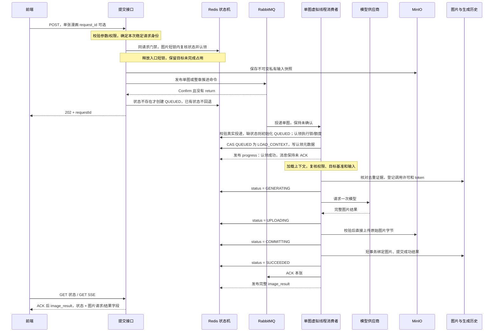
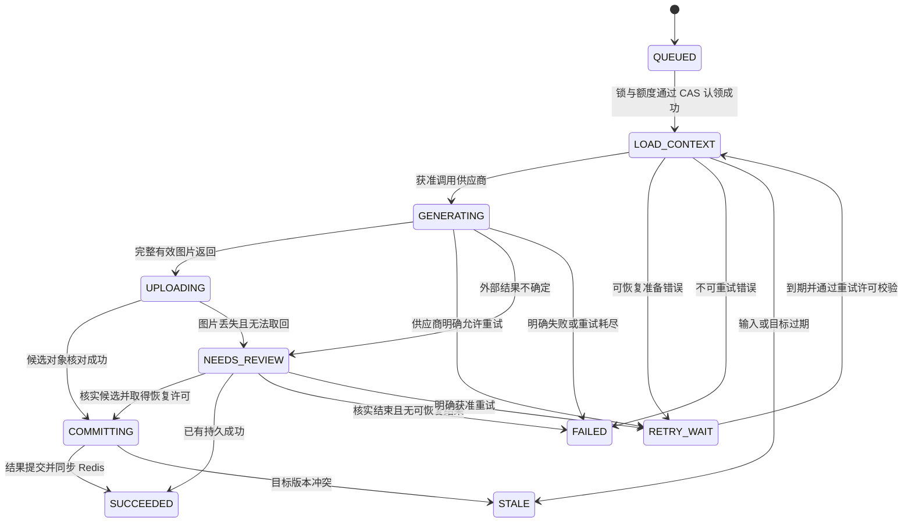

# 普通生图：RabbitMQ 与 Redis 状态机开发方案

修订日期：2026-10-26。状态：**本轮已获用户明确授权并落地代码，尚未生产部署。** 实际模块、迁移、已验证子集及未验证场景见 [实施记录](image-generation-implementation.md)。本文后续设计基线和验收要求不代表已逐项全部通过。

已单独授权并完成的“原始图片字节直接上传 MinIO”见 [generated-image-direct-upload.md](generated-image-direct-upload.md)，本次 MQ 实现复用此链路。

单张漫画从 Controller 封装、校验、同请求门禁、图片认领到入队/消费的完整顺序和异常决策见 [single-manga-image-request-lifecycle.md](single-manga-image-request-lifecycle.md)。

2026-10-26 审核修订：已按 [审核原文](image-generation-design-review.md) 的 H1–H4、M1–M7、L1–L10 修订本方案；资源/安全、键空间、恢复接口、图片版本和实施规格的逐项决策见 [审核修订与实施规格](image-generation-review-revisions.md)。用户随后明确授权本轮即时单图与整章一起实施，覆盖原“等待授权/整章另行确认”的实施门禁。

## 1. 本轮决策与审核范围

处理普通单图、独立单张漫画首次生成、即时整章缺图生成、单图重生成的进程宕机恢复。预约生图和 Agent 定时任务保持独立，不迁移预约任务表或定时任务中心。

| 审核项 | 建议方案 |
| --- | --- |
| 入口 | Controller 封装 → 校验/身份补全 → 同请求门禁 → 图片短锁内状态判定/目标认领 → 确认发布 MQ → 返回 202；已有操作复用状态/结果 |
| 单张消费单位 | 一张图片从加载上下文到模型生成、上传 MinIO、提交图片结果的完整操作 |
| 状态存储 | Redis Hash 只保存一个执行 status；LOAD_CONTEXT/GENERATING/UPLOADING/COMMITTING 都是 status 枚举值，不另设 phase |
| 成功边界 | 图片上传成功、结果及幂等证据提交、Redis 写入 SUCCEEDED 后 ACK 本张；不等待下一张发布 |
| 前端结果 | ACK 调用后通过已建立的 SSE 返回完整 image_result，包含 status 和该图片请求/结果信息；断线后 GET 补取同一结果 |
| 消费者认领 | 锁/额度与状态证据核对后，CAS QUEUED → LOAD_CONTEXT 表示认领成功；写 owner/claim_id/认领时间并发 progress；认领时不完成 ACK，不新增 CLAIMED |
| 模型与上传阶段 | 分开观察和恢复，仍在同一消费者中连续执行；供应商完整响应后才上传 MinIO |
| 图片存储队列 | 不增加；复用已实现的内存图片直接流上传 |
| 数据库职责 | 现有图片/历史、调用与结果去重证据；不保存 LOAD_CONTEXT 等阶段状态机，不做数据库任务扫描 |
| Redis 职责 | 提交合并、运行状态、共享锁/额度、SSE 通知；不作为待发送命令缓冲 |
| 整章选型 | 后端串行编排，前一张结束后才发布下一张；整章生成与全部重生成共用串行模型通道，单图完成独立 ACK |
| 独立单图首次生成 | 允许并行，包括同用户、同配置、同章不同图序；共享总额度与目标图片互斥 |
| 恢复入口 | GET 返回 recovery_actions；核实/人工申请/安全继续/安全终结及显式替代请求均有接口；未知外部调用不凭年龄清占用 |
| 图片基准 | 新增 MangaImage.version；章节与结果返回 image_version，重生成固定 expected_image_id + expected_image_version |
| 服务器规格 | 按用户意见不纳入本轮审核，不以扩容/外置服务作为开发前置；保留已确认的并发设计 |
| 外部结果未知 | 默认 SAFE：支持查询/供应商幂等则恢复，否则 NEEDS_REVIEW，不盲目再次收费 |
| 执行方式 | 专用虚拟线程；初期单 Worker、并行通道 4 个消费者、串行通道 1 个消费者；全局/用户/配置模型额度 4/4/4，串行通道额外上限 1 |
| 故障目标 | 应用/Broker 重启后命令可恢复；Redis 丢状态后可保守重建，不承诺供应商严格 exactly-once |

本轮按用户建议合并状态字段、明确 ACK 后的完整前端结果，并取消全章子命令预分发。第 8 节改为由一个可恢复的章节控制消息逐张推进；图片成功消息的 ACK 不依赖发布下一张，失败消息的可靠重试/隔离转交仍要求 Confirm 后 ACK。

不建设通用任务平台、DB Outbox、Redis 待发送列表、独立上传 Worker、全章批量预入队、整章内部并行或精确排队名次。需要用户审核的实质变化是：Redis 单字段状态机、串行章节编排、ACK 后完整结果契约，以及现有历史表的有限扩展。

### 1.1 已确认的并发规则

用户已确认：“整章和所有重生成请求串行，仅独立单张首次生成可并行”。据此划分模型调用通道，不能仅按消息是一张图片就把它当成可并行任务。

| 业务场景 | execution_mode | execution_lane | 调用规则 |
| --- | --- | --- | --- |
| 整章入口生成漫画，包括界面的“重新生成漫画” | CHAPTER_SERIAL | SERIAL_MODEL | 章内逐张提交；所有章节与重生成共享最多 1 个在途模型调用 |
| 任意已有图片重新生成，包括独立点击某张“重新生成” | SINGLE_IMAGE | SERIAL_MODEL | 与整章及其他重生成互斥，不走并行通道 |
| 独立单张漫画首次生成 | SINGLE_IMAGE | PARALLEL_MODEL | 不同目标图片可并行，同用户/同模型也允许 |
| 普通独立单图首次生成 | SINGLE_IMAGE | PARALLEL_MODEL | 在共享额度内并行 |

“串行”在本版明确为整个 SERIAL_MODEL 通道互斥，不仅是每个章节内部各自串行。PARALLEL_MODEL 可与串行通道同时执行，所有模型调用仍共用全局额度。后续若希望不同章节各自串行而章节间并行，需显式调整此约束。

execution_mode/lane 是受理时固定的请求属性，不是第二套状态机；status 仍只有一个字段。通道由服务端按业务操作判定，不接受客户端任意选择以绕开串行规则。首次生成发现目标已有图片时，返回已有结果或明确冲突，不能暗中按并行通道覆盖重生成。

## 2. 实施前代码基线与边界

下表保留设计时的改造依据；实施后的接口、配置和测试状态见实施记录，不能把此表的“当前情况”当作现状。

| 当前位置 | 当前情况 | 计划调整 |
| --- | --- | --- |
| ImageGenController / ImageGenService | 普通生图直接进入应用内异步；事务提交前启动线程，线程内长事务包含外部 IO | 改为提交服务确认发布；消费端外部 IO 与短事务分开 |
| GenerationGuardService / IdempotencyService | 有 Redis leader/follower，但普通生图入口未调用 executeImageGeneration；固定锁值和无 owner 释放 | 新增提交专用 single-flight，保留其他 guard 的现有语义 |
| MangaGenerationService / MangaGenerationJob | activeJobs 和 SSE 关系在内存；同章串行，有外层立即重试 | 改为单图处理器、Redis 单字段状态与可恢复串行编排，清除 MQ 路径叠加重试 |
| 单图重生成 | 同步等待，使用共享图片保存服务 | 异步提交，统一消费并发和状态；失败保留原图 |
| WebClientImage2Client | 完整结果校验后返回 GeneratedImage 字节；普通路径有连接提前关闭自动重试 | MQ 路径明确一次供应商尝试，保留错误类别和 Retry-After，不影响预约路径语义 |
| MangaImageStorageService | 原字节流上传；随机对象名；保存图片记录后清理旧对象 | 增加按操作/尝试隔离的候选键、短事务绑定和提交后清理 |
| ImageGenService.listHistory | 查询时把超过 12 分钟的 RUNNING 标为失败 | 对新 MQ 请求停用该推断；排队不算执行超时 |
| RedisConfig | 已有 StringRedisTemplate / PubSub，UTF-8 字符串序列化 | 复用独立命名空间与 Lua，不把状态写入 Agent 对象序列化模板 |
| docker-compose.yml | 有 Redis 数据卷，未显式启用 AOF；没有 RabbitMQ | 审核后增加持久化/内存策略和 RabbitMQ，当前不修改部署 |

Java 21、Spring Boot 3.3.5、MinIO SDK 8.5.12 保持现有基线。AMQP 使用 Boot 管理的 starter 版本，不顺手升级框架。工作区已有大量未提交修改，实施前再次检查并保留。

## 3. 主链路与各存储职责

下图展示单图消费主链路；整章控制消息的串行推进见第 8 节。



- RabbitMQ 保管命令；发布确认与消费者 ACK 是两个边界，均需处理不确定结果。[1][2]
- Redis 是运行状态机的读写入口，记录单一 status 与恢复元数据，不保存图片二进制或明文凭据。
- MinIO 保存不可变输入和图片结果；当前内存字节只在一次执行内存在，不是重启恢复依据。
- PostgreSQL 保留现有业务图片和生成历史，以及“是否已准备发送/已成功”的必要消费证据。LOAD_CONTEXT/UPLOADING 等阶段不复制为第二套数据库状态机，也不扫描历史派发任务。

Redis 状态不是外部付费副作用的唯一证据。AOF 或主从切换仍可能丢失最新状态，因此在再次收费之前必须核对持久调用证据；图片已成功则以业务结果修复 Redis，而非重新生成。

## 4. 单图状态机：只保留 status

### 4.1 状态定义

| status | 含义 | 消息处置 |
| --- | --- | --- |
| QUEUED | 已入队，尚未取得执行资格；额度等待原因放 blocked_reason | 可靠排队；需要让出消费者时确认发布延迟命令后 ACK 当前投递 |
| LOAD_CONTEXT | 已成功认领；加载快照、配置、参考图，复核权限、目标版本及消费证据 | 写认领元数据、发布 progress，保持未 ACK；确认未发送时可安全恢复 |
| GENERATING | 已进入一次供应商尝试，等待完整响应和图片校验 | 宕机或超时先核实外部结果 |
| UPLOADING | 已有完整有效图片字节，上传 MinIO | 字节仍在则仅重试上传；不重调模型 |
| COMMITTING | 候选对象已核对，提交图片绑定与成功历史 | 失败恢复绑定，不重新生成 |
| RETRY_WAIT | 已批准的有限重试等待；retry_kind / retry_at 表示原因和时间 | 替代命令确认发布后 ACK 当前投递 |
| SUCCEEDED | 图片及结果已提交；outcome=GENERATED 或 REUSED | Redis 成功写入后 ACK，随后发送完整结果；重投复用 |
| FAILED | 确定失败，自动重试结束 | 保存错误，可靠隔离后 ACK |
| NEEDS_REVIEW | 外部可能已受理，无法自动确认结果 | 保存依据，可靠隔离后 ACK，停止自动收费 |
| STALE | 输入或目标失效，不能覆盖较新结果 | 保存原因，可靠隔离后 ACK，中止本章余下调用 |

用户的 loadcontext/process/pushminio/finish/fail 分别对应 LOAD_CONTEXT/GENERATING/UPLOADING/SUCCEEDED/FAILED。另保留 QUEUED、RETRY_WAIT 和 COMMITTING 等恢复所需状态。

进入状态机先解析既有状态，不能无条件写 QUEUED。初次 QUEUED 只在 Publisher Confirm 且正确路由后，或消费者收到合法真实投递时初始化；提交中的 PUBLISHING/UNKNOWN 属于传输凭证，不伪装成已入队。消费者可能先推进，API 后续初始化必须 create-if-absent/合法 CAS，禁止状态回退。具体分支见单图细化方案第 5、6 节。

本流程线性且没有同时存在的独立子阶段，使用一个 status 足够；不再保存 phase 或通用 RUNNING。GENERATING 和 UPLOADING 是同一个字段的不同值，便于分别观察模型耗时与上传故障，没有拆分消费者或上传队列。已有历史的粗粒度 RUNNING 仅用于实际调用，不用于新路径排队。



恢复时可依据已核对候选直接进入 COMMITTING；状态图不要求再次执行已经完成的外部调用。

### 4.2 迁移与超时规则

1. 状态迁移经统一服务和 Lua CAS，条件包含 owner、claim_id、expected_version、允许的原 status；进入 LOAD_CONTEXT 时写认领元数据。execution_token 在调用许可短事务中才分配，此后结果/状态提交再校验 token；首次认领不假定已有 token。成功后 version + 1。
2. 同一次执行按合法状态前进；只有已批准重试才可从 RETRY_WAIT 回 LOAD_CONTEXT。准备或额度等待不增加 provider_attempt；实际获准发起模型请求才增加。
3. SUCCEEDED/FAILED/STALE 不回执行态。NEEDS_REVIEW 经受控核实恢复已有成功或确定失败；再次付费使用新 operationId。
4. 旧 Worker、旧尝试及迟到的 API QUEUED 不能覆盖新状态。租约过期不表示供应商停止，也不自动允许重调模型。
5. GENERATING 与 UPLOADING 在同一消费者连续执行。供应商完整响应、有效字节校验结束后才上传；同一缓冲内有界上传重试不重跑整个生成方法。
6. Redis 不可用时停止新模型调用。已有图片优先上传/提交；最终状态同步失败则保留当前投递，恢复后以业务结果修复 SUCCEEDED 再 ACK。
7. queued_at、started_at、status_started_at、completed_at 分别计时。单投递处理预算 15m；单图总预算为首次认领起 60m，跨重投/重试不刷新；首次排队不计入。执行起点凭证持久保存以防 Redis 重建重置 deadline，批准重试需容纳等待、模型及后处理预算。

消费认领、Broker 发布确认和消费 ACK 是三个不同边界。发布确认是 Broker 对生产者确认接收；认领是消费者将状态 CAS 为 LOAD_CONTEXT；ACK 是消费者向 Broker 确认本次投递已处理/可靠转交。API 不等待认领再返回 202，RabbitMQ 不自动把认领回传生产者。认领状态先写 Redis，再发 progress；通知丢失由查询恢复。CAS 失败释放自己持有的资源，不进入模型调用。完整认领规则与恢复见单图细化方案第 7.1–7.5 节。

## 5. Redis 数据模型、持久化与恢复

### 5.1 Key 和字段

同一根请求使用完整 `{rootId}` Cluster hash tag，userId 放 tag 外保留键空间隔离。Redis 对 tag 全部内容做哈希，原 `{userId:rootId}` 也随 rootId 分散，不等于按用户固定 slot；此次统一简化分片边界，不承诺消除单根热点。根域 Lua 同 slot，图片/额度域仍独立。具体结构及验证见审核修订第 3 节。

| Key | 内容 |
| --- | --- |
| image:request:userId:{rootId} | 合并 submission_hash、提交受理凭证及根请求元数据；独立单图直接在此保存唯一状态，不另写 op Hash；整章保存聚合/推进字段 |
| image:submission-lock:userId:{rootId} | 提交 owner lease；60 秒，20 秒续期 |
| image:op:userId:{rootId}:operationId | 仅整章已发布子图的状态 Hash；StateRepository 统一解析单图/整章状态键 |
| image:op-lock:userId:{rootId}:operationId | 同一单图操作的重复投递互斥；120 秒，30 秒续期 |
| image:terminal-set:userId:{rootId} | 整章已计入聚合的 operationId 集合；重复终态不会重复累加 |
| image:advance-lock:userId:{rootId} | 同一根请求的短时游标推进锁；仅处理控制消息期间持有，不锁住整章图片 |
| image:recovery-lock:userId:{rootId}:operationId | 同原操作的有界核实链互斥，不代替图片锁或调用许可 |
| image:target-active:{chapterId:imageNumber} | canonical 身份、操作/输入/基准/提交状态、active_version、created_at/updated_at/last_heartbeat_at；不设 TTL，2h 只触发核实 |
| image:target-lock:{chapterId:imageNumber} | 单张图片租约；入口短时判定/认领 60 秒、20 秒续期，Worker 执行 120 秒、30 秒续期；owner 独立，不同图序不互阻 |
| image:permits:{serial-model} | ZSET 租约信号量，容量 1；结果不确定时持久证据另阻断新串行调用 |
| image:permits:{global} / {user:userId} / {profile:profileId:modelHash} | 分作用域 ZSET，member=operationId:claimId，score=到期毫秒；TIME + Lua 原子取得/续期/回收 |
| image:events:userId:{rootId} | 请求级 Pub/Sub 通知；只订阅相关请求，断线读 snapshot，不承担可靠命令传输 |

单图 Hash 至少包含：operation_id、root_request_id、user_id、input_hash、status、execution_mode、execution_lane、outcome、state_epoch、version、execution_token、owner、claim_id、claimed_at、lease_expires_at、last_heartbeat_at、provider_attempt、retry_kind、retry_at、blocked_reason、candidate_object_key、record_id、image_number、error_code、queued_at、started_at、status_started_at、completed_at、updated_at。started_at 仅首次认领写入，claimed_at 随合法接管/重试更新，execution_token 在持久调用许可生成前可空；owner/claim_id 等为内部恢复元数据，默认不暴露前端。

消息不包含明文 BYOK，Redis 也不存图片字节、临时文件 Path、明文 API Key、可过期下载 URL 或完整供应商响应。

状态与对应执行锁在同 slot 校验；全局/用户/供应商配置/串行通道额度及目标锁是不同作用域，按固定顺序分别原子认领，失败回滚已持有额度。不能声称一个跨 slot Lua 原子完成全部作用域。所有续期和释放均校验 owner；持久 token 在数据库结果提交时再校验。

额度取得采用 global→serial（适用时）→user→profile→op-lock→target-lock，失败逆序释放本 claim。独立双平台线程续租调度器维护 op/target/额度及 heartbeat，不依赖阻塞的虚拟监听线程；ZSET 回收不代表外部调用结束，DB 许可仍核对各域 UNRESOLVED 容量。算法、时间源及失租处置见审核修订第 6.1 节。

### 5.1.1 漫画业务互斥采用单张图片粒度

图片锁使用 `chapterId + imageNumber`，例如 `image:target-lock:{123:7}` 表示第 123 章第 7 张图片。该身份在图片尚未入库时也能确定，因此不能只使用已有 MangaImage 的数据库 ID；也不能包含 requestId，否则不同请求操作同一张图片会拿到不同锁。

锁实现明确使用 StringRedisTemplate 的 owner 租约：SET NX PX 获取，Lua 校验 owner 后续期/释放；不要求可重入，不新增 Redisson 依赖，不以 JVM ReentrantLock 代替跨实例锁。接口与消费者分别持有独立 owner，锁失效仍需核对持久证据。

| 同时到达的操作 | 图片锁规则 |
| --- | --- |
| 第 123 章第 7 张与第 8 张首次生成 | 不同锁，允许在并行通道同时执行 |
| 不同请求操作第 123 章第 7 张 | 入队前由 target-active 合并相同操作或拒绝冲突；执行端仍共用同一图片锁并检查结果及版本 |
| 整章当前图与独立单图命中同一张 | 同一锁，不能因来自不同通道而绕过互斥 |
| 不同章节的图片使用相同图序 | 不同锁；是否可以同时调用模型另由通道规则决定 |

目标图片租约有两个使用位置：入口在同请求门禁后短时取得，复核状态并认领 target-active 后释放；Worker 收到消息后以新 owner 独立认领，正常在 ACK 和短预算结果发送后释放。入口租约不跨越排队或网络等待，target-active 则跨排队保留未完成占用；不把 API owner 的锁交给 Worker，也不锁住整章。取得执行锁后再次核对持久结果、未决调用和目标版本。重试等待释放本次租约；结果未知时仍需持久证据阻止同目标新调用，不能凭锁 TTL 到期就认定上一请求已结束。

`op-lock` 防止同一 operationId 被重复消费，`target-lock` 防止不同 operationId 同时操作同一张图片，两者作用不同。`advance-lock` 仅保护一个根请求的推进游标，不参与图片执行，不会阻挡同章其他图序。

整章内部的先后顺序由串行编排器保证；用户已确认的“整章及所有重生成共用一个串行模型通道”由通道额度 1 保证。二者均不通过扩大图片锁到整章来实现。

### 5.2 保留策略

- 未完成、RETRY_WAIT、NEEDS_REVIEW 及整章尚未收尾的状态不设置自动删除 TTL；执行锁单独有短 lease。根请求未结束前，其已完成前置图片状态也保留，便于串行游标和结果恢复。
- 整个请求终态后，状态/提交凭证建议保留至少 30 天；输入快照和持久去重证据保留不短于可重放窗口。用户删展示历史不删除去重依据。
- 专用 Redis 实例建议 appendonly yes、appendfsync everysec、数据卷、maxmemory-policy noeviction，并监控 AOF 重写、磁盘和内存。若共享实例，需先审核共享淘汰策略影响；仅换 Redis logical DB 不能隔离内存淘汰策略。
- AOF everysec 不能承诺最新一秒状态绝不丢失，副本故障切换也不能用状态存在与否推断外部调用是否发生。[8][11]
- 内存写满/Redis 无法写入时暂停新生图和消费，而不是回退到 JVM 状态。现有业务结果阅读可降级查询。

### 5.3 Redis 数据丢失如何重建

| 可核对证据 | 重建动作 |
| --- | --- |
| 已有持久成功历史与图片绑定 | 恢复 SUCCEEDED；结果已被用户删除则返回曾成功但已删除，不重新收费 |
| 候选对象存在且摘要/归属/token 有效 | 恢复到 COMMITTING，核对目标版本后绑定 |
| 有待核实记录或调用前发送标记，但无可核实结果 | 恢复 NEEDS_REVIEW，查询供应商或隔离，不重置为首次 GENERATING |
| 有已批准重试的尝试号和最早时间 | 恢复 RETRY_WAIT；只执行获准的新 attempt，不重放旧 attempt |
| 无发送标记，当前有合法 MQ 命令和完整快照 | 重建 QUEUED，按正常消费认领，CAS 创建调用记录 |
| 只有 manifest，无提交凭证/消费记录/当前投递 | GET 返回 STATUS_UNAVAILABLE；快照存在不等于已入队，不自动派发 |

Redis 重建使用新的 state_epoch；同一 epoch 内比较 version，跨 epoch 前端以新 GET snapshot 重新建立基线，防止旧 SSE 事件覆盖。中间阶段历史无法从快照恢复时只展示已核实状态，不伪造执行轨迹。

重建由消息消费或按 requestId 的查询触发，不增加数据库任务扫描器。Redis 清空不会删除 RabbitMQ 命令；但也不能恢复失联供应商调用的精确瞬时并发，默认 SAFE 对这类调用停止自动重试。

### 5.4 长期占用与有界核实

保留 target-active 无 TTL，增加 2h 未活跃提示、3s 入口核实预算、脱离入口的 IMAGE_RECOVER 消费及用户/管理恢复操作。Redis 或 DB 不可用都返回 503，不以查失败当无证据。入口不查询供应商、不下载候选；已有明确终态立即按 active_version 清残留，未知调用不按时间强解锁。完整恢复/替代/清理与前端按钮见审核修订第 4 节及本文第 12 节。

## 6. 提交幂等、单张图片业务 single-flight 与受理

### 6.0 统一参数校验与请求身份补全

所有单张漫画入口先经过 `ImageGenerationRequestValidator`，验证通过后形成统一的已校验请求，再进入目标业务 single-flight、快照和 MQ；整章编排构造的单图操作也复用相同校验规则。该模块不调用模型，也不作为独立 MQ 消费阶段。

| 校验范围 | 规则 |
| --- | --- |
| 用户与归属 | userId 从登录态取得；章节存在且当前用户有操作权限，不使用客户端传入 userId 生成身份或授权 |
| 供应商选择 | 前端明确提交有效 config_id 或该入口支持的完整临时供应商配置；缺失返回 400 / PROVIDER_REQUIRED / “无供应商，请选择生图供应商”，不入队，不猜默认供应商 |
| 图片目标 | chapterId 合法；imageNumber 为正整数且在已保存分镜/允许范围内；路径和请求体中的目标一致 |
| 业务动作与基准 | 首次生成固定 expected_absent；重生成提交 expected_image_id + expected_image_version；版本来自章节/结果 DTO，类型/基准不一致拒绝 |
| 生成参数 | 提示词/分镜可解析、长度合法；模型配置归属正确；尺寸、数量、参考图数量/体积等满足所选适配器能力 |
| 参考图和配置 | 入口验证引用的归属、元数据及必要配置；消费者 LOAD_CONTEXT 再实际加载、解密并核对内容，不在 API 内提前调用供应商模型 |
| 请求身份 | 有 request_id 则检查合法 UUID 并与既有提交的用户、目标、类型、参数绑定核对；非空但格式错误返回 400，不悄悄重建 ID |

已知请求身份先在鉴权及结构校验后查原受理凭证，按原 submission_hash/快照核对并返回，不重新套用当前默认模型等可变配置。新操作才解析当前允许配置并固定快照；消费者对尚未成功的调用仍复核原配置是否有效。

有效 config_id 是前端对供应商的明确选择，不要求每次传明文 API Key。仅有 model 名不能作为供应商选择；临时 BYOK 按支持协议检查 provider/端点/凭据等完整性。现有默认配置解析路径需在实施时统一收口。缺供应商是调用前参数错误；NEEDS_REVIEW 是供应商已知且已尝试调用后结果无法确认，二者不能混用。详细定义见审核修订第 4.0 节。

入口校验失败不建立目标占用、不确认发布 MQ、不触发付费模型调用。校验通过不意味着输入永久有效：消费端在 LOAD_CONTEXT、取得本张执行资格后，再核对权限、基准版本、配置指纹、参考图及持久调用证据，成功后才进入 GENERATING。消费校验失效按 FAILED/STALE 处置，不刷新 requestId 或偷偷选用新配置。

### 6.1 身份与合并

独立单张漫画首次生成/重生成允许省略客户端 request_id。规范为：

1. 有 request_id：作为本次单图提交标识使用，在当前登录用户作用域查找或条件创建；重试原样传递，不覆盖既有操作。若命中目标未完成操作，按第 6.2 节返回 canonical ID。
2. 没有 request_id、但有 UUID 格式的 Idempotency-Key：作为兼容输入使用。两个字段同时存在须相等；不要求客户端传两套标识。
3. 两者都没有：由服务端在校验后按下述规则稳定派生，不能每次随机生成 UUID：

```text
businessKey = 当前登录 userId + chapterId + imageNumber
fallbackRequestId = stableUuid(命名空间, businessKey, operation, targetBaseVersion)
```

`targetBaseVersion` 是本次提交的图片基准，首次生成使用 expected_absent，重生成使用前端看到并提交的 expected_image_id + expected_image_version。参与派生的字段做明确边界编码；不拼接无分隔字符串，不使用客户端声称的 userId。相同目标、动作、基准缺省提交得到相同 ID；不同参数不通过加入参数哈希“逃逸”成新 ID，而是按提交内容冲突检查处理。

固定的 userId/chapterId/imageNumber 标识图片业务目标，不能单独永久作为一次生成请求的 ID，否则以后该图片所有重生成都会指向第一次请求。加入操作和基准后，第 7 张基于版本 3 的重生成与基于版本 4 的重生成是两次操作；同版本重试仍是同一次。结果已明确失败后，用户若要在同版本再次主动尝试，可显式提供新 request_id，仍须通过业务 single-flight 和安全调用许可。

重生成缺少基准版本返回校验错误，不能替客户端读取最新版本再派生新 ID：否则响应丢失后重试可能变成又一次收费。首次生成目标已存在时复用/冲突，不因 ID 补全而覆盖图片。请求已结束后，同一个显式或缺省 ID 始终返回原操作结果，不转成新任务。

身份补全只发生在新提交入口。已发布 MQ 消息必须携带原 request/operation ID；内部消息缺失或格式错误进入协议错误隔离，不能在消费端临时生成新 ID 绕过去重。

规范化后的单图 requestId 为候选根身份，operationId 稳定派生；目标合并后返回既有 canonical requestId/operationId，并保存提交关联。前端拿到返回的 canonical request_id 后，后续查询/重试直接复用。重试不得改基准或重算身份。

普通无固定漫画目标的生图、整章计划提交仍要求 Idempotency-Key，并按用户+键派生根身份；整章子图沿用根请求+cursor 的稳定 operationId，不为每次控制唤醒重新生成。入口提供明确的身份来源 metadata，单图状态仍只有 status 字段。

分别计算 submission_hash（规范化原始输入）和 input_hash（首次解析后的模型、端点指纹、提示词、引用摘要、尺寸、风格、目标版本和策略版本）。同键不同输入/操作类型返回 409。新键还需通过单张图片业务 single-flight，不能仅凭 UUID 不同就再次排队；无固定漫画目标的普通独立生图仍可用新键主动生成新图片。

leader 获取带 owner 的提交 lease 后再次检查既有凭证，读取/条件创建快照，确认发布。follower 共享原 requestId，默认最多等 8 秒的提交结果，不等待模型；超时返回 503 SUBMISSION_IN_PROGRESS、Retry-After、已确定的 request_id 及复用原身份/基准的重试提示。

提交 leader 先在图片短锁内读取请求状态、目标占用及必要持久证据，再决定能否安排初次入队；状态缺失但有调用痕迹时先重建，不能默认初次执行。认领结束释放入口图片锁，保留 target-active，再做快照/网络发布；同请求提交 lease 继续约束发布，不能持 API 图片锁等待模型。

确认正确路由且收到 Confirm 才返回 202 ACCEPTED；确认超时返回 503 PUBLISH_OUTCOME_UNKNOWN，不等于确定未入队。客户端原身份重发可能产生重复命令，消费端必须去重。[1][2]

ACCEPTED 不被迟到的 PUBLISHING/UNKNOWN/REJECTED 覆盖。Pub/Sub 只唤醒 follower，返回前后都重读凭证。Confirm 已成功、Redis 写凭证失败时 leader 仍可凭本次确认返回 202，记录状态同步异常，后续通过消费重建。

### 6.2 同章节、同图片序号的业务 single-flight

UUID 只能识别一次提交的重试，图片执行锁只能防止并发执行；两者都不能单独阻止 A/B/C 使用不同 UUID 后串行重复收费。因此在入队前按 `chapterId + imageNumber` 原子认领 `image:target-active:{chapterId:imageNumber}`，每张图片最多保留一个未完成的逻辑操作。

| 目标现状 | 新提交的处理 |
| --- | --- |
| 无未完成操作，首次生成目标也无已有图片 | 认领为 leader，固定输入并确认发布一份单图命令 |
| 已有未完成操作，操作类型、目标基准版本、输入摘要及通道均相同 | follower 返回已有 canonical requestId/operationId；不另写一份执行快照、不发布新生图命令、不占模型额度 |
| 已有未完成操作，但参数、类型、基准版本或通道不同 | 视为新的业务意图，但目标忙而拒绝执行；返回 409 IMAGE_GENERATION_IN_PROGRESS 及有权查看的原请求信息，不错误合并、不自动排队、替换或取消 |
| 前次已成功，仍请求首次生成 | 返回已有图片或明确冲突，不重新调用模型 |
| 前次已结束，用户主动重生成且提交新的当前目标版本 | 允许新键建立新的重生成操作，仍走串行通道 |
| 前次外部结果未知/NEEDS_REVIEW | 保留目标占用并提示核实；换 UUID 不能绕过 |

userId/chapterId/imageNumber 用于用户作用域的提交身份；目标占用和执行锁仍按章节+图序，不把 userId 加入物理图片锁来允许不同授权用户同时覆盖同一目标。已有 canonical 请求只向有权查看者返回。

输入摘要覆盖最终提示词、模型/配置指纹、尺寸、参考图摘要、风格及目标基准版本，不包含 UUID/rootId 等传输身份。操作类型不同不自动合并；同一目标正在首次生成时，再发“重新生成”也不能先排队等待收费。

认领和“读取既有 owner/摘要”在目标 key 内以 Lua 原子完成，不能先 GET 再 SET。目标 key 与请求凭证可能不在同一 Redis Cluster slot，分别使用条件写、稳定身份和恢复核对，不声称跨 slot 原子提交。follower 只有核实原操作已 Confirm 受理后才返回 202；原提交仍 PUBLISHING/UNKNOWN 时按第 6.1 节短等/返回带 canonical ID 的提交未确定响应，不能虚报受理。

`target-active` 是未完成操作映射，排队、执行、上传、提交、RETRY_WAIT、提交确认未知期间均保留，不按 300 秒固定 TTL 自动清除。提交 leader 的短租约过期只允许同输入接管并继续发布原 canonical 命令，不允许创建另一个操作。确认未发布且安全拒绝时可条件释放；发布结果未知不能凭超时删除占用。

单图成功 ACK/短预算结果发送后，或确定失败已可靠转交后，只允许以 canonical operationId + owner 条件清理自己的目标占用，不能删除后续操作。SUCCEEDED 已写入但当前投递仍在收尾时继续返回既有结果。NEEDS_REVIEW 只在确认旧调用结束或未受理、旧 Worker 已退出且受控核实完成后解除；正常执行锁到期不解除业务占用。

若 ACK 后、清理占用前进程退出，后续提交可在入口图片短锁内核实业务终态、无未决调用及旧执行租约已结束，按旧 canonical operationId/占用版本 CAS 清理残留；保留原请求凭证，再校验新的目标基准。不能使一条终态 target-active 永久阻挡重生成。

重生成必须携带前端看到的 expected_image_id + expected_image_version，targetBaseVersion 固定为 ID:version，避免删除重建后的版本 0 复用；首次生成使用明确的“目标尚不存在”基准。同请求身份重试保持原基准，不自动刷新为当前图片版本。Redis 映射丢失时，入队/消费按目标和基准核对持久未决调用及已有结果；不同 operationId 不能各自凭锁依次收费。调用许可短事务须对同目标原子核对并登记基准证据，已被成功操作消耗的旧版本只允许复用或返回 STALE。

整章逐张发布也经过相同目标认领，不能绕过业务防重。若当前图被其他请求占用，编排器保留控制责任并等待/核实既有结果，不发布第二份生图；完成后按选图规则复用已有图片或报告冲突，不自动追加一次重生成。不同章节/图序仍是独立目标，不作全局参数哈希去重。

### 6.3 不可变私有输入

私有独立 bucket 保存 generation-inputs/userId/requestId/manifest.enc 及内容摘要命名的参考图，不能挂现有公开图片静态接口。manifest 固定完整请求体、业务操作及服务端 execution_mode/lane、整章 planned_images、模型配置指纹和目标期望版本；MQ 只引用对象键和摘要。

使用存储端条件创建，禁止非原子 HEAD → PUT 模拟；同键重发使用原快照和原首次时间，不重新解析已变化的默认模型、分镜或目标版本。阶段 A 验证当前 MinIO/SDK 条件写能力，不满足则先调整实现，不降级覆盖。[9]

优先引用用户已有配置 ID；消费时校验归属及端点/模型指纹，配置删除或关键变更明确失败，不切换默认供应商。临时 BYOK 只在加密私有快照中保存，复用版本化 AES-GCM 能力，不放 MQ/Redis/日志。重启保留密钥版本，解密失败不使用默认密钥。

未完成/隔离请求的快照持续保留，终态建议至少 30 天。Confirm 未知时孤立快照可能仍被消息引用，首期提供清单和人工核对，不盲目按时间清理，也不新增待发送扫描器。

## 7. RabbitMQ 协议、拓扑和单图 ACK

### 7.1 执行、章节推进与恢复命令

单图 IMAGE_EXECUTE 包含 schema_version、event_id、root_request_id、operation_id、user_id、operation、execution_mode、execution_lane、manifest_key、manifest_hash、cursor、attempt、not_before、defer_reason、created_at、trace_id。

operation 支持 STANDALONE、MANGA_GENERATE、MANGA_SINGLE_GENERATE、MANGA_REGENERATE。MANGA_GENERATE 的子图均为 SERIAL_MODEL；MANGA_REGENERATE 无论是否独立提交也均为 SERIAL_MODEL；首次生成的 STANDALONE/MANGA_SINGLE_GENERATE 为 PARALLEL_MODEL。命令包含服务端固定的 execution_mode、execution_lane，并与 manifest 校验一致。普通单图 cursor=0；章节 cursor 是 planned_images 内的下标，image_number 仍保留真实图序。event_id 用于一次逻辑投递关联，operationId 用于业务去重；传输重发保持业务身份。

整章 MANGA_ADVANCE 包含 schema_version、event_id、root_request_id、user_id、manifest_key/hash、control_generation、not_before、created_at、trace_id；仅检查当前图及推进一张，不调用模型、不上传图片。control_generation 关联重复控制投递，不作为跳过业务结果校验的依据。

有界核实 IMAGE_RECOVER 另含 action_id、expected_recovery_version、probe_index、recovery_deadline 和原操作关联；只核对持久结果/候选/支持的供应商查询，禁止调用生成接口。恢复命令独立消费者，避免阻塞章节推进。安全继续仍按许可发布原 IMAGE_EXECUTE，不把核实消息转换成随意重调。

持久化 JSON，禁用 Java 原生反序列化；消息默认不超过 64 KiB。由服务端登录身份构造归属和路径，不信任客户端提交 manifest_key。未知 schema、摘要不符和缺失快照走明确隔离路径。

### 7.2 拓扑

| 组件 | 建议名称与配置 |
| --- | --- |
| 单图工作交换机 | artverse.image.work.x，durable direct，按服务端 lane 路由 |
| 首次单图并行队列 | artverse.image.work.parallel.q，durable quorum，execute.parallel |
| 整章/重生成串行队列 | artverse.image.work.serial.q，durable quorum，execute.serial |
| 整章推进 | artverse.image.advance.x / artverse.image.advance.q，durable direct + quorum，advance |
| 推进唤醒 | artverse.image.advance.wait.x / artverse.image.advance.wait.5s.q，固定 TTL 5s、quorum、DLX 回 advance.x |
| 延迟重试 | artverse.image.retry.x，parallel/serial 各自的 30s/120s/600s 固定 TTL quorum 队列，DLX 回 work.x 的原通道路由键 |
| 隔离 | artverse.image.quarantine.x / artverse.image.quarantine.q，durable quorum，保留原命令/错误/所属阶段 |
| 核实 | artverse.image.recovery.x / artverse.image.recovery.q，durable direct + quorum，recover，消费者 1、prefetch=1 |
| 核实等待 | artverse.image.recovery.wait.x，30s/120s 固定 TTL quorum，DLX 回 recovery.x/recover |

工作/推进队列无业务过期 TTL，禁止 exclusive、auto-delete、drop-head；容量满选择 reject-publish。Broker 数据使用持久卷；需要节点故障容忍时验证三独立节点/三副本 quorum 布局，单节点磁盘卷不等于高可用。[3]

单节点暂保留 quorum 是为验证可靠 DLX 协议，不是获得节点冗余；classic 替换需另审相应保证。服务器规格/扩容不列本轮门槛，配置范围与端口/凭证规则见第 14.1 节及审核修订第 2 节。

RabbitTemplate 开启 correlated Confirm、returns、mandatory，Confirm 等待初值 5 秒；按实际 Spring AMQP 版本验证 return 关联与先后语义。Confirm 本身不能替代不可路由检测。[1][4]

重试/额度等待/重放始终保持原 execution_lane，串行消息不能因重试改投并行队列。两个工作容器独立，串行积压不占住并行队列消费者。

显式配置 quorum delivery-limit、overflow 和 DLX；TTL → DLX 和投递超限 → 隔离路径需要验证 at-least-once dead-lettering，不能把默认死信转发视为可靠事务。[3][6]

### 7.3 成功 ACK 与前端通知顺序

1. 核对候选对象真实存在且内容/元数据正确。
2. 短事务提交图片绑定和成功历史；事务成功后再清理旧对象。
3. Redis CAS 写 SUCCEEDED、record_id、结果引用和 completed_at，按 operationId 幂等更新根请求计数。
4. 消费监听线程对本条 deliveryTag 执行 basicAck(tag, false)。此刻不发布下一张图片命令。
5. ACK 调用正常返回后，通过结果发布服务发送完整 image_result（字段见第 12 节），finally 释放执行锁和额度。结果发送设短预算，不等待浏览器回执；失败交由 GET/重连恢复。

SUCCEEDED 是业务结果成功，不表示已获得 Broker 对 ACK 的二次确认；消费 ACK 没有与数据库/Redis/浏览器共同的事务。ACK 丢失时重投复用结果。状态查询可能在 ACK 前看到已提交结果，这是允许的，不建立无法可靠维护的 ACKED 业务状态。[1][2]

SSE 错误不能回滚 SUCCEEDED、不能再次 nack 已 ACK 的消息，更不能重做生图。前端断线后 GET 同一 requestId 恢复；SSE 只代表通知，不是成功判定依据。

发布前退出不属于已可靠受理：若只认领 Redis/写快照而尚未首次 Confirm，允许原身份提交重试恢复，当前无 Outbox/发送扫描器，不能承诺自动后台补发。Confirm 超时保留 UNKNOWN；一次后续拒收不能推翻更早未知尝试。QUEUED 与发布确认的竞态、终态占用清理见单图细化方案。

### 7.4 失败与重试的 ACK

可重试时先记录批准的新 attempt / not_before 和 Redis RETRY_WAIT，再发布同 operationId 的延迟命令，收到 Confirm 后 ACK 当前投递；失败则保留当前消息。额度/重复执行等待不增加 provider_attempt，状态保持 QUEUED + blocked_reason。

确定失败、STALE 或待核实时：先提交安全的历史结果及 Redis 状态，再可靠发布隔离命令并 Confirm，最后 ACK。重投看见终态也要核对是否仍需补隔离；不因看到终态就吞掉必要的可靠转移。成功图片不需要隔离命令，直接按第 7.3 节 ACK。

异常兜底不得吞掉异常后成功返回、不得无限高速 requeue。依赖持续故障时停止消费并退避恢复，关闭 Channel 后让 Broker 重排未确认消息；达到实际投递限制时有监控和隔离处理。[1][3]

## 8. 整章：逐张提交、串行执行、各张独立 ACK

### 8.1 顺序与职责

本版取消全章预入队及后继图片的依赖轮询。整章入口的“生成漫画/重新生成漫画”都按本节串行推进；独立单张重生成不需要章节编排，但同样进入 SERIAL_MODEL 通道。只在当前图成功，或明确失败且允许继续后，才创建/发布下一张单图命令。后端负责串行推进，前端断线不影响后续生成。

正常顺序为：第 a 张生成 → 上传与结果提交 → Redis SUCCEEDED → ACK 第 a 张 → 返回本张完整结果 → 释放本张执行锁 → 编排器发布第 a+1 张。最后一张结束后才发送整章 done。浏览器是否收到结果不阻塞章节继续。

图片消费者只结束自己的操作；MangaSerialCoordinator 负责下一张。为覆盖“第 a 张已经 ACK，下一张尚未发布”的宕机窗口，RabbitMQ 始终保留一条可恢复的章节推进责任，而不是只在内存中调用 next()。

这属于即时整章生成的消息协调，不接入预约生图、Agent 定时任务或数据库任务扫描。

### 8.2 章节控制消息协议

1. 提交时固定 planned_images，按入口既有选图规则确定，最多 60 张；当前整章服务跳过已有图片，因此本方案仍按缺图生成，不因按钮名“重新生成漫画”而自动新增覆盖全章行为。若后续支持整章覆盖重生成，使用同一串行协议并为目标固定期望版本。稳定 operationId 由 root + cursor 派生；无缺图返回 200 NO_WORK。
2. API 确认发布首条 MANGA_ADVANCE 后返回 202。未开始的后续图片只在 manifest 中，不预发布 IMAGE_EXECUTE。
3. 推进消费者取得本根请求的短租约，按 manifest 和已核实业务结果恢复连续完成游标。Redis 的 current_cursor、current_operation_id、已发布提示只是加速信息，不能越过未核实结果。
4. 若当前图尚未发布，先做目标业务 single-flight：被其他请求占用则保留控制唤醒等待，不发布重复命令；已有可复用成功结果则记录本章 REUSED 并推进。确认本章获得当前图的认领后，发布它的 IMAGE_EXECUTE 并等待 Confirm；确认未知时允许重发相同 operationId。每章同时只有一个逻辑当前图，传输重复消息由单图互斥和结果证据去重。
5. 当前图未结束时，发布下一条延迟 5 秒的 MANGA_ADVANCE 并等待 Confirm，之后才 ACK 当前控制投递。当前图若在等待期间完成，下一次控制消费会发现并推进；不为每张未来图片创建等待消息。
6. 当前图结果可继续且执行锁已释放时，推进游标，只发布下一张，并确认保留下一条延迟控制消息后 ACK 当前控制投递。若已是最后一张，聚合终态、ACK 控制投递并发送整章结果。
7. 控制处理预算 30 秒，不在消费者内睡眠等待模型。任何必要的下一条控制消息或当前图片发布未获确认，都不能 ACK 当前控制投递；暂停/恢复消费，保留责任。
8. Confirm 已成功但控制 ACK 丢失可能产生重复控制消息。每次转交派生 generation=g+1；替代控制消息确认后，才在根锁下 CAS 记录 last_transferred_generation=g、successor_confirmed=true，随后 ACK 当前控制投递。重复消息若 g <= last_transferred_generation 且核对 successor_confirmed 凭证有效，可 ACK，因为该代责任已经可靠转给后继；没有凭证就再次确认转交。更新游标/代次使用 CAS，不能让迟到的低代次覆盖高代次。Redis 回滚丢提示可能多发，但不能漏发。根锁/generation 合并分支、稳定单图身份防重复有效调用；不能在替代消息 Confirm 之前写“已处理”再吞掉当前唯一消息。根终态或暂停的去重还需核对业务终态/已确认隔离依据。

控制消息的可靠转交采用 Confirm 后 ACK；延迟队列的 TTL/DLX 也必须验证可靠转发。正常每章仅有一条推进责任，异常可短暂重复。需要验证重复合并不会积累无界唤醒；不以 Redis 状态存在替代 MQ 责任保留。

### 8.3 ACK 与恢复边界

正常推进要求上一张执行锁已释放，因此不会抢在上一张 ACK/结果发送代码之前开始下一张。发送结果使用短预算，断线不长期持锁。若进程异常退出，租约到期后根据持久结果恢复推进。

消费 ACK 没有 Broker 二次确认，故无法把“已证明 Broker 收到上一张 ACK”做成跨重启的前置条件。异常时可在确认上一张业务已成功后推进；上一张旧消息重投只返回原结果，不再调用模型。这保持模型调用串行及图片独立成功的语义。

| 当前图结果 | 章节动作 |
| --- | --- |
| QUEUED/LOAD_CONTEXT/GENERATING/UPLOADING/COMMITTING/RETRY_WAIT | 保留同一当前图；只保留控制唤醒，不发布后继图 |
| SUCCEEDED，执行锁已释放 | 发布下一张；完成图直接复用 |
| FAILED，错误为单图确定失败且计划允许继续 | 记录失败后发布下一张，最终 PARTIAL_FAILED 或 FAILED |
| NEEDS_REVIEW | 暂停章节；可靠隔离控制消息后 ACK，核实后受控重放，不调用后继 |
| STALE/权限或输入失效 | 中止余下计划，标记阻断原因，不误计为已调用失败 |

独立单张首次生成不取得整章互斥锁；同章不同图序可并行。两通道若命中同一目标，均需目标图片锁及版本校验，不可同时覆盖。整章和所有重生成的模型调用由 SERIAL_MODEL 共享额度 1 互斥；后继图只在前图结束后发布，不保证整章在通道内连续霸占执行权，其他章节/重生成可在图间获得机会，也不承诺跨请求严格 FIFO。

### 8.4 故障闭环与代价

| 中断位置 | 恢复后 |
| --- | --- |
| API 确认首条控制命令后退出 | 控制消费者从首张开始，不依赖 API 进程 |
| 当前图发布确认后、控制消息转交前退出 | 当前控制投递重投，稳定操作身份防止重复有效调用 |
| 替代控制消息确认后、旧控制 ACK 前退出 | 至少有一条控制责任；重复唤醒收敛，不提前提交后继 |
| 第 a 张 ACK 后、下一张发布前整个 Worker 退出 | 已保留的控制消息恢复推进；本张不承担补发下一张 |
| 下一张发布后、游标写入前退出 | 根据连续结果重建游标，可能重复投递同一操作，不跳图 |
| Redis 游标回退/清空 | MQ 控制责任 + manifest + 业务证据恢复当前图；发送不确定仍 SAFE |

相较只用内存接力，多一条短控制队列及每活跃章节约每 5 秒一次检查；正常无积压时下一张可能增加约 0–5 秒启动等待，故障/积压不在该估算内。该成本换取 ACK 后宕机也能恢复的串行责任链，列为本轮审核项。

## 9. 消费执行、虚拟线程与资源预算

### 9.1 消费模型

初期使用 SimpleMessageListenerContainer、MANUAL ACK、专用虚拟线程 TaskExecutor；并行图片、串行图片和章节推进分别使用独立容器。每个容器消费者在自己的监听线程内完成本条处理和 ACK，prefetch=1；通过阶段 A 的 Thread.isVirtual() 和故障实验确认实际执行线程与未确认上限。[5]

此处替代旧版 CompletableFuture 自动异步完成 ACK 的设想，目的是让“ACK 后通知”顺序可直接控制。监听方法不再提交额外后台任务后提前返回，不同时使用 Future 自动 ACK 与手工 basicAck，也不跨无关线程复用消费 Channel。RabbitTemplate 发布使用自己的模板/Channel。[1][5]

并行队列消费者数 4、串行队列消费者数 1、coordinator 消费者数 1，均 prefetch=1。单实例最多 5 条在途图片投递，模型调用受共享总额度 4 限制，其中 SERIAL_MODEL 最多 1 个；不能把两个容器的在途上限误写为 4。多实例必须额外取得 Redis 串行额度 1，不能只依赖每实例的消费者数 1。保留 newVirtualThreadPerTaskExecutor，不再无限 submit 模型任务。

处理步骤：读取消息/快照 → 查询终态与发送证据 → 校验通道；仅章节子图核对当前图资格 → 取得 owner/目标锁和共享额度（串行通道另取额度 1） → CAS 为 LOAD_CONTEXT（认领成功，写 owner/claim_id/时间） → 发 progress、复核业务输入 → 登记调用许可/token → GENERATING → UPLOADING → COMMITTING → SUCCEEDED → ACK → 发送完整结果。仅收到消息或仅获得图片锁均不算认领完成。

### 9.2 初始预算

| 参数 | 初值 | 说明 |
| --- | --- | --- |
| Worker 部署 | 1 | API/Worker 可同应用，通过角色开关分离 |
| 并行消费者 / prefetch | 4 / 1 | 独立单张首次生成，可同时处理不同目标 |
| 串行消费者 / prefetch | 1 / 1 | 所有章节子图及重生成；跨实例另有共享串行额度 |
| 推进消费者 / prefetch | 1 / 1 | 不占模型调用额度 |
| 全局 / 每用户 / 用户配置+模型额度 | 4 / 4 / 4 | 初值允许同用户、同配置的独立首次生成并行；均可按供应商限制调低 |
| SERIAL_MODEL 共享额度 | 1 | 跨章节、跨用户、跨 Worker 的所有整章/重生成模型调用互斥 |
| 同目标图片执行额度 | 1 | 按 chapterId + imageNumber，两通道共用；不同图序允许并行 |
| 提交 lease / 续期 / follower 等待 | 60s / 20s / 8s | 与单图执行 lease 分开；发布确认仍 5s |
| 执行 lease / 续期 | 120s / 30s | owner 条件续期与释放 |
| 单次模型调用 | 600s | 供应商尝试预算 |
| 单投递处理 | 15m | 覆盖一次投递的准备、生成、上传、提交及可靠转移 |
| 单图操作总预算 | 60m | 首次认领起，含后续等待/重试，重投不刷新；每次调用预留后处理 180s |
| 单次章节推进处理 | 30s | 仅处理当前图及可靠控制转交，超时保留投递 |
| 消费 ACK 超时 | 30m | 覆盖 15m 单投递处理；60m 操作跨多次可靠转交，非单条投递长期不 ACK |
| 供应商尝试数 | 最多 3 | 控制唤醒/额度等待、存储重试不计入 |
| 章节控制唤醒 | 5s | 每章一个当前图；不预发后继图片 |
| 正常排空 / 容器退出宽限 | 16m / 17m | 停新消费，维持续租直至在途处理/转交完成 |
| 紧急停机 | 60s | 接受未知外部结果，按 SAFE 核实，不作为正常发布承诺 |
| 核实消费者 / probe / 总预算 | 1 / 10s / 3 次且 180s | 独立于模型/推进消费者；单投递 30s，不调用生图模型 |

串行额度遇到未知结果时不能仅凭租约过期释放后启动下一条。SERIAL_MODEL 的未决调用使用第 10 节持久调用证据阻断、查询或人工核实；PARALLEL_MODEL 的独立首次生成在共享额度允许时继续，不因串行待核实而全局停机。

锁/额度失效不能撤销外部已受理请求。即使 token 能阻止旧 Worker 覆盖结果，也不承诺严格限制失联供应商侧的瞬时并发。AMQP heartbeat 不能代替业务执行期限。[7]

## 10. 现有业务历史的有限扩展

### 10.1 不把阶段状态机搬到数据库

LOAD_CONTEXT、GENERATING、UPLOADING、COMMITTING、RETRY_WAIT 等运行状态存 Redis。数据库复用 image_gen_records 保留调用与结果凭据，不增加通用 job 表，也不从该表扫描下一次任务。

现有 RUNNING/SUCCEEDED/FAILED 历史枚举继续作为粗粒度业务展示；新阶段来自统一请求接口。NEEDS_REVIEW/STALE/REUSED 通过明确的 result_code/outcome 表达，避免将运行状态枚举散落到两套存储；原有定时任务字段不复用为本方案调度字段。

| 建议字段 | 作用 |
| --- | --- |
| request_id UUID，唯一(user_id, request_id) | 单图 operationId，防止同一操作建立多个有效结果 |
| target_image_id / target_base_version / target_expected_absent | 固定图片 ID + 图片版本/无图片基准，防删除重建 ABA，并核对跨 UUID 同目标许可 |
| root_request_id、request_hash、operation、execution_lane | 归属、聚合、输入冲突与串行未决调用核对；普通历史过滤 STANDALONE |
| profile_model_key | 与 Redis 配置/模型额度同作用域的服务端标识，用于持久未决容量核对，不含明文密钥 |
| chapter_id、image_number、manga_image_id | 漫画结果关联；漫画 conversation_id 可空 |
| execution_token BIGINT | 数据库原子递增的执行代次，最终写入再次校验，不能仅信 Redis counter |
| provider_attempt、provider_started_at | 一次外部尝试的调用前持久标记；不是完整阶段状态机 |
| attempt_decision、retry_not_before | 本次尝试 UNRESOLVED / RETRY_ALLOWED / FINAL，及获准重试时间；仅随消息读取 |
| candidate_object_key/prefix、candidate_hash、candidate_content_type | 跨进程核对候选结果；调用前先固定 token 对应前缀，返回后上传前登记实际键/摘要 |
| provider_request_id、result_code、outcome | 供应商查询能力、待核实/失效/复用等结果解释 |
| status、image_path、completed_at | 沿用已有粗粒度历史和最终图片 |
| recovery_action_id/recovery_version/recovery_decision/review_requested_at/recovery_audit | 有界恢复、人工申请和脱敏决定凭证，不承担定时派发；替代操作保留原/新关联 |
| first_started_at / operation_deadline | 沿用私有执行起点凭证的首次认领时间与总截止，不随 Redis 重建/重投刷新 |

这些字段是对外部调用和业务结果的持久证据。若不接受调用前标记，Redis 丢失/回滚后便不能可靠区分“尚未调用”和“已经收费但无结果”；因此此有限扩展是本版恢复目标的审核项。

新路径排队不创建 RUNNING 记录，实际登记调用许可才写粗粒度 RUNNING。旧 markExpiredRunningAsFailed 必须保留 automation_target_key IS NULL 并新增 request_id IS NULL；列表查询不得把新未决调用推断成失败。存量 automation_* 不迁义，旧行 request_id 保持 NULL，与唯一(user_id, request_id) 共存；不回填随机身份。审核修订第 6.4 节规定回归矩阵。

### 10.2 调用许可和重试许可

SERIAL_MODEL 的调用许可须在同一短事务中取得通道级互斥、核对该通道是否有其他 UNRESOLVED 调用，再登记本次调用证据；不能对不同图片各自先查后写而形成并发许可。通道互斥只用于短事务许可，不能持有数据库事务等待约 300 秒模型响应。恢复未知结果时还需确认旧 Worker 已退出或其调用权已撤销，不能核实一次“未受理”便允许暂停中的旧线程稍后发送。实现阶段验证事务锁/索引方案，数据库仅承担调用许可一致性，不增加任务表、派发扫描器或跨网络长事务。未知结果需先查询/核实为已结束或明确未受理；无法核实则阻断串行通道，不能为了释放额度把未决记录伪造为 FINAL。

SERIAL_MODEL 未决核对按 execution_lane + attempt_decision=UNRESOLVED 查询，不因展示历史已记为待核实/失败就忽略潜在外部调用。确定成功的结果提交同步将 decision 改为 FINAL；明确未受理允许重试时为 RETRY_ALLOWED。通道阻断只影响串行消息，后续串行请求保持 QUEUED + SERIAL_CALL_UNRESOLVED 并可靠延迟，不占住并行队列消费者。

所有漫画操作在调用前以目标 + 基准版本取得短事务互斥，核对其他操作的未决调用及已完成证据；同一基准已有未决调用或成功结果时，不能因 operationId 不同再次取得调用许可；已确认结束且无成功结果的确定失败，可在显式新操作及既定策略下重新申请。数据库各域按 global→serial→user→profile→target→history 固定加锁顺序，建议使用 transaction advisory lock 进行有界短事务互斥；各域核对 UNRESOLVED 容量，不只检查串行。基准、候选和目标证据不足时拒绝新收费，不用 Redis key 不存在推断可以调用。具体 ID 编码与索引在阶段 A 提交验证。

第一次调用前短事务创建/锁定历史，核对 input_hash，登记 provider_attempt=1、provider_started_at、attempt_decision=UNRESOLVED、execution_token，事务提交后才允许发送模型请求。旧消息只能复用许可或检查恢复，不能因为 Redis 显示 QUEUED 就再次发送。

明确可重试的供应商响应，短事务将本次 decision 改为 RETRY_ALLOWED 并记录下一次最早时间；重试命令携带 attempt+1。只有持久记录允许、attempt 匹配、达到 not_before、取得有效 owner 后，才原子增加一次供应商尝试并登记新的 UNRESOLVED 标记。并发/重复重试消息不能各自递增重试次数。

标记提交后、实际网络发送前也有宕机窗口，UNRESOLVED 不等于供应商一定已受理；无法核实时保守待核实，不伪造确定结论。

### 10.3 图片候选与原子绑定

候选前缀 generation-results/userId/operationId/executionToken/，最终键 result.<真实扩展名>。上传写入 operationId、input_hash、execution_token、内容摘要元数据。旧执行者只能留下自己的候选，不能覆盖其他尝试。

模型返回后，短事务核对 token 并登记实际候选键/摘要；随后事务外上传。若这一登记失败，字节仍在时先有界恢复登记/上传；字节丢失且无供应商恢复能力则待核实。

最终短事务锁定历史和目标图片，核对 token、输入内容/权限、期望图片 ID/版本、候选摘要，原子绑定图片引用与成功历史。MangaImage 增加 @Version Long version，迁移 BIGINT NOT NULL DEFAULT 0；章节列表/详情与结果返回 image_version 字符串。新接口同时要求 expected_image_id + expected_image_version。缺图插入依赖现有章节+图序唯一约束。仅比较 Chapter.version 不足以代表实际分镜/角色变化。

改造共享保存/替换及预约等所有图片写入以递增 version；新旧写实例不并行切换。OptimisticLockingFailureException 映射 TARGET_CONFLICT/STALE，保留当前图片，候选进入待清理清单，不重试整个生图调用。版本来源、前端赋值/重试、删除重建与发布顺序见审核修订第 5 节。

MinIO 与 PostgreSQL 无共同事务：上传后 DB 失败保留候选，重投核对元数据及可读性后继续 COMMITTING。不能仅因路径存在就认定是本次结果。旧对象只在提交成功后清理，清理失败不重做模型。

历史软删除不删除幂等证据；已成功图片被用户删除后，重投只返回曾成功但已删除。迁移使用实施时下一个可用 Flyway 版本，不修改已存在 V14/V26/V47/V50，也不预占后续版本；保持 ddl-auto: validate。

## 11. 重试、失败、待核实与依赖故障

| 情况 | 状态与动作 |
| --- | --- |
| 输入加载失败，确认未发起外部调用 | 可恢复则 RETRY_WAIT；非法输入/权限/配置问题确定失败或 STALE |
| 未取得用户/全局额度或执行锁 | QUEUED + blocked_reason，可靠延迟；不记模型失败 |
| 429 等供应商明确未受理且契约允许重试 | 登记 RETRY_ALLOWED，RETRY_WAIT，有限退避并尊重 Retry-After |
| 5xx、超时、连接提前关闭 | 默认不能证明未受理；查询/供应商幂等恢复，否则 NEEDS_REVIEW |
| 模型返回完整字节，MinIO 暂时不可用 | UPLOADING，同一内存字节内有界上传重试，不回 GENERATING |
| 上传响应丢失 | 核对候选对象摘要/元数据，再决定继续 COMMITTING 或重试同一字节上传 |
| 已有候选，数据库暂时不可用 | 保留候选与未确认消息，恢复后继续绑定 |
| 业务提交成功，Redis 状态写入失败 | 不回滚业务、不重新生成；保留投递，恢复时重建 SUCCEEDED 后 ACK |
| ACK 后通知失败/浏览器断开 | 保持成功，GET/SSE 重连补快照 |
| 投递/重试/隔离目标暂不可用 | 保留当前未确认命令，暂停相应消费并退避恢复，不高速 nack |

MQ 路径关闭供应商客户端 PrematureClose 隐式重试与整章外层立即重试，用一次尝试接口/选项实现，保留预约调用方既有安全语义。不能先把错误变成通用 BusinessException，再猜测是否允许收费重试。

not_before 选择不小于剩余等待的最小 30s/120s/600s TTL 档位；超过 600 秒先延迟 600 秒后复核剩余时间。提前唤醒只能再次可靠转交，未到时间不得调用。额度不足按 defer_count 采用 30s→120s→600s 封顶退避；控制唤醒、额度等待、存储重试不增加 provider_attempt。所有获准重试需容纳于首次认领起 60m 总预算及后处理预留，不能理解成保证 3×600s 都可用。

供应商幂等头/结果查询仅在适配器声明支持且通过测试后启用，不给所有兼容端点盲加请求头。SAFE 无法核实时进入隔离，保留快照、调用证据和结果引用。GET 给出恢复动作，RECHECK/申请人工核实/安全继续/已核实终结及显式替代接口见第 12.4 节。核实每条链最多 3 次、180s，不支持查询则明确转人工。默认禁止无供应商结束证据的不安全放弃；不能同时承诺强制解锁、供应商严格串行和绝不重复收费。

## 12. HTTP、SSE 与前端契约

### 12.1 接口

| 方法与路径 | 职责 |
| --- | --- |
| POST /api/image-gen/requests | 提交普通单图 |
| POST /api/chapters/{chapterId}/manga-requests | 提交即时整章缺图计划，CHAPTER_SERIAL + SERIAL_MODEL |
| POST /api/chapters/{chapterId}/manga-images/{imageNumber}/generation-requests | 提交独立单张首次生成，SINGLE_IMAGE + PARALLEL_MODEL；已有图片不在此入口覆盖 |
| POST /api/chapters/{chapterId}/manga-images/{imageNumber}/regeneration-requests | 提交单图重生成，SINGLE_IMAGE + SERIAL_MODEL |
| GET /api/image-generation/requests/{requestId} | 当前用户根请求和所有单图快照 |
| GET /api/image-generation/requests/{requestId}/events | 只读 SSE |
| POST /api/image-generation/requests/{requestId}/operations/{operationId}/recovery-actions | RECHECK / REQUEST_REVIEW / RESUME_SAFE / RELEASE_CONFIRMED，有界且幂等 |
| POST /api/image-generation/requests/{requestId}/operations/{operationId}/abandon-and-regenerate | 新身份显式替代，默认要求旧调用已核实结束，重复收费风险确认 |
| GET /api/admin/image-generation/reviews | ADMIN 只读分页待核实清单，不扫描派发任务 |
| POST /api/admin/image-generation/requests/{requestId}/operations/{operationId}/review-decisions | ADMIN 基于明确证据作恢复决定，校验 recovery_version/token |

单张漫画的 request_id 可选；Idempotency-Key 是兼容的同一身份输入，二者均无时按第 6.1 节稳定补全。普通生图和整章提交仍要求 Idempotency-Key。沿用现有 BYOK、config_id、conversation_id、reference_images 参数含义。漫画首次生成固定 expected_absent，重生成要求 expected_image_id + expected_image_version；重试不能刷新原基准。现有章节 GET/list 的图片项增加 image_version（十进制字符串），结果 DTO 同样返回图片 ID/version；前端不得将状态机 version 当图片版本。返回使用现有 Result 包装，SSE 不套 JSON 包装；Cookie、CSRF 与归属校验保持。

202 data 包含 request_id、submission_status=ACCEPTED、status、total_images、status_url、events_url；整章含 current_image_number（尚未开始时可空）。202 表示计划命令已受理，不表示所有单图已入队。快照可能已经进入 GENERATING/SUCCEEDED，API 不迟到覆盖。

POST 返回 202 后该 HTTP 响应已结束。“ACK 后返回前端”通过 GET SSE 的 image_result 实现；GET 状态返回同一份结果，不尝试对原 POST 再响应一次。

同键重发共享原 canonical requestId；不同键同目标且操作/参数一致时关联既有未完成操作，响应包含 canonical request_id、operation_id、joined_existing=true。不同参数/操作返回 409 IMAGE_GENERATION_IN_PROGRESS，不排第二份任务。已有终态可返回 200 原结果；无缺图返回 200 NO_WORK。Confirm 未知/不可用/提交 leader 未完成返回 503 稳定错误码与 request_id、retry_with_same_key、Retry-After，不误报生成最终失败。

### 12.2 状态响应

根请求至少有 request_id、operation、execution_mode、execution_lane、status、status_source、state_epoch、version、total_images、current_image_number、completed_images、failed_images、uncertain_images、blocked_images、images、error_code。

单图 images 项含 operation_id、image_number、execution_lane、status、state_epoch/version、provider_attempt、retry_kind/retry_at、blocked_reason、record_id、outcome、manga_image_id/image_version、image_path/image_url、content_type、size_bytes、model、size、status_started_at/completed_at、error_code。另含 last_activity_at/review_reason/recovery_version/recovery_actions/recovery_in_progress/next_check_at/review_requested_at/blocks_serial_lane/evidence_summary，供恢复详情及按钮决策。

status_source 明确为 redis（运行态读取）、rebuild（本次核实重建并成功写回）、db（只读降级的已确定业务终态）。证据不足时 status=null + STATUS_UNAVAILABLE，不由 DB RUNNING 猜阶段，也不开放新调用。

images 仅列已提交的单图或有消费证据的操作；manifest 中尚未发布的后续计划不伪装成已入队 QUEUED，计划总数另由 total_images 表示。

普通单图根状态等于单图 status。整章未收尾时映射当前图 status，图间交接为 QUEUED；单张 SUCCEEDED/FAILED 不立即成为根终态。全部计划处理后按成功数得到 SUCCEEDED/PARTIAL_FAILED/FAILED，待核实为 NEEDS_REVIEW、失效中止为 STALE。根与子图各自只有 status，不引入第二个阶段字段。STATUS_UNAVAILABLE 是查询证据不足的响应，不写成可执行失败状态。阻断未调用数与已调用但结果未知数分别统计。

错误码包含 INVALID_INPUT、IDEMPOTENCY_CONFLICT、IMAGE_GENERATION_IN_PROGRESS、SUBMISSION_IN_PROGRESS、QUEUE_UNAVAILABLE、PUBLISH_OUTCOME_UNKNOWN、UNROUTABLE、CONFIG_CHANGED、INPUT_STALE、TARGET_CONFLICT、RESULT_UNCERTAIN、STATUS_UNAVAILABLE。供应商 401 是生图错误，不能让前端误判用户登录失效。

字符串码放 data.error_code；Result.code 分配 40060–40063、40960–40967、42960、50260、50360–50365，逐项映射见审核修订第 7 节，含 PROVIDER_REQUIRED=40062 与 PROVIDER_CONFIG_INVALID=40063。GET/受理成功 code=0，即使返回 FAILED/NEEDS_REVIEW 业务状态；SSE 不套 Result。补本功能异常载荷映射，不能沿用仅透传 provider 而丢失错误 data 的处理。

### 12.3 SSE 与页面

SSE 先发 snapshot，然后 progress、image_result、image_error、needs_review、done，15 秒 heartbeat。处理中可发送 progress；成功 image_result 在本张 ACK 调用正常返回后主动发送，携带完整展示结果，而非要求前端再根据一个 ID 拼接结果：

```json
{
  "event": "image_result",
  "request_id": "root-uuid",
  "operation_id": "image-operation-uuid",
  "chapter_id": 123,
  "image_number": 1,
  "status": "SUCCEEDED",
  "state_epoch": "epoch-uuid",
  "version": 6,
  "record_id": 456,
  "manga_image_id": 1234,
  "image_version": "3",
  "image_path": "images/user/operation/result.png",
  "image_url": "/api/images/images/user/operation/result.png",
  "content_type": "image/png",
  "size_bytes": 1048576,
  "model": "submitted-model-id",
  "size": "1024x1024",
  "outcome": "GENERATED",
  "completed_at": "2026-10-25T10:00:00Z",
  "error_code": null
}
```

地址为示意，实施复用现有安全访问/签名能力，不另造公开桶路径；chapter_id/image_number 对普通图片可空。返回保存后的安全请求信息和图片结果，不回传密钥或私有输入快照。GET snapshot 的单图结果与事件使用同一 DTO，已有请求详情可通过相同权限接口读取。

ACK 与浏览器接收不存在原子事务。ACK 后进程退出、Pub/Sub 丢通知或连接断开，可能错过该次主动事件；重连先发完整 snapshot，前端可 GET 同一结果。本版保证可查询恢复，不承诺每条 SSE 事件必达或完整回放。通知失败记录指标，不 nack、不重新生图；成功不等待浏览器回执。

每条事件携带 root/operation、state_epoch/version；同 epoch 丢弃旧版本，重建后 GET 建立新 epoch 基线。图片完成事件按 operationId 幂等合并，单图成功不让整章直接 done；根请求按计划图结果聚合。

ImageGenPage、MangaPanel 和统一 hook 展示排队、加载、生成、上传、保存、待重试、待核实；不把阶段分配伪造为模型百分比。页面刷新保留 requestId/幂等键，不增加明文凭据缓存；重连只 GET，不再 POST。

MangaImage/展示映射保留 image_version，点击重生成固定图片 ID/version；缺版本先刷新 GET 并禁用提交，冲突后不自动换基准。needs_review 显示依据及服务端允许的恢复按钮，不把“隐藏记录”当成释放目标。

实际迁移已选择保留 generate、regenerate-image、generate-manga-stream URL，并适配到统一 MQ 受理，同步更新前端响应契约；新 URL 也进入相同链路。禁止双轨调用模型或自动降级到原内存执行。本轮没有将旧接口批量改为 410。停止订阅不伪装成取消付费请求，首期不做运行中取消。

### 12.4 待核实、替代请求与对象回收

recovery-actions 请求含 action_id、action、expected_recovery_version；重复同动作返回原结果，过期版本 409。RECHECK/安全继续可靠发布后 202，人工申请/安全终结持久提交后 200。核实消费者独立、有界、禁止生成调用；管理页按持久未决记录分页查询，ADMIN 决定带证据来源、版本和 token，未确认不得伪造 FINAL。

暂停的整章子图恢复后，需可靠重放原根请求的 MANGA_ADVANCE 控制责任；不会由恢复消费者直接发布下一张。仅原计划仍有效且本章未被终止时继续，已结束根请求不复活。控制恢复失败保留当前恢复投递/可靠责任，避免只恢复图片而整章永远暂停。

abandon-and-regenerate 要求新的 request_id、当前图片基准及 accept_possible_duplicate_charge=true；先保存旧操作不可复活的安全终结与替代关联，再经正常新提交协议发布。默认 allow-unsafe-abandon=false，旧调用未确认结束则 409 EXTERNAL_CALL_UNRESOLVED 并引导人工核实；若要求无证据强制放行，需另审收费和串行保证。新发布失败仍复用同一新身份，不能回滚复活旧操作。

未决候选/快照不自动删；已确定终态保留至少 30d/可重放窗口后，人工 dry-run 核对无未决、无当前图片引用才可清理，保留轻量幂等凭证。完整动作/审计字段、超时、清理算法和前端行为见审核修订第 4 节。

## 13. 开发文件与职责

| 文件/模块 | 职责 |
| --- | --- |
| ImageGenerationRequestValidator / ImageRequestIdentityResolver | 统一入口校验、身份字段规范化/缺省派生、消费前业务复核规则；不调用模型 |
| ImageRequestSubmissionService / ImageSubmissionSingleFlight | 已校验请求、身份幂等、目标业务 single-flight、canonical 提交关联、Confirm 后受理 |
| ImageRequestSnapshotService | 私有条件写快照、参考图、摘要、加密凭据引用 |
| ImageRequestStateService / RedisImageStateRepository + Lua | 单一 status、CAS、版本/epoch、重建、终态聚合 |
| ImageExecutionPermitService | owner/目标锁、两通道共享额度及串行额度、续租释放、未决调用阻断 |
| ImageCommandPublisher / ImageMessagingConfig | JSON 协议、拓扑、Confirm/return、MANUAL ACK 容器与虚拟线程 |
| ImageCommandListener / ImageCommandProcessor | 当前线程执行生命周期、单次 ACK、通知异常隔离 |
| MangaSerialCoordinator / MangaAdvanceListener | 当前图游标、逐张发布、可靠控制唤醒、章节聚合，不做图片存储 |
| ImageGenerationAttemptService | 供应商一次调用、调用/重试许可、结果核实 |
| ImageGenerationResultService | 候选元数据、短事务绑定、目标版本与 token 校验 |
| ImageRecoveryService / Listener / Controller | 有界核实、恢复版本及审计、人工清单、安全替代关联；不重复调用模型 |
| ImageLeaseRenewalScheduler | 独立平台线程续期 op/target/额度/占用 heartbeat，失租停止安全推进，不跨线程 ACK |
| ImageGenRecord / Repository / Flyway | 有限消费证据、历史过滤与兼容；无扫描派发 |
| ObjectStorageService / MinioStorageService | 已有流上传 + 私有不可变输入 + 条件创建 + 候选元数据 |
| ImageGenerationRequestController / DTO | 四种提交、统一查询和 SSE、权限检查 |
| frontend API / useImageGenerationRequest / 页面 | 单一 status 类型、保存 canonical ID/基准并原样重试、GET SSE、阶段展示与恢复 |
| Compose / pom.xml / application.yml | MQ、Redis 持久化策略、角色与预算配置，审核后才改 |

类名为职责建议，允许合理合并；不为了每个状态 创建一个通用工作流框架。运行时业务 skill 的提示词/分镜语义不随此次消息基础设施改造改变。

## 14. 部署和观测

开发时增加 Boot 管理的 spring-boot-starter-amqp。RabbitMQ 固定当时验证通过的受支持 patch/digest，避免 latest/浮动大版本。单节点环境只验证重启恢复，生产 HA 单独验收副本布局和存储。

建议配置项：producer-enabled、worker-enabled、coordinator-enabled、parallel-consumer-concurrency=4、serial-consumer-concurrency=1、coordinator-concurrency=1、global-model-concurrency=4、user-model-concurrency=4、profile-model-concurrency=4、serial-model-concurrency=1、prefetch=1、publish-confirm-timeout=5s、submission-lease=60s、submission-renew=20s、follower-wait=8s、execution-lease=120s、execution-renew=30s、provider-timeout=600s、delivery-processing-timeout=15m、operation-total-timeout=60m、postprocess-reserve=180s、advance-timeout=30s、chapter-wake-delay=5s、max-provider-attempts=3、uncertain-policy=SAFE、terminal-retention=30d、entry-reconcile-budget=3s、stale-active-after=2h、recovery-consumer-concurrency=1、recovery-probe-timeout=10s、recovery-delivery-timeout=30s、recovery-max-probes=3、recovery-total-timeout=180s、recovery-cooldown=60s、allow-unsafe-abandon=false、drain-timeout=16m。

Broker ACK 超时、DLX 和 quorum 策略单独配置并验证；Redis AOF/内存淘汰策略按第 5 节实施，不能用 application.yml 字段假装已经设置服务端行为。

监控：发布 Confirm 耗时/未知结果、章节推进积压与当前游标、单图工作/延迟/隔离积压、未确认数量、single-flight 等待、同目标合并/冲突次数、目标占用异常、两通道积压/模型并发、串行阻断原因、各 status 耗时、控制唤醒/重复合并次数、存储恢复次数、provider_attempt、NEEDS_REVIEW、旧 token 拒绝、Redis 写失败/重建、SSE 重连。日志仅 ID、阶段、安全错误码，不输出 API Key、Base64、完整提示词或供应商原始响应。

MQ/Redis 异常阻断新受理或新模型调用，已有图片历史阅读尽量可用；按 API、Worker、coordinator 能力区分健康状态。不得回退为 JVM 内存任务。

### 14.1 配置范围与安全

按用户意见，服务器规格、扩容/外置和同机内存预算不作为本轮方案内容或开发前置。保留 Redis/MQ 写失败不降级、队列满拒绝且不丢原责任等功能要求，执行并发沿用已确认配置。

拟实施范围为仓库开发 compose 与新增 deploy/compose.production.yml/.env.example；实际 /opt/artverse 部署另行审核执行。RabbitMQ 5672/15672 仅回环映射或内部网络；PostgreSQL/Redis/MinIO 端口与既有默认凭证一起给出安全差异和轮换手册。全部凭证走环境变量且启动拒绝空/默认值，不在示例写真实凭证，不假定修改环境即可轮换已有数据卷账号。

## 15. 分阶段开发

| 阶段 | 内容 | 完成条件 |
| --- | --- | --- |
| A：协议与兼容性验证 | DTO/状态表、Lua/多额度 ZSET、独立续租、JDK21 JFR pinning、MinIO 条件写、虚拟监听手工 ACK、Confirm/DLX、drain | 无业务流量，实验可停止；真实组件形成证据，关键语义不符先调整 |
| B：状态与结果基础 | Redis StateService、CAS、epoch/TTL、有限历史迁移、调用许可、候选和结果绑定 | 非法迁移/旧 owner 被拒绝；Redis 丢失保守重建；旧历史可读 |
| C：独立单图双通道 | 完整单图链；首次并行、所有重生成串行、共享额度/未决阻断及图片版本 | 停新受理、保留兼容 Worker 排空可回退；旧整章入口不得绕过统一许可 |
| D：整章编排（可二期） | 逐张发布、可靠控制链、每张独立 ACK、章节聚合，复用 C 的双通道 | 可独立停推进但保留控制责任；控制转交/单图 ACK 后宕机不断章 |
| E：前端/API 切换 | 单一 status、图片版本、完整结果、SSE/GET 分离、恢复/管理界面、旧入口退休 | 可回退写按钮而保留查询/已受理请求；各阶段/结果一致 |
| F：部署与故障验收 | Broker/Redis 持久化、恢复/隔离工具、观测和回退手册 | 实际故障测试覆盖本方案保证与 SAFE 限制 |

按阶段提交可审核变更。后端执行 mvn -q -DskipTests compile 和新增/受影响测试；前端执行 npm run lint、npm run build，并按已有工具验证状态合并/重连，不新增空壳测试框架。

阶段 B 向前兼容列保留，可回退新读接口。二期整章未完成时，新整章入口保持关闭；现有整章直接执行路径若不能同用目标/串行许可，须明确迁移安排，不能在原内存任务与新 MQ 并跑时宣称满足串行。“旧写入口”就是目前启动生成/保存图片的 HTTP 接口，不是数据库操作，现有 URL 可以适配 MQ 而保留；清单和含义见审核修订第 8 节。本轮不暂停现有接口。

## 16. 验证矩阵

以真实 RabbitMQ/Redis/PostgreSQL/MinIO 和可控供应商替身测试。故障钩子准确定位中断窗口，不用随机 sleep 猜测。

| 编号 | 场景 | 必须满足 |
| --- | --- | --- |
| T01 | 单图/章节控制 Confirm 后终止 API | 重新启动仍有命令，与原 JVM 无关 |
| T02 | 发布成功但 HTTP 响应或 Confirm 丢失 | 原身份同 ID；重复消息不重复有效生图决策 |
| T03 | 不可路由、队列满、Broker 不可用 | 不虚报 202，带原身份重试错误 |
| T04 | 缺省 request_id 提交响应丢失、快照写后退出、默认配置变化 | 同用户/目标/动作/基准重试身份不变，原快照/原结果复用；不刷新基准额外收费 |
| T05 | 多 API 同键或不同键同目标同输入并发、follower 漏通知/超时 | 目标原子认领只有一个 canonical 操作；不同 UUID 的 B/C 关联 A，不再入队；Confirm 前不虚报 202 |
| T06 | 提交 owner 过期、旧 finally、消费抢先推进、ACK 后占用未清理 | 不删除新 owner、不把 ACCEPTED/SUCCEEDED 回写 QUEUED；在短锁内核实终态后清理旧占用，允许合法下一次操作 |
| T07 | 显式/缺省 ID、同目标不同 UUID、同 ID 不同参数、重生成基准变化 | 缺省稳定派生；错误 ID/双字段不一致拒绝；同目标同输入合并、差异 409；不同目标独立；新版本重生成产生新身份 |
| T08 | 收到消息/额度不足、认领 CAS 成功/失败、progress 丢失、正常状态迁移 | 未获资格保持 QUEUED；CAS 成功才写 owner/claim_id/时间并认领，不在认领时完成 ACK；失败释放本 owner 资源不调用模型，通知丢失查询恢复，终态不回退 |
| T09 | LOAD_CONTEXT 且调用标记未提交时退出 | 可证实未发送后安全执行，不虚增尝试 |
| T10 | 调用标记提交后、网络发送前退出 | 不能凭 Redis status 盲重调；核实或 NEEDS_REVIEW |
| T11 | GENERATING 时进程死/超时/提前断连 | 供应商支持则幂等/查询恢复，否则 SAFE 隔离，无底层隐式重试 |
| T12 | UPLOADING 短暂失败，字节仍在 | 只重开同一缓冲输入流上传，模型调用仍为 1 次 |
| T13 | 上传响应丢失；上传后 DB 提交前退出 | 元数据/摘要核对后继续 COMMITTING，不重调模型 |
| T14 | 只有内存字节时退出，无可恢复候选 | 可查询则取回，否则 NEEDS_REVIEW |
| T15 | DB 成功后 Redis 最终写失败/进程退出 | 重投修复 SUCCEEDED 后 ACK，不重复绑定或生成 |
| T16 | SUCCEEDED 后 ACK 丢失/重复投递 | 复用持久成功，单图成功计数不重复 |
| T17 | ACK 后 SSE 失败、页面断线/刷新 | 不 nack 已 ACK 消息、不回退成功，GET 恢复 |
| T18 | Retry-After / 旧 attempt 重投 / 并发重试消息 | 不早于时间，许可只认领一次，最多 3 次模型尝试 |
| T19 | Redis 重启/AOF 回滚/清空 | 用消息/快照/调用与结果证据保守重建，不把已发送当首次 |
| T20 | 旧 owner/旧 token 迟到上传与提交 | 不能覆盖较新目标或状态，候选按 token 隔离 |
| T21 | 当前图确认发布后、控制转交前退出 | 原控制重投，同一 operationId 去重，后继尚未入队 |
| T22 | 第 a 张 ACK 后立即关闭整个 Worker | 可靠控制责任继续逐张推进，完成图不重做 |
| T23 | 多消费者/重复控制命令同时推进 | 同章只允许一个当前操作，a 未结束不发布 a+1 |
| T24 | 新控制 Confirm 后旧控制 ACK 前退出 | 至少一个责任载体，重复唤醒收敛；5 秒唤醒和额度等待不计模型 attempt |
| T25 | 当前图确定失败、待核实、输入失效 | 分别继续、可靠隔离暂停、中止；未调用图不误计失败 |
| T26 | 当前图发布后游标回退/全部 Redis 丢失 | 从计划及持久证据恢复，不跳图、不重做成功图、不预发后继 |
| T27 | 重试/隔离/DLX 暂不可用，Broker 重启 | 不静默丢失；Confirm 前不 ACK，死信策略真实验证 |
| T28 | 双通道慢模型 + 多实例 | 同用户同配置的独立首次生成可重叠；章节与全部重生成合计模型在途最多 1，允许与首次生成重叠；模型总在途不超过 4，单实例图片投递最多 5，虚拟线程/ACK 超时符合预算 |
| T29 | 同章不同图序首次生成；不同请求/通道争用同一图；目标编辑/删除/替换 | 不同图序使用不同锁可并行；同目标跨 UUID 在受理时合并/冲突、消费时互斥，重查基准和版本；锁或映射丢失仍核对未决调用，STALE/冲突不覆盖新图，重生成失败保留原图 |
| T30 | 软删除成功历史后重投 | 保留幂等证据，不重新收费生成 |
| T31 | 缺供应商/无效配置/仅 model、参数/图序、伪造 userId、无权章节、私有快照/BYOK、配置变更 | 缺供应商明确 40062，不猜默认/不入队/不占目标/不调用；有效 config_id 不要求重传凭据，身份取登录用户，消费复核失效拒绝调用 |
| T32 | Redis 内存满/noeviction、续租失败；串行未知结果或 Redis 回滚 | 停止不安全新调用，持久未决证据阻止串行并发；仅串行待核实时独立首次生成可继续，旧 token 不覆盖，命令/结果保留 |
| T33 | Redis 重建 epoch 与 SSE 旧事件 | 新 GET 快照为基线，旧 epoch/旧 version 不覆盖 |
| T34 | Flyway/JPA、旧历史、预约共享调用回归 | 新迁移向前兼容，原有定时任务语义不迁入 MQ |
| T35 | 旧入口切换/紧急停机/回退 | 同入口不双执行，保留兼容 Worker 排空已受理命令 |
| T36 | Cluster 键空间、请求频道、独立单图 Hash | 同根 KEYSLOT 一致、不同根分布统计，跨用户隔离；无全局广播、无重复状态 Hash |
| T37 | target-active 超 2h、终态残留、Redis/DB 不可用 | 2h 只提示；入口核实 3s 内完成/降级，确证才 CAS 清理，不下载候选或强解未知 |
| T38 | RECHECK/人工申请/安全继续/终结，重复或越权动作 | action_id 幂等、recovery_version 冲突可见，probe 有界，未核实不得 FINAL，无收费恢复不调用模型 |
| T39 | 显式替代、旧 Worker/消息迟到、替代 Confirm 丢失 | 默认拒绝不安全放弃；安全终结不可复活，新身份原样重试，仍串行且无多份替代 |
| T40 | 图片版本迁移、列表/结果/前端提交、删除重建 | 图片 ID+版本全链路，旧数据 0，ABA 拒绝，缺版本不默认，乐观锁冲突不重跑模型 |
| T41 | 多额度并发/回收/局部失败；模型阻塞 600s | ZSET 容量正确、逆序只释放本 claim，独立续租准时，未决不被 TTL 漏计，旧 owner 不复活 |
| T42 | 15m/60m 截止、总预算重建、Retry-After/额度退避 | 区分投递/操作预算，重投不刷新；30/120/600s 有界延迟，不早调、不虚增尝试，未知不伪造失败 |
| T43 | 正常 drain/紧急退出、JDK21 carrier pinning | 正常排空维持续租且不跨线程 ACK；17m 宽限匹配，紧急未知可查，pinning 无长期耗尽 carrier |
| T44 | Result 数值/字符串码、SSE、status_source 降级 | 契约一致，401 供应商不触发登出；redis/rebuild/db 含义明确，证据不足禁调用 |
| T45 | 旧 RUNNING / 新 MQ / automation_* 共存 | 12m 推断仅旧非 automation 行；排队不写 RUNNING，NULL request_id 与唯一索引兼容 |
| T46 | Redis 写失败/MQ 满盘或满队列/安全配置 | 不降级内存执行，拒绝发布不丢原责任；端口/凭证配置符合方案，不包含服务器规格验收 |
| T47 | 分期双通道与整章入口/长期对象清理 | 旧入口不能绕许可；回退不丢队列，未决/被引用对象不删，终态按保留期人工核对清理 |

本次只整合设计，未运行上述新增故障矩阵。已完成直接上传的 26 项测试只验证其自身改造，不能作为 MQ/Redis 状态机已验收的证据。

## 17. 发布、回退与用户审核清单

发布顺序：验证 Redis/MQ 与安全配置 → 兼容迁移/图片版本读字段 → 升级全部图片写入口及旧历史过滤 → 新 Worker/查询/恢复页面 → 按审核后的接口迁移方案切新提交、适配或退休原直接执行路径。整章可二期，前提是各入口不绕统一许可。原内存任务不能靠滚动重启自动恢复，切换前需完成或明确核实外部结果。

正常发布先停新受理与推进，暂停拉取工作消息，维持续租和连接，等待在途单投递完成/可靠转交，排空上限 16m、容器退出宽限 17m。60s 为紧急停机预算，可能留下 NEEDS_REVIEW；不能作为慢模型正常发布的完成保证。阶段 A 验证 listener/Spring/container 的真实停止行为。

回退先停新受理，保留新协议 Worker/coordinator 排空或隔离命令；不删除队列/数据卷，不交给不识别协议的旧内存代码。数据库向前兼容，不回滚删除去重字段。

审核重点：

1. 增加统一校验和身份补全：单张漫画可缺省 request_id，按登录用户+目标+动作+提交基准稳定派生；不把固定图片业务键永久当操作 ID。提交身份幂等之外，按章节+图序做业务 single-flight；同目标相同未完成操作共享 canonical 请求，差异输入 409 不自动排队。Redis 仅保存 status，LOAD_CONTEXT/GENERATING/UPLOADING/COMMITTING 均为其枚举值；未完成状态不自动 TTL。
2. MinIO + 业务结果成功 + Redis SUCCEEDED 后 ACK 本张，ACK 调用后发送完整 image_result，断线 GET 同 DTO 恢复；不增加 ACKED 状态。
3. 整章逐张提交执行；接受独立章节控制责任链、每章约每 5 秒一次唤醒及正常无积压时约 0–5 秒启动等待，不预入队后继。
4. 接受现有历史上的有限调用/结果证据及图片乐观锁；这些不构成数据库任务状态机或扫描派发。
5. 整章及所有重生成共用 SERIAL_MODEL 额度 1；仅独立首次生成走并行通道。全局/用户/配置模型初值 4/4/4，同目标互斥；串行未知结果阻断新串行调用，独立首次生成仍可继续。默认 SAFE、直接上传和 BYOK 私有加密快照保持。
6. QUEUED → LOAD_CONTEXT 表示业务认领，含 owner/claim_id/认领和租约时间，不增 CLAIMED；Publisher Confirm、认领和 Consumer ACK 分清。采用虚拟监听线程内手工 ACK，认领不完成 ACK；阶段 A 验证，不混用 Future 自动 ACK。
7. 实际保留现有三个生图 URL 并适配统一 MQ，不双轨直接调用模型，不将旧接口批量改为 410；前端同步采用 202 + GET/SSE。
8. 按审核修订落实 H1–H4/M1–M7/L1–L10，服务器规格按用户意见排除。供应商缺失先校验失败；调用已发出但结果未知才走 SAFE。复审图片版本兼容切换及整章分期；T36–T47 为新增验收，未声称已执行。

**用户审核并明确授权后，才按第 15 节开始 MQ/状态机代码、依赖、迁移和部署改造。本轮仅修改设计文档。**

## 18. 官方依据与待验证项

1. RabbitMQ ACK / Publisher Confirms：<https://www.rabbitmq.com/docs/confirms>
2. RabbitMQ Reliability：<https://www.rabbitmq.com/docs/reliability>
3. RabbitMQ Quorum Queues / dead-lettering：<https://www.rabbitmq.com/docs/quorum-queues>
4. Spring AMQP 3.1 RabbitTemplate / Confirm-return：<https://docs.spring.io/spring-amqp/reference/3.1/amqp/template.html>
5. Spring AMQP 3.1 threading / listener acknowledgement：<https://docs.spring.io/spring-amqp/reference/3.1/amqp/receiving-messages/threading.html>、<https://docs.spring.io/spring-amqp/reference/3.1/amqp/containerAttributes.html>
6. RabbitMQ TTL：<https://www.rabbitmq.com/docs/ttl>
7. RabbitMQ Consumers / ACK Timeout：<https://www.rabbitmq.com/docs/consumers>
8. Redis Persistence：<https://redis.io/docs/latest/operate/oss_and_stack/management/persistence/>
9. S3 条件创建参考（不是本项目 MinIO 已验收声明）：<https://docs.aws.amazon.com/AmazonS3/latest/userguide/conditional-writes.html>
10. OpenJDK JEP 444：<https://openjdk.org/jeps/444>
11. Redis Replication：<https://redis.io/docs/latest/operate/oss_and_stack/management/replication/>

以上为协议/框架依据。阶段 A 需要形成实际 Boot 依赖版本、MinIO 条件写/元数据、虚拟消费者与 MANUAL ACK、Confirm/return、quorum 可靠死信、Redis AOF/故障恢复证据。文档不把建议参数或组件特性等同于已部署事实。
