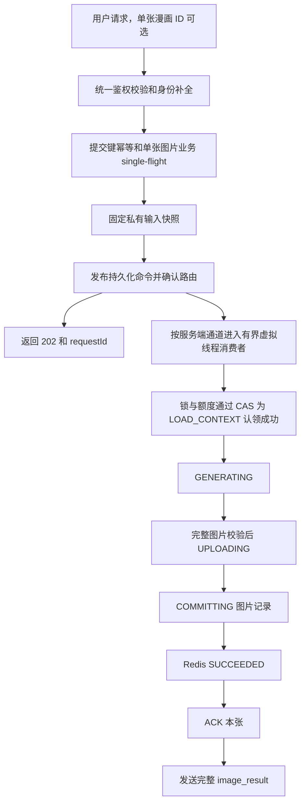

# 普通生图：RabbitMQ 与 Redis 状态机设计概览

修订日期：2026-10-26。状态：**已根据后续明确授权实现即时 MQ、Redis 状态机和串行章节控制；尚未生产部署。** 代码范围、验证证据及未验证场景见 [实施记录](image-generation-implementation.md)。

权威实施与验收方案为 [image-generation-rabbitmq-development-plan.md](image-generation-rabbitmq-development-plan.md)。本文只保留概念说明，本轮采用单一 status、ACK 后完整结果及逐张提交的章节串行编排。

2026-10-26 审核 H1–H4/M1–M7/L1–L10 的具体修订见 [审核修订与实施规格](image-generation-review-revisions.md)，包括资源/安全、恢复接口、图片版本和明确实施参数。用户本轮授权覆盖原等待开发确认的说明。

单张图片入口、图片锁/占用、状态解析、入队与消费竞态的完整细化见 [single-manga-image-request-lifecycle.md](single-manga-image-request-lifecycle.md)。

已独立授权实现的图片直接上传见 [generated-image-direct-upload.md](generated-image-direct-upload.md)。它没有引入 MQ、ACK 或跨进程结果恢复。

## 1. 处理范围

处理普通单图、独立单张漫画首次生成、单图重生成、即时整章缺图生成在应用进程死亡后的命令保留与安全重新消费。预约生图和 Agent 定时任务继续独立，不迁移其任务中心、调度接口或数据库任务表。

三个主要职责：

- RabbitMQ 保存已受理、未完成及等待重试的命令。
- Redis 保存单字段运行状态机、提交 single-flight、执行锁/额度和实时通知。
- MinIO 与现有业务数据库保存输入、图片结果，以及调用/结果去重证据；不增加数据库任务扫描或 Outbox。

用户已确认并发规则：整章生成和所有重生成共用 SERIAL_MODEL 通道，跨章节/跨请求合计最多一个在途模型调用；仅独立单张首次生成走 PARALLEL_MODEL，允许同用户、同配置、同章不同图序并行。两个通道可同时工作，共用模型总额度；独立单张重生成也属于串行通道。

execution_mode/lane 是服务端固定的请求属性，status 仍只有一个字段。漫画业务锁按 `chapterId + imageNumber` 设置，例如 `image:target-lock:{123:7}`；同一张图片跨请求、跨通道共用该锁，同章不同图序使用不同锁。锁键不包含 requestId，也不依赖图片已经有数据库 ID。

整章顺序由编排器保证，整章与所有重生成的模型串行由通道额度 1 保证，不使用覆盖整章的图片执行锁。`advance-lock` 只是根请求的短时推进游标锁；`op-lock` 防止同一消息操作重复执行，均不替代单张目标图片锁。目标锁过期后仍核对持久结果及未决调用，不能直接再次收费生成。

## 2. 单图主流程

只保存一个 status：QUEUED → LOAD_CONTEXT → GENERATING → UPLOADING → COMMITTING → SUCCEEDED，另有 RETRY_WAIT、FAILED、NEEDS_REVIEW、STALE。不再保存 phase 或通用 RUNNING；各执行步骤直接作为 status 枚举值。状态迁移、字段和恢复表见详细方案第 4、5 节。

认领成功明确由 QUEUED → LOAD_CONTEXT 表达：消费者验证消息和状态证据、取得执行锁及额度后 CAS 写状态和 owner/claim_id/claimed_at/租约信息，再发 progress。仅收到消息、仅取得锁或额度不足都不算认领，保持 QUEUED。CAS 失败条件释放自己持有的资源，不调用模型；progress 丢失通过查询恢复。不另设 CLAIMED，也不等待生产者收到认领才继续执行。

Publisher Confirm 是 Broker → 生产者的消息接收确认；业务认领是消费者写 Redis 状态；Consumer ACK 是消费者 → Broker 的投递处理确认。RabbitMQ 不自动把消费者认领回传生产者，API 返回 202 不等待认领，前端通过查询/SSE 观察。认领时不发送成功 ACK，本张结果成功后才 ACK；可靠等待/失败转交按原规则执行。

GENERATING 与 UPLOADING 分开用于观察和恢复，但仍由同一个消费者连续执行。供应商完整响应、取出有效图片字节后直接流上传 MinIO，不创建输出临时 PNG，不拆存储队列。

成功需要图片上传、图片引用/结果证据提交和 Redis 成功状态更新。之后立即 ACK 本张，不要求它发布下一张图片。通知失败通过 GET snapshot 恢复，不回退成功、不重新生图。

SUCCEEDED 是业务结果成功，可能在 ACK 实际送达 Broker 前被 GET 查询到。ACK 没有与数据库、Redis、浏览器共同的事务，不增加 ACKED 业务状态。ACK 丢失重投仍靠成功结果去重。[1][2]

## 3. 提交键、图片目标和消费防重

统一入口先校验登录用户/章节归属、图序、操作与基准、模型配置/尺寸及参考图元数据；无效请求不入队、不占目标、不调用模型。消费端 LOAD_CONTEXT 在实际调用前再次核对变化后的权限、配置和目标。

新请求须明确选择供应商：有效 config_id 或入口支持的临时供应商配置；缺失在参数校验返回“无供应商”，不按 model 名猜默认供应商。供应商参数缺失与“请求已发出、但宕机后调用结果未知”不同，后者才走 SAFE/NEEDS_REVIEW。

单张漫画可传 request_id，兼容 UUID 格式的 Idempotency-Key（同时存在须相等）；均无时按 stableUuid(命名空间, 登录 userId, chapterId, imageNumber, operation, targetBaseVersion) 派生。固定三元组是业务目标，操作类型和提交基准区分后续重生成；重试不刷新基准、参数差异走冲突检查。重生成固定 expected_image_id + expected_image_version，版本来自章节/结果的 image_version 字符串；与状态机 version 不同，删除重建 ID 不同也拒绝旧基准。普通生图/整章提交仍要求 Idempotency-Key。

同用户、同请求身份先按一次提交处理；漫画还必须按 chapterId + imageNumber 做业务 single-flight。已有未完成操作时，相同操作/参数的新 UUID 返回既有 canonical requestId/operationId，不再发布；参数、类型或通道不同返回 409 IMAGE_GENERATION_IN_PROGRESS，不自动排队。leader 准备快照和确认发布，follower 短等受理凭证，不等待约 300 秒模型返回。

同目标不能仅凭新 UUID 或相同提示词就再建任务；不同目标可以独立生成，同身份改变输入返回冲突。前次结束后，用户基于当前图片版本主动重生成才建立新操作。Confirm 超时可能已经入队，客户端复用原身份及基准重试；消费者必须独立校验 operationId、输入摘要、owner、执行 token 和历史结果，不能依靠入口保证消息只有一份。[1][2]

新增 image:target-active:{chapterId:imageNumber} 保存未完成操作映射，由 Lua 原子认领，不设自动过期 TTL；它防止不同 UUID 先后重复收费，执行锁仍负责消费互斥。完成或安全拒绝后条件释放，结果未知时保留。请求凭证固定与 canonical 操作的关联，后续重试不悄悄创建新任务。Redis 丢失时以目标基准版本、持久未决调用及成功结果保守恢复。整章当前图发布也经过此规则，遇到已占用目标保留控制责任等待/复用，不再发布重复生图。

完整入口顺序是 Controller 封装 → 校验/补身份 → 同请求门禁 → 图片短租约内读取已有状态、复核证据并认领目标 → 释放入口短锁 → 固定快照、确认发布 → 初始化 QUEUED 并返回。排队期间由 target-active 保留占用，Worker 以独立 owner 认领执行锁；不让 API 持一把长锁等待整个生图。已有成功返回原结果，处理中返回进度，失败返回原失败，待核实保留占用，不能一律重置排队。

QUEUED 仅在正确路由 Confirm 后或收到合法真实投递时初始化；消费者若已先推进，API 不覆盖较新状态。首次发布前退出的请求未可靠受理，依赖原身份重试；不能把快照或 Redis 占用当成持久发送保证。ACK 后清理前退出留下的终态占用，由下一次提交在图片短锁内核实终态、无未决调用、旧执行租约结束后条件清理。

原始输入摘要与首次解析快照摘要分开。私有快照使用原子条件创建，临时 BYOK 加密保存且只在快照中可恢复，不写入 MQ、Redis 或日志。

## 4. Redis 是状态机，持久证据用于恢复

单图 Hash 保存 status、version、state_epoch、owner、claim_id、claimed_at、lease_expires_at、last_heartbeat_at、execution_token、provider_attempt、候选/结果引用、错误和各阶段时间；execution_token 在后续持久调用许可时分配，初次认领用 owner/claim_id 及版本校验，不假定 token 已存在。未完成状态不自动过期。终态按根请求收尾后建议保留至少 30 天，执行锁单独使用短租约，采用 Redis SET NX PX + owner 校验 Lua，不新增 Redisson。

Lua 校验 owner、token、版本和合法迁移，禁止旧 API 写 QUEUED 覆盖已经开始/成功的消费。请求内 key 使用一致 Cluster hash tag；不同额度作用域分步认领和回滚，不声称跨 slot 原子更新。

请求 hash tag 统一 `{rootId}`，userId 在 tag 外；复合 `{userId:rootId}` 原本也随 rootId 分散，不误写为按用户固定 slot。提交凭证合并 request Hash，独立单图直接使用同一 Hash 保存状态；整章才分子图 Hash。事件改请求级频道。多额度采用 ZSET + TIME/Lua，独立平台线程续租；未决调用仍由持久证据计入容量。

部署建议使用数据卷、AOF everysec、noeviction；它们不能替代调用/结果证据。AOF/副本故障时最新状态仍可能回滚，Redis 消失不表示供应商尚未受理。[7][8]

因此复用现有生成历史的有限字段：稳定 operationId、调用前发送标记、尝试许可、持久 token、候选键/摘要和最终结果。数据库不存 LOAD_CONTEXT 等阶段，也不扫描历史进行派发。Redis 重建时：已成功则恢复成功；候选可核实则继续绑定；可能已发送却无结果则 NEEDS_REVIEW。缺少凭证时不自动判失败或新建收费请求。

## 5. 整章：逐张提交，可靠串行推进

正常顺序：第 a 张生成 → 上传 MinIO → 提交结果/Redis SUCCEEDED → ACK → 返回完整结果 → 释放执行锁 → 发布第 a+1 张。没有预先发布全部单图的批次分发，也不让未来图片反复等待前置依赖。

整章入口生成与界面“重新生成漫画”均保持本节串行规则；选图仍按已有缺图逻辑，不因按钮名称新增全章覆盖模式。独立单张重生成直接入串行工作队列，不需要整章控制消息。

API 确认发布一个 MANGA_ADVANCE 控制消息，manifest 固定整章计划；MangaSerialCoordinator 每次只检查当前图，当前图结束且执行锁已释放才发布下一张。图片消费者独立保存、ACK、返回自己的结果，不承担下一张发布。

为防止“本张已 ACK、下一张未发布”时进程退出而断章，控制责任一直保留在 RabbitMQ：当前图未结束时，确认发布一条延迟 5 秒的控制唤醒后才 ACK 本次控制投递；可推进时只发布下一张，并确认保留后续控制责任后 ACK。最后一张完成则聚合结束。控制消费不等待模型、不占生图额度。

Confirm/ACK 丢失可产生重复控制或图片消息，根请求 owner 锁、稳定 operationId、结果证据和游标校验防止重复有效调用及越序；Redis 游标丢失由 MQ 控制消息、manifest 和业务证据恢复，不能凭旧游标跳图。待核实则可靠隔离控制责任并暂停；输入失效中止后续调用。

消费 ACK 没有 Broker 二次确认。正常等待上一张执行锁在 ACK/结果发送后释放；宕机恢复则核实已完成业务结果后推进，上一张重投复用成功，不等待无法证明的 ACK 接收状态。

新增一条短控制队列和每活跃章节约每 5 秒一次检查，正常无积压时可能增加约 0–5 秒启动等待；重复唤醒收敛与可靠 TTL/DLX 需要故障验证。该机制仅用于即时整章生成，与 Agent 预约任务独立。详情见开发方案第 8 节。

## 6. 执行、重试与故障边界

保留 Java 21 虚拟线程。初期 SimpleMessageListenerContainer 的专用虚拟 TaskExecutor、并行队列 4 个消费者、串行队列 1 个消费者，均 prefetch=1、MANUAL ACK；处理与 basicAck 在同一监听线程完成，再发送完整结果。章节推进容器独立，消费者数 1。不得同时使用 Future 自动完成 ACK 和手工 ACK，也不得 submit 后提前返回。[3]

全局/用户/配置模型额度建议 4/4/4，SERIAL_MODEL 额外跨实例共享额度 1。同用户同模型的独立首次生成可并行，串行队列积压不占并行队列消费者；单实例最多 5 条在途图片投递，模型总在途不超过 4（未知已发送调用仍占持久额度）。owner lease 120 秒、独立线程 30 秒续期；单次模型 600 秒，单投递处理预算 15 分钟，单图首次认领起总预算 60 分钟，ACK 超时 30 分钟。正常 drain 16 分钟、容器宽限 17 分钟，60 秒只用于紧急停机。初值都需真实组件验证。[4]

- 模型明确未受理且契约允许：有限重试，尊重 Retry-After，最多 3 次供应商尝试。
- 上传失败、图片字节仍在：只恢复上传；候选已存在则只恢复绑定。
- 可能已受理但无结果：查询/供应商幂等恢复，否则 NEEDS_REVIEW，不盲目再次收费。串行未决调用通过持久调用证据阻断后续 SERIAL_MODEL 许可，不能只凭 Redis 租约到期认定可并行；独立首次生成在共享额度允许时继续。
- 失败、重试或隔离转交：确认替代命令可靠入队后才 ACK 当前投递。
- Redis/DB/MinIO/MQ 持续故障：停止相应消费、退避恢复，原消息保持未确认或可靠隔离，不高速循环 requeue。

parallel/serial 工作队列及推进队列持久化、quorum、无静默业务 TTL，满时 reject-publish；重试保留原通道路由，采用固定 TTL 档位并验证可靠死信转发，Broker 数据卷和副本布局需要真实验收。[1][5][6]

长期占用保留无 TTL，2h 仅触发核实提示；入口最多 3s 核对，外部查询走独立 IMAGE_RECOVER 队列。恢复详情/按钮、人工管理清单、安全继续/终结及显式替代均有接口；默认禁止未确认旧供应商结束的强制放弃。未决对象保留，终态且无引用后按保留期人工清理。

## 7. 前端与实施审核

POST 提交与 GET 状态/SSE 分离；单张漫画返回 canonical request_id 后前端保存并原样复用，不必每次新建 UUID。只暴露 status。POST 快速返回 202；本张 ACK 调用后，通过另行建立的 GET SSE 发送完整 image_result，包含请求/操作 ID、图序、status、图片记录、地址、类型、大小、模型、完成时间等安全信息。GET snapshot 使用同一结果 DTO。

ACK 与浏览器接收没有原子事务；ACK 后断线或进程退出时通过 GET/重连快照恢复，不要求浏览器回执、不重新生图。事件按 state_epoch/version 丢弃旧版本；单图成功不能直接显示整章完成。

实施按“组件兼容性 → Redis 状态/有限结果证据及图片版本 → 独立单图双通道 → 整章编排 → 前端切换 → 故障验收”分阶段。整章可二期，但旧整章写入口须暂停或统一许可；所有重生成始终串行。详细方案含 47 项验证场景、各阶段回退点及 Result 数值码/字符串错误码映射。

服务器规格/扩容按用户意见移出本轮审核，不作为开发前置。开发 compose 与拟新增生产模板分开、凭证环境注入且启动校验、MQ 端口仅回环/内部；本轮不改实际部署。现有普通生图/整章生图/重生成接口可保留 URL 并适配 MQ，“旧写入口”指其原直接执行生成的路径，不指数据库写入。

本轮只修订设计文档。用户审核并明确授权后，才增加 AMQP 依赖、Java/前端实现、迁移或运行配置。

## 8. 官方依据

1. RabbitMQ ACK / Confirms：<https://www.rabbitmq.com/docs/confirms>
2. RabbitMQ Reliability：<https://www.rabbitmq.com/docs/reliability>
3. Spring AMQP 3.1 Threading / Container Attributes：<https://docs.spring.io/spring-amqp/reference/3.1/amqp/receiving-messages/threading.html>、<https://docs.spring.io/spring-amqp/reference/3.1/amqp/containerAttributes.html>
4. RabbitMQ Consumers：<https://www.rabbitmq.com/docs/consumers>
5. RabbitMQ Quorum：<https://www.rabbitmq.com/docs/quorum-queues>
6. RabbitMQ TTL：<https://www.rabbitmq.com/docs/ttl>
7. Redis Persistence：<https://redis.io/docs/latest/operate/oss_and_stack/management/persistence/>
8. Redis Replication：<https://redis.io/docs/latest/operate/oss_and_stack/management/replication/>
