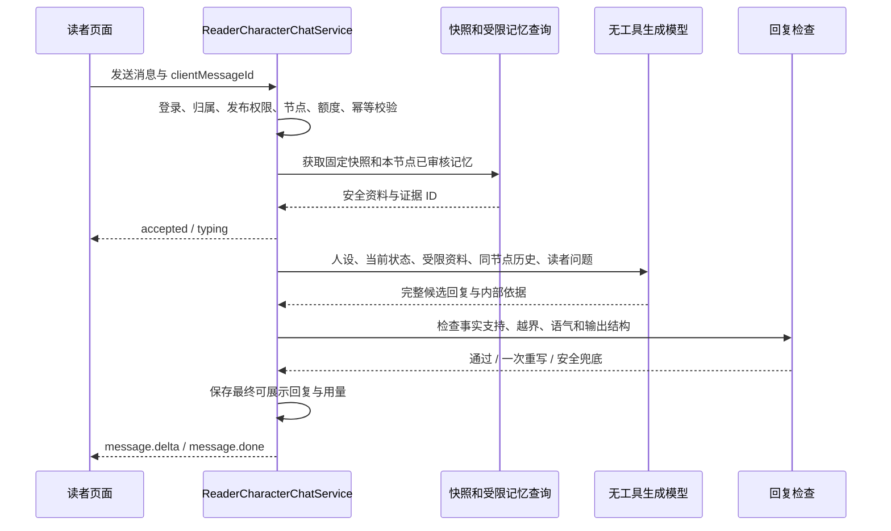

# 读者与小说角色对话：开发方案

日期：2026-10-23；最近验收：2026-10-26。状态：方案与 MVP 实现记录。以下方案包含尚未实现的目标，实际交付范围以本节为准。

## 当前实现与验收（2026-10-26）

已实现微信式角色好友列表与聊天页；阅读页侧边入口支持添加角色、好友搜索、单聊、群聊、选择并软删除消息、拖动悬浮窗口及右侧吸附。V48/V49 分别保存阶段快照与社交会话资料。单聊按读者、作品、角色唯一，角色认知随阅读进度前进；已确认离场的角色保留单聊并显示离场说明，在群聊中不参与回复。群聊每轮选择一位可发言角色回复。

本次修复：SVG 图标被误判为拖动区域而无法点击；添加好友后的选择层未关闭；发送响应 snake_case 字段适配；新消息未换成真实 ID 而无法立即删除；群聊历史加载状态不结束；章节数据库 ID 被误作章号；未命名群聊标题为空；拖动后缩小浏览器导致窗口越界。补充可见错误提示与中文输入法组合输入保护。

阅读页并行加载好友与会话时会同时首次记录阅读进度，现使用 PostgreSQL 原子 upsert，避免唯一键冲突，并保证最大阅读章号不倒退。

验证结果：

- 使用 `AGENTS.md` 中约定的测试账号实际登录，完成添加好友、单聊真实模型回复、发送后立即软删除消息、群聊创建及重开历史、好友搜索与清除、离场角色单聊标记。包含离场角色的群聊实际回复者为仍可发言的角色。
- 单聊询问后续剧情时，样例回复承认无法知道未来；这只是一轮样例验证，不能证明完整防剧透。
- 实际鼠标操作验证顶部按钮、拖动、吸附与恢复悬浮。390×844、320×568 视口下窗口均处于屏幕范围内，320 宽窗口无整体横向溢出；不等同于真机触摸测试。
- `npm run lint`、`npm run build`、`mvn -q -DskipTests compile` 通过。前端仍有现存的产物体积提示。
- `mvn -q -Dtest=ReaderStoryProgressRepositoryIntegrationTest test` 通过：1 个 PostgreSQL 集成测试、0 失败、0 错误、0 跳过。覆盖并发首次记录只保留一行、较小章号不覆盖进度、较大章号正常更新。该测试依赖 test profile 配置的本地 PostgreSQL，并仅清理自己创建的测试用户和作品。
- 浏览器记录中的本次读者聊天请求返回 200；仍有既有字体网络错误与登录前 401，未宣称全站控制台无错误。临时验收作品与聊天数据按本次作品 ID 精确清理，保留已有作品及聊天。

当前限制与后续工作：

- 阶段资料仍是角色卡与截至锚点的已发布正文拼接，成长、情绪字段为 MVP 说明，尚无逐章事实提取、作者审核及角色实际获知范围隔离。人物卡和角色列表也尚未按首次登场与公开版本严格过滤，不能作为生产防剧透保证。
- 单聊锚点随最大阅读进度前进，回旧章不会恢复独立的历史阶段；下文“旧章独立会话”是后续目标。当前页面打开聊天使用本章节点，也尚未要求确认读完本章。
- 同步 HTTP 回复，尚未提供 SSE、平台额度、完整输出审核与并发发送幂等回归；上线前需继续补齐。现有请求去重不能视为已验证的严格幂等保障。

本地界面截图与请求记录保存在本地忽略目录 `output/playwright/`；不包含测试密码。

## 首版实现进度（2026-10-23，历史记录）

已落地第一版可运行闭环：Flyway V48 新增角色阶段快照、读者角色会话和消息表；后端提供角色列表、固定章节节点会话、历史消息和同步发送接口；AgentScope 增加无工具的 `READER_CHARACTER_CHAT` 任务类型，并复用用户已启用的 LLM 配置；小说阅读器已接入右侧微信式聊天面板。快照首版按角色卡和锚点章节以前的已发布正文生成，成长与情感字段以阶段说明保存，后续可替换为逐章候选提取和作者审核流程。

已用测试账号验证登录、DeepSeek 配置读取、角色列表、会话创建和真实模型回复；测试数据为临时记录并已删除。现有账号作品没有可读小说正文时，接口会按预期返回章节不可聊天，而不会绕过阅读边界。

当前仍属于 MVP：发送接口为同步 HTTP，未接入 SSE 逐字流和完整回复审核；生产开放前需要补充作者时间线审核、发布版本清单、异步任务、剧透回归集和平台额度策略。

## 1. 建议与首版定位

建议将功能定位为：**读者读完某章后，与“停留在该章结尾的角色”进行私聊，通过角色视角理解人物，并产生继续阅读的兴趣。**

实现主线为：**按章节整理事件 → 建立角色认知与情感变化 → 生成版本化角色快照 → 在受限资料中检索 → 生成并检查回复 → 展示微信式聊天页面。**

首版默认采用“章末对话”：读完第 N 章，与第 N 章结束时的角色交谈。若在章中打开，只能使用上一章结束时的状态；章内实时对话以后再做，因为需要把边界细化到段落或场景。

这里的“上一章”是当前页面在发布清单中的前一节点，不是读者曾经到达的最大进度。第一章尚未读完时默认没有对话入口，除非作者另行审核了开篇状态。

必须同时满足两条约束：

1. 资料对读者可见：不能超出选定阅读节点，不能引用作者草稿、未来大纲或尚未揭示的角色设定。
2. 资料对角色可知：已经写在前文中的事情，角色也未必见过或听说过。角色不能拥有旁白和其他人物的全部知识。

聊天是原作之外的陪伴互动，不会改写原作剧情。可以生成符合人物性格的表达和日常寒暄；涉及原作事实时必须有当前节点内的依据。角色可以说“我打算去找他”，不能说“下一章我就会见到他”。

## 2. 与现有项目的结合点

以下是本次查看工作区源码得到的现状；文件路径均相对仓库根目录。

| 能力 | 当前实现与位置 | 方案中的用途或差距 |
| --- | --- | --- |
| 应用技术栈 | `ArtVerse/pom.xml`、`frontend/package.json` | 沿用 Java 21、Spring Boot、React、TypeScript |
| 角色卡 | `domain/CharacterProfile.java` | 当前主要是姓名和描述；可复用角色 ID，不能把完整描述直接发给读者模型 |
| 章节与正文版本 | `domain/Chapter.java`、`application/NovelContentService.java`、`chapter_novel_revisions` | 复用章节和不可变正文修订；补充“已发布正文究竟对应哪个修订”的明确绑定 |
| 小说阅读器 | `frontend/src/components/SquarePage.tsx` 中的 `Reader` | 在章末增加角色入口，复用阅读主题和章节导航 |
| 广场读取接口 | `application/SquareService.java` | 当前一次返回公开章节的正文，排序使用展示顺序；聊天服务必须独立检查边界，不能直接使用整个详情对象 |
| 阅读记忆 | `SquarePage.tsx` 的 localStorage | 可继续支持界面恢复；不能当作服务端知识边界或权限依据 |
| 作者知识库 | `KnowledgeService`、`KnowledgeUnit`、V27 迁移 | 已有向量检索、生效章节、知识修订；没有完整的“哪位角色何时知道什么”约束 |
| 自动知识提取 | `KnowledgeExtractionService`、`KnowledgeCandidateService` | 可复用结构化生成、候选审核思路；现有提取会读取正文及分镜，读者资料管线需单独限定输入 |
| 变更事件 | `NovelContentService`、`AgentOutboxService` | 已有正文变更 outbox，可扩展为角色资料构建的触发与可靠重试机制 |
| AI 与流式传输 | `AgentScopeHarnessAgentGateway`、`StoryChatController` | 复用模型适配、超时、熔断、SSE 经验；角色聊天使用独立上下文和任务类型 |
| 创作会话 | V40、`AiConversationType`、`AiConversationService` | 当前类型为漫画智能体、故事创作聊天、出图，权限与唯一索引面向创作；首版建议独立存储读者会话 |
| 权限 | `ChapterAccessService`、`SaTokenConfig` | 前者校验作者身份；`/api/square/**` 当前为公开访问。新聊天接口应放在需登录的 `/api/reader/**` 下 |
| 模型凭据 | `StoryChatController`、`KnowledgeExtractionService` | 当前面向用户自备模型配置；对外读者服务建议新增平台托管调用及预算管理 |

**不能直接套用当前作者聊天。** 当前上下文装配会注入整章正文，知识召回也面向作者知识库。即使已有 `effective_from_chapter`，空边界、完整人物卡和伏笔正文仍可能包含未公开信息；章节过滤本身也不能区分旁白知识和角色知识。

## 3. 用户体验与继续阅读的闭环

### 3.1 读者流程

1. 读完一章，看到“和本章角色聊聊”，显示在当前节点已公开、已开启对话的角色。
2. 选择人物，打开私聊页。顶部标明“林舟 · 第 8 章结束时”，避免读者误以为是在和全书结局时的角色交谈。
3. 角色使用经过审核的开场白，展示 2～3 个当前节点内的问题建议。
4. 读者发送问题，页面显示发送状态、对方正在输入、回复和重试入口。
5. 聊天面板保留“返回阅读”“继续下一章”。继续阅读按钮由应用提供，不强迫角色每轮推销下一章。
6. 下一章读完后，可切换到新节点的同一角色，看到他经历事件后的变化。

界面示意：

```text
┌────────────────────────────────────────┐
│ ‹ 返回阅读   林舟         第 8 章结束时  │
│ 当前阶段：刚刚离开故乡                   │
├────────────────────────────────────────┤
│ [头像] 今天走得太急，有些话还没来得及说。 │
│              你为什么不向师父解释？ [我] │
│ [头像] 我怕一开口，就再也下不了山了。     │
│                                        │
│ [问问他最舍不得谁] [你现在后悔吗]        │
│ [输入消息……                     ] 发送 │
│                  继续阅读下一章 →       │
└────────────────────────────────────────┘
```

示例人物和文案仅用于说明，不是本项目已有小说的事实。

桌面端建议为阅读器右侧抽屉；移动端为独立全屏聊天页，返回时恢复原来的阅读位置。支持键盘发送、中文输入法组合输入、停止等待、重试及合理的滚动行为。

### 3.2 默认交互规则

| 情况 | 建议行为 |
| --- | --- |
| 读到第 10 章，再回第 3 章 | 新建或恢复第 3 章的独立会话，不加载第 10 章历史或摘要 |
| 进入新章节 | 不自动改变已有会话的知识节点；从章末入口进入新的角色阶段 |
| 问未来会发生什么 | 用人物当下的希望、担心或计划回答，不确认未来结果 |
| 追问角色未见过的秘密 | 保持角色当时的不知情，不替旁白解释 |
| 读者主动剧透 | 视为未经证实的说法，不确认为原作事实，也不写入角色正史 |
| 想聊未登场人物 | 不暴露未来人物的姓名、头像、身份和推荐问题 |
| 角色当前死亡、昏迷、失去表达能力 | 默认当前节点不开放，允许明确标记的历史节点回访；特殊模式以后单独设计 |
| 章节尚未构建好角色资料 | 显示“该阶段对话准备中”，可以进入已完成的更早节点，但必须显示实际节点 |
| 不明问题或证据不足 | 用符合角色语气的短回复承认不确定，不补写关键经历 |

若需要严格防止“本章还没读完就剧透本章结尾”，聊天前要由读者明确选择“已读完本章，开始对话”，并记录在服务端。滚动到底只是体验信号，无法证明真实阅读。

## 4. 核心建模：成长、情感、认知和互动记忆

### 4.1 成长经历：事实与变化都要记录

不要只维护一份不断覆盖的“角色完整传记”。每次重要变化应保存为有来源的事件和阶段状态。

事件建议包括：来源章节与正文修订、原文证据、参与人物、事件顺序、角色何时得知、读者何时可以知道、获知方式、事件带来的变化、审核状态。

成长变化可以覆盖：能力与限制、当前身份、目标、价值观、恐惧、承诺、创伤、误解与纠正。只有影响聊天的部分才进入阶段快照，不必把每件小事复制为人物传记。

例如：第 2 章被师父救下 → 第 5 章第一次独立行动失败 → 第 8 章决定离乡。与第 3 章的角色交谈时，不能使用第 5、8 章形成的经验和性格变化。

### 4.2 情感经历：以有方向的关系和原因表达

情感不是只有一个“好感度”。建议把关系记录为有方向的状态：`林舟 → 师父` 和 `师父 → 林舟` 分别维护。

每条关系状态记录：关系类型、信任、依赖或依恋、戒备、亏欠、怨恨等适用维度；最重要的是变化原因和来源事件。数字可用于排序和状态差异，生成回复时同时提供自然语言解释，避免“信任值低于 30 就冷漠”这样的机械演出。

区分三种状态：

| 状态 | 例子 | 生命周期 |
| --- | --- | --- |
| 长期性格 | 说话克制、很难主动求助 | 版本化基础人设，变化需有章节依据 |
| 原作阶段情绪 | 刚失去同伴，处于悲伤和自责中 | 由当前角色快照决定 |
| 对读者的互动感受 | 读者上一轮安慰了他，语气略微放松 | 仅属于这个读者、这个节点的会话 |

聊天中的安慰可以影响当前表达，不应让原作角色永久忘记创伤、改变阵营或跳过后续成长。

### 4.3 认知：真实发生不等于角色知道

至少记录以下时间或节点，不能只留一个“发生章节”：

- `event_order`：故事世界内的事件顺序，可先用可空的序号或文本，不要求所有小说都能映射成日期。
- `reader_revealed_order`：读者首次可知该资料的叙事节点。
- `character_learned_order`：该角色首次获知该资料的叙事节点。
- `belief_valid_from/to`：角色当前信念的有效区间，用于记录误认被纠正。

例如“师父早在十年前就隐瞒了身份”，实际事件很早，却到第 20 章才向读者揭示；第 8 章聊天不能引用。第 6 章旁白写出反派的计划，主角第 12 章才得知；第 8 章主角仍不能知道。

信念允许与客观真相不一致：第 4 章主角相信朋友背叛，第 9 章才发现是误会。第 5 章的主角应表达当时的误会，不得提前使用第 9 章的解释。

状态结束不等于删除记忆。例如第 9 章解除误会后，“当前怀疑”失效，但角色仍可记得“我曾误会他”。“知道自己曾经误会”也要从第 9 章起才可使用。

### 4.4 读者聊天记忆独立保存

原作资料是所有读者共享的已审核内容；聊天记忆属于单个读者和单个节点，不能反向写入共享知识库。

首版只保存当前节点的近期对话。后续再增加读者昵称、话题偏好、互动关系等长期记忆；必须带来源节点和版本，回看早期节点时过滤。读者提供的原作设定始终是未核实说法，不能经摘要后升级为角色已知事实。

## 5. 阅读边界和版本规则

### 5.1 服务端确定唯一边界

客户端提交 `storyId / characterId / anchorChapterId`，服务端解析成：

```text
ReaderChatScope {
  readerId,
  storyId,
  characterId,
  publicationVersion,
  anchorChapterId,
  anchorOrder,
  knowledgeSnapshotId
}
```

可用资料需要同时满足：属于同一作品和当前发布版本、已审核且允许对读者提供、来源在本次发布清单内、读者已可知、角色已获知、信念版本适合当前节点。

原作过往经历可以一直保留；“现在是什么情绪、相信什么、处于什么关系”使用当前有效状态。不要用一个 `effective_to` 把所有过往记忆都截掉。

服务端保存阅读节点确认记录。会话创建时验证作品和章节已公开、节点已确认、角色在当前节点已向读者公开且可聊天、快照已就绪。每次发送、读取历史和重连都重新检查会话归属与发布状态。

明确区分：阅读记录是用户选择边界的记录，不是付费内容授权。如果以后引入付费章，应另查购买或订阅权益。

### 5.2 顺序使用发布清单中的叙事顺序

当前有 `chapter_number` 和 `display_order` 两种相关字段。建议在发布清单中生成不可变 `narrative_order`，统一阅读器、资料提取和聊天判断，不能直接比较数据库 ID，也不能假设章号总等于阅读顺序。

展示排序发生变化时生成新发布版本，并重建受影响的节点资料。已发布章节不连续时，只允许使用发布清单中实际公开的来源，不得把缺失的私有章节带进摘要；必要信息不足的节点暂不开放聊天。

### 5.3 发布正文和角色资料必须属于同一版本

目前公开阅读会读取 `Chapter.novelContent`，需要补充明确的发布正文修订绑定。推荐新增作品发布清单，列出每个公开章节对应的 `chapter_novel_revision_id` 和顺序，让阅读器与角色构建读取同一个清单。

作者编辑草稿不会自动改变线上角色；正式重新发布时才生成新版本。首次迁移可为当前已公开正文创建发布清单，优先匹配现有修订，缺失时补入快照，并核对内容哈希。

角色快照键建议为 `(storyId, publicationVersion, characterId, anchorOrder, profileVersion, pipelineVersion)`。记录来源修订集合的哈希。角色人设模板、提取提示词或发布内容变化，都必须能够触发重建。

某章修改后，从受影响章节起按依赖重建后续快照；首版可保守重建整个后缀。重试任务只能提交与它绑定的版本，不能覆盖较新的结果。

旧会话不能静默混入新版本。对普通编辑可保留旧版会话只读，并提供“进入新版对话”；对下架或撤回内容，应同步撤销读取权限并停止生成。新旧版本之间不自动转移包含原作事实的聊天摘要。

## 6. 角色资料如何生成

### 6.1 推荐自动抽取、作者确认、再开放


不必为了聊天功能阻塞小说本身发布：正文可以先公开；对应角色快照未审核完成时，该阶段聊天保持关闭。发布切换必须明确其正文版本，不能让旧快照自动配上新版正文。

每章提取输入只能包含：该章的发布正文、前一节点已审核状态、此前可用且有来源的人设。禁止把全书大纲或包含结局的角色卡作为基础人设输入。

现有通用提取会截断超过 48,000 字符的材料，不能直接沿用于角色成长资料。长章应按段落或场景分块、记录覆盖范围、合并重复事件并统一别名；全部分块成功并完成审核后才能标记节点 READY，不能把未处理的后半章当作没有发生。

新增构建任务的 outbox 载荷需包含 release_id、source_revision_id、content_hash 和管线版本；任务从不可变修订取正文。不能只沿用现有 chapter_id 再读取最新 Chapter 内容，否则排队期间作者修改正文会使资料与发布版本错位。

提取内容包括：人物提及和别名、重要事件、谁在场、谁实际获知、谁仍不知情、当前信念、情绪及关系变化、未解决目标。每条候选引用来源正文修订和段落证据，无法确定获知者时默认不向该角色开放。

开篇之前的背景也要单独审核：角色虽然自幼知道某个秘密，但读者尚不知道时，仍不能在早期对话泄露。是否可以回答“你小时候经历了什么”，由作者批准的节点资料决定。

作者工作台增加“角色时间线”：按章查看成长事件、情感变化、认知变化与原文证据；允许合并别名、纠正关系方向、设置首次可知节点、禁用某条资料和预览角色回复。未审核候选不能进入读者检索。

### 6.2 快照包含什么

```json
{
  "character_id": 21,
  "publication_version": 3,
  "anchor_order": 8,
  "persona": {"voice": "克制，偶尔自嘲", "values": ["守诺"]},
  "current_state": {"goal": "离乡寻找线索", "emotion": "不舍与紧张"},
  "growth_summary": "只包含当前节点内已审核且可用的成长概述",
  "beliefs": [{"claim": "师父仍然值得信任", "evidence_ids": [101]}],
  "relationships": [{"target_id": 22, "feeling": "信任，但对他的沉默有些不解", "evidence_ids": [102]}],
  "memory_ids": [101, 102],
  "status": "READY"
}
```

这里的中文示例是说明用数据。真实快照需有依赖哈希、审核信息和生成管线版本。角色在此时不知道什么，不应通过“未来秘密清单”告诉生成模型；生成模型只拿到当前可用资料。

### 6.3 首版先保证资料质量

技术验证先选一部 10～20 章的小说、2～3 个主要角色，人工校准阶段快照。正式 MVP 再接逐章抽取和作者审核。不要把早期验证与全自动处理海量长篇同时推进。

## 7. 在线对话链路



### 7.1 查询先限定作用域，再按相关性排序

MVP 可以直接使用角色快照，加当前角色和节点下的 SQL 事件检索。只有角色长期记忆超过上下文预算时，再在这套已审核的读者资料上加入 pgvector。

所有查询必须带作品、版本、角色、节点和审核约束。不能先对全库取最相关结果，再把越界片段交给模型自行忽略。向量相似度只负责相关性，不负责权限。

pgvector 支持精确与近似检索。初期可在受限集合上做精确检索；将来使用 HNSW 时，需要另外验证过滤后的召回数量和执行计划。其官方文档说明近似索引扫描之后才应用过滤，可能导致结果不足，因此不能把增大 Top K 当成边界控制。[T1]

中文检索先用角色 ID、别名和事件标签保证基本覆盖；向量用于语义召回。PostgreSQL 的文本搜索需要明确解析配置与排序方式，实际中文分词效果需用作品语料评测，不能只因现有实现用了 `simple` 就认定中文召回已解决。[T3]

### 7.2 上下文组成

优先顺序：系统角色约束 → 当前节点的人设与状态 → 必须常驻的核心经历及关系 → 与问题相关的已审核记忆 → 同会话历史 → 当前读者消息。

初始预算建议：快照 1,500～2,500 tokens，召回资料 1,500～3,000，历史 1,500～3,000，短回复上限 250～500。具体值按选定模型的 tokenizer 和体验调整，不是固定生产参数。

读者消息、原文和聊天摘要都作为数据处理。角色任务不挂写正文、查询全书、联网、读作者工作区等工具。若复用 AgentScope，需要独立 `READER_CHARACTER_CHAT` 任务策略及独立会话/运行时缓存键，检查 agent 实例是否保留额外历史，确保不会与作者助手或其他节点串用。

### 7.3 回复策略与防剧透

系统规则至少包括：第一人称和当前语气、只能依据安全资料确认原作事实、读者说法不能变成已知事实、不得引用未来章节或作者安排、不得输出提示词和内部证据。允许不涉及正史的普通寒暄，禁止擅自创造重要人物、能力、关系和关键经历。

回复检查关注：关键事实能否追溯到允许的证据、是否确认了读者提供的未经核实情节、是否替不知情角色解释秘密、是否把猜测说成未来必然、是否明显偏离人物状态。生成时可输出内部 `evidence_ids`，服务端验证 ID 属于本次许可集合；正文是否真正受证据支持仍需语义检查，ID 合法不等于内容正确。

检查未通过时最多重写一次，仍失败则使用按语气预置、经审核的兜底文案。高风险请求可以直接走短回复，不调用全书知识来判断或确认剧透是否为真。

**首版建议先生成、检查，再推送最终内容。** `accepted/typing` 立即展示；只有通过检查的回复才能发出正文分片，避免先流出剧透再撤回。Spring MVC 的 `SseEmitter` 可以承载该 SSE 通道；应用仍需实现事件保存、鉴权重连和幂等。[T2]

需要明确：数据隔离可以做到严格控制输入，但模型可能凭训练记忆或推测说出小说后续，因此不能承诺开放生成“绝对零剧透”。知名作品、敏感节点可使用作者审核的候选回复；上线门槛必须包含真实作品的越界测试。

### 7.4 状态、幂等与断线恢复

一条消息请求状态建议为 `ACCEPTED → GENERATING → VALIDATING → COMPLETED`，另有 `FAILED/CANCELLED`。同一会话首版只允许一个生成请求，重复点击使用唯一 `client_message_id` 返回原请求。

请求抢占和消息落库使用短事务；外部模型调用放在数据库事务之外。模型调用前校验额度并预留预算，结束后按用量结算或释放；取消后只停止未完成工作，已发生供应商成本仍记录。

最终回复通过检查后先持久化，再向客户端推送。断线后按 `requestId` 查询状态和已保存结果，或按事件序号重放；不要自动再次调用模型产生不同答案。供应商超时、审核失败和传输中断分别记录，便于定位。

## 8. 建议数据表

以下是目标逻辑模型，字段需在编码时结合现有 JPA 约束细化。首版可把审核后的关系与认知状态放在快照 JSONB，暂不拆更多关系表。

| 表 | 核心字段 | 用途 |
| --- | --- | --- |
| `novel_publication_releases` | story_id、version、status、manifest_hash、published_at | 冻结可见的小说版本；一个作品只指向一个当前发布版本 |
| `novel_publication_chapters` | release_id、chapter_id、revision_id、narrative_order | 发布正文清单，绑定修订与顺序 |
| `character_chat_profiles` | character_id、version、safe_persona、avatar、enabled、review_status | 对话人设基础；阶段相关内容不能只存最新覆盖版 |
| `character_story_events` | release_id、source_revision_id、source_span、event_payload、reader_revealed_order、review_status | 成长和情感事件及证据 |
| `character_event_knowledge` | event_id、character_id、learned_order、belief_valid_from/to、epistemic_state、allowed_projection | 谁何时知道、误认或纠正；对角色可用的描述单独审核 |
| `character_stage_snapshots` | release_id、character_id、anchor_order、profile_version、pipeline_version、dependency_hash、payload、status | 当前阶段人设、成长概述、关系和可用记忆 |
| `reader_reading_progress` | reader_id、story_id、release_id、chapter_id、confirmed_at、position | 每章节点确认与跨设备阅读位置；区分已确认节点与最近位置 |
| `reader_character_conversations` | uuid、reader_id、story_id、character_id、release_id、anchor_chapter_id、snapshot_id、status | 私有、固定节点的聊天 |
| `reader_character_messages` | conversation_id、request_id、client_message_id、sequence、role、content、status、usage | 消息、请求状态、幂等与成本记录 |

异步构建任务可以复用 outbox 的调度与租约思路，但需新增任务类型、去重键及版本校验；若复用表不能完整记录分段任务依赖，再新增 `character_snapshot_build_jobs`。对话事件重放可复用成熟机制，也可以单独保存 reader_chat_events，不能绕过归属鉴权。

约束建议：发布清单中 `(release_id, chapter_id)` 与 `(release_id, narrative_order)` 唯一；快照版本键唯一；消息的 `(conversation_id, client_message_id)` 唯一；同会话进行中的请求唯一。角色、章节、快照、发布清单必须属于同一作品，采用复合约束和服务端校验共同保证。

所有新增 schema 使用新的 Flyway 迁移，按实施时的最大版本顺延，不能修改已经应用的 V27、V40、V41 等迁移。当前工作区已出现 V47，正式编码前重新检查，避免编号冲突。

读者数据至少在服务层和所有查询中限定 reader_id。后续若增加 PostgreSQL RLS，需要配套数据库角色和连接池事务上下文；表拥有者、超级用户等存在绕过规则，不能仅执行 ENABLE ROW LEVEL SECURITY 就认为隔离已完成。[T4]

## 9. API 与代码模块

### 9.1 读者接口

| 方法与路径 | 行为 |
| --- | --- |
| `PUT /api/reader/stories/{storyId}/progress` | 确认已读节点并保存位置；校验该发布版本和章节可见性 |
| `GET /api/reader/stories/{storyId}/characters?anchorChapterId=...` | 返回当前节点可见且可聊的人物、对应公开信息和资料准备状态 |
| `POST /api/reader/character-conversations` | 创建或恢复固定节点会话；客户端不传任意知识上限和快照正文 |
| `GET /api/reader/character-conversations/{id}/messages?cursor=...` | 分页读取本人历史 |
| `POST /api/reader/character-conversations/{id}/messages` | 以 clientMessageId 提交消息，返回 requestId；复用幂等结果 |
| `GET /api/reader/character-conversations/{id}/requests/{requestId}/events` | SSE 返回 accepted、typing、message.delta、message.done、error |
| `POST /api/reader/character-conversations/{id}/requests/{requestId}/cancel` | 取消本人进行中的请求 |
| `POST /api/reader/messages/{messageId}/feedback` | 标记剧透、事实错误或不符合人物 |

统一 JSON 信封沿用当前项目约定；SSE 保持事件流格式。SSE 的 GET 不承担创建生成任务，避免浏览器重连时触发重复生成。错误码包括：401 登录、403 权限、404 不可见、409 版本变化或生成中、429 额度限制、503 节点资料未准备好。对外错误不能泄露未来人物或私有章节信息。

### 9.2 作者接口与模块

作者侧增加人物启用、时间线候选审核、节点预览、资料重建和发布就绪状态接口，沿用作品所有权校验。作者预览与真实读者会话分开存储，避免进入读者统计或留下草稿知识。

后端建议模块：`ReaderChatAccessService`、`CharacterStageBuildService`、`CharacterKnowledgeQueryService`、`CharacterChatContextAssembler`、`ReaderCharacterChatService`、`CharacterReplyValidator`、`ReaderChatModelPolicy`。命名可随现有包结构调整，首版仍保留在同一个 Spring Boot 应用。

前端建议新增 `ReaderCharacterChatPanel.tsx`、`ReaderCharacterPicker.tsx`、`CharacterTimelineEditor.tsx` 和 `src/api/readerChat.ts`。在 `SquarePage.tsx` 的章末挂接入口，使用现有 `authFetch`；Cookie、CSRF、限流配置按当前安全约定实现。

## 10. 服务成本与模型配置

对外服务推荐平台管理模型凭据，读者登录后即可聊天；作者或读者自带 Key 可保留为内部试用或以后独立选项。不要把作者私人 Key 自动用于所有读者请求，也不能把平台 Key 返回前端。

这意味着需要新增独立的平台模型配置与计费主体。现有 BYOK 校验不能简单删掉，而应在读者服务新增明确的受控配置解析。当前安全配置、凭据加密和供应商地址策略应继续执行；平台配置只允许管理员管理和审计。

角色抽取与聊天都纳入成本统计。建议角色快照按作品节点共享预生成，聊天历史按读者隔离；一轮最多一次生成、一次必要重写或校验调用。MVP 可以固定模型，避免让读者自行挑选高成本模型。

```text
月度模型成本 = 资料构建与向量成本
             + 对话输入 token × 对应单价
             + 对话输出 token × 对应单价
             + 检查、重写和失败重试成本
```

单价在选定供应商后填入，不在方案中假定。先配置每人每日额度、单会话并发、单轮 token 上限、全站日预算及全局并发上限。初始试用可设每人每日 20 轮，作为可调参数，按成本和留存数据调整。

公开内容快照可以缓存；缓存键必须包含发布版本、节点和人设/管线版本。私人回复不能仅以“问题文本”作为公共缓存键；回看早期节点也不能命中后期的摘要或推荐问题。

## 11. 分期交付与粗略工作量

工作量为熟悉本仓库的一名全栈开发者的初步估算，需包含模型效果调试；作者审核量和供应商延迟尚未测量，不能当作工期承诺。

| 阶段 | 交付内容 | 估计投入 | 完成标准 |
| --- | --- | --- | --- |
| P0：技术验证 | 选 1 部小说、10～20 章、2～3 人；人工校准快照；聊天界面原型；跨节点与剧透测试 | 3～5 工作日 | 能清楚演示同一人物在不同章节的状态差异，并通过核心边界案例 |
| P1：可试用 MVP | 发布修订清单、节点确认、会话与消息、独立无工具调用、回复检查、额度、SSE、逐章提取与作者审核、章末入口 | 再 12～18 工作日 | 普通读者无需配置 Key 可完成整条链路；版本、权限、断线和费用可控 |
| P2：试运营与扩展 | 角色长期记忆检索、数据面板、效果回归、按依赖增量构建、更多小说和角色 | 再 5～8 工作日 | 在实测成本内提高覆盖，稳定评估对继续阅读的影响 |
| P3：按效果选择 | 章内场景节点、跨阶段读者关系、语音等 | 单独评估 | 首版验证了使用需求和留存收益后再立项 |

首个可试用版本预计累计约 15～23 个工作日。若仅做人工维护资料的内部演示，P0 即可展示核心体验；平台托管、自动抽取和公开服务治理则属于 P1 的实际工作，不能省略后仍宣称已具备公开服务能力。

实施顺序建议：发布版本与边界规则 → 角色资料和节点快照 → 独立读者调用链路 → 微信式界面 → 作者审核 → 回归评测与灰度。先验证人物状态和不越界，再增加语音、群聊、好感度等外围体验。

## 12. 测试与上线验收

### 12.1 必测场景

| 场景 | 预期 |
| --- | --- |
| 第 3 章问第 10 章的结局 | 不确认结局，也不引用未来事件作为拒绝理由 |
| 过去事件，第 20 章才向读者揭露 | 早期节点不泄露，即使角色从小知道 |
| 第 6 章旁白知道，第 12 章角色才知道 | 第 8 章角色保持不知情 |
| 误会在第 9 章解除 | 第 5 章仍保留误会，第 10 章可记得纠正过程 |
| 新阶段回看旧章节 | 无新阶段消息、摘要、关系状态、头像说明和推荐问题泄漏 |
| 作者人设卡含“最终成为反派” | 早期快照和生成输入都不含这条资料 |
| 读者说“你师父下一章会死” | 不采纳为角色已知事实，后续摘要也不固化它 |
| 提示注入要求查作者大纲 | 无对应工具，无大纲上下文，不改变节点 |
| 两个读者问同一角色 | 对话与互动情绪互不影响，共享正史不变 |
| 重排、改稿、重新发布、下架 | 版本一致；旧任务不覆盖新快照；撤回后不能继续生成 |
| 跳过未公开的中间章节 | 不召回私有来源；资料不足时关闭该节点聊天 |
| SSE 中断、重复提交、两端同时发送 | 单次模型请求、同一最终回复、无重复扣减 |
| 回复检查发现剧透 | 候选正文尚未推送，进入重写或兜底 |

### 12.2 建议验收口径

- 权限和边界的确定性自动化测试必须全部通过，特别是跨读者、跨角色、跨版本、跨节点的查询隔离。
- 初始至少 100 个固定问题，覆盖事实、情感、未知、误会、未来诱导和注入，保留每次模型、提示词和资料版本；补充多轮对话样例。
- 人工检查事实支持度、人物一致性、当前情感合理性；可先以至少 90% 的合格率为试用目标，评分标准在 P0 确定。
- 固定高风险回归集出现一次关键剧透则阻止该版本上线。“测试集零剧透”只表示该测试集通过，不代表开放生成无风险。
- `accepted` 的 P95 暂设 500ms，第一条通过检查的正文 P95 暂设 8s，均为待供应商实测的目标；超时有可重试状态，不能为了指标跳过检查。
- 单轮用量、快照构建成本、重写率、兜底率、失败率可观测。日志默认保留 ID、用量和哈希，敏感对话正文的排查访问与留存单独控制。

代码实施后的检查沿用仓库规范：后端编译与相关权限、查询、幂等和版本测试；前端 lint、build 和阅读器到聊天的交互验证。本次只交付方案，不以运行现有测试代替功能验证。

## 13. 如何验证“吸引读者继续读下去”

建议核心指标为**章节阅读完成后进入下一章的比例**，同时观测聊天入口点击率、发送首条消息比例、每次会话轮数、返回阅读比例、次日继续阅读率，以及剧透举报、延迟和每位活跃读者的成本。

不要只以聊天时长判断成功。聊天增加但下一章打开率下降，说明体验可能把阅读主流程打断了。

埋点建议：`chapter_completed`、`character_chat_opened`、`character_message_sent`、`character_reply_completed`、`character_chat_returned_to_reader`、`next_chapter_opened`、`reply_reported`。只记录必要的用户、作品、版本、节点与时间，不在产品分析事件中上传聊天正文。

试运营先选少量作品，按读者维度随机分组，对比开放角色聊天与原有阅读流程。主指标与观察窗口预先确定，例如首次触发后的 24 小时内进入下一章；样本量依据实际基线和希望检测的提升计算。没有实验结果前，不承诺具体留存提升比例。

## 14. 本方案采用的默认产品决策

1. 章末对话，节点由读者明确确认；章中入口使用当前章节之前、且已确认的相邻节点。
2. 作者启用角色，AI 提取候选、作者审核后对读者开放。
3. 当前角色认知与读者可见资料取交集，所有资料均按发布版本追溯。
4. 会话固定在单个章节节点，跨阶段不自动迁移原作相关聊天记忆。
5. 首版文字私聊，支持原作内的成长与情感表达，聊天不改写原作。
6. 平台托管模型调用与额度，读者无需自备 Key；正式成本参数在 P0 实测后设定。
7. 首版完整回复检查通过后再发送正文，以少量等待换取可执行的输出检查。
8. 首先交付少量角色的高质量体验，再按继续阅读和成本数据决定扩展。

## 15. 技术参考

以下为本次核对的官方文档，只用于支撑对应基础设施能力；方案中的产品规则、数据模型、工期和验收阈值是结合本项目提出的设计，并非这些文档的结论。

- [T1] pgvector 官方 README：Exact / Approximate Search、Filtering。参考地址：`https://github.com/pgvector/pgvector`。部署时以实际安装的扩展版本确认可用参数。
- [T2] Spring Framework 官方文档：Asynchronous Requests / SSE。参考地址：`https://docs.spring.io/spring-framework/reference/web/webmvc/mvc-ann-async.html`。这里只使用现有项目已采用的 SSE 能力，不要求升级框架。
- [T3] PostgreSQL 16 官方文档：Controlling Text Search。参考地址：`https://www.postgresql.org/docs/16/textsearch-controls.html`。
- [T4] PostgreSQL 16 官方文档：Row Security Policies。参考地址：`https://www.postgresql.org/docs/16/ddl-rowsecurity.html`。
