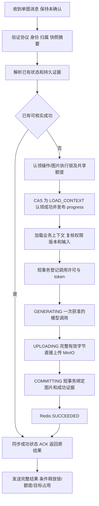

# 单张漫画请求完整处理方案

修订日期：2026-10-26。本文细化单张图片的请求封装、校验、幂等、图片锁、状态机与故障恢复。**用户已明确授权并完成本轮代码接入，尚未生产部署。** 实际完成状态和故障验证边界见 [实施记录](image-generation-implementation.md)。总体组件和规格见 [image-generation-rabbitmq-development-plan.md](image-generation-rabbitmq-development-plan.md)。

H1–H4、M1–M7、L1–L10 的逐项处理与明确参数见 [审核修订与实施规格](image-generation-review-revisions.md)。本文保留设计与验收要求，运行验证不作超出实施记录的承诺。

## 1. 执行边界与约束

一个逻辑操作只处理 `chapterId + imageNumber` 指定的一张图片。操作包含加载上下文、获准的模型尝试、上传 MinIO、保存结果、更新 Redis、ACK、发送结果；每次尝试只调用一次供应商，不叠加底层隐式重试。重投和批准的重试仍属于原 operationId，不能变成新的收费请求。

流程采用用户提出的顺序：Controller 封装 → 参数校验/身份补全 → 同请求幂等门禁 → 图片级认领 → 读取已有状态及证据 → 决定复用或安排入队 → 消费状态机。

保留此前已确认的并发约束：整章生成和所有重生成共用 SERIAL_MODEL，跨请求合计最多一个模型调用；独立单张首次生成走 PARALLEL_MODEL，可在总额度内并行。同目标图片两通道互斥，同章不同图序不共用图片锁。

可靠受理边界是路由正确且 Publisher Confirm 成功，或已有可核实的业务完成结果。收到 HTTP 请求、写入 Redis、保存输入快照均不等同于消息已可靠入队。无 Outbox/发送扫描器时，首次发布前退出的未受理请求依赖客户端原身份重试恢复，不能承诺自动完成。

## 2. 单张图片涉及的身份与锁

| 概念 | 身份/内容 | 目的与生命周期 |
| --- | --- | --- |
| 提交身份 | 登录 userId + requestId，绑定 submission_hash | 同一次 HTTP 提交去重；终态后继续保留，重复 POST 不重新执行 |
| 目标身份 | chapterId + imageNumber | 确定正在操作哪张漫画图片，不包含 requestId |
| 图片短租约 | image:target-lock:{chapterId:imageNumber}，值含 owner/用途 | 入口短时检查认领；消费者独立取得后保护执行，分别续期及条件释放 |
| 未完成占用 | image:target-active:{chapterId:imageNumber} | 保存 canonical requestId/operationId、输入摘要、类型、基准；覆盖提交、排队、重试、执行、待核实，不自动过期 |
| 操作执行租约 | 原 operationId 对应 op-lock | 同一操作重复投递互斥，不代替跨操作的图片锁 |
| 通道/共享额度 | SERIAL_MODEL 与全局/用户/配置模型额度 | 限制模型调用，不代替目标幂等或状态检查 |

根域键使用 userId 在 tag 外、`{rootId}` 在 tag 内；独立单图合并提交凭证与唯一状态 Hash，不双写 request/op；整章才分子图 Hash。事件频道按请求隔离。全局/串行/用户/配置额度是 ZSET owner 租约，独立平台线程每 30s 续期；不能由阻塞监听线程承担续租，也不能将过期回收当成供应商已结束。算法见审核修订第 3、6.1 节。

图片锁明确采用现有 StringRedisTemplate 实现的 Redis owner 租约锁：SET NX PX 获取、Lua 比较 owner 后续期/释放，不要求可重入，不新增 Redisson 依赖。RLock 是 Redisson 的分布式可重入锁，Java ReentrantLock 仅在单 JVM 生效；本方案不使用本地锁替代跨实例互斥。租约锁不能替代持久调用证据与目标版本检查。

入口与 Worker 使用不同 owner。入口图片短租约建议 60 秒、20 秒续期；只包围状态核对及认领，不跨网络等待 Broker/模型，不传递线程持有关系。Worker 图片租约建议 120 秒、30 秒续期。租约到期仅代表所有权失效；未完成占用及持久调用证据仍需核实。

入口短锁释放后，target-active 继续阻止别的请求创建第二个操作，Worker 才能独立取得执行锁。不能用一把 API 长租约跨越任意排队时间，否则进程退出后无法可靠决定是否可以再次生图。

## 3. Controller 封装与参数校验

Controller 只把路径、请求体和登录上下文封装为规范请求，不启动线程生图。身份至少包括：requestId、operationId、userId、chapterId、imageNumber、operation、目标基准、模型参数、execution_lane、traceId；校验后不可任意修改。

校验分为两次：

1. 入口：检查登录态/章节权限、路径体一致、合法图序、生成/重生成类型、提示词或分镜、明确的供应商选择（有效 config_id 或入口支持的临时配置）、模型配置/尺寸、参考图元数据、目标基准、请求 ID 格式。缺供应商返回 400 / PROVIDER_REQUIRED / “无供应商，请选择生图供应商”；不靠 model 名猜默认供应商。失败不创建图片占用、不发布 MQ、不调用模型。
2. LOAD_CONTEXT：真正执行前重新检查权限、图片版本、配置指纹/解密、输入摘要和参考图可用性，并核对既有调用证据。输入变化返回 STALE/明确错误，不自动改模型、改基准或覆盖新图。

userId 仅取登录态。已有 requestId 先按当前用户核对原提交；重复已受理操作使用原快照，不重新解析今天的默认模型。单张漫画缺 ID 时稳定派生：

```text
businessKey = 登录 userId + chapterId + imageNumber
requestId = stableUuid(命名空间, businessKey, operation, targetBaseVersion)
```

首次生成以 expected_absent 为基准；重生成必须提交前端看到的 expected_image_id + expected_image_version，targetBaseVersion 为 ID:version，防止删除重建后数字版本复用。图片版本来自章节 GET/list 或生成结果的 image_version 十进制字符串，与 Redis 的 version 不同；缺字段先刷新，不默认 0。request_id 与 UUID 格式 Idempotency-Key 可二选一，同时传须相等。非法 ID 不作为“缺失”处理。内部 MQ 缺失身份则隔离，不能补一个新随机 ID 后执行。

## 4. 同请求幂等门禁与图片认领

### 4.1 同请求门禁

按用户和提交身份读取凭证，比较规范化原始输入的 submission_hash：

- 相同身份、相同输入：进入原操作的状态解析，返回原结果/进度；不再次执行入队动作。
- 相同身份、不同输入或目标：409 IDEMPOTENCY_CONFLICT。
- 新身份：用短提交 owner lease 防止同身份并发创建，取得入口图片短租约，再核对目标。
- 原提交 PUBLISHING/UNKNOWN：短等原受理结果，超时返回 503 与原 canonical ID；只有获准接管原提交才可恢复原命令发布。

幂等门禁不能简单记录 `processed=true`。处理过可能是已受理、正在生成、成功或失败，必须返回真实状态。相同身份不会因为终态记录过期/被用户隐藏就自动成为新收费请求。

### 4.2 图片认领

取得图片短租约后，再读一次请求状态、target-active 和必要持久证据，避免进入锁前读取的状态已经过期：

| 情况 | 决策 |
| --- | --- |
| 目标空闲、无本操作已发送/已成功证据、基准有效 | 原子创建 target-active，绑定 canonical 操作；只有此 leader 可安排初次发布 |
| 已有未完成操作，类型、输入摘要、基准及通道一致 | 关联原 canonical 操作，返回它的进度/结果，不新增消息或模型调用 |
| 已有操作，类型/参数/基准/通道不同 | 承认这是新的业务意图，但目标忙时拒绝此次执行，409 IMAGE_GENERATION_IN_PROGRESS；不把它错误合并为原请求，也不自动排在原请求后面 |
| target-active 指向已结束操作，但进程退出前未清理 | 在入口图片短锁内核实业务终态、无未决调用、旧执行租约已结束；按原 operationId/占用版本 CAS 清理残留，再判断新提交的基准。保留旧请求凭证，不把残留当成永久处理中 |
| 图片锁由 Worker 持有且 target-active 可核实 | 不等模型，读取上述占用并返回已有状态或冲突 |
| 图片锁忙且占用、状态、证据互相矛盾 | 503 STATUS_UNAVAILABLE，保留既有责任，不删别人锁、不猜测为成功或新任务 |
| 首次生成目标已有图片 | 返回已有结果/冲突；主动替换须走重生成 |
| 目标版本已改变 | STALE / TARGET_CONFLICT，不套用当前版本重新提交 |

target-active 的比较和认领在目标 key 内原子完成。请求凭证、状态、图片 key 可能跨 Redis Cluster slot，不能用一段 Lua 假定全局原子；以稳定 canonical 身份、条件写和恢复核对衔接。入口图片短锁在认领结束后释放；后续快照和发布由提交 lease 及 target-active 约束。

target-active 增加 active_version、created_at/updated_at/last_heartbeat_at；2h 未活跃只提示核实。入口清理总预算 3s，Redis/DB 失败都 503，不把不可读当无未决；不在锁内下载 MinIO 候选或查询供应商。已有明确终态立即按 canonical + active_version 清残留，不必等 2h；发布前放弃先持久登记未调用终结凭证以拒绝迟到消息。完整决策见审核修订第 4.1 节。

## 5. 状态判定：先读取，再决定能否入队

下表是提交或重投时的决策，不把所有“非成功”都解释为可以从头生成：

| 已有 status/证据 | HTTP 重复提交 | MQ 重投 |
| --- | --- | --- |
| 无状态且无执行证据 | 满足认领条件才执行初次入队动作 | 只有合法消息及快照才可初始化 QUEUED，核对调用证据后认领 |
| QUEUED | 已确认受理则 202 + 原 ID；发布未确定则返回提交未确定，不反复发布 | 取得当前 owner/目标锁、通过证据核对后 CAS 到 LOAD_CONTEXT |
| LOAD_CONTEXT / GENERATING | 202 + 原进度，无新的模型调用 | 有有效 owner 则不能抢占；owner 失效后检查发送证据，不能直接从头调用 |
| UPLOADING | 202 + 原进度 | 核对候选对象；可恢复则继续上传/提交，否则查询供应商或 NEEDS_REVIEW |
| COMMITTING | 202 + 原进度 | 核对候选、token 和目标版本，恢复绑定 |
| RETRY_WAIT | 202 + retry_at | 仅批准的 attempt、达到 not_before 后可执行；旧消息补可靠转交或延迟，不能增加尝试次数 |
| SUCCEEDED | 200 + 完整原结果 | 核对持久成功后 ACK 当前投递，返回原结果，不调用模型 |
| FAILED | 200 + 原失败结果，不隐式重启 | 补齐必要的可靠隔离后 ACK |
| STALE | 返回目标冲突及原状态 | 补齐隔离后 ACK，不覆盖较新图片 |
| NEEDS_REVIEW | 返回待核实状态；新收费提交被目标占用阻断 | 补齐可靠隔离后 ACK，不盲目重调 |
| 缺失/损坏/未知状态且有执行痕迹 | 先按持久证据重建；不足则 STATUS_UNAVAILABLE/NEEDS_REVIEW | 保留投递或可靠隔离，绝不默认 QUEUED |

HTTP 查询返回状态与结果本身；POST 的 200/202/409/503 按受理/冲突区分。FAILED 是原操作的业务结论，不等于本次查询服务发生 HTTP 500。

## 6. QUEUED 与 RabbitMQ 的入队边界

单图第一个执行状态仍为 QUEUED，不增加 status+phase。PUBLISHING/ACCEPTED/PUBLISH_UNKNOWN 是提交传输凭证，不是执行阶段。

初次入队按以下顺序：

1. 已通过校验、同请求幂等和图片认领；持有 canonical 提交身份，target-active 已保留。
2. 条件创建原输入快照，固定 manifest_key/hash、operationId、attempt=1 以及通道路由；登记本次 publish_attempt_id 和 PUBLISHING。
3. 发布持久化 IMAGE_EXECUTE，使用 mandatory、return 处理及 Publisher Confirm。等待期间不持有入口图片短锁；提交 lease 仍续期。
4. 正确路由且 Confirm 成功：条件写 ACCEPTED；状态不存在时才初始化 QUEUED。已有 LOAD_CONTEXT 等较新状态时直接读取，禁止覆盖。
5. 返回 202、canonical requestId、当前状态及查询/SSE 地址，提交 lease 条件释放；target-active 仍保留。

消费可能先于 API 收到 Confirm：消费者凭真实合法投递可 CAS 初始化 QUEUED，再取得执行资格转 LOAD_CONTEXT。API 的迟到回写必须幂等，不能让它把生成中/成功覆盖回排队。执行开始时间与 Broker Confirm 回调顺序不互相假设。

Confirm 后 Redis 写入失败：本次 API 可凭确切确认返回 202，标记状态暂不可用；由合法投递和持久证据修复状态。不能把 Redis 写失败解释成 Broker 拒收并释放目标。

未路由/明确拒收且所有发布尝试均能证明未受理：返回 503，按身份条件安全解除占用。存在任何确认未知的旧尝试时，后一次明确失败不足以证明之前没入队，仍保留 canonical 责任。确认超时返回 503 PUBLISH_OUTCOME_UNKNOWN；原身份重试可恢复发布相同命令，消费端独立去重。

QUEUED 不能仅由 API 预写 Redis 推断，队列长度、排队时间和 RabbitMQ redelivered 标志也不能证明某次模型是否已调用。纯状态查询不自动发布新命令；提交重试/章节控制恢复是明确的发布入口。

## 7. 消费者与单图执行状态机



消费者在同一监听虚拟线程处理本张并手工 ACK；不再提交另一个后台任务后提前返回。两个工作容器独立，prefetch=1；没有执行资格时可靠转延迟后 ACK，不无限原地阻塞或高速 requeue。

### 7.1 三个确认边界

| 边界 | 谁向谁确认 | 状态与含义 |
| --- | --- | --- |
| 发布确认 Publisher Confirm | Broker → 生产者/API | 路由正确且 Confirm 成功，才可依据它初始化 QUEUED；不表示消费者已认领 |
| 业务认领 | 消费者 → Redis 状态机，并发布 progress | 成功取得执行资格并 CAS 到 LOAD_CONTEXT；这是应用层状态迁移，不是 RabbitMQ ACK |
| 消费完成确认 Consumer ACK | 消费者 → Broker | 本张成功结果提交且 Redis 成功同步后 ACK；失败/等待的可靠转交另按既定规则处理 |

RabbitMQ 不把消费者认领或 ACK 自动回传给生产者。API 返回 202 不等待消费者认领；API/前端通过 Redis 查询或 SSE progress 得知认领。保持一个 status 字段，不新增 CLAIMED、RECEIVED、ACKED，owner 等是执行元数据，不是第二套 phase。

### 7.2 消费者成功认领的精确定义

1. 收到消息、验证协议/身份/快照及当前 canonical 目标，解析已有状态与调用证据；仅“收到投递”不代表认领成功。
2. 已成功则复用结果；其他需要恢复/隔离的情况按第 5 节处理。正常排队操作取得 operation owner 锁、图片执行锁及通道/共享额度；任何一项不足仍为 QUEUED，不写 LOAD_CONTEXT、不发认领事件。
3. 重新核对 canonical 操作、允许的源状态和版本；以 owner + claim_id + expected_version 做 CAS，将 QUEUED 改为 LOAD_CONTEXT，写入此次认领元数据。只有 CAS 成功的消费者才可继续加载业务上下文。
4. 状态写成功后发布 progress(status=LOAD_CONTEXT)。Redis 状态为事实来源，progress 丢失由 GET/snapshot 恢复；通知失败不撤销认领、不重调模型。
5. 保持当前投递未确认，复核权限、基准、配置及输入，随后登记持久调用许可/token，进入 GENERATING。不得在认领成功时发送“完成 ACK”后把余下执行丢给内存线程。

| 认领元数据 | 规则 |
| --- | --- |
| owner / claim_id | owner 标识本执行者；claim_id 是本次消费认领的随机代次，接管或批准重试重新生成，不复用旧 owner |
| claimed_at / lease_expires_at / last_heartbeat_at | 分别记录本次认领、最近租约到期及续期时间；不把历史认领时间当成当前仍活跃的证据 |
| started_at / status_started_at / version | started_at 仅首次认领写入；每次合法迁移更新 status_started_at，递增 version |
| execution_token | 由后续调用许可短事务分配的持久代次；不能在首次认领时假定已存在，更不能直接用 claim_id 替代 |

操作状态与操作锁在同 slot 内 CAS；图片锁/各类额度分作用域认领，失败条件回滚自己持有的资源，禁止声称跨 slot 一次原子成功。CAS 后、调用前还需校验租约和持久调用许可；旧认领者失去所有权不能继续推进状态或提交结果。

正常首次认领从 QUEUED 进入 LOAD_CONTEXT；批准的重试从已到期 RETRY_WAIT 经许可进入 LOAD_CONTEXT，也记录新 claim_id，但不增加无必要的供应商尝试。恢复已有候选可直接继续 COMMITTING，不为了制造“认领事件”把已有状态先回退 QUEUED/LOAD_CONTEXT。

### 7.3 认领中断和重投

| 中断/竞态 | 处置 |
| --- | --- |
| 收到消息但锁/额度不足 | 保持 QUEUED，可靠延迟转交；此处 ACK 仅表示责任已转交，不是认领/生图成功 |
| 取得锁/额度但 LOAD_CONTEXT CAS 失败 | 不加载后续业务、不调用模型；条件释放自己的资源，重读最新状态决策，不能释放其他 owner 的锁 |
| CAS 成功但认领 progress 丢失 | Redis 保持 LOAD_CONTEXT，查询或重连获取；不因前端没收到事件重新生成 |
| LOAD_CONTEXT 后退出，持久调用标记尚未提交 | 租约失效后重新核对确实未发送，允许安全接管；本张消息仍由 MQ 保留 |
| 调用标记已提交后退出 | 不能根据 Redis 仍是 LOAD_CONTEXT 就认定未调用，按持久未决证据查询/隔离 |
| 消费者先认领，生产者后收到 Confirm | 生产者只补受理凭证，不把 LOAD_CONTEXT/更后状态覆盖成 QUEUED |
| 同一消息重投但当前 owner 仍有效 | 不抢占、不提前完成 ACK；保留可靠责任或按规范延迟，禁止第二次模型调用 |

### 7.4 外部结果未知的核实与解除

此处“结果未知”发生于供应商参数已校验、已经尝试发送模型请求之后；供应商身份本身已知。例如进程等待响应时宕机，重启后无法判断该笔生图是否完成。缺少供应商属于第 3 节的调用前参数错误，不进入 NEEDS_REVIEW；有效 config_id 已足以明确供应商，无需重传凭据。

NEEDS_REVIEW 不保持 Worker 的执行租约或线程无限等待，而是保留结果未知的业务标记与目标占用。先检查业务成功和 MinIO 候选；仅在供应商适配器显式支持且已验证时，使用 provider_request_id 查询/取消或供应商幂等恢复。当前 Image2Client 仅提供生成接口，没有实现任务查询、取消或供应商幂等恢复，不能把自动核实写成已有能力。

自动核实仅对有能力的适配器启用；独立 IMAGE_RECOVER 消费者，单 probe 10s、单投递 30s、最多 3 次且总计 180s，超预算/无能力则维持 NEEDS_REVIEW 并显示人工入口，不新建 Agent 定时任务，不无限轮询。核实消息禁止调用生成接口。

可以核实成功则恢复原结果；明确未受理或已结束且没有可恢复结果，确认旧执行者已退出后解除占用。GET/needs_review 返回 recovery_actions、recovery_version、依据和串行阻断范围；前端提供重新核实、申请人工核实、安全继续/终结按钮。恢复 mutation 校验 action_id、版本、归属和许可，管理决定使用 ADMIN 权限与可审核证据；不是只保留“等人工”的文字。

“放弃旧结果并重新生成”有独立 abandon-and-regenerate 接口，要求新 request_id、当前图片基准和重复收费风险确认；默认 allow-unsafe-abandon=false，仅旧调用核实结束后安全替代。未知调用不能靠时间到期自动放弃；若需要无证据强制放行，须另审供应商严格串行和收费保证。未决候选/快照不自动删，终态后至少 30d 且无当前引用才人工核对清理。完整 HTTP/前端/清理规格见审核修订第 4 节。

### 7.5 调用、上传与结果提交

调用许可检查包括本 operationId 的尝试、该目标基准的既有成功/未决调用，以及 SERIAL_MODEL 的共享未决调用。登记和核对使用短事务互斥，避免 Redis 丢失后不同 operationId 各自取得收费许可；外部 IO 不包进数据库长事务。

时间口径：单次投递处理 15m，单图首次认领起总预算 60m（含后续重试等待、跨重投不重置），模型一次 600s，下一次调用前预留后处理 180s。额度等待按 30/120/600s 退避，defer_count 与 provider_attempt 分离。剩余总预算不足时不新发调用；已有未决须核实，不凭超时宣告确定失败。

供应商完整响应并提取有效图片字节后才进入 UPLOADING，记录候选键/摘要并上传原字节流，不落本地输出 PNG，不拆存储 Worker。候选按 operationId/token 隔离。最终绑定再次核对目标版本和 token，成功提交后才清理旧对象；清理失败不重新生图。

图片 version 新增 BIGINT NOT NULL DEFAULT 0 / @Version，所有共享图片写入口升级后才开放新重生成。最终比较固定图片 ID/version；OptimisticLockingFailureException 按 TARGET_CONFLICT/STALE 处理，不重新调用模型，候选保留待清理。

成功顺序固定：业务结果提交 → Redis SUCCEEDED → 本张 ACK → 发送完整 image_result → 条件释放锁/额度/target-active。成功结果包含原请求关联、图序、状态、图片地址/记录、类型、大小、模型、完成时间。通知短预算，浏览器断开不阻塞执行或改变成功。

若某次处理中 owner 过期，旧执行者不得提交较新版本。新执行者也不能仅凭拿到锁就重调模型；先依据候选、业务记录、供应商查询/幂等能力确定恢复点。结果未知则 NEEDS_REVIEW，保留目标占用，串行通道按既定规则暂停。

## 8. 故障与并发处理矩阵

| 故障/竞态 | 处置及约束 |
| --- | --- |
| A/B/C 同目标、不同 UUID、同参数 | 同一 canonical 操作；B/C 不各自排队收费 |
| 同 ID 不同参数；同目标新参数 | 分别 IDEMPOTENCY_CONFLICT / IMAGE_GENERATION_IN_PROGRESS，不静默替换 |
| 入口认领后、快照或首次发布前宕机 | 未受理；保留可核对占用，原身份重试接管提交并恢复同一命令；无后台发送保证 |
| 发布成功但 Confirm/HTTP 响应丢失 | 发布结果未知；原身份、原快照、原基准恢复；不新建操作 |
| 消费先于 API QUEUED 写入 | 消费初始化/推进，API create-if-absent/合法 CAS，不回退 |
| Redis QUEUED 很久没变化 | 排队久不等于模型超时；只查询/核实，不靠定时再次调用模型 |
| Redis 清空、状态缺失，但消息重投 | 查持久成功/未决调用/候选，保守重建；输入快照不是“未调用”证据 |
| 两消费者收到相同/别名操作 | 操作锁、目标锁、短事务调用证据共同裁决，重复消息无新调用许可 |
| 已登记发送但尚未真正发请求时退出 | 也存在不确定窗口；供应商可查询/幂等则恢复，否则待核实 |
| 供应商超时/连接关闭/5xx | 默认无法证明未受理，SAFE 核实；只有明确获准的有限重试才入 RETRY_WAIT |
| 返回图片后上传短暂失败 | 同一字节缓冲有界上传重试，不重调模型 |
| 图片只在内存时进程死 | 无候选且供应商不能恢复则待核实；MQ 无法找回已丢内存字节 |
| MinIO 成功但上传响应丢失/DB 失败 | 按候选归属、token、摘要核对，恢复 COMMITTING |
| DB 已成功但 Redis 未同步/ACK 丢失 | 同步原成功后 ACK 重投，不再次模型生成或绑定 |
| ACK 后 SSE 失败或进程退出 | GET/重连 snapshot 返回同一结果，不 nack、不重做 |
| 成功 ACK 后、target-active 清理前退出 | 后续提交在入口短锁内核实终态和旧租约，CAS 清理原占用；不能永久阻挡合法下一次重生成 |
| Redis/DB/MQ 持续不可用 | 暂停相应新调用，保留未确认/可靠转交责任，不降级为 JVM 内存任务 |
| 重试或隔离发布失败 | 不 ACK 原投递；已写状态不等于已完成可靠转交 |
| 入口租约失效后旧发布迟到 | 不覆盖当前 canonical 占用；消费核实提交资格/基准，失效消息不恢复成新的收费操作 |
| 旧 API/Worker finally 迟到 | 比较 owner 和 canonical operationId 后释放，不能删新请求的锁/占用 |
| 用户生成期间编辑/替换/删除目标 | 按基准和版本返回 STALE；保留新图和必要去重证据 |
| 成功历史或图片被用户删除后重投 | 返回曾成功但已删除的事实，不再次收费补图 |

## 9. 整章衔接、接口与验收

整章只是逐张调用本单图协议。当前图未结束，不发布下一张；当前图被外部单图占用时控制消息等待/复用，不另发一份。该张 ACK 不依赖发布下一张，可靠章节控制消息覆盖两张之间的宕机窗口。

API 新提交的 202 表示可靠受理；重复处理中返回 canonical ID 和进度；已成功返回完整结果。SSE 先 snapshot 后状态/结果，ACK 后发送最终 image_result；已结束 POST 不能再次返回，断线由 GET 恢复。身份和参数校验、锁、幂等均不增加前端必须跟踪的阶段字段。

实施至少验证：同/不同 UUID 目标防重、缺省 ID 稳定派生、请求与目标内容冲突、认领后发布前退出、Confirm/HTTP 丢失、消费者抢先推进、状态不回退、重复消费者、锁/状态丢失、外部未知、候选/DB/Redis 提交窗口、ACK/SSE 窗口，以及串行/并行通道共享额度和目标互斥。对应总体计划 T01–T47，新增审核覆盖键空间、恢复界面/接口、版本 ABA、额度续租、时间预算、drain、错误码和容量；本文不宣称这些新测试已经执行。

**本轮只细化开发设计，待审核后实施。**

## 10. 协议依据

- RabbitMQ 的 Publisher Confirm 与消费者 ACK 相互独立；重复投递需应用幂等，ACK 使用原 Channel 的 deliveryTag。见官方 [Consumer Acknowledgements and Publisher Confirms](https://www.rabbitmq.com/docs/confirms)。
- Redis 租约需要 owner 条件释放/续期，过期后不能依赖旧锁所有权。见官方 [Distributed Locks](https://redis.io/docs/latest/develop/use/patterns/distributed-locks/)。
