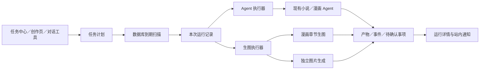
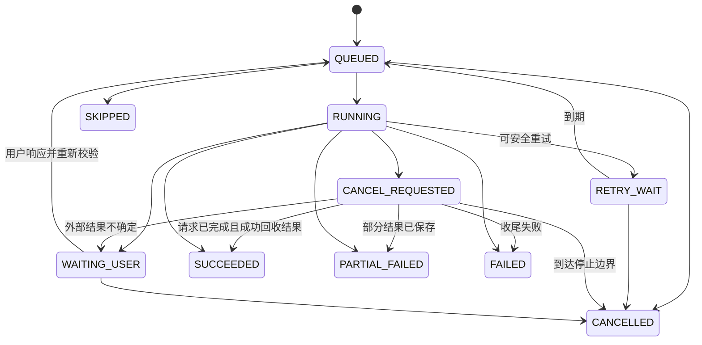

# ArtVerse 定时任务中心：设计与开发方案

> 日期：2026-10-25。状态：核心能力已实施；实际实现、验证证据及未覆盖场景见 [实施记录](task-center-implementation.md)。本文保留设计依据与目标验收标准，不代表每一项均已通过实测。
> 已确认的方向：参考 Codex 的任务体验，使用 ArtVerse 现有 Agent；不接入 Codex CLI／SDK。

## 1. 产品定位与核心决策

将“预约生图”提升为统一的**定时任务中心**，支持两类任务：

| 用户看到的类型 | 执行内容 | 例子 |
| --- | --- | --- |
| Agent 任务 | 到点唤醒现有小说／漫画 Agent，按说明执行创作、检查或整理 | 每周一 09:00 检查第三章分镜的角色一致性 |
| 生图任务 | 到点直接调用生图业务服务，执行已明确的图片请求 | 明天 00:00 生成第三章缺失图片；每天生成一张指定主题插画 |

两类任务共用计划、触发、运行记录、通知和管理页面；执行器分别实现。生图任务不必先调用 LLM 来决定是否生图。Agent 任务也不能因此获得直接调用供应商、绕过业务授权的能力。

最关键的模型调整是：**一个计划对应多次运行，每次运行再对应业务执行记录。**



这是一项新产品能力和渐进式重构。仅给现有 `requested_at` 增加周期字段，会混淆下一次触发、当次重试和历史结果，不宜作为长期模型。

## 2. 参考依据与适配边界

### 2.1 可以直接采用的交互

用户提供的截图可以确认这些元素：任务入口、任务列表、新建任务、说明输入框、重复规则、时间及时区、高级配置、创建与取消。

本项目采用同样的信息层级，并补充两类任务所需的业务字段。先写“做什么”，再选“什么时候做”，高级选项默认收起。

本次曾通过官方文档搜索及直接请求尝试核对 `developers.openai.com/codex/app/automations/`；页面返回 403，另一官方入口连接超时。因此，本文不声称复刻 Codex 当前所有能力，也不推断它内部使用的数据库、调度算法、补跑策略和服务架构。以下持久化、状态机、并发和迁移规则均为 ArtVerse 的设计建议。

### 2.2 本项目需要明确的差异

- 服务端到点执行，浏览器关闭后仍可运行；部署服务必须在线。
- 任务绑定 ArtVerse 的用户、作品、章节或图片会话；不引入代码仓库、worktree、Shell 执行权限。
- Agent 沿用现有创作边界；覆盖分镜、提交小说原文等操作沿用既有确认流程。
- 生图涉及外部付费请求，必须保留逐图幂等、防重复派发和结果不确定状态。
- “开始时间”表示最早进入执行流程的时间，不承诺在该时刻完成；排队、供应商耗时会影响完成时间。

## 3. 当前实现核查

以下结论来自当前工作区源码；旧文档里的测试记录不等于本次重新执行的结果。

| 已有能力 | 当前入口或实现 | 对新方案的意义 |
| --- | --- | --- |
| 单章节一次性预约 | `application/ScheduledMangaGenerationService.java#create` | 保留权限、分镜校验、模型配置解析和输入快照 |
| 多章节预约 | 同类 `createBatch`；每请求最多 3 章 | 当前生成多条章节任务，尚无持久化父计划 |
| 任务持久化 | `domain/ScheduledMangaGeneration.java`、V47 | 可作为生图执行子任务，不适合作为重复计划本体 |
| 到期扫描 | `ScheduledMangaGenerationService#poll`，默认 5 秒 | 数据库调度可继续使用，无需立即引入 MQ |
| 多实例防重 | Repository 原子认领、租约、fencing token | 应沿用并在新运行层建立明确的归属关系 |
| 逐格处理 | 分格状态、成功结果保留、失败重试、`UNCERTAIN` | 新任务中心应展示这些业务状态 |
| 进度读取 | 章节任务 GET／SSE，SSE 读取数据库快照 | 可接入统一运行详情 |
| 对话创建 | `agent/mcp/ArtVerseMcpServerConfiguration.java` 中 `schedule_manga_generation` | 当前只创建一次性漫画生图，不支持通用 Agent 计划 |
| 漫画 Agent | `MangaAgentService`、`MangaWorkflowOrchestrator` | 可复用业务执行，但需补后台入口 |
| 小说 Agent | `StoryChatAgentService` | 复用小说草稿、审阅和人工确认能力 |
| Agent 持久化 | `MangaAgentRunService`、`AgentRunLeaseService`、事件和产物记录 | 与任务运行关联，避免再造一套 Agent 引擎 |
| 独立生图 | `ImageGenService#submit` | 有生图记录，但入口读取 `StpUtil` 登录上下文，不能直接由定时线程调用 |
| 前端 | `App.tsx`、`appRouting.ts`、`ImageGenPage.tsx`、`MangaPanel.tsx` | 尚无统一任务中心，也未发现预约接口的前端调用 |

还需保留的事实：当前漫画运行技能明确由 Agent 准备分镜、提示词等内容，图片由现有业务服务生成；当前预约生命周期协调实际由确定性应用代码负责，对话 Agent 主要承担意图理解与任务创建。

### 3.1 当前模型的具体限制

1. `scheduled_manga_generation` 同时保存预约时间、运行状态和章节快照；人工重试、容量等待也使用该任务状态或时间字段。周期任务需要独立的计划时间、原定触发时间和重试时间。
2. 没有计划级暂停、恢复、编辑、执行历史和统一列表 API。
3. 章节与缺失分格在创建时冻结。章节版本或输入变化会进入 `STALE_REQUIRES_CONFIRMATION`，不能直接满足“每天处理当时缺失的图片”。
4. Agent 的流式入口创建 `SseEmitter` 和具体 `RunEventSink`；需要将业务执行与浏览器订阅进一步解耦。
5. 独立生图入口允许请求携带临时供应商配置。预约必须引用可持久使用的用户配置 ID，不能把请求密钥写进计划。

## 4. 页面和交互设计

### 4.1 入口与页面结构

侧栏新增“定时任务”，受登录保护。现有漫画生成按钮和独立生图页面增加“预约执行”；对话内继续支持自然语言创建。三个入口最终调用同一个计划应用服务。

桌面采用任务列表＋详情布局；手机采用列表进入详情。列表显示名称、类型、作品／章节、规则摘要、下一次执行、最近结果。提供全部、启用中、已暂停、待处理筛选，以及名称搜索。

详情分为“任务设置”和“执行记录”。执行记录展示原定时间、实际开始、结束、排队时长、结果摘要、图片／草稿、失败原因与可用操作。待确认事项在列表和详情都有明显入口。

### 4.2 新建弹窗

```text
设置定时任务

任务类型       [Agent 任务] [生图任务]
任务名称       每周分镜检查
任务说明       检查第三章角色设定与分镜是否一致，给出修改建议……
执行对象       作品《……》／第三章

重复           不重复／每天／工作日／每周
日期           2026-10-26                 ← 一次性任务显示
时间           09:00
时区           Asia/Shanghai（中国时间）
接下来执行     2026-10-26 09:00、2026-10-27 09:00、……

高级 ▾         模型配置、执行上限、错过执行策略、通知
                                             取消    创建
```

表单差异：

| 字段 | Agent 任务 | 生图任务 |
| --- | --- | --- |
| 说明 | 发给 Agent 的任务指令 | 独立图片提示词；章节生图可由目标章节展示说明 |
| 执行对象 | 小说／漫画作品与章节 | 漫画章节，或独立图片会话 |
| 模型配置 | LLM 配置 ID 与模型 | 图片配置 ID、模型、尺寸 |
| 输入策略 | 按运行开始时的作品上下文组装 | 固定快照，或每次获取指定章节的缺失分格 |
| 输出 | 检查报告、建议、草稿、分镜产物 | 图片与逐图状态 |

交互规则：

- 重复任务必须由用户明确选择或明确表达“每天／每周”等，不从一句“凌晨生成”自动推断。
- 一次性默认是下一次未来的指定本地时间；创建摘要展示完整日期及时区。时间或目标不明确时才澄清。
- 一次性生图默认固定快照；重复章节生图默认“每次运行时获取所选章节缺失分格”，并在表单中解释差异。
- 首期选择明确章节 ID，不自动包含未来新增章节。每轮解析后产生不可变输入快照。
- 暂停只阻止后续自动触发；“停止本次运行”是单独操作。
- 立即执行真实运行一次，会调用模型或生图服务；时间预览只计算日期。
- 对话创建参数完整且用户意图明确时直接登记，成功回复必须附持久化计划 ID、范围、规则和下一次执行时间。

## 5. 任务领域模型

建议使用 `Automation` 表示计划，`AutomationRun` 表示一次运行；前端统一称“定时任务”。避免用 `CODEX_TASK` 命名本项目现有 Agent。

### 5.1 计划 `automation`

| 字段组 | 建议字段 |
| --- | --- |
| 身份 | `id UUID`、`user_id`、`name`、`task_type = AGENT / IMAGE` |
| 内容 | `instruction`、`payload_version`、`payload JSONB`、`origin`、`source_conversation_id` |
| 执行器 | `executor_key = MANGA_AGENT / STORY_CHAT / MANGA_IMAGE / IMAGE_GEN` |
| 规则 | `schedule_kind = ONCE / DAILY / WEEKLY`、`schedule_spec JSONB`、`timezone_id` |
| 调度 | `next_run_at TIMESTAMPTZ`、`misfire_policy`、`overlap_policy`、`max_lateness_seconds` |
| 限额 | `max_images_per_run`、`max_model_calls_per_run`、`max_duration_seconds` |
| 生命周期 | `status = ACTIVE / PAUSED / COMPLETED / ARCHIVED`、`version`、创建／更新时间 |

“工作日”是 WEEKLY 的星期一至五快捷选项；不代表法定节假日／调休安排。首期不开放任意 Cron、RRULE 或任意脚本输入。

`payload` 使用按执行器区分的强类型 DTO；JSONB 是存储方式，不是放弃服务端校验。只保存模型配置引用、对象存储键和业务 ID，不保存密钥、原始登录令牌或短期签名链接。

### 5.2 本次运行 `automation_run`

| 字段组 | 建议字段 |
| --- | --- |
| 关联 | `id UUID`、`automation_id`、`user_id`、`automation_version` |
| 触发身份 | `trigger_kind = SCHEDULED / MANUAL`、`scheduled_for`、`invocation_key` |
| 输入 | `definition_snapshot JSONB`、`input_snapshot JSONB`、`snapshot_hash` |
| 状态 | `state`、`attempt_count`、`next_attempt_at`、`cancel_requested_at` |
| 认领 | `lease_owner`、`lease_until`、`fencing_token` |
| 结果 | `summary`、`error_code`、`error_message`、`waiting_reason` |
| 时间 | `created_at`、`started_at`、`last_progress_at`、`completed_at` |

约束建议：

- 自动触发建立 `(automation_id, scheduled_for)` 的部分唯一索引（仅 `trigger_kind=SCHEDULED`）。
- 所有触发建立 `(automation_id, invocation_key)` 唯一约束；人工执行使用客户端幂等键，允许同一时刻有不同的明确请求。
- 一个计划最多一条阻塞中的运行：对 `QUEUED / RUNNING / RETRY_WAIT / WAITING_USER / CANCEL_REQUESTED` 建立计划 ID 部分唯一索引。`SKIPPED` 是终态，不占该约束。
- 到期查询索引覆盖启用计划的 `next_run_at`；Worker 就绪索引覆盖运行状态与 `next_attempt_at`。
- `scheduled_for` 永远保留原计划时间；重试只调整 `next_attempt_at`。

每次运行冻结计划版本。编辑计划不影响已排队或执行中的输入，详情明确显示该运行采用的版本。

### 5.3 执行与事件关联

增加 `automation_run_execution`，记录 `run_id`、执行目标、`execution_kind` 和业务记录引用。Agent 关联现有 Agent Run；漫画图片关联一至多条章节生成任务；独立生图关联 `ImageGenRecord`。执行引用采用分别可建外键的可空列并加类型检查约束，避免无约束的多态字符串 ID。

每个运行内的目标有稳定 `target_key`，约束 `(run_id, target_key)` 唯一。业务调用另带稳定幂等键，保证“业务记录创建成功、关联回写前进程退出”后可以找回原记录。

另增加 `automation_run_event(run_id, sequence, type, safe_payload, created_at)`：记录排队、输入解析、进度摘要、人工确认、完成、失败。现有 Agent 细粒度事件和图片分格状态继续保留在各自业务模型中；统一事件只保存索引和摘要。

通知表建议独立 `automation_notification`，按用户及运行保存已读状态，并以 `(run_id, notification_kind)` 防重。运行终态与通知／通知待发送记录在同一事务落库；不向现有知识抽取 outbox 塞入无法识别的事件类型。

## 6. 时间规则、触发与并发

### 6.1 时间语义

- 保存 IANA 时区和本地规则，执行时刻统一用 UTC。每天 09:00 是该时区的 09:00，不等于上次执行后加 24 小时。
- ONCE：本地日期时间转换为一个明确时刻；沿用当前规则，拒绝夏令时不存在或有歧义的时间，要求选择明确时间或偏移。
- DAILY／WEEKLY：首期约定夏令时跳过不存在的本地时刻；重复出现时只选择较早偏移对应的一次。规则预览和运行计算使用同一实现。
- 修改规则、修改时区、恢复暂停时，从当前时刻重新计算未来触发点；不补跑主动暂停期间的计划。
- 一次性任务执行完进入 COMPLETED；失败、待确认时仍保留可处理状态，直到运行被重试、取消或明确关闭。计划详情同时呈现运行状态，避免把“启用”误读为“执行成功”。

### 6.2 错过执行和重叠

| 场景 | 首期建议 |
| --- | --- |
| 一次性任务因服务离线错过 | 恢复后执行一次并标记延迟；可配置最晚允许延迟，超限记 SKIPPED |
| 重复任务错过多次 | 默认合并为最近一次：24 小时内补跑一次，其余记录错过次数；超过窗口跳过并推进到未来 |
| 上次仍在运行或等待确认 | 新周期记 SKIPPED／OVERLAP，不积压多个付费任务 |
| 暂停期间错过 | 不补跑 |
| 用户点击立即执行 | 新建 MANUAL 运行；不改自动计划的下一次时间；若有阻塞运行返回 409 |
| 当前运行等待人工确认 | 释放计算资源，保留 WAITING_USER；后续周期按重叠规则跳过，通知用户处理 |

`RUN_LATEST` 的计算必须基于原定计划时刻，不能把服务恢复时间当作新的每日锚点。对于大量错过的周期，只生成一条合并摘要，避免逐条创建多年历史记录。

### 6.3 触发事务

建议继续使用 PostgreSQL＋Spring 周期扫描，初始扫描间隔 5 秒，批量和并发限制外置配置。扫描与业务执行分开：

```text
短事务 A：
  从 ACTIVE 且到期的计划中，FOR UPDATE SKIP LOCKED 读取一小批
  读取规则、版本、错过执行策略，决定补跑或跳过
  若已有阻塞运行，生成本周期 SKIPPED 记录
  否则插入 QUEUED 运行及计划定义快照
  同事务推进 next_run_at；ONCE 清空 next_run_at
提交

短事务 B：
  Worker 从到期的 QUEUED／RETRY_WAIT 运行中原子认领
  设置租约、owner 和递增 fencing token
提交

事务之外：
  解析输入并冻结快照 → 权限与额度校验 → 执行适配器 → 持久化进度
短事务更新业务结果、运行终态及通知
```

任务认领成功但线程池提交失败时，释放／回退认领或由租约恢复。触发记录和 `next_run_at` 必须原子提交，避免数据库已推进时间但没有运行记录。

使用同一计划行锁串行化创建运行、人工执行、暂停、编辑和归档；部分唯一索引作为并发兜底。跨计划操作同一章节还需共享章节生成占用，不能只靠单个 JVM 的 `isGenerationRunning`。

### 6.4 租约与恢复

- 计划扫描锁仅覆盖调度事务，不覆盖网络调用。运行 Worker 定期续租，建议租期 90 秒、每 30 秒续租，并配合最大运行时长与进度超时。
- 顶层运行租约负责执行器协调；现有 Agent／图片子任务租约负责业务副作用。顶层接管时先查找子任务，子任务仍有有效 owner 时只观察，不再次启动。
- 业务调用前及写入前检查所有权；每个结果写入必须携带适用的 token／版本条件。
- 认领过期但尚未调用外部服务的运行可以安全续作。已有 Agent 写入、供应商请求或上传中的运行先核对业务记录，不盲目整体重做。
- 图片供应商可能已接受请求但本地没有结果时，保留 `UNCERTAIN` 并进入待处理；供应商若提供可靠 request ID／查询 API，可增加结果核对适配器。
- 已明确成功的分格不重做；明确可重试的失败按分格重试，遵守 `Retry-After` 和退避策略。

## 7. 状态机与操作语义



状态补充规则：

- `WAITING_USER.waiting_reason` 区分 Agent 提问、输入变化、供应商结果不确定、配置需要修复。不能把所有待处理问题都交给通用“重试”按钮。
- 自动重试是同一运行的后续尝试；人工“重试失败项”也复用该运行及原定时间，增加重试审计事件。已成功分格保持不变。
- 人工重试终态运行前锁定计划，若已有其他阻塞运行则返回 409；只允许重试明确失败且可安全执行的目标。重新生成全部图片属于新的明确请求。
- ONCE 终态关闭后计划为 COMPLETED；显式重试将计划重新打开，但不设置新的自动触发时间，避免一边重试一边再次触发。
- 归档阻止未来触发并保留历史，不隐式停止正在运行的任务。仍有未关闭事项的计划继续出现在“待处理”筛选。
- 停止运行表示停止后续可停止步骤；外部已派发的请求不保证撤销。已返回的图片仍保存并在详情展示，失败或不确定的收尾也需记录；不承诺返还已产生的供应商费用。
- 运行终态成功但产物无变更也应可解释；例如章节全部有图时，记录 `SKIPPED / NO_MISSING_IMAGES`，不调用模型。

## 8. 执行器如何接入现有代码

### 8.1 统一协议

建议新增 `AutomationExecutor`，按 `executor_key` 注册，提供：

```java
ExecutionHandle start(AutomationExecutionContext context);
ExecutionObservation observe(ExecutionHandle handle);
void requestCancel(ExecutionHandle handle);
```

Context 包含受信任的用户身份、计划／运行 ID、版本快照、预算、作用域和取消信号。执行器使用稳定业务幂等键创建或复用记录；`start` 只是派发，不代表运行成功，最终由业务记录确定。

先以同一应用内的注册表实现，不做分布式插件协议。任务中心负责触发、归属和汇总；业务服务负责权限、输入、供应商调用、存储和业务状态。

### 8.2 Agent 执行器

新增后台 Agent 运行入口，复用现有上下文组装、路由、AgentScope Gateway、预算、并发门禁、Run 持久化、工具审计和产物记录。

需要抽出与传输无关的事件接口，使持久化事件接收端可独立工作；SSE 订阅该事件流。不要构造无人连接的 `SseEmitter` 来充当后台执行器，也不要由定时任务调用自己的 HTTP Controller。

- 每次自动执行建立独立运行会话；记录源对话引用和必要上下文，不无限继承原对话的全部历史。后台会话带任务来源标记，不替换用户当前选中的活跃创作会话。
- 同一运行的恢复使用原会话和 request ID；不同周期不复用同一个 request ID。
- 执行开始时读取指定作品／章节的最新上下文，冻结本次输入和技能版本；多周期的上下文允许不同。
- 首期支持审阅、建议、草稿和既有能力内的创作。生成草稿完成与写入正式章节分开展示。
- 涉及现有 HITL 写入或覆盖时进入 WAITING_USER；仅创建定时任务不等于授权以后覆盖作品。
- 后台上下文默认禁止自动创建、修改其他计划，防止定时 Agent 自我复制任务；用户在交互式会话中仍可管理计划。
- 生图保持独立执行器。首期不提供“Agent 自动改分镜后再付费生图”的复合工作流；后续可增加显式阶段及预算。

### 8.3 漫画生图执行器

保留 `ScheduledMangaGenerationService` 的校验、快照、逐格生成和重试能力，先作为兼容适配器使用：

1. `FIXED_SNAPSHOT`：创建计划时固定输入；执行前仍校验版本／指纹，变化进入 WAITING_USER／INPUT_CHANGED，不静默换用新内容。
2. `RESOLVE_AT_RUN`：创建时授权明确章节集合；每次运行开始读取这些章节当前缺失分格，按上限冻结本轮快照。执行期间再发生变化时停止并请求处理。
3. 将旧服务的未来时间登记与“本次已经到期的立即入队”拆开。旧 `create` 要求预约时间至少在 15 秒之后，新运行不能通过它再延迟预约。
4. 复用相同的用户／模型／全局生图配额。现有预约全局槽位数为 2；接入独立生图后需要统一容量策略，避免各自限流导致总请求数翻倍。
5. 漫画任务重试成功后再重算父运行；`STALE_REQUIRES_CONFIRMATION` 和逐格 `UNCERTAIN` 映射成明确的待处理原因。

首期保留旧章节任务 Worker 作为图片子任务唯一执行者，顶层只派发与观察。后续若将图片 Worker 收敛到统一执行链，必须同步关闭旧轮询路径并做回归，不能让两个 Worker 同时发图。

### 8.4 独立生图执行器

`ImageGenService#submit` 当前从 `StpUtil` 取用户，且提交进程内异步工作。需要增加显式用户身份、稳定幂等键、记录创建和执行分离的服务入口：

- HTTP 入口继续由 `CurrentUserService` 解析用户；后台入口使用计划归属用户并重新验证资源权限。
- 执行前按配置 ID 解析当时有效的图片配置，不持久化运行时密钥，不自动切换到另一家供应商。
- 参考图先上传为受用户授权的持久对象，计划只保存对象键；每轮验证对象仍可用。
- 图片记录与 `(run_id, target_key)` 的关系必须可恢复；`ImageGenRecord` 创建成功而进程退出后不能再创建第二次请求。
- 生成调用在短事务之外进行，结果存储和状态变化使用短事务；保持现有图片历史和查看入口。

## 9. API 草案

以下均为新增接口建议。沿用现有认证、CSRF、全局响应包装和分页约定；示例仅展示业务数据字段。

| 接口 | 用途 |
| --- | --- |
| `POST /api/automations/schedule-preview` | 校验时间规则，返回下一批触发点，不创建任务、不调用模型 |
| `POST /api/automations` | 创建计划，要求 `Idempotency-Key` |
| `GET /api/automations` | 当前用户计划分页、类型／状态／待处理过滤 |
| `GET /api/automations/{id}` | 设置、下一次执行和最近结果 |
| `PATCH /api/automations/{id}` | 编辑未来计划，要求 `expectedVersion`，冲突返回 409 |
| `POST /api/automations/{id}/pause`、`/resume`、`/archive` | 计划生命周期操作，带版本校验 |
| `POST /api/automations/{id}/run-now` | 立即执行一次，要求幂等键 |
| `GET /api/automations/{id}/runs` | 执行历史，游标分页 |
| `GET /api/automation-runs/{runId}` | 本次运行、产物与业务子任务摘要 |
| `GET /api/automation-runs/{runId}/events` | 支持事件游标／Last-Event-ID 的持久化 SSE |
| `POST /api/automation-runs/{runId}/cancel`、`/retry` | 停止本次运行或重试失败项，幂等处理 |
| `POST /api/automation-runs/{runId}/respond` | 根据 waiting reason 提交类型化响应；人工响应要求幂等键 |
| `GET /api/automation-notifications`、`POST /api/automation-notifications/{id}/read` | 未读事项与已读标记 |

每日章节补图示例：

```json
{
  "name": "每天补齐第三章图片",
  "taskType": "IMAGE",
  "executorKey": "MANGA_IMAGE",
  "instruction": "为第三章当前缺失的分格生成图片",
  "schedule": {
    "kind": "DAILY",
    "localTime": "00:00",
    "timezone": "Asia/Shanghai"
  },
  "payload": {
    "version": 1,
    "storyId": 12,
    "chapterIds": [35],
    "inputPolicy": "RESOLVE_AT_RUN",
    "modelConfigId": 8,
    "model": "用户已配置的图片模型"
  },
  "limits": { "maxImagesPerRun": 20, "maxDurationSeconds": 1800 },
  "misfirePolicy": "RUN_LATEST",
  "overlapPolicy": "SKIP"
}
```

服务端从认证上下文取得 `userId`；不接受模型或客户端指定任务所有者。创建响应返回 `automationId`、版本、规范化规则、下一次 UTC 时间和本地展示时间、已验证范围及执行上限。

同一幂等键对应不同语义请求必须返回 409，不能只比较章节 ID。方案需要分别定义创建、立即运行、响应和重试的规范化请求哈希。

Agent 工具新增 `create_automation`、`list_automations`、`update_automation` 等受限能力，字段与应用 DTO 对齐。旧 `schedule_manga_generation` 保留一次性语义并转调统一服务。后台自动执行的 Agent 不默认获得计划管理工具。

## 10. 权限、预算与通知

- 创建和每次执行都校验用户、作品、章节、模型配置、参考图片权限。用户被禁用或资源删除后停止付费操作并提供可解释结果。
- 保留现有章节数量和分格上限，先按当前每请求最多 3 章／每章最多 60 格的能力做限制；计划数、运行并发与每轮付费请求数分别限额，不能直接把旧“最多 3 条活动任务”当作重复计划总数。
- 初始建议每用户最多 10 个启用计划，Agent 与图片各自限并发；具体值作为产品配置，不作为当前已支持能力。
- 生图数量超上限时不静默截断：创建预览／执行校验说明原因，要求调整范围或额度。重复任务运行时范围膨胀同样需要处理。
- 未配置价格表时只承诺张数、模型调用数和运行时长限制，不显示虚构金额。可靠价格数据和计费账本具备后再支持金额预算。
- 默认完成、失败、部分失败和需要用户处理时生成站内通知；持续 RUNNING 或没有新变化时不反复通知。
- 无缺失图片的周期运行保留记录，默认不发完成通知。邮件、短信、外部推送留待后续配置。
- 日志和事件不输出密钥、供应商原始认证信息或完整私密提示词；产物查看继续校验归属。

## 11. 渐进迁移与兼容

### 阶段 A：统一内核和后台执行入口

新增计划／运行／执行关联／事件／站内通知模型和迁移；实现时间预览、原子触发、幂等、Worker、暂停恢复、基本查询。新增 Agent 持久化事件接收端和独立生图显式身份入口。

先贯通三个最小样例：一次性章节补图、每天固定主题图片、每周章节审阅。以模型／供应商测试替身完成自动化验证，人工验收付费调用单独操作。

### 阶段 B：兼容已有预约记录

新增 Flyway 迁移文件，实施时重新查看最大版本号；不修改 V47，也不预占可能被其他开发使用的 V50。

1. 给旧章节任务增加可空的 `automation_id`、`automation_run_id` 及相应外键／唯一约束。旧任务状态和快照保持原义。
2. 在暂停新旧调度扫描的短维护窗口内执行幂等回填：每条旧任务映射一个 ONCE 计划，迁移键 `legacy-scheduled-manga:{taskId}` 防重。
3. 尚未开始的旧 SCHEDULED 任务只关联计划，不提前建运行；计划 `next_run_at` 等于旧预约时刻。统一触发器到点创建运行，执行适配器再幂等地关联已有章节任务，不能重建一条生图任务。
4. 旧图片 Worker 增加筛选门禁：没有统一计划的旧任务照常处理；有统一计划的任务，必须已有运行关联且获准派发才能认领。尚未触发的旧任务不能绕过计划暂停／归档直接开跑。关联、运行取消和派发资格按事务／条件更新协调。
5. RUNNING 任务只关联一个已有运行，不迁移执行所有权；其旧 Worker 继续完成，统一层观察并汇总。此前已开始、后来回到 SCHEDULED 的重试任务也映射为已有运行，不作为新的预约触发。已结束任务映射历史运行；需处理的旧状态映射待处理原因。
6. 恢复旧图片 Worker 及统一协调器；同一漫画业务任务只有旧图片 Worker 派发，新层负责计划触发、关联和观察。对没有待执行运行的 ONCE 计划才能正常计算下一次自动触发。
7. 旧 API 暂时继续可用，新创建请求经统一应用服务登记计划；为兼容返回的旧章节任务 ID，可预建章节任务并关联计划，但仍受上述触发门禁约束。旧查询、SSE、取消和重试语义保持兼容，并同步计划／运行状态。

旧批量任务没有持久化批次父记录，不能可靠恢复成一个原始父计划；按独立任务展示。新批量请求才建立一个计划、多章节子任务的关联。

回滚优先通过特性开关停用新触发和入口，保留新增表。已发出的外部请求和已创建业务记录不能用数据库回滚来撤销；回滚演练须覆盖仍在运行的任务如何继续收尾和查询。

回滚运行版本必须保留旧 Worker 的统一计划门禁；直接退回完全不识别新关联字段的旧二进制，会让尚未获准派发的章节任务提前执行，不属于安全回滚路径。

### 阶段 C：任务中心及创作入口

新增列表／详情／新建弹窗，接入现有设计令牌和路由；章节、独立生图和对话创建统一计划。完成运行记录、待处理响应、结果跳转和通知已读。

### 阶段 D：后续扩展

在现有能力稳定后，再评估每隔 N 小时、月度规则、自定义 Cron、动态章节选择、Agent→生图组合流程、金额预算和外部通知。吞吐量或隔离需求有证据后再考虑专用队列；当前设计不要求新增 RabbitMQ／Quartz／独立调度服务。

## 12. 代码改动地图

下列为建议新增位置，遵循当前分层；实施时可按现有模块粒度调整。

| 位置 | 主要工作 |
| --- | --- |
| `domain/Automation*.java`、`persistence/Automation*Repository.java` | 计划、运行、事件、执行关联与查询 |
| `application/automation/` | 时间计算、计划服务、触发扫描、运行协调、执行器注册和适配器 |
| `api/AutomationController.java`、`AutomationRunController.java`、`api/dto/AutomationDtos.java` | 统一 API 和强类型请求响应 |
| `application/MangaAgentRunEventPublisher.java` 及 Agent 服务 | 持久化事件与 SSE 分离，后台调用入口 |
| `application/ImageGenService.java` | 显式用户、稳定幂等、记录与执行分离、持久参考图 |
| `application/ScheduledMangaGenerationService.java` | 到期入队接口、输入策略、旧 API 兼容适配 |
| `agent/mcp/ArtVerseMcpServerConfiguration.java`、工具策略、提示词 | 统一任务工具与受限管理权限 |
| `resources/business-agent-skills/` | 若行为边界改变，同步运行技能；不授予 Agent 直接绕过业务服务生图的权限 |
| `resources/db/migration/`、`config/ArtVerseProperties.java`、`application.yml` | 新迁移和可配置调度／预算／并发参数 |
| `frontend/src/appRouting.ts`、`App.tsx` | 受保护任务路由及侧栏入口 |
| `frontend/src/components/automations/`、`frontend/src/api/automations.ts` | 任务列表、详情、编辑表单、运行记录和接口类型 |
| `MangaPanel.tsx`、`ImageGenPage.tsx`、相关对话组件 | 预约入口、对话结果任务卡、产物跳转 |

## 13. 验收标准

### 13.1 必须自动验证的行为

1. 同一时间被两个实例扫描，只创建一次自动运行，且无重复业务记录／付费派发。
2. 触发事务提交后、线程提交前进程退出，重启能认领已有运行；提交失败不漏任务。
3. 子任务创建成功、父关联回写前退出，重启通过业务幂等键找到原子任务。
4. 暂停、编辑、立即执行与到期触发并发时，版本、唯一约束和最终规则一致。
5. Asia/Shanghai 的 DAILY／WEEKLY 预览正确；美国时区夏令时跳过／重复严格符合本文规则。
6. 服务离线跨多个周期，按 RUN_LATEST／时间窗口合并处理，不产生补跑风暴；暂停期间不补跑。
7. WAITING_USER 不占线程和供应商并发槽；下一周期遵守重叠策略；响应仍使用原运行和产物版本。
8. 章节变化、配置失效、参考图失效、跨用户访问与后台伪造 userId 均被业务层阻止。
9. 生图成功项不重做；明确失败项可以重试；UNCERTAIN 没有直接自动重试路径。
10. Agent 后台运行可以独立产生持久化结果，浏览器断开不影响任务；小说／分镜写入沿用原确认边界。
11. SSE 断线重连可凭事件 ID 读取后续持久化事件；已完成运行可重新打开查看结果。
12. 回填执行两次不重复建计划，旧预约查询、SSE、取消、重试保持兼容，旧 Worker 不被重复派发。

### 13.2 页面验收

- 从侧栏、章节或独立生图页完成创建，刷新后仍可见完整规则与下一次执行时间。
- 重复规则预览与服务端实际触发使用相同算法；日期、时区和延迟原因明确。
- 每条运行都能查看产物、错误或跳过原因；失败重试与重新生成的含义清晰。
- 新建弹窗可用键盘完成、关闭后恢复焦点；手机可查看和处理待确认事项。

### 13.3 实施时检查

后端按仓库要求运行 `mvn -q -DskipTests compile`，并运行时间计算、API、幂等、租约、执行适配器和 PostgreSQL 集成测试；前端运行 `npm run lint` 与 `npm run build`。当前前端没有独立测试脚本，需要在实施时为时间表单、任务状态与路由补适合的验证方式。

初次设计阶段仅完成源码核查与方案。随后已实施统一任务中心、应用 V50 迁移并进行规定账号回归；按用户要求跳过真实生图测试。验证范围和限制以 [实施记录](task-center-implementation.md) 为准。
