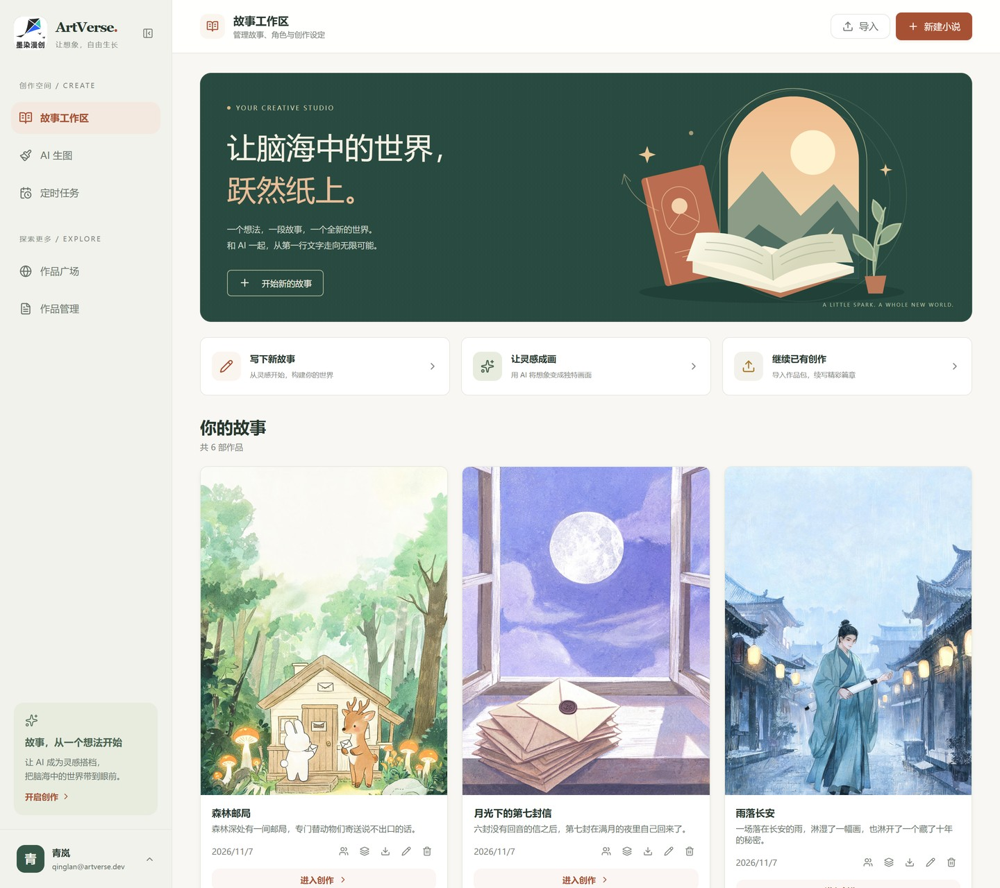
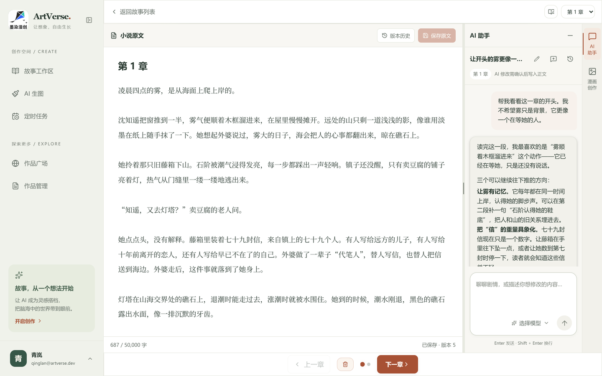
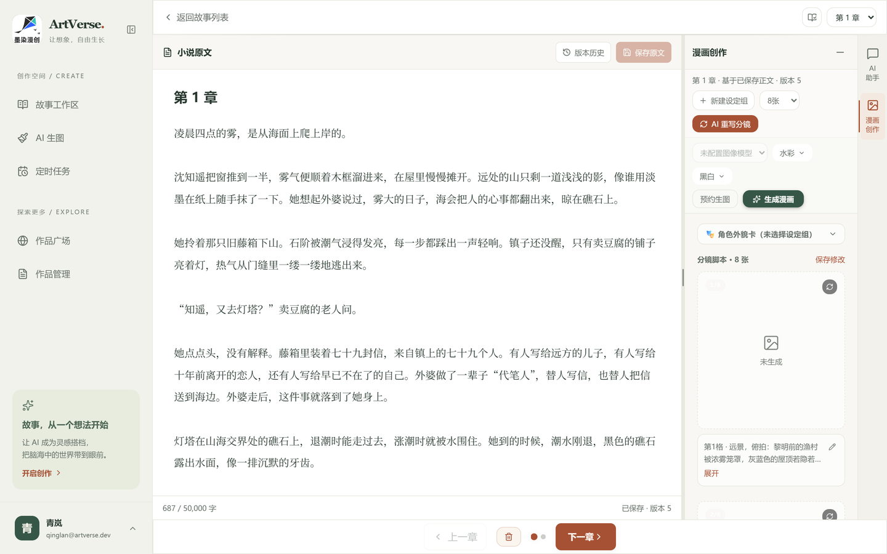
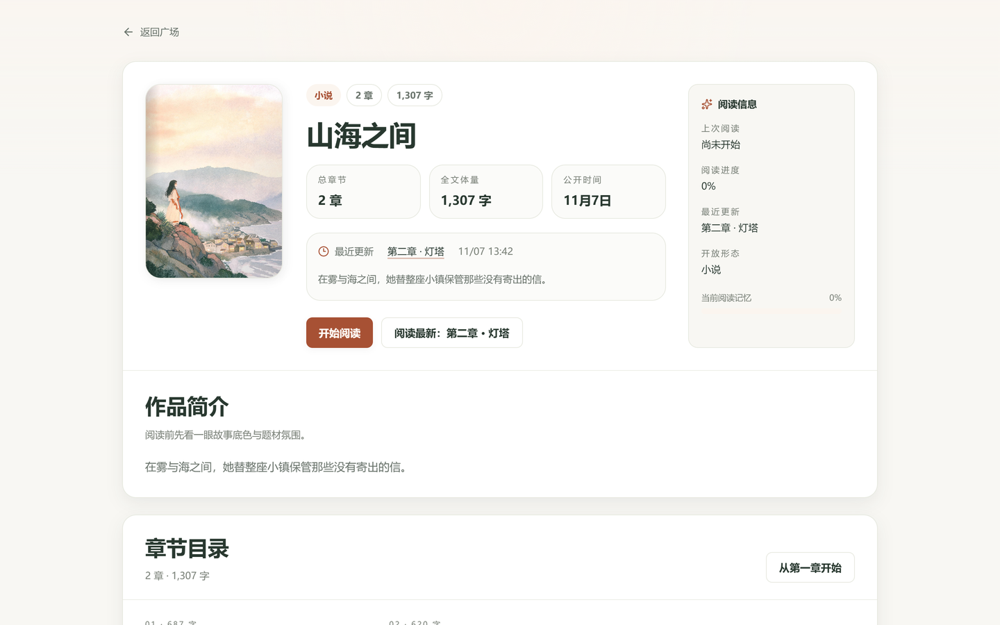
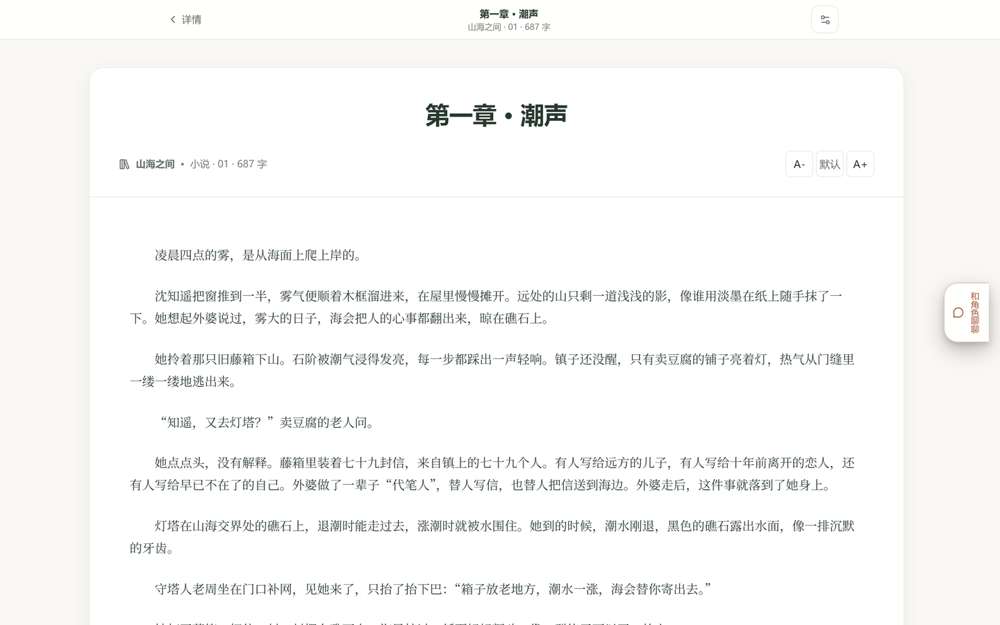
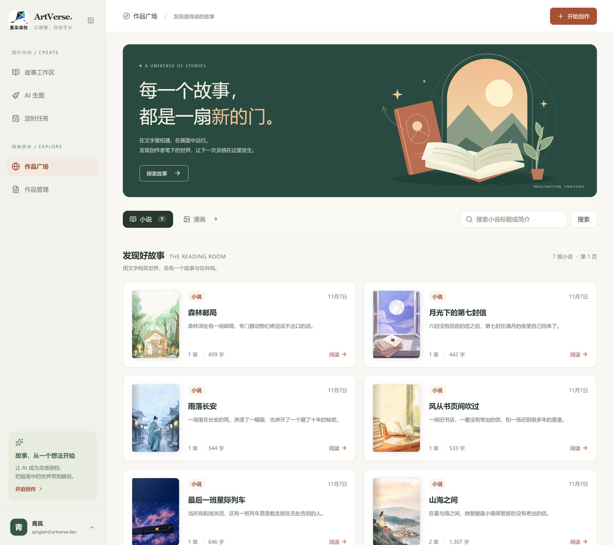
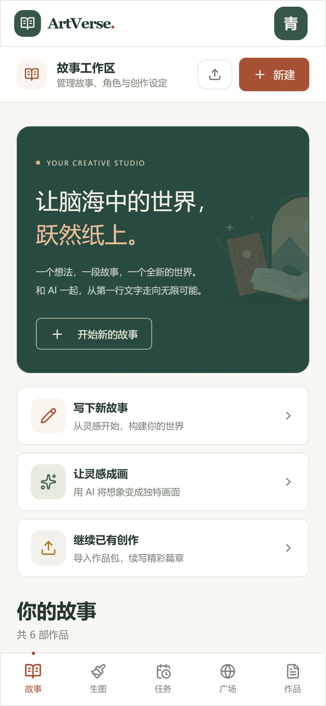
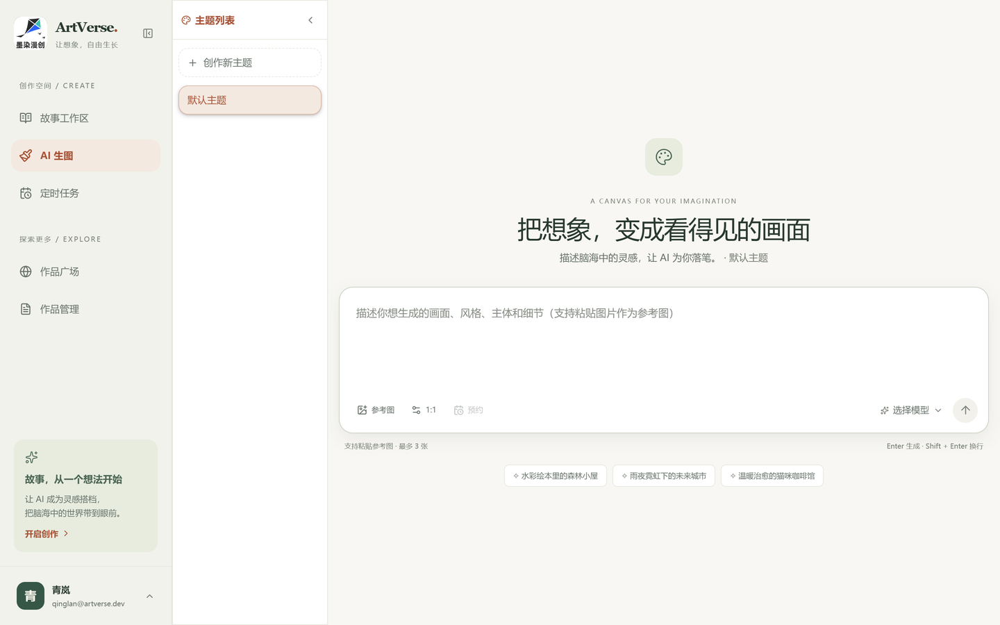
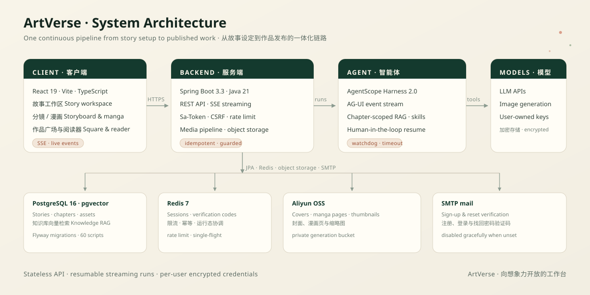

<div align="center">

# ArtVerse

**An AI-native studio for story writing, storyboarding, manga image generation, publishing, and chapter-scoped agent collaboration.**

[](https://openjdk.org/)
[](https://spring.io/projects/spring-boot)
[](https://react.dev/)
[](https://www.typescriptlang.org/)
[](https://vite.dev/)
[](https://tailwindcss.com/)

[中文文档](./README.zh.md)

<p align="center">
  
</p>
<p align="center"><sub>Your creative studio — stories, covers and quick actions in one place. Screenshots use sample stories and a demo account.</sub></p>

## Overview

ArtVerse turns a scattered writing toolkit into one continuous pipeline: shape a story in a workspace, write the prose with an AI partner that understands the current chapter, turn the prose into a storyboard, generate manga pages, and publish the result to a community square with a built-in reader.

- Manage stories, chapters, characters, reference images and asset groups in a single workspace
- Co-write with a chapter-scoped AI conversation and keep a full run history
- Turn a chapter into scene-by-scene storyboard prompts, then generate manga images
- Publish novels and manga, browse the works square and read in an immersive reader
- Register, sign in and recover accounts with email verification codes under layered security

## Highlights

- **One flow, no hand-offs.** Story setup, prose, storyboard, image generation and publishing live in the same product, backed by the same data model.
- **An agent that knows the chapter.** Agent runs are scoped to a chapter, streamed over AG-UI / SSE, resumable after interruption, and grounded by knowledge-base RAG.
- **Guard rails for AI work.** Redis-backed rate limiting and single-flight idempotency keep image generation and agent runs safe under concurrency.
- **Production-minded security.** Sa-Token HttpOnly sessions, enforced CSRF, graded brute-force protection, per-user encrypted AI credentials, and a production profile that refuses to start misconfigured.
- **Made for real creators.** Story package import/export, thumbnail pipelines, object storage, works management and a reading experience for finished pieces.

## Product Tour

### Write with an AI partner that sees the chapter

<p align="center">
  
</p>
<p align="center"><sub>Novel editing on the left, a chapter-scoped assistant on the right. The conversation reads the current story context, suggests concrete rewrites and keeps its history.</sub></p>

### From prose to a storyboard you can generate

<p align="center">
  
</p>
<p align="center"><sub>Scene-by-scene prompts, character asset groups, image-count tiers and one-click manga generation — all attached to the same chapter.</sub></p>

### Publish, discover and read

| Work detail | Built-in reader |
| :---: | :---: |
|  |  |
| <sub>Cover, synopsis, chapter list and reading entry</sub> | <sub>An immersive reader for finished novels</sub> |

### A community square that works on any screen

| Works square | Mobile workspace |
| :---: | :---: |
|  |  |
| <sub>Discover novels and manga from other creators</sub> | <sub>The same workspace, responsive on mobile</sub> |

### An image playground for everything else

<p align="center">
  
</p>
<p align="center"><sub>Prompt, model selection, image parameters and generation history — separate from the chapter workflow but sharing the same guards.</sub></p>

## Architecture

<p align="center">
  
</p>

ArtVerse is a Spring Boot backend and a Vite React frontend, with an AgentScope-powered manga agent in the middle. PostgreSQL (pgvector) holds stories, chapters and knowledge vectors; Redis coordinates sessions, verification codes, rate limits, idempotency and running agent state; Aliyun OSS stores covers, manga pages and thumbnails. AI providers are configured per user and stored encrypted — the repository ships no operator credentials.

## Features

### Story Workspace

- Story, chapter, character-profile, reference-image and asset-group management
- Novel content writing with story-context AI conversation support
- Story package import and export

### Manga Agent

- Chapter-scoped conversations and run history
- AG-UI / SSE streaming execution events
- Human-in-the-loop (HITL) resume flow after interruptions
- Knowledge-base RAG injection and built-in business skills (manga / novel)
- Run watchdog, timeout controls and a multi-instance event bus

### Storyboard & Image Generation

- Two-phase storyboard generation with image-count tiers from 4 to 20
- Reference-image-assisted generation, generation history query and deletion
- Redis-backed guard layer with rate limiting (`@RateLimit`) and idempotency (single-flight)
- Thumbnail processing and Aliyun OSS object storage

### Accounts & Security

- Dual sign-in: email + password, or email verification code
- Graphic captcha for registration; password reset via a one-time reset ticket (verify the code first, then reset)
- Graded brute-force protection for password login: 3 failures in a 5-minute window triggers captcha, 6 failures locks password login for 10 minutes
- IP-level rate limiting with separate policies for login and registration
- Sa-Token sessions: HttpOnly cookies (SameSite=Strict) backed by Redis, with refresh-token support
- JSON API success and error responses use a shared `code / message / data` envelope; HTTP status codes continue to express request outcomes. SSE, file/image responses and `204 No Content` keep their transport-specific formats

### Works Square

- Browse works and manga with a built-in reader
- Personal works management

### Platform Foundations

- Spring Data JPA + Flyway migrations (60 scripts)
- pgvector for knowledge-base vector search
- Redis for sessions, verification codes, rate limiting, idempotency and runtime coordination
- Resilience4j circuit breakers and retries; Actuator exposes health / metrics / prometheus

## Tech Stack

| Layer | Stack |
| --- | --- |
| Backend | Java 21, Spring Boot 3.3.5, Spring Web, Spring Data JPA, Flyway, Resilience4j |
| Frontend | React 19, TypeScript 6, Vite 8, Tailwind CSS 4 |
| Agent Runtime | AgentScope Harness 2.0, AG-UI protocol (SSE streaming) |
| Data & Storage | PostgreSQL 16 (pgvector), Redis 7, Aliyun OSS |
| Auth & Security | Sa-Token (Redis integration), BCrypt, Spring Mail (direct SMTP) |

## Repository Layout

```text
ArtVerse/
├─ ArtVerse/                        # Spring Boot backend
│  └─ src/main/java/com/artverse/
│     ├─ api/                       # REST controllers
│     ├─ application/               # Application services
│     ├─ agent/ ai/ prompt/         # Agent runtime, AI gateway, prompts
│     ├─ mail/                      # Email verification codes and SMTP delivery
│     ├─ security/ guard/           # Auth risk control / rate limit & idempotency
│     ├─ media/ storage/            # Image processing and object storage
│     └─ domain/ persistence/       # Domain models and data access
├─ frontend/                        # Vite + React frontend
│  └─ src/components/               # Pages and business components
├─ docs/
│  ├─ screenshots/                  # README screenshots
│  └─ assets/                       # Architecture diagram
├─ ArtVerse/AGENTS.md               # Repository working conventions
├─ README.md                        # English README
└─ README.zh.md                     # Chinese README
```

## Quick Start

### Prerequisites

- JDK 21
- Node.js 22
- Docker and Docker Compose

### 1. Start local dependencies

```bash
cd ArtVerse
docker compose up -d
```

This starts PostgreSQL 16 (pgvector) and Redis 7 from `ArtVerse/docker-compose.yml`. Object storage is Aliyun OSS and is not started by Compose.

### 2. Configure environment variables

The backend loads a `.env` file from the repository root via `spring.config.import` (OS environment variables of the same name take precedence). Create `.env` at the repository root:

```properties
# Database (matches docker-compose.yml)
POSTGRES_PASSWORD=postgres

# Aliyun OSS object storage (V4 signature; two private buckets are required)
ARTVERSE_OSS_ENDPOINT=https://oss-cn-hangzhou.aliyuncs.com
ARTVERSE_OSS_BUCKET=artverse-manga
ARTVERSE_OSS_PRIVATE_BUCKET=artverse-generation-private
ARTVERSE_OSS_ACCESS_KEY=
ARTVERSE_OSS_SECRET_KEY=

# Encryption and auth-risk HMAC keys (required in production; distinct random values of at least 32 characters)
ARTVERSE_SECRET_ENCRYPTION_KEY=
ARTVERSE_AUTH_RISK_HMAC_KEY=

# SMTP email verification codes (QQ Mail example; password is the SMTP authorization code)
ARTVERSE_MAIL_HOST=smtp.qq.com
ARTVERSE_MAIL_PORT=465
ARTVERSE_MAIL_USERNAME=you@qq.com
ARTVERSE_MAIL_PASSWORD=your-smtp-authorization-code
ARTVERSE_MAIL_FROM=you@qq.com
```

Notes:

- Without `ARTVERSE_MAIL_HOST`, the mail feature is disabled automatically; everything else keeps working
- API keys and base URLs for AI capabilities (LLM / image / workflow) are saved per user on the settings page and stored encrypted; the repository ships no operator credentials
- `.env` is ignored by `.gitignore` and will not be committed
- The current Compose file uses local development credentials and publishes PostgreSQL and Redis ports. Use it only in a trusted development environment; production deployments need separate strong credentials and network or firewall restrictions for dependency services
- The `prod` or `production` Spring profile validates key length and separation, HTTPS cookies, enforced CSRF, and disabled Flyway checksum auto-repair; the application refuses to start if these requirements are not met

### 3. Run the backend

```bash
cd ArtVerse
mvn spring-boot:run
```

The backend listens on `http://localhost:8080`.

For local Windows development, run from the repository root:

```powershell
.\ArtVerse\start-backend-local.ps1
# Run in the background with logs under ArtVerse/target:
.\ArtVerse\start-backend-local.ps1 -Background
# If another app owns IPv4 port 6379 while local Redis is available over IPv6:
.\ArtVerse\start-backend-local.ps1 -Background -RedisHost ::1
```

Stop the old backend on port 8080 first. The script uses the `local` profile, allows `http://localhost:5173` and `http://127.0.0.1:5173`, uses non-Secure cookies for local HTTP, and enforces CSRF. Overrides apply only to this launch; `.env` and global environment variables are preserved. For IDE launches, set `SPRING_PROFILES_ACTIVE=local`, `ARTVERSE_CORS_ORIGINS=http://localhost:5173,http://127.0.0.1:5173`, and `ARTVERSE_AUTH_COOKIE_SECURE=false`. Production keeps its separate HTTPS origins, Secure cookies and production profile. See the [local login CSRF implementation notes](ArtVerse/docs/login-csrf-analysis-and-plan.md) (Chinese).

### 4. Run the frontend

```bash
cd frontend
npm install
npm run dev
```

The frontend dev server runs at `http://localhost:5173`, with CORS pre-configured for the backend.

## Configuration Reference

| Variable | Description | Default |
| --- | --- | --- |
| `POSTGRES_PASSWORD` | PostgreSQL password | `postgres` |
| `ARTVERSE_OSS_ENDPOINT` / `ARTVERSE_OSS_ACCESS_KEY` / `ARTVERSE_OSS_SECRET_KEY` | Aliyun OSS endpoint and credentials (`artverse.oss.enabled=true` requires all three) | empty (application refuses to start) |
| `ARTVERSE_OSS_BUCKET` / `ARTVERSE_OSS_PRIVATE_BUCKET` | Public image bucket and private generation bucket | `artverse-manga` / `artverse-generation-private` |
| `ARTVERSE_SECRET_ENCRYPTION_KEY` | Encryption key for user-stored credentials | empty |
| `ARTVERSE_AUTH_RISK_HMAC_KEY` | HMAC key for login risk control | empty |
| `ARTVERSE_MAIL_HOST` / `PORT` | SMTP server and port | empty / `465` |
| `ARTVERSE_MAIL_USERNAME` / `PASSWORD` | SMTP account and authorization code | empty |
| `ARTVERSE_MAIL_FROM` | Sender address (must match the SMTP account) | empty |
| `ARTVERSE_MAIL_SSL` | Enable SSL | `true` |
| `ARTVERSE_MAIL_ENABLED` | Enable email verification codes | `true` |
| `ARTVERSE_AUTH_COOKIE_SECURE` | Set to `true` behind HTTPS | `false` |
| `ARTVERSE_AUTH_CHALLENGE_MODE` | Captcha mode (`enforce` / relaxed) | `enforce` |
| `ARTVERSE_DEV_MODE` | `true` = local development (adds localhost origins, disables Secure cookies); `false` = online mode | `false` |
| `ARTVERSE_CORS_ORIGINS` | Comma-separated origins allowed by CSRF/CORS (for example `http://<server-ip>`) | `http://localhost:5173,http://127.0.0.1:5173` |

## Development Commands

### Backend

```bash
cd ArtVerse
mvn -q -DskipTests compile   # fast compile
mvn test                     # run unit tests
```

### Frontend

```bash
cd frontend
npm run dev       # dev server
npm run build     # type check + production build
npm run lint      # ESLint
npm run preview   # preview production build
```

## Production Deployment Notes

- Frontend build output is served by Nginx (SPA fallback `try_files ... /index.html`) and reverse-proxies `/api` and SSE endpoints (`proxy_buffering off`)
- The backend is packaged as a JAR managed by systemd (`Restart=always`), with `.env` placed next to the JAR
- Do not deploy the repository's local-development Compose configuration as-is; production needs separate credentials and network or firewall restrictions for PostgreSQL and Redis, plus a properly secured OSS bucket policy
- Set `SPRING_PROFILES_ACTIVE=production` and configure distinct encryption and HMAC keys with at least 32 characters
- Set `ARTVERSE_AUTH_COOKIE_SECURE=true` behind HTTPS. Actuator requires an administrator login except for `/actuator/health`, and health details are hidden
- Flyway checksum mismatches stop startup and require migration-history review; deployed database checksums are not repaired automatically
- See [ArtVerse/AGENTS.md](./ArtVerse/AGENTS.md) for the full working conventions

## License

No license file is currently included in this repository.
