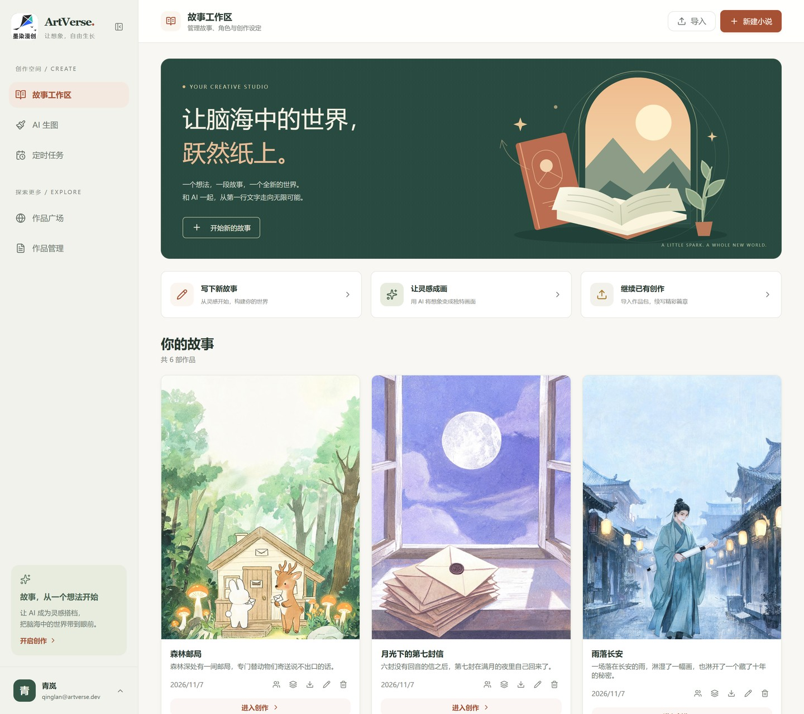
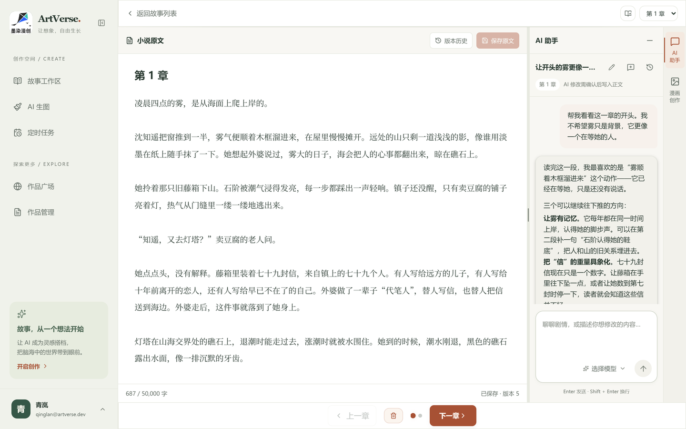
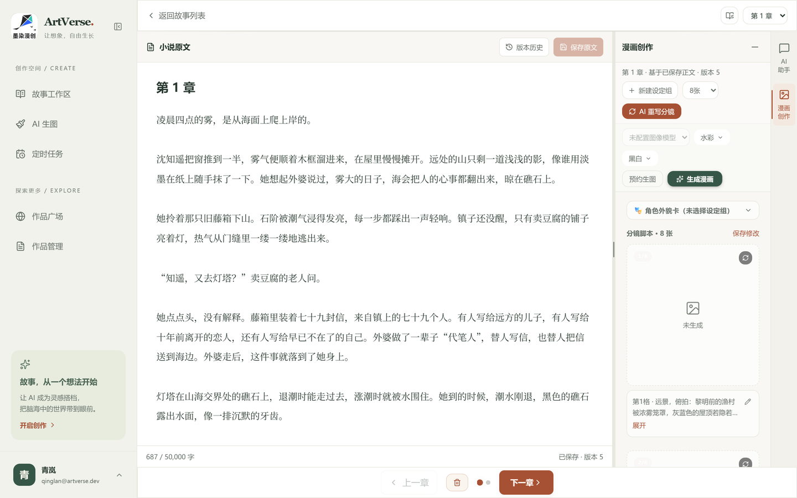
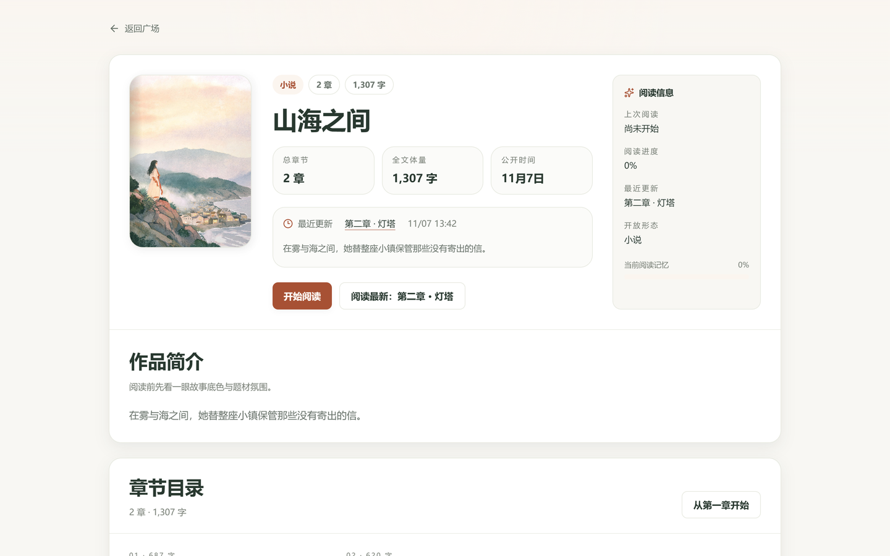
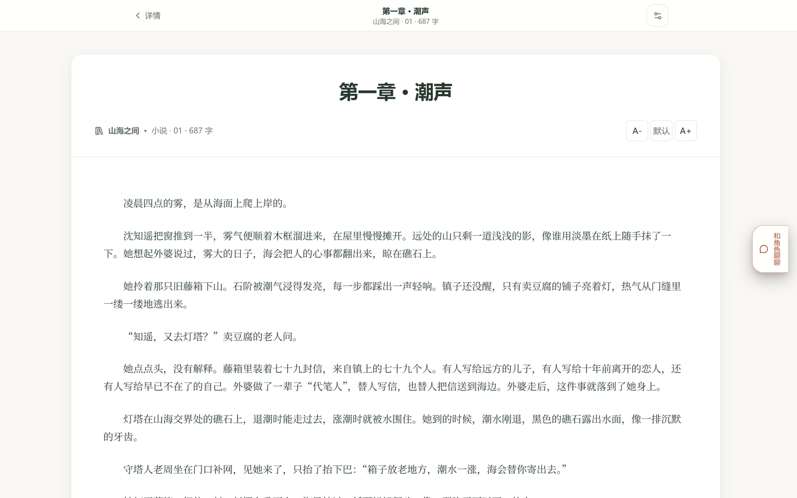
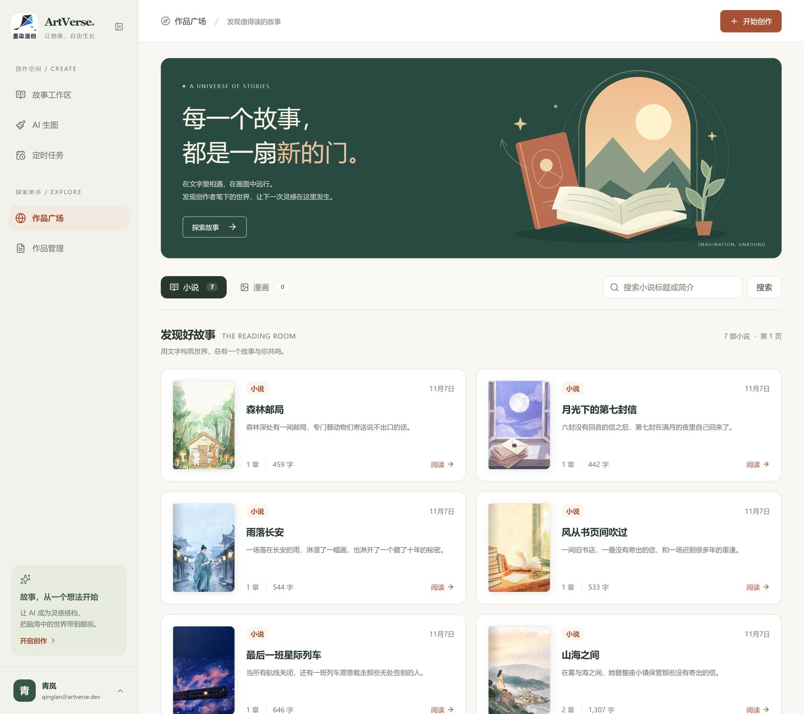
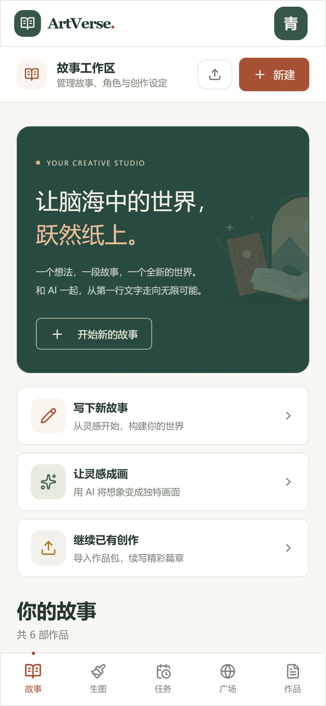
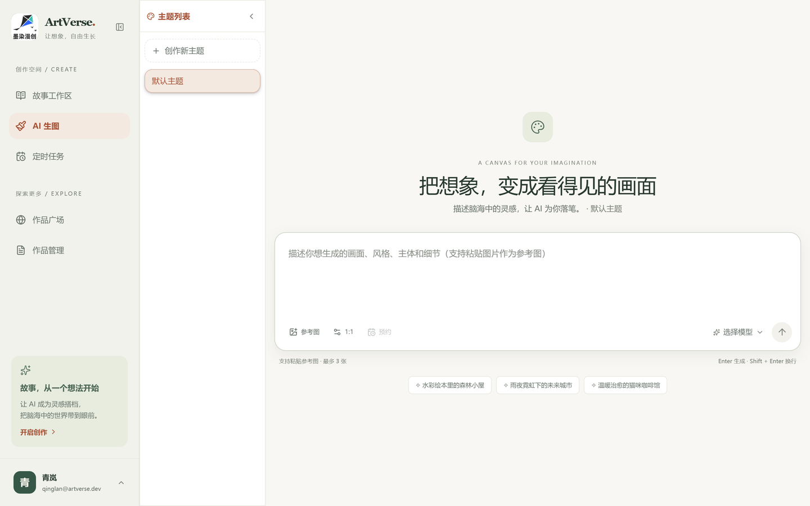
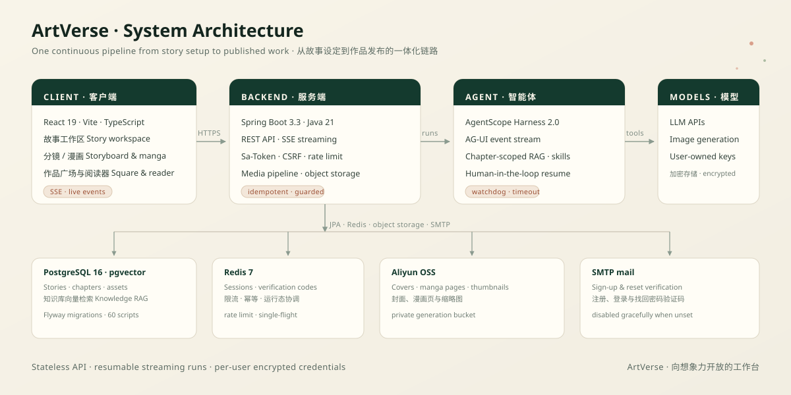

<div align="center">

# ArtVerse

**面向漫画与小说创作的 AI 原生工作台：从故事设定、正文写作、分镜生成、漫画出图，到作品发布与章节级智能体协作。**

[](https://openjdk.org/)
[](https://spring.io/projects/spring-boot)
[](https://react.dev/)
[](https://www.typescriptlang.org/)
[](https://vite.dev/)
[](https://tailwindcss.com/)

[English README](./README.md)

<p align="center">
  
</p>
<p align="center"><sub>创作空间：故事、封面与快捷入口集中在一个工作台。截图使用示例故事与演示账号。</sub></p>

## 项目简介

ArtVerse 把原本分散的写作工具串成一条连续的创作链路：在工作区里搭建故事，让理解当前章节的 AI 搭档参与写作，把正文拆成分镜，生成漫画页面，最后发布到作品广场，并用站内阅读器完成阅读。

- 在一个工作区里管理故事、章节、角色卡、参考图与素材组
- 与"看得见本章上下文"的 AI 对话协作，并保留完整运行记录
- 把一章正文拆成逐格分镜提示词，再推进到漫画图片生成
- 发布小说与漫画，在作品广场浏览，并通过沉浸式阅读器阅读
- 通过邮箱验证码完成注册、登录与找回密码，并带有分层安全防护

## 项目亮点

- **一条链路，无需搬运。** 故事搭建、正文、分镜、出图与发布共享同一套数据模型，全部在同一个产品里完成。
- **真正理解章节的智能体。** 智能体运行按章节隔离，通过 AG-UI / SSE 实时流式输出，中断后可恢复，并由知识库 RAG 提供上下文。
- **为 AI 任务准备护栏。** 基于 Redis 的限流与 single-flight 幂等，让并发生图与智能体运行在压力下依然安全。
- **面向生产的安全设计。** Sa-Token HttpOnly 会话、强制 CSRF、分级防爆破、用户级加密 AI 凭据，以及配置不合格时拒绝启动的生产 Profile。
- **为真实创作者而做。** 故事包导入导出、缩略图处理、对象存储、作品管理与成品阅读体验。

## 功能展示

### 与"看得见本章"的 AI 搭档一起写作

<p align="center">
  
</p>
<p align="center"><sub>左侧写正文，右侧是与当前章节对话的 AI 助手：它会读取故事上下文，给出具体的改写建议，并保留完整对话历史。</sub></p>

### 从正文到可生成的分镜

<p align="center">
  
</p>
<p align="center"><sub>逐格分镜提示词、角色素材组、出图数量档位与一键生成漫画，都挂在同一章之下。</sub></p>

### 发布、发现与阅读

| 作品详情 | 站内阅读器 |
| :---: | :---: |
|  |  |
| <sub>封面、简介、章节列表与阅读入口</sub> | <sub>为成品小说准备的沉浸式阅读</sub> |

### 在任何屏幕上都能逛的作品广场

| 作品广场 | 移动端工作区 |
| :---: | :---: |
|  |  |
| <sub>发现其他创作者的小说与漫画</sub> | <sub>同一套工作区，在手机上依然可用</sub> |

### 独立的 AI 生图工作台

<p align="center">
  
</p>
<p align="center"><sub>提示词、模型选择、图片参数与生成历史——独立于章节流程，但共享同一套限流与幂等保护。</sub></p>

## 系统架构

<p align="center">
  
</p>

ArtVerse 由 Spring Boot 后端与 Vite React 前端组成，中间是基于 AgentScope 的漫画智能体。PostgreSQL（pgvector）承载故事、章节与知识库向量；Redis 负责会话、验证码、限流、幂等与智能体运行态协调；阿里云 OSS 存储封面、漫画页与缩略图。AI 服务由每个用户自行配置并加密入库，仓库不内置任何运营方凭据。

## 功能特性

### 故事创作工作区

- 故事、章节、角色卡、参考图与设定组管理
- 小说正文创作与 AI 对话辅助（按故事上下文）
- 故事数据打包导入、导出

### 漫画智能体协作

- 按章节隔离的对话与运行记录
- 基于 AG-UI / SSE 的实时流式执行反馈
- 支持中断后的人机协同（HITL）恢复
- 知识库 RAG 注入与内置业务技能（manga / novel）
- 运行看门狗、超时控制与多实例事件总线

### 分镜与图片生成

- 分镜两阶段生成，支持 4–20 张的出图数量档位
- 参考图参与生成、生成历史查询与删除
- Redis guard 层提供限流（`@RateLimit`）与幂等（single-flight）保护
- 图片缩略处理与阿里云 OSS 对象存储

### 账号与安全

- 双登录方式：邮箱 + 密码、邮箱验证码
- 注册需图形验证码；找回密码采用一次性 reset_ticket（验证码先验证，再重置）
- 密码登录分级防爆破：5 分钟窗口内错 3 次追加图形验证码，错 6 次锁定 10 分钟
- IP 维度限流（登录、注册分策略）
- Sa-Token 会话：HttpOnly Cookie（SameSite=Strict）+ Redis 存储，支持 Refresh Token
- JSON API 成功与错误响应统一使用 `code / message / data` 信封；HTTP 状态码继续表达请求结果。SSE、文件/图片响应及 `204 No Content` 保持对应传输格式

### 作品广场

- 作品与漫画浏览、站内阅读器
- 我的作品管理与创作入口

### 平台基础设施

- Spring Data JPA + Flyway 管理数据模型（60 个迁移脚本）
- pgvector 支撑知识库向量检索
- Redis 承载会话、验证码、限流、幂等与运行态协调
- Resilience4j 熔断与重试；Actuator 暴露 health / metrics / prometheus

## 技术栈

| 分层 | 技术方案 |
| --- | --- |
| 后端 | Java 21、Spring Boot 3.3.5、Spring Web、Spring Data JPA、Flyway、Resilience4j |
| 前端 | React 19、TypeScript 6、Vite 8、Tailwind CSS 4 |
| 智能体运行时 | AgentScope Harness 2.0、AG-UI 协议（SSE 流式） |
| 数据与存储 | PostgreSQL 16（pgvector）、Redis 7、阿里云 OSS |
| 认证与安全 | Sa-Token（Redis 集成）、BCrypt、Spring Mail（SMTP 直连） |

## 仓库结构

```text
ArtVerse/
├─ ArtVerse/                        # Spring Boot 后端
│  └─ src/main/java/com/artverse/
│     ├─ api/                       # REST 控制器
│     ├─ application/               # 业务服务层
│     ├─ agent/ ai/ prompt/         # 智能体运行时、AI 网关与提示词
│     ├─ mail/                      # 邮箱验证码与 SMTP 发信
│     ├─ security/ guard/           # 认证风控 / 限流幂等
│     ├─ media/ storage/            # 图片处理与对象存储
│     └─ domain/ persistence/       # 领域模型与数据访问
├─ frontend/                        # Vite + React 前端
│  └─ src/components/               # 页面与业务组件
├─ docs/
│  ├─ screenshots/                  # README 演示图
│  └─ assets/                       # 系统架构图
├─ ArtVerse/AGENTS.md               # 仓库协作规范
├─ README.md                        # 英文 README
└─ README.zh.md                     # 中文 README
```

## 快速开始

### 环境要求

- JDK 21
- Node.js 22
- Docker 与 Docker Compose

### 1. 启动本地依赖

```bash
cd ArtVerse
docker compose up -d
```

会启动 PostgreSQL 16（pgvector）与 Redis 7（见 `ArtVerse/docker-compose.yml`）。对象存储使用阿里云 OSS，不由 Compose 启动。

### 2. 配置环境变量

后端通过 `spring.config.import` 自动加载仓库根目录的 `.env` 文件（同名操作系统环境变量优先）。在仓库根目录创建 `.env`：

```properties
# 数据库（与 docker-compose.yml 保持一致）
POSTGRES_PASSWORD=postgres

# 阿里云 OSS 对象存储（V4 签名；需要两个私有 bucket）
ARTVERSE_OSS_ENDPOINT=https://oss-cn-hangzhou.aliyuncs.com
ARTVERSE_OSS_BUCKET=artverse-manga
ARTVERSE_OSS_PRIVATE_BUCKET=artverse-generation-private
ARTVERSE_OSS_ACCESS_KEY=
ARTVERSE_OSS_SECRET_KEY=

# 敏感数据加密密钥与风控 HMAC 密钥（生产必填，至少 32 个字符且必须不同）
ARTVERSE_SECRET_ENCRYPTION_KEY=
ARTVERSE_AUTH_RISK_HMAC_KEY=

# SMTP 邮箱验证码（以 QQ 邮箱为例，password 填授权码）
ARTVERSE_MAIL_HOST=smtp.qq.com
ARTVERSE_MAIL_PORT=465
ARTVERSE_MAIL_USERNAME=you@qq.com
ARTVERSE_MAIL_PASSWORD=your-smtp-authorization-code
ARTVERSE_MAIL_FROM=you@qq.com
```

说明：

- 未配置 `ARTVERSE_MAIL_HOST` 时邮件功能自动禁用，其余功能不受影响
- AI 能力（LLM / 图像 / 工作流）的 API Key 与 Base URL 由每个用户在设置页自行保存，加密入库，仓库不内置任何运营方凭据
- `.env` 已被 `.gitignore` 忽略，不会被提交
- 当前 Compose 文件使用本地开发凭据并发布数据库与 Redis 端口，仅适用于可信的开发环境；生产环境应使用独立的强凭据，并通过部署网络或防火墙限制依赖服务访问
- `prod` 或 `production` Spring Profile 会校验密钥长度与差异、HTTPS Cookie、CSRF 强制模式及 Flyway 校验和自动修复关闭；未满足时应用拒绝启动

### 3. 启动后端

```bash
cd ArtVerse
mvn spring-boot:run
```

后端监听 `http://localhost:8080`。

Windows 本地开发推荐在仓库根目录执行：

```powershell
.\ArtVerse\start-backend-local.ps1
# 后台运行并将日志写入 ArtVerse/target：
.\ArtVerse\start-backend-local.ps1 -Background
# 若 IPv4 的 6379 被其他程序占用，而 Redis 在 IPv6 本机地址可用：
.\ArtVerse\start-backend-local.ps1 -Background -RedisHost ::1
```

启动前停止占用 8080 的旧后端。脚本固定使用 `local` Profile，允许 `http://localhost:5173` 与 `http://127.0.0.1:5173`，为本地 HTTP 使用非 Secure Cookie，并保留 CSRF 强制校验。配置只作用于该启动进程，不改写 `.env` 或全局环境变量。IDE 启动时也需设置 `SPRING_PROFILES_ACTIVE=local`、`ARTVERSE_CORS_ORIGINS=http://localhost:5173,http://127.0.0.1:5173` 和 `ARTVERSE_AUTH_COOKIE_SECURE=false`。生产环境继续使用独立的 HTTPS 域名、Secure Cookie 和生产 Profile。详见[本地登录 CSRF 排查与实施记录](ArtVerse/docs/login-csrf-analysis-and-plan.md)。

### 4. 启动前端

```bash
cd frontend
npm install
npm run dev
```

前端开发地址为 `http://localhost:5173`，已配置指向后端的跨域许可。

## 环境变量参考

| 变量 | 说明 | 默认值 |
| --- | --- | --- |
| `POSTGRES_PASSWORD` | PostgreSQL 密码 | `postgres` |
| `ARTVERSE_OSS_ENDPOINT` / `ARTVERSE_OSS_ACCESS_KEY` / `ARTVERSE_OSS_SECRET_KEY` | 阿里云 OSS 地址与凭据（`artverse.oss.enabled=true` 时三项必填） | 空（应用拒绝启动） |
| `ARTVERSE_OSS_BUCKET` / `ARTVERSE_OSS_PRIVATE_BUCKET` | 图片 bucket 与生图私有 bucket | `artverse-manga` / `artverse-generation-private` |
| `ARTVERSE_SECRET_ENCRYPTION_KEY` | 用户凭据字段加密密钥 | 空 |
| `ARTVERSE_AUTH_RISK_HMAC_KEY` | 登录风控 HMAC 密钥 | 空 |
| `ARTVERSE_MAIL_HOST` / `PORT` | SMTP 服务器与端口 | 空 / `465` |
| `ARTVERSE_MAIL_USERNAME` / `PASSWORD` | SMTP 登录账号与授权码 | 空 |
| `ARTVERSE_MAIL_FROM` | 发件人地址（需与登录账号一致） | 空 |
| `ARTVERSE_MAIL_SSL` | 是否启用 SSL | `true` |
| `ARTVERSE_MAIL_ENABLED` | 是否启用邮件验证码功能 | `true` |
| `ARTVERSE_AUTH_COOKIE_SECURE` | HTTPS 环境下置为 `true` | `false` |
| `ARTVERSE_AUTH_CHALLENGE_MODE` | 图形验证码模式（`enforce` / 宽松模式） | `enforce` |
| `ARTVERSE_DEV_MODE` | `true` = 本地开发（自动放行 localhost 来源并关闭 Secure Cookie）；`false` = 线上模式 | `false` |
| `ARTVERSE_CORS_ORIGINS` | CSRF/CORS 允许的来源，逗号分隔（如 `http://<服务器IP>`） | `http://localhost:5173,http://127.0.0.1:5173` |

## 常用开发命令

### 后端

```bash
cd ArtVerse
mvn -q -DskipTests compile   # 快速编译
mvn test                     # 运行单元测试
```

### 前端

```bash
cd frontend
npm run dev       # 开发服务器
npm run build     # 类型检查 + 生产构建
npm run lint      # ESLint 检查
npm run preview   # 预览生产构建
```

## 生产部署要点

- 前端 `npm run build` 产物由 Nginx 托管（SPA 路由 `try_files ... /index.html`），并反代 `/api` 与 SSE 接口（`proxy_buffering off`）
- 后端打包为 JAR，由 systemd 托管（`Restart=always`），`.env` 与 JAR 同目录
- 不要直接以仓库中的本地开发 Compose 配置部署生产服务；生产环境需使用独立凭据，并由部署网络或防火墙限制 PostgreSQL、Redis 的访问，同时为 OSS bucket 配置最小权限策略
- 生产环境设置 `SPRING_PROFILES_ACTIVE=production`，并配置独立且至少 32 字符的加密密钥与 HMAC 密钥
- HTTPS 环境记得设置 `ARTVERSE_AUTH_COOKIE_SECURE=true`；Actuator 除 `/actuator/health` 外要求管理员登录，健康详情不对外显示
- Flyway 校验和不一致会中止启动，应检查并修复迁移历史；不要自动修复已部署数据库的校验和
- 完整协作规范见 [ArtVerse/AGENTS.md](./ArtVerse/AGENTS.md)

## License

当前仓库尚未附带开源 License 文件。
